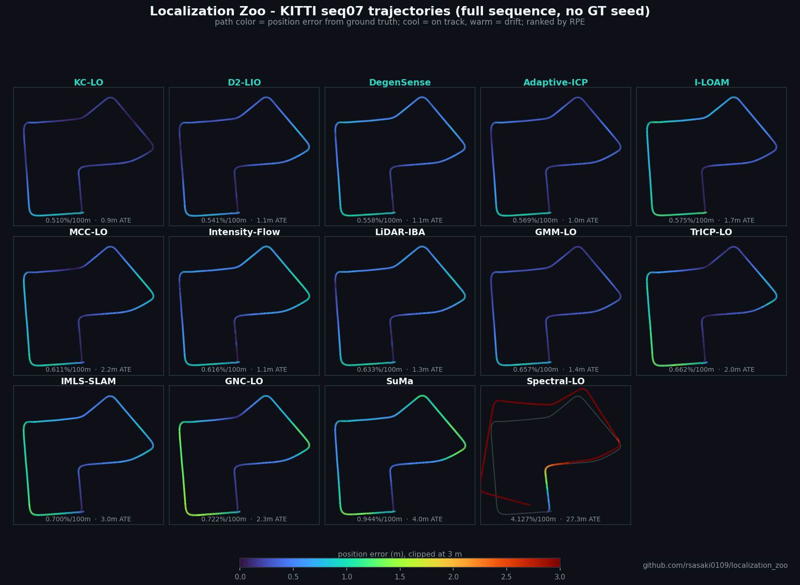

<div align="center">
  <h1 align="center">Localization Zoo</h1>
  <p align="center">
    <b>C++ implementations, derived variants, and compact baselines for localization papers</b>
  </p>
  <p align="center">
    <b>107 methods</b> · <b>77 paper reimplementations</b> · <b>44 papers with no public author code</b> · one C++ API · honest KITTI benchmarks
  </p>
  <p align="center">
    
    
    
    
    
  </p>
  <p align="center">
    <a href="https://rsasaki0109.github.io/localization_zoo/">
      
    </a>
  </p>
  <p align="center">
    <sub>KITTI seq07 odometry, no GT seed — current promoted trajectories on one shared drift-colored scale.</sub>
  </p>
  <p align="center">
    <a href="https://rsasaki0109.github.io/localization_zoo/"><b>↪ Open the interactive benchmark and method explorer</b></a>
  </p>
</div>

**Try it in one command** — no build, no dataset; runs a quick synthetic and
committed-data comparison and writes `report.html` plus its reproducibility
`manifest.json` to `./zoo-demo/`:

```bash
docker run --rm -v "$PWD/zoo-demo:/out" ghcr.io/rsasaki0109/localization_zoo:latest
```

Every method is C++17 behind one API, with tests, a shared evaluation harness
and ROS 2 wrappers. Methods are labelled **paper reimplementation**,
**derived variant** or **compact baseline**; a benchmark number alone does not
prove paper fidelity ([reproduction status](docs/reproduction_status.md),
[paper-ready criteria](docs/paper_ready_reproducibility.md)).

| I want to… | Go to |
|---|---|
| See which methods are accurate on KITTI | [Leaderboard](#leaderboard--odometry-rpe-drift-100-m-lower-is-better) · [paper-number check](#paper-number-check-official-kitti-rte) · [explorer](https://rsasaki0109.github.io/localization_zoo/) |
| Browse all methods | [Implementations](docs/implementations.md) |
| See other benchmarks (from-paper ports, 2D laser, hard PCL, ablations) | [Benchmark overview](docs/benchmark_overview.md) · [place recognition](docs/place_recognition_benchmark.md) · [paper paths on NCLT](docs/nclt_paper_paths.md) |
| Build and run the tests | [Quick start](#quick-start) |
| Call a method from Python or run it on a ROS 2 bag | [Python bindings](#python-bindings-experimental) · [ROS 2](#ros-2) |
| Use the IMU tools (motion / health SDK, attitude filters, Allan variance) | [IMU tools](docs/implementations.md#imu-motion--health-sdk) |
| Re-run a paper-number row | [`reproduce_paper_row.py`](#paper-number-check-official-kitti-rte) |
| Port a method to KITTI without the usual traps | [KITTI pitfalls](docs/kitti_pitfalls.md) |
| Add a paper or extend a benchmark | [Adding a new paper](#adding-a-new-paper) · [CONTRIBUTING](CONTRIBUTING.md) |

<!-- LEADERBOARD:START -->
## Leaderboard — odometry, RPE [drift %/100 m], lower is better

KITTI Odometry full sequences, ranked by relative pose error (the
seed-independent local-accuracy metric). ATE in parens is unbounded drift over
the run. Full matrix: [**explorer**](https://rsasaki0109.github.io/localization_zoo/).

| Method | Seq 00 | Seq 02 | Seq 05 | Seq 07 | Seq 08 |
|---|---:|---:|---:|---:|---:|
|  | _4541 fr_ | _4661 fr_ | _2761 fr_ | _1101 fr_ | _4071 fr_ |
| SuMa | **0.82%** <sub>(8 m)</sub> | 0.91% <sub>(17 m)</sub> | **0.42%** <sub>(3 m)</sub> | **0.42%** <sub>(1 m)</sub> | **1.30%** <sub>(24 m)</sub> |
| LF-GICP | 0.82% <sub>(9 m)</sub> | 0.89% <sub>(33 m)</sub> | 0.51% <sub>(6 m)</sub> | 0.54% <sub>(1 m)</sub> | 1.35% <sub>(16 m)</sub> |
| LeGO-LOAM | 0.84% <sub>(13 m)</sub> | **0.88%** <sub>(42 m)</sub> | 0.56% <sub>(6 m)</sub> | 0.53% <sub>(3 m)</sub> | 1.38% <sub>(18 m)</sub> |
| A-LOAM | 0.89% <sub>(12 m)</sub> | 0.92% <sub>(50 m)</sub> | 0.53% <sub>(5 m)</sub> | 0.61% <sub>(3 m)</sub> | 1.39% <sub>(18 m)</sub> |
| KISS-ICP | 0.87% <sub>(14 m)</sub> | 0.92% <sub>(35 m)</sub> | 0.67% <sub>(5 m)</sub> | 0.60% <sub>(1 m)</sub> | 1.33% <sub>(22 m)</sub> |
| F-LOAM | 0.92% <sub>(10 m)</sub> | 0.94% <sub>(52 m)</sub> | 0.54% <sub>(6 m)</sub> | 0.61% <sub>(3 m)</sub> | 1.40% <sub>(20 m)</sub> |
| CT-ICP | 0.96% <sub>(12 m)</sub> | 0.97% <sub>(46 m)</sub> | 0.71% <sub>(6 m)</sub> | 0.70% <sub>(2 m)</sub> | 1.34% <sub>(31 m)</sub> |
| MULLS | 0.98% <sub>(16 m)</sub> | 1.02% <sub>(47 m)</sub> | 0.78% <sub>(7 m)</sub> | 0.73% <sub>(2 m)</sub> | 1.32% <sub>(30 m)</sub> |
| L-LO | 1.54% <sub>(16 m)</sub> | 3.97% <sub>(142 m)</sub> | 1.59% <sub>(15 m)</sub> | 1.17% <sub>(3 m)</sub> | 2.05% <sub>(36 m)</sub> |

_Best variant per cell ([`docs/experiments.md`](docs/experiments.md)). KISS-ICP /
LOAM ~0.5–1.4% drift is competitive — their large ATE is honest drift, not a
broken port. This RPE averages 100 m segments and is not the official KITTI
metric (100–800 m) that papers report; see
[paper-number check](#paper-number-check-official-kitti-rte). † = not re-run
with the current code since per-run provenance was added (2026-10); such
values may not reproduce ([drift audit](experiments/results/kitti_drift_audit.json))._

> **No GT-seeded methods here.** NDT / LiTAMIN2 / GICP use the ground-truth pose
> as the per-frame initial guess, so their ATE is seed adherence, not tracking —
> and the ranking even inverts: NDT's 0.02 m comes from *not* registering
> (`--no-gt-seed` → 87% RPE, the worst tracker), while GICP's larger ATE is real
> registration. They need a GT prior and aren't standalone odometry, so they are
> not ranked.

<!-- LEADERBOARD:END -->

### Paper-number check (official KITTI RTE)

Paper-reported KITTI Odometry error against the repository on the same full
sequences and the official metric (100–800 m segments). Repo values are the
best variant of each sweep on the evaluated sequence, so the ratios are
optimistic bounds; per-sequence values are in
[`paper_ratio_table.csv`](docs/assets/paper/paper_ratio_table.csv) and the
audit in [`docs/paper_claim.md`](docs/paper_claim.md).

| Method | Sequences | Repo / paper | Note |
|---|---|---:|---|
| LiTAMIN2 | 00-10 | 1.00x | paper pipeline; one fixed setting on all 11: 1.05x ([details](papers/litamin2/README.md)) |
| A-LOAM | 00/02/05/07/08 | 1.01x | vs LOAM values cited by later papers |
| LF-GICP | 00/02/05/07/08 | 0.96x | no author code |
| KISS-ICP | 00/04 | 1.04x | upstream elevation correction; 00-10 average equals the official code's ([details](papers/kiss_icp/README.md#deviations-from-upstream-kiss-icp-130)) |
| MULLS | 00-10 | 1.12x | MULLS-LO; 00-10 average equals the official code's ([details](papers/mulls/README.md)) |
| CT-ICP | 00-10 | 1.15x | upstream pipeline; 00-10 average equals the official code's ([details](papers/ct_icp/README.md)) |
| SuMa | 00-10 | 0.97x | paper frame-to-model pipeline; 01 (highway) 2.09x; one setting for all 1.25x ([details](papers/suma/README.md#full-sequences)) |
| Quadric-LO | 00/07 | 0.80x | vs the paper's scan-to-submap table; no author code |
| DiLO | 00/07 | 0.87x | plane-only paper pipeline, from 4.12x ([details](papers/dilo/README.md)) |
| IMLS-SLAM | 00/07 | 1.04x | paper pipeline, from 2.66x ([details](papers/imls_slam/README.md)) |
| Mesh-LOAM | 00/07 | 1.08x | paper nearest-facet association, from 1.80x ([details](papers/mesh_loam/README.md#paper-mechanics-and-the-gap-to-the-paper)) |
| ELO | 00/07 | 1.17x | gap remains; forward-bias fixes chosen on 07, 00 held out, from 2.60x ([details](papers/elo/README.md#forward-drift-biases-of-the-projective-model)) |
| InTEn-LOAM | 00/07 | 1.18x | gap remains: 07 1.04x, 00 1.34x with an S2M plane check; one setting for both 1.20x ([details](papers/inten_loam/README.md#paper-pipeline)) |
| L-LO | 00/02/05/07/08 | 1.58x | gap remains; the paper's 00/07 values are below every roll-free GT trajectory ([why](papers/l_lo/README.md#vertical-pose-and-the-gap-to-the-paper)) |

Most gaps closed by the same few checks (elevation correction, no deskew on
KITTI, association with moved points, map biases): see
[KITTI pitfalls](docs/kitti_pitfalls.md). The ports of papers without author code,
on the shared harness, are in the
[benchmark overview](docs/benchmark_overview.md#from-paper-reimplementations-no-public-reference-code--kitti-full).

Re-run any row in one command — it fetches only that KITTI sequence (HTTP
range requests), runs the recorded arguments and prints your official RTE next
to the recorded and paper values:

```bash
python3 evaluation/scripts/reproduce_paper_row.py --list
python3 evaluation/scripts/reproduce_paper_row.py --method litamin2 --sequence 07 --kitti-root data/kitti --fetch
```

## Promoted LiDAR odometry v14

A GT-free branch selector over the zoo's LiDAR frontends; ground truth is used
only for scoring.

| Public evaluation | v14 ATE | v14 translational RPE | Rate | Comparator |
|---|---:|---:|---:|---|
| Same-input KITTI Odometry 00 | **8.934 m** | **0.877%** | 120.6 FPS | CUBE-LIO 9.044 m / 0.880% |
| Same-input KITTI Odometry 07 | **0.772 m** | **0.604%** | 11.9 FPS | CUBE-LIO 1.645 m / 0.624% |
| Untouched Boreas 2021-09-07 (600 frames, declared before download) | **2.597 m** | **0.962%** | 18.1 FPS | CUBE-LIO 3.050 m / 1.156% at 1.7 FPS |
| NTU VIRAL eee_01, eee_03, HILTI 2022 Exp14 | median ratio 0.999 | median ratio 0.997 | 10.4 FPS | Official FAST-LIVO2 (= 1.0) |

FAST-LIVO2 rows are parity, not a decisive win. See the
[frozen manifest](evaluation/data/lidar_odometry_candidate_runtime_feasible_reference_v14.json),
[promotion audit](evaluation/data/lidar_odometry_v14_promotion_audit.json) and
[protocol](docs/lidar_odometry_sota_protocol.md).

## Quick Start

### Native build

```bash
sudo apt install libeigen3-dev libpcl-dev libopencv-dev libceres-dev libgtest-dev
python3 -m venv .venv && . .venv/bin/activate
python3 -m pip install -r requirements-lock.txt
bash evaluation/scripts/demo_localization_zoo.sh   # build + synthetic + quick real-data fixtures
```

Manual build and test (Eigen ≥ 3.3, PCL ≥ 1.10, Ceres ≥ 2.0, GTest ≥ 1.11, OpenCV ≥ 4.0):

```bash
cmake -B build -DCMAKE_BUILD_TYPE=Release
cmake --build build -j"$(nproc)"
ctest --test-dir build --output-on-failure
```

Demo output goes to `experiments/results/runs/demo_localization_zoo/`; more
workflows (KITTI preparation, matrices, smoke checks) are in
[`evaluation/README.md`](evaluation/README.md) and
[experiments](docs/experiments.md).

### Python bindings (experimental)

pybind11 bindings for KISS-ICP, NDT, GICP and LiTAMIN2
([API](python/README.md)):

```bash
cmake -B build -DCMAKE_BUILD_TYPE=Release -DBUILD_PYTHON_BINDINGS=ON
cmake --build build -j"$(nproc)" --target localization_zoo_py
```

```python
import sys; sys.path.insert(0, "build/python")
import localization_zoo as lz

odom = lz.KissICP()
for scan in scans:          # Nx3 float64 numpy arrays
    odom.register_frame(scan)
print(odom.pose)            # 4x4 world-frame pose
```

### ROS 2

```bash
cd ros2 && colcon build && source install/setup.bash
ros2 launch localization_zoo_ros play_rosbag.launch.py \
  bag_path:=/path/to/bag points_topic:=/velodyne_points
```

## Architecture

```
localization_zoo/
├── common/       # shared Eigen/PCL utilities
├── papers/       # one self-contained, ROS-independent directory per method
├── evaluation/   # pcd_dogfooding runner, scripts, metrics
├── experiments/  # manifests and results of benchmark variants
└── ros2/         # ROS 2 Humble wrappers
```

## Adding a New Paper

Create `papers/your_method/{include/your_method,src,test}` with a
`CMakeLists.txt`, add it to the top-level `CMakeLists.txt` and keep `ctest`
passing. [CONTRIBUTING.md](CONTRIBUTING.md) has the checklist and the honesty
policy; requests go to a
[paper request](https://github.com/rsasaki0109/localization_zoo/issues/new?template=paper_request.yml).

## Citation

See [CITATION.cff](CITATION.cff) or GitHub's "Cite this repository" button.

```bibtex
@software{sasaki_localization_zoo,
  author  = {Sasaki, Ryohei},
  title   = {Localization Zoo: from-paper {C++} reimplementations of {LiDAR}
             localization and odometry methods, honestly benchmarked},
  url     = {https://github.com/rsasaki0109/localization_zoo},
  version = {1.0.0},
  year    = {2026}
}
```

## License

MIT
