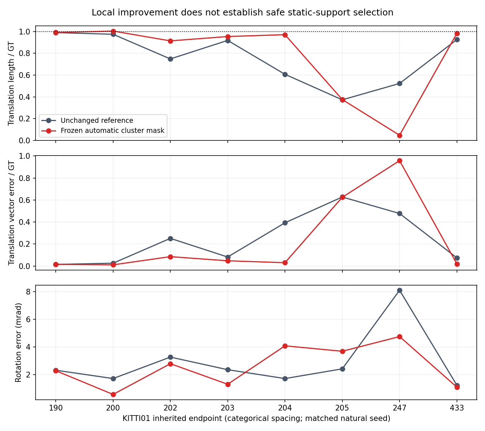
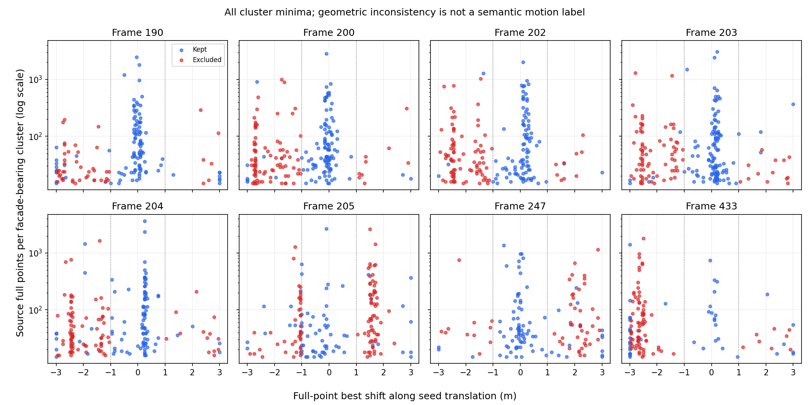

# InTEn-LOAM: automatic cluster-geometry feasibility trial

**Do not adopt this mask.** Geometry-based cluster selection improves the local
collapse onset but removes useful support in an adverse case. This is a completed
matched-seed diagnostic, not a full-sequence odometry comparison or a recovered01
trajectory. Production source, API, defaults and every historical result stay intact.

The complete numerical snapshot is `58240931bbe1dbd9696a9dea3604708e980467d3`,
committed before this interpretation. [report.json](analysis/report.json) retains
every endpoint, mask, error and control; [protocol.json](protocol.json) fixes the
rule before output. The isolated native producer never reads GT or a hand region.

## Mechanism and calibration

For each non-ground cluster bearing facade features, transform all of its extracted
points by the original natural estimated seed. Profile one-way nearest-point
distance to all previous non-ground points along the seed translation direction,
using the lowest80percent squared distances, translations -3m..3m at0.05m spacing.
Keep zero-prediction/empty cases, exact minima nearest zero, and boundary minima.
Exclude source facade queries only for an interior optimum more than1m from zero
with cost below half the zero-shift cost. The mask stays fixed through the terminal
solve. Full profiles and all negative/boundary cases are archived.

These are new outside-paper diagnostic rules, not the paper's DOR. Profile extent,
spacing and trimming come from the preceding geometric diagnosis;1m comes from
the native S2S gate radius. The half-cost criterion reuses the numerical DOR object
ratio but changes its meaning. All choices were fixed before this trial; there is
no threshold sweep, per-frame winner, GT seed or automatic semantic-object label.

The original profile was calibrated on07, diagnosed on00 and inherits the prior
fraction0.03 chosen on DiLO01. This trial uses every previously selected01 endpoint,
including the adverse247 and already collapsed205. All prior KITTI exposure is
development; there is no independent held-out claim. Both arms use the accepted
PCA reference, with Cauchy and predicted-DOR gates off. Only source facade support
changes; later correspondence updates and adaptive-prior information may change.

## Every terminal outcome

| Endpoint | Excluded / profiled clusters | Translation length / GT, reference → mask | Translation vector error / GT, reference → mask | Rotation error (mrad), reference → mask |
|---:|---:|---:|---:|---:|
| 190 | 48/155 | 0.990767 → 0.991896 | 0.014508 → 0.015141 | 2.320873 → 2.285065 |
| 200 | 93/201 | 0.975241 → 1.004744 | 0.025618 → 0.010923 | 1.717553 → 0.569798 |
| 202 | 92/186 | 0.748598 → 0.914806 | 0.251434 → 0.085286 | 3.270653 → 2.794870 |
| 203 | 86/201 | 0.918730 → 0.954679 | 0.081779 → 0.047482 | 2.359487 → 1.305914 |
| 204 | 90/185 | 0.607064 → 0.971692 | 0.392957 → 0.030332 | 1.716533 → 4.087598 |
| 205 | 104/171 | 0.372446 → 0.375024 | 0.627582 → 0.625054 | 2.419936 → 3.694301 |
| 247 | 51/134 | 0.522727 → 0.046618 | 0.477580 → 0.957949 | 8.113092 → 4.759058 |
| 433 | 82/126 | 0.926498 → 0.983740 | 0.074390 → 0.019433 | 1.232359 → 1.096354 |

Translation-length error decreases at7 endpoints and increases at1. That count
does not make the mask safe: at204, length/GT improves0.607064→0.971692 and vector
error/GT0.392957→0.030332, while rotation worsens1.716533→4.087598mrad. At247,
length/GT collapses0.522727→0.046618 and vector error/GT worsens0.477580→0.957949.
The already collapsed205 stays near0.375024 length/GT, with worse rotation.
At190 the small length improvement accompanies a worse translation-vector error.
Every adverse metric is retained rather than reduced to an improvement count.




## Controls and interpretation

The actual native run profiles1359 clusters and completes16 terminal calls. Every
unmodified output, first-class H/g/count and full solver state/iteration matches
the committed natural reference exactly. Only the forced API's returned count
convention differs from the normal caller; it is checked independently as the sum
of first data-class counts. All candidate non-facade first equations are exact.
Every masked facade first system is independently reconstructed from the original
accepted queries: maximum relative H error1.558953e-16 and g error0. Native static,
moving, search-boundary and zero-prediction mechanism checks exit0. All finite
damped updates pass backward-error checks. Compiler, native and analysis commands
retain their actual exit codes.

The right-side motion diagnosis from the preceding study uses GT only offline.
It does not certify these cluster masks as moving/static truth. Here the reference
is one possibly biased prediction: static support can prefer another translation,
and one-way trimming, aperture, sampling and cluster fragmentation can create
ambiguous minima. At247 the actual removal is harmful. Without a matched-history
intervention, it is not proven that every excluded cluster or the prediction alone
causes that harm. Removing source facades also leaves target contamination and
other classes. This result rejects the frozen rule as a safe remedy; it does not
show all geometry-based selection must fail.

No production option is introduced and there is no accuracy-profile adoption.
Full01 recovery and10 gradual drift remain open. A next mechanism must distinguish
shared ego-prediction error from independently moving support, then demonstrate
recursive behavior; changing a threshold on these endpoints would be a new study.
Any later accuracy candidate needs one fixed opt-in/default-off setting on every
full00–10 sequence before official RTE or paper-ratio claims.

## Reproduction and evidence

Use an isolated checkout of producer commit `be3b5bdc`, with the pinned compiler,
libraries and existing development container recorded in [controls](controls/).
From that checkout, run:

```bash
PYTHONDONTWRITEBYTECODE=1 /workspace/localization-env/host-venv/bin/python experiments/results/inten_cluster_motion/execute.py
```

The producer restores byte-verified committed full extracted frames and original
traces from the preceding studies. It serializes exact feature/class order and
uses natural estimated seeds. It acquires no raw scans, reads no GT in native
input, and feeds no output back into a trajectory. Paths, source commit, compiler,
link commands, binary/object/static-library hashes, linked-library metadata,
generated-input hashes, stdin, stdout/stderr and actual exits are retained.
Every output archive is verified by a lossless byte roundtrip.

The compiler's intentional final blank line initially fails `git diff --check`
with exit2. [archival_encoding.json](archival_encoding.json) records its subsequent
lossless gzip encoding; the original stage output and all numerical bytes remain
unchanged, with no native rerun. The portable verifier uses an exact archived
native source snapshot, so future development does not need to retain live source
at this old revision. Local preservation checks additionally check live source and
the complete historical diff against the parent.

Docs/figure/check commands and actual exits are retained under `completion/`.
The roadmap generators are rerun using the pinned analysis environment; only
proved generation-clock differences are restored. No aggregate, index content,
Table6, root README paper row or paper-number JSON is promoted by this diagnostic.
