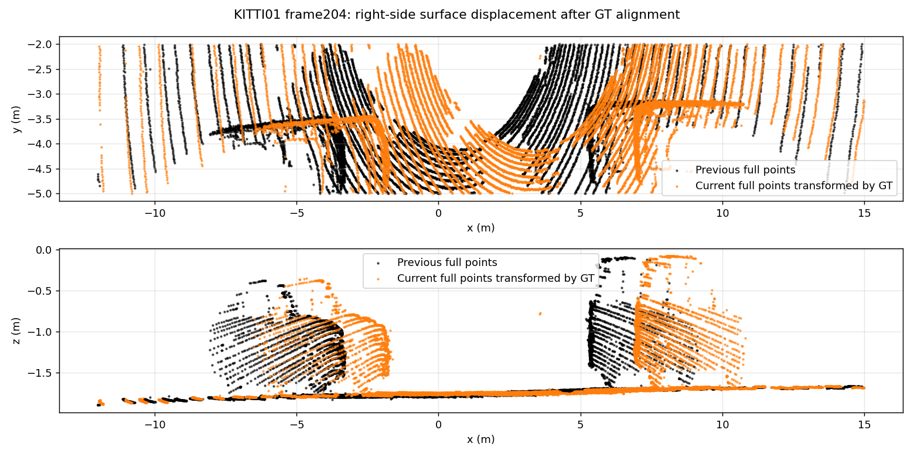
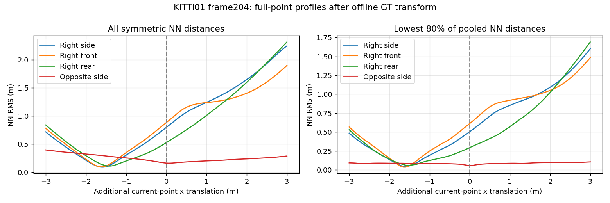

# Current KITTI01 correspondence and scene-motion diagnosis

Actual current-onset facade correspondences include right-side surface motion that is incompatible with the static-scene GT transform. Removing that region conditionally repairs the terminal S2S solve at204; it is **not a proposed odometry configuration**. The same removal harms247 and cannot undo the already collapsed natural seed at205. No full-trajectory recovery or paper-ratio improvement is claimed.

Numerical baseline evidence was committed as `96197955`; exhaustive ablations and independent full-point profiles as `59925767`, before this interpretation. No production estimator, API, default, old result, Table6 or paper number changes.

## Fixed scope and provenance

- Exactly the inherited eight current01 control endpoints:190,200,202,203,204,205,247,433. All are retrospective development evidence; none is independent held out.
- Reference is the preceding facade-PCA trajectory, not the rejected spread candidate: mapped prediction, translation prior0.03, ground/facade PCA and acceleration on; row completion off; S2M spread zero. Existing07-selected profile,00 diagnosis and prior fraction inherited from DiLO01 tuning are disclosed. No new accuracy setting or per-sequence adoption.
- The passive producer replays the actual normal prefix. Every pose and both solver traces for all434 frames exactly equal archived PR159 candidate. Reconstructed residual equations agree with every selected iteration, and all source/target features, row/cluster labels, ordered ten-neighbour coordinates/distances, triangle selections and final normals are retained.
- Maximum relative reconstructed-H difference: 2.00954596398e-15; maximum absolute-g difference: 7.1054273576e-14. Original equations and outputs, rather than counts or rank alone, establish the control.
- Study-only native copies add passive callbacks and, separately, one terminal facade-query gate. The immutable original native library supplies independent full-point extraction. No diagnostic producer supplies full-sequence accuracy scores. All binaries, native source, library hashes, compiler/link metadata, command/cwd/environment/exit receipts are retained.

## Terminal iterative interventions

Fresh pair controls receive exactly the actual S2S input and previous scan. Every natural baseline output exactly reproduces continuous S2S. Mapping is disabled for this isolated S2S endpoint; no result updates future map/history. The oracle receives GT only as an explicitly labelled diagnostic seed. Each source facade cluster is removed individually, including ineffective and adverse removals; ground/edge/intensity initial data equations stay exact. Adaptive prior information can change with facade H.

The right box is x[-12,15], y[-5,-2], z[-1.6,0.5]m in the current sensor frame. It was selected after visually inspecting committed204 geometry and is applied unchanged at every endpoint. It may include static points. Cluster labels are local segmentation IDs, not semantic objects; fragmentation means removing one cluster is not removing an entire vehicle. Neither this box nor GT is a deployable dynamic-object filter.

| Frame | Natural baseline length/GT | Right-box removal | All-facade removal | Baseline vector error/GT | Right-box vector error/GT |
|---|---:|---:|---:|---:|---:|
| 190 | 0.990767 | 0.990767 | 0.994365 | 0.014508 | 0.014508 |
| 200 | 0.975241 | 1.003974 | 0.984939 | 0.025618 | 0.009093 |
| 202 | 0.748598 | 0.953398 | 0.417119 | 0.251434 | 0.046792 |
| 203 | 0.918730 | 0.976010 | 0.916020 | 0.081779 | 0.025579 |
| 204 | 0.607064 | 1.004733 | 1.058653 | 0.392957 | 0.008495 |
| 205 | 0.372446 | 0.383909 | 0.385918 | 0.627582 | 0.616102 |
| 247 | 0.522727 | 0.039218 | 0.021522 | 0.477580 | 0.967765 |
| 433 | 0.926498 | 0.927517 | 0.963080 | 0.074390 | 0.074340 |

| Frame | Oracle baseline length/GT | Right-box removal | All-facade removal | Baseline vector error/GT | Right-box vector error/GT |
|---|---:|---:|---:|---:|---:|
| 190 | 0.990769 | 0.990769 | 0.994652 | 0.014507 | 0.014507 |
| 200 | 0.975895 | 1.004929 | 0.980045 | 0.024962 | 0.009644 |
| 202 | 0.799360 | 0.957317 | 0.460261 | 0.200668 | 0.042861 |
| 203 | 0.919442 | 0.976008 | 0.916050 | 0.081055 | 0.025580 |
| 204 | 0.907092 | 1.003930 | 1.066697 | 0.093159 | 0.008124 |
| 205 | 0.934604 | 0.974075 | 0.932238 | 0.065814 | 0.026277 |
| 247 | 1.025685 | 1.024949 | 1.031128 | 0.027536 | 0.028109 |
| 433 | 0.926441 | 0.927925 | 0.963248 | 0.074445 | 0.073957 |

The natural204 length ratio changes0.607064→1.004733 and vector error0.392957→0.008495. At247 the same box changes0.522727→0.039218, worsening vector error0.477580→0.967765. At205 it changes only0.372446→0.383909 under the already collapsed natural seed, versus0.934604→0.974075 under the oracle. Blanket facade removal is also mixed:202 worsens0.748598→0.417119. These are conditional terminal results, not recursive prevention.

| Frame | Natural individual-cluster removals: lower / higher / equal length error | Oracle: lower / higher / equal |
|---|---:|---:|
| 190 | 32 / 42 / 81 | 30 / 43 / 82 |
| 200 | 74 / 46 / 81 | 48 / 68 / 85 |
| 202 | 58 / 71 / 57 | 97 / 31 / 58 |
| 203 | 82 / 43 / 76 | 21 / 111 / 69 |
| 204 | 50 / 84 / 51 | 71 / 47 / 67 |
| 205 | 41 / 71 / 59 | 85 / 23 / 63 |
| 247 | 26 / 39 / 69 | 30 / 31 / 73 |
| 433 | 48 / 13 / 65 | 49 / 13 / 64 |

All 2766 native terminal calls and every individual result are retained in [ablations/native.stdout](ablations/native.stdout), [report](ablations/report.json) and [protocol](ablation_protocol.json). No best cluster is selected as a configuration.

## Independent full-point geometry

Current full extracted range-image points are transformed by offline GT, independently of facade selection, plane normals and native associations. The same fixed boxes are used at every endpoint; front/rear subdivide the right box at x[3,15]/[-12,-2]. The opposite-side comparison box is x[-30,30], y[2,25], z[-1.6,2]m. It is not certified static ground truth. Symmetric NN squared distances are evaluated for every additional x shift from-3 to3m in0.05m increments; all121 costs are retained, including an80% pooled-distance trimmed mean. This is a geometric diagnostic, not tuning an odometry setting.

| Frame | Region | Best x shift, all / trimmed (m) | MSE at zero / best, all (m²) | MSE at zero / best, trimmed (m²) |
|---|---|---:|---:|---:|
| 190 | right | unavailable: empty fixed region | — | — |
| 190 | right front | unavailable: empty fixed region | — | — |
| 190 | right rear | unavailable: empty fixed region | — | — |
| 190 | opposite side | 0.10 / -0.05 | 0.041400 / 0.040850 | 0.004203 / 0.004041 |
| 200 | right | -1.60 / -1.60 | 0.443287 / 0.005506 | 0.115392 / 0.002597 |
| 200 | right front | -1.55 / -1.55 | 0.902043 / 0.065990 | 0.505245 / 0.002087 |
| 200 | right rear | unavailable: empty fixed region | — | — |
| 200 | opposite side | 0.10 / 0.05 | 0.017784 / 0.017049 | 0.003719 / 0.003428 |
| 202 | right | -1.65 / -1.65 | 0.597220 / 0.004404 | 0.219799 / 0.002023 |
| 202 | right front | -1.60 / -1.60 | 0.900260 / 0.004517 | 0.522462 / 0.001512 |
| 202 | right rear | -0.50 / -0.15 | 0.151179 / 0.081976 | 0.009099 / 0.007488 |
| 202 | opposite side | 0.10 / 0.05 | 0.025698 / 0.025016 | 0.003794 / 0.003496 |
| 203 | right | -1.55 / -1.55 | 0.522033 / 0.004760 | 0.186415 / 0.002219 |
| 203 | right front | -1.60 / -1.60 | 0.765742 / 0.003232 | 0.380939 / 0.001440 |
| 203 | right rear | -0.30 / -0.35 | 0.104715 / 0.090078 | 0.022072 / 0.015440 |
| 203 | opposite side | 0.00 / -0.05 | 0.023019 / 0.023019 | 0.003761 / 0.003539 |
| 204 | right | -1.60 / -1.60 | 0.631819 / 0.007759 | 0.254127 / 0.001627 |
| 204 | right front | -1.60 / -1.60 | 0.775562 / 0.008668 | 0.375312 / 0.001196 |
| 204 | right rear | -1.40 / -1.55 | 0.274354 / 0.011669 | 0.086295 / 0.003288 |
| 204 | opposite side | 0.05 / 0.00 | 0.025779 / 0.025269 | 0.003150 / 0.003150 |
| 205 | right | -1.70 / -1.70 | 0.680307 / 0.004427 | 0.274334 / 0.001428 |
| 205 | right front | -1.70 / -1.70 | 0.744259 / 0.004096 | 0.325039 / 0.001000 |
| 205 | right rear | -1.70 / -1.70 | 0.550280 / 0.006310 | 0.203397 / 0.002810 |
| 205 | opposite side | 0.25 / 0.05 | 0.048586 / 0.044022 | 0.003718 / 0.003450 |
| 247 | right | 0.60 / 0.00 | 0.034860 / 0.022775 | 0.003148 / 0.003148 |
| 247 | right front | 0.50 / -0.05 | 0.053730 / 0.030941 | 0.005778 / 0.005599 |
| 247 | right rear | 0.10 / 0.05 | 0.005371 / 0.004697 | 0.001852 / 0.001781 |
| 247 | opposite side | 1.00 / -0.05 | 0.079743 / 0.060144 | 0.004413 / 0.004365 |
| 433 | right | 0.00 / -2.40 | 0.004028 / 0.004028 | 0.001683 / 0.000698 |
| 433 | right front | 0.00 / 0.00 | 0.003707 / 0.003707 | 0.001272 / 0.001272 |
| 433 | right rear | 0.05 / -0.05 | 0.003819 / 0.003575 | 0.002407 / 0.002326 |
| 433 | opposite side | -2.40 / -2.65 | 0.820188 / 0.098768 | 0.134915 / 0.002078 |

At204, right/front require an additional-1.60m shift, rear-1.40m (trimmed-1.55m), while the opposite-side profile is near zero (+0.05m, trimmed0m). Right-side symmetric MSE falls0.631819→0.007759m². Combined with the matched removal, this supports moving right-side surface correspondences as a local cause of the204 S2S deficit. It does not establish a semantic vehicle label, exact object velocity, a universal motion detector, the entire01 interval or the10 drift cause. Cropping, occlusion, sampling, repeated geometry and GT timing/calibration remain limitations.





Initial profile execution exited1 because the first fixed right region was empty. [Original source/binary/command/output and failure](motion_initial_failure/) are preserved. The separately compiled corrected producer records explicit unavailable rows without changing regions, grid or cost; all profile execution and analysis then exited0. Official acquisition retries are also retained.

## Reproduction and data policy

Run from the worktree root in a fresh isolated study workspace; the scripts refuse to overwrite execution directories. Native commands run inside the existing Ubuntu22.04 container with OMP_NUM_THREADS=1 and OPENBLAS_NUM_THREADS=1. The absolute compiler flags, immutable dependencies, source commits and binary SHA256 values needed to reconstruct this environment are in the committed command/binary receipts. The scripts use `/workspace/localization-env/host-venv/bin/python` and PYTHONDONTWRITEBYTECODE=1.

```bash
python experiments/results/inten_current_correspondences/run.py
python experiments/results/inten_current_correspondences/analyze.py
python experiments/results/inten_current_correspondences/ablate.py
python experiments/results/inten_current_correspondences/motion.py
python experiments/results/inten_current_correspondences/figures.py
```

`run.py` compiles the committed passive source, uses `evaluation/scripts/fetch_kitti_odometry_sequences.py --output-root <owned>/kitti --sequence 01 --workers 4`, verifies every official scan hash against committed prior inputs, and replays the unchanged normal prefix. `analyze.py` validates every numerical control before interpretation. Stage receipts record the actual commands/cwd/source/environment/exits; numerical archives are byte-roundtrip verified by the existing archival/restoration helpers. `ablate.py` and `motion.py` operate on that owned sequence and committed seeds. Plots restore archived points, not raw scans.

Only one owned full raw sequence was acquired. Native outputs, all failure/retry records and lossless archives are committed and normally pushed before verified owned-scan deletion; cleanup is committed and pushed separately. Historical worktrees/source/builds/binaries/logical evidence are preserved. Immutable identical historical evidence storage sharing has byte/hash/mode proof. This diagnosis adds no aggregate or scored row, so canonical full00–10 tables remain unchanged. An automatic estimator based on this evidence remains future work and would require one frozen setting across all full00–10 sequences, defaults off and every adverse outcome reported.
