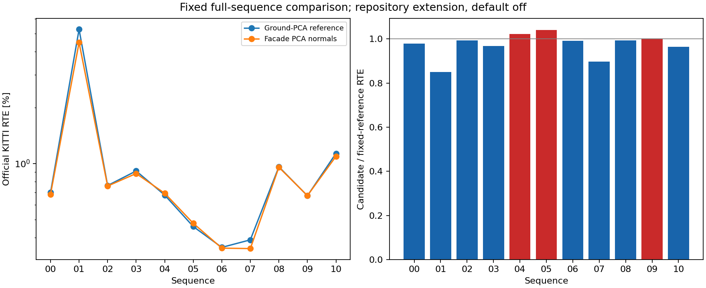

# Full iterative S2S facade PCA intervention

The preceding ground-PCA study leaves the early KITTI01 collapse and10 drift.
Current01 onset controls are committed before selecting this intervention.
The same native S2S solver reproduces the saved current-natural initial-seed
output exactly; GT-oracle seeds are diagnostic controls only. Facade gradients
contribute backward initial updates while the existing weak-direction prior is
inactive. This motivates a facade-normal intervention, without proving surface
correctness or an isolated S2M cause.

Only `s2s_facade_pca` differs between full arms. The new option is outside the
paper and default off. For already accepted facade triangles, the existing
ground-PCA helper fits the same in-gate ten neighbours, keeps the original
nearest-point plane anchor, and falls back to the triangle on numerical
degeneracy. All native acceptance tests, rows, gates and iteration budgets stay
fixed. At a fixed pose all counts and non-facade data equations remain exact.
The unchanged data-adaptive prior rule can immediately change its information;
subsequent poses, support and mapping also depend on the realized trajectory.

Both arms retain ground PCA, rigid mapped-motion prediction, soft prior0.03,
acceleration, original120m range/.17deg correction/.05m S2M plane check, with row
completion off. Original profile chosen on07,00 informed diagnosis; the prior
fraction came from DiLO KITTI01 tuning. The PCA construction and numerical
fallback criterion are inherited unchanged. Current01 was acquired first for
onset diagnosis; this known failure and all prior KITTI outcomes are development
data. No independent held-out claim or per-sequence option adoption is made.
Every full sequence uses the same frozen setting, starts from an empty map,
and traverses all scans continuously without GT seeding.

Only one owned full raw sequence exists at a time. The official fetch script,
input/GT hashes, actual argv/environment/exits, native producer and binary hashes,
all trace systems and saved poses are retained. Each lossless archive is
round-tripped, committed and normally pushed before owned raw scans are removed;
cleanup is committed/pushed before the next acquisition. Initial01 reuses the
owned official diagnostic acquisition after full hash revalidation. Older data,
worktrees and binaries remain unchanged. Every negative outcome is reported.
Paired processes share CPUs, so raw timings are retained without standalone FPS.

The initial collector exited1 after both native01 calls and their analyses
exited0: its settings guard removed the old ground flag instead of the facade
flag. `checks/collection_initial_failure/` retains the invocation and code.
`collection_recovery.json` seals all completed bytes; an explicit resume
corrects only the guard, verifies hashes/argv/exits and reuses those calls
without changing or repeating their native execution. The native producer,
settings and input scans are unchanged.

These orchestration scripts record this preserved workspace and its pinned
parent build libraries. They do not modify or rebuild those parents. A fresh
machine can use the standard full CMake build at the native source commit in
`protocol.json` and run the committed manifest arguments on the official inputs;
the historical boundary control requires its matching older headers/library.

Commands (actual absolute paths and exits are in adjacent receipts):

```bash
python3 experiments/results/inten_facade_pca/boundary.py
python3 experiments/results/inten_facade_pca/build.py
python3 experiments/results/inten_facade_pca/collect.py
python3 experiments/results/inten_facade_pca/report.py --output-dir experiments/results/inten_facade_pca/report
python3 experiments/results/inten_facade_pca/import_results.py
python3 experiments/results/inten_facade_pca/finalize_docs.py
```

The boundary command is phase-specific: run its recorded source commit
`20c3314e` with the immutable PR158 headers/library; later estimator headers
add a new parameter and must not be mixed with that older binary ABI. The
receipts pin each historical source and producer. Full-run source is separately
pinned in `protocol.json`. Sources and protocol are frozen before their phase; all numerical
report/import artifacts are committed before the prose below. Boundary diagnosis
uses the immutable preceding native library, separately from the new producer.
The complete Native and ROS2 CI must pass at the final PR head before Ready.

Geometric mean of option / reference official RTE: **0.971379x** across all sequences.
Lower RTE: 00, 01, 02, 03, 06, 07, 08, 10. Higher RTE: 04, 05, 09. Unchanged RTE: none.
This is a fixed experimental comparison; no per-sequence default is adopted.
Bad-length labels use the inherited local 20% threshold for GT motion at least 0.1 m,
separate from official KITTI 100–800 m RTE. Raw paired timing is not an FPS benchmark.

Numerical sources committed before prose: `f6e023be5786c20eabaffbe35cfc9781a4bd55d0`.

| Sequence | Reference RTE [%] | Option RTE [%] | Reference ATE [m] | Option ATE [m] | Bad-length steps, reference / option |
|---|---:|---:|---:|---:|---:|
| 00 | 0.698468 | 0.683293 | 17.664608 | 17.051301 | 13 / 13 |
| 01 | 5.276027 | 4.481189 | 103.447496 | 88.786456 | 50 / 44 |
| 02 | 0.761893 | 0.756938 | 42.445818 | 40.602835 | 2 / 2 |
| 03 | 0.912470 | 0.884094 | 6.441482 | 6.251484 | 2 / 1 |
| 04 | 0.676872 | 0.692176 | 1.550584 | 1.563220 | 0 / 0 |
| 05 | 0.458453 | 0.477296 | 9.416840 | 9.639439 | 0 / 0 |
| 06 | 0.353991 | 0.350792 | 1.906228 | 1.952842 | 0 / 0 |
| 07 | 0.388674 | 0.348742 | 1.571423 | 1.391385 | 0 / 0 |
| 08 | 0.961094 | 0.955307 | 28.631257 | 29.422940 | 19 / 19 |
| 09 | 0.671125 | 0.672321 | 11.037572 | 11.508132 | 0 / 0 |
| 10 | 1.134467 | 1.093310 | 8.884908 | 8.851550 | 0 / 0 |

Every adverse comparison (reference → option):

- 00: bad-vector steps 41 → 42.
- 01: rotation [deg/100 m] 0.287500 → 0.289430.
- 02: RPE [%] 0.808386 → 0.813418; bad-vector steps 7 → 8.
- 03: RPE [%] 0.578998 → 0.586278.
- 04: official RTE [%] 0.676872 → 0.692176; ATE [m] 1.550584 → 1.563220; RPE [%] 0.700809 → 0.715182.
- 05: official RTE [%] 0.458453 → 0.477296; rotation [deg/100 m] 0.291415 → 0.302184; ATE [m] 9.416840 → 9.639439.
- 06: rotation [deg/100 m] 0.140748 → 0.143796; ATE [m] 1.906228 → 1.952842.
- 07: RPE [%] 0.426869 → 0.432137.
- 08: rotation [deg/100 m] 0.337706 → 0.342667; ATE [m] 28.631257 → 29.422940; bad-vector steps 98 → 99.
- 09: official RTE [%] 0.671125 → 0.672321; rotation [deg/100 m] 0.238239 → 0.261265; ATE [m] 11.037572 → 11.508132.

New local bad labels in the candidate relative to the reference (all frames):

| Sequence | Newly bad length steps | Reference-only bad length steps | Newly bad vector steps | Reference-only bad vector steps |
|---|---:|---:|---:|---:|
| 00 | 0 | 0 | 1 | 0 |
| 01 | 0 | 6 | 0 | 6 |
| 02 | 0 | 0 | 1 | 0 |
| 03 | 0 | 1 | 1 | 1 |
| 04 | 0 | 0 | 0 | 0 |
| 05 | 0 | 0 | 0 | 0 |
| 06 | 0 | 0 | 0 | 0 |
| 07 | 0 | 0 | 0 | 0 |
| 08 | 0 | 0 | 1 | 0 |
| 09 | 0 | 0 | 0 | 0 |
| 10 | 0 | 0 | 0 | 0 |

Each pair uses the same input frame and GT labels but different realized
trajectories. These are outcome differences, not matched-seed interventions.
Every affected frame index is retained in the numerical report.

Failure-sequence observations along each realized trajectory:

- 01: final bad-length frames 204–252, 433 → 204–247; raw S2S bad-length outputs 50 → 48; S2S fallbacks 0 → 0; final rejected S2M 0 → 0.
- 02: final bad-length frames 1787, 3308 → 1787, 3308; raw S2S bad-length outputs 2 → 2; S2S fallbacks 0 → 0; final rejected S2M 0 → 0.
- 10: final bad-length frames none → none; raw S2S bad-length outputs 0 → 0; S2S fallbacks 0 → 0; final rejected S2M 0 → 0.

Candidate sequences exceeding twice the cited paper RTE:

| Sequence | Option RTE [%] | Paper RTE [%] | Option / paper | Largest position-error growth block | Position error start → end [m] | Local block error [%] |
|---|---:|---:|---:|---|---:|---:|
| 01 | 4.481189 | 0.640000 | 7.001858 | 200–300 | 2.343195 → 85.894160 | 31.650624 |
| 01 | 4.481189 | 0.640000 | 7.001858 | 600–700 | 97.526384 → 102.790044 | 0.868889 |
| 01 | 4.481189 | 0.640000 | 7.001858 | 400–500 | 88.288483 → 93.216990 | 0.701984 |
| 10 | 1.093310 | 0.450000 | 2.429578 | 700–800 | 8.398529 → 13.327142 | 0.948694 |
| 10 | 1.093310 | 0.450000 | 2.429578 | 600–700 | 6.086614 → 8.398529 | 2.125897 |
| 10 | 1.093310 | 0.450000 | 2.429578 | 800–900 | 13.327142 → 15.558974 | 0.526846 |

These fixed-size motion blocks locate error growth; their relative errors are
not official distance-segment RTE and do not establish the solver-level cause.
Paper values are cited context; this extension is not the paper algorithm.

These are natural full-run observations, not matched-seed causal interventions.
The complete report retains every step and all motion-error blocks. The option
remains outside the paper and default off; earlier results are preserved.

## Known diagnostic entries along natural runs

| Sequence / frame | Mode | Input length / GT | S2S length / GT | Final length / GT | First ground pairs | First facade pairs | Data forward information | Prior forward information |
|---|---|---:|---:|---:|---:|---:|---:|---:|
| 01 / 200 | baseline | 1.035491 | 0.949833 | 0.929639 | 43 | 464 | 33.333842 | 0.000000 |
| 01 / 203 | baseline | 0.977103 | 0.953662 | 0.841332 | 52 | 582 | 40.655479 | 0.000000 |
| 01 / 204 | baseline | 0.842659 | 0.453615 | 0.417265 | 34 | 523 | 27.822712 | 0.000000 |
| 01 / 217 | baseline | 0.279898 | 0.367051 | 0.381278 | 89 | 422 | 37.798146 | 0.000000 |
| 01 / 253 | baseline | 0.323665 | 0.882383 | 0.944763 | 31 | 329 | 9.571871 | 0.000000 |
| 01 / 420 | baseline | 1.022974 | 0.713008 | 1.013524 | 63 | 357 | 25.897953 | 0.000000 |
| 01 / 433 | baseline | 0.970326 | 0.981006 | 0.738277 | 169 | 356 | 30.187680 | 0.000000 |
| 01 / 200 | candidate | 1.020246 | 0.975241 | 0.928945 | 41 | 465 | 25.316014 | 0.000000 |
| 01 / 203 | candidate | 0.947942 | 0.918730 | 0.913917 | 56 | 579 | 23.327641 | 0.000000 |
| 01 / 204 | candidate | 0.915358 | 0.607064 | 0.422811 | 39 | 548 | 19.392964 | 0.000000 |
| 01 / 217 | candidate | 0.282140 | 0.364153 | 0.364718 | 86 | 419 | 31.833873 | 0.000000 |
| 01 / 253 | candidate | 0.984349 | 1.003778 | 1.009001 | 54 | 345 | 32.610873 | 0.000000 |
| 01 / 420 | candidate | 1.013016 | 0.606071 | 0.999430 | 73 | 366 | 26.536353 | 0.000000 |
| 01 / 433 | candidate | 0.977513 | 0.926498 | 0.926296 | 175 | 352 | 28.357906 | 0.000000 |
| 02 / 1876 | baseline | 0.997530 | 0.927945 | 1.022570 | 238 | 569 | 9.722716 | 2.632754 |
| 02 / 4460 | baseline | 0.952265 | 0.939158 | 1.009021 | 251 | 485 | 5.440152 | 5.390064 |
| 02 / 4463 | baseline | 1.057748 | 0.964138 | 0.987610 | 274 | 534 | 7.855732 | 4.125815 |
| 02 / 4526 | baseline | 0.985697 | 1.008189 | 0.981827 | 171 | 460 | 26.154284 | 0.000000 |
| 02 / 1876 | candidate | 0.994352 | 0.975852 | 0.985967 | 242 | 567 | 6.694067 | 8.893846 |
| 02 / 4460 | candidate | 0.948044 | 0.943207 | 1.021095 | 252 | 482 | 4.087063 | 9.317419 |
| 02 / 4463 | candidate | 0.998455 | 0.988885 | 1.033124 | 274 | 539 | 5.321078 | 9.932705 |
| 02 / 4526 | candidate | 0.993712 | 1.002433 | 0.983592 | 177 | 466 | 20.369222 | 0.000000 |

Forward information projects the first sensor-centered data Schur matrix
and fixed prior information along the GT motion direction. GT is used only
in offline diagnosis, never as an estimator input. Different realized
trajectories make these descriptive observations, not matched-seed causal
comparisons. The soft-prior rule is identical while its information may
change immediately with the facade equations.

## Matched current01 onset controls

The public forced S2S diagnostic uses the actual saved current-profile
initial poses and separately GT-oracle poses. It repeats native association
through the entire S2S solve. Its mapping-disabled state is deliberate:
this is a same-pair S2S control, not full-sequence accuracy or a replay
of S2M history. GT is never fed to the full estimator.

| Initial seed | Pairs | Lower absolute length error | Higher absolute length error | Unchanged |
|---|---:|---:|---:|---:|
| current_full_natural | 34 | 12 | 22 | 0 |
| ground_truth_oracle | 34 | 9 | 25 | 0 |

All original-profile outputs and class equations match exactly in the
new facade-off probe. All fixed-pose class counts and every non-facade
equation match between arms. All pairs, including adverse ones, are in
`sequences/01/current_boundary_intervention/result.json`.

| Frame | Seed | Reference output length / GT | Facade-PCA output length / GT |
|---|---|---:|---:|
| 200 | current_full_natural | 0.949833 | 0.975226 |
| 200 | ground_truth_oracle | 0.949758 | 0.975895 |
| 203 | current_full_natural | 0.953662 | 0.918933 |
| 203 | ground_truth_oracle | 0.953936 | 0.919442 |
| 204 | current_full_natural | 0.453615 | 0.403115 |
| 204 | ground_truth_oracle | 0.985225 | 0.907092 |
| 217 | current_full_natural | 0.367051 | 0.363855 |
| 217 | ground_truth_oracle | 0.952192 | 0.939258 |
| 253 | current_full_natural | 0.882383 | 0.879602 |
| 253 | ground_truth_oracle | 0.995994 | 1.001927 |
| 420 | current_full_natural | 0.713008 | 0.614273 |
| 420 | ground_truth_oracle | 0.708800 | 0.557002 |
| 433 | current_full_natural | 0.981006 | 0.926734 |
| 433 | ground_truth_oracle | 0.984751 | 0.926441 |

At the current01 onset pair, the matched-initialization results are:

- current_full_natural: length / GT 0.453615 → 0.403115; absolute length error changes by 0.050499 (higher).
- ground_truth_oracle: length / GT 0.985225 → 0.907092; absolute length error changes by 0.078133 (higher).

These controls retain the actual repeated-association S2S solve. Full-run
RTE also includes earlier seed and map changes; an aggregate improvement
does not establish that facade PCA repairs the onset correspondence or
that a first-system class contribution explains the later collapse.

Baseline initial first-order forward-correction contributions as percent of the GT
step, through the joint damped system (classes are additive gradients,
not separately re-associated interventions):

| Frame | Seed | Edge | Ground | Facade | Intensity | Total |
|---|---|---:|---:|---:|---:|---:|
| 200 | current_full_natural | -0.737626 | 0.003747 | -2.735948 | -0.118881 | -3.588707 |
| 200 | ground_truth_oracle | -0.031123 | -0.026061 | -2.084757 | -0.025345 | -2.167286 |
| 203 | current_full_natural | -0.846793 | -0.040677 | -0.577748 | 0.025651 | -1.439566 |
| 203 | ground_truth_oracle | -1.053606 | -0.031753 | -1.622290 | 0.008497 | -2.699152 |
| 204 | current_full_natural | 0.098536 | -0.042348 | -1.176751 | -0.102098 | -1.222661 |
| 204 | ground_truth_oracle | 0.197908 | -0.016569 | -0.917182 | 0.162251 | -0.573592 |
| 420 | current_full_natural | -2.516112 | -0.020484 | -2.296614 | 0.200683 | -4.632527 |
| 420 | ground_truth_oracle | -1.518773 | -0.112217 | -2.458958 | 0.170383 | -3.919565 |
| 433 | current_full_natural | 0.194297 | -0.009856 | 0.258806 | -0.147495 | 0.295751 |
| 433 | ground_truth_oracle | -0.268154 | -0.010702 | -0.779215 | -0.160258 | -1.218330 |

The full native onset S2S output matches the forced control exactly.
Class-wise H/g summation differs from serial totals only at retained
roundoff; numerical maxima and all source/binary hashes are in
`boundary/report.json`. The seed intervention distinguishes optimizer
basins at that pair. It does not identify the physical target surface
or establish that the first facade gradient explains later collapse.

## Active prior and native solve checks

| Sequence | Frames with active prior | Recorded S2S systems checked | Maximum prior-information reconstruction error | Maximum relative damped-system residual |
|---|---:|---:|---:|---:|
| 00 | 0 | 42886 | 0 | 1.32311e-16 |
| 01 | 9 | 9809 | 6.10623e-15 | 6.91745e-17 |
| 02 | 150 | 44320 | 2.13163e-14 | 1.30721e-16 |
| 03 | 0 | 7586 | 0 | 1.20064e-16 |
| 04 | 0 | 2626 | 0 | 8.57244e-17 |
| 05 | 0 | 26044 | 0 | 1.49784e-16 |
| 06 | 0 | 10946 | 0 | 1.11882e-16 |
| 07 | 0 | 10339 | 0 | 1.13795e-16 |
| 08 | 0 | 38281 | 0 | 1.39129e-16 |
| 09 | 0 | 15101 | 0 | 1.00612e-16 |
| 10 | 0 | 11014 | 0 | 1.42312e-16 |

The stored information is independently reconstructed from the first
data Hessian after subtracting the recorded prior. Every recorded finite
update is checked against its total damped H/g using relative backward error.
Independent LAPACK/Eigen step differences are retained without treating
poorly conditioned world-coordinate forward errors as implementation drift.
This checks the declared
implementation, not the correctness of its correspondences.

The candidate changes the preceding trajectory as well as the current seed.
Support counts alone do not establish the cause of a change.



Every fresh facade-PCA-off reference exactly reproduces the preceding ground-PCA candidate RTE.
