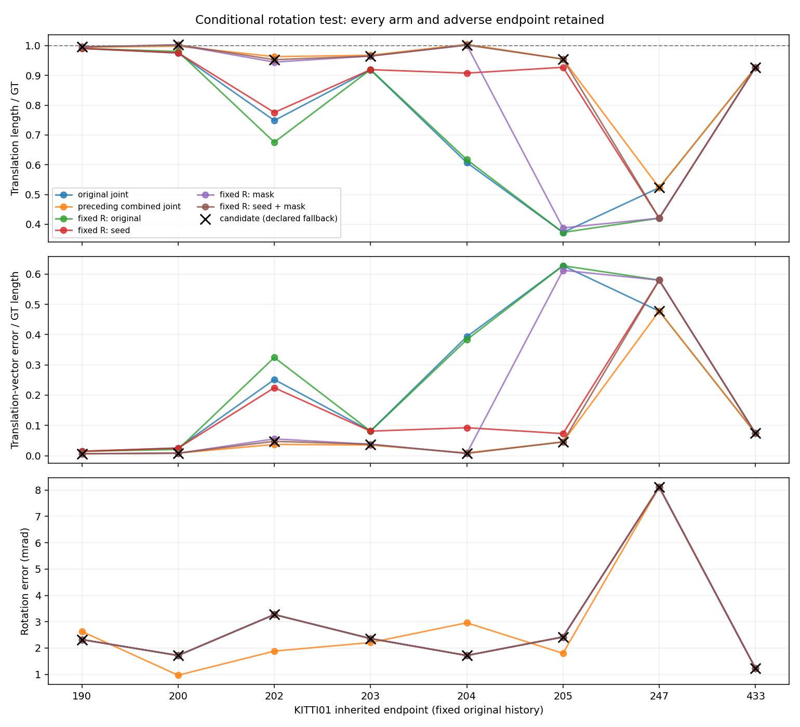

# Rotation-conditioned translation feasibility

The joint consensus correction could recover translation while increasing
rotation error. This prospective diagnostic asks whether keeping the original
unmasked **estimated** rotation and actually re-solving translation can retain
that recovery. It re-associates every iteration; it does not splice a translation
from the old joint solution. No GT rotation, hand region, parameter sweep,
per-endpoint winner or production change is used.

Complete numerical snapshot `0e2ab939e7b0164729294131e70020c4096b7d10` precedes this interpretation.
All48 actual native calls at every inherited KITTI01 endpoint
are retained, including every adverse control. Source/rule/protocol were committed
before measurement. This is fixed-original-history sensitivity, not a recursive
trajectory, official RTE, paper ratio or evidence of full01 recovery.

## Fixed intervention and controls

The unchanged preceding consensus admits multiple shifts for ambiguous clusters,
uses equal cluster votes, and requires a strict majority plus an interior grid
optimum. It changes neither profile costs nor thresholds. Corrected translation
is also the native adaptive-prior center. Source facade masking can change data
and adaptive-prior information; other classes still re-associate.

Original joint and preceding combined joint arms reproduce their committed
output, every first class system and the entire solver trace exactly. Four
translation-only arms form a complete seed-correction × facade-mask factorial.
They all use the original unmasked joint estimate's rotation. Only the conditional
damped Htt translation block is solved, with zero angular increment and additive
translation update. This is not a marginalized Schur translation solve or the
translation part of the joint update. Native first-iteration Schur-based prior
information remains unchanged in definition, and is frozen through the solve.
Pair gates, iteration/convergence limits, Huber scale and associations remain native.

The predeclared candidate uses the combined translation-only arm when consensus
is usable, otherwise the original joint result exactly. All raw factorial arms
are still run at fallback endpoints. No error metric influences this choice.
The inherited progression condition and a stricter all-endpoint translation
nonregression requirement were fixed before output; neither was relaxed.

**Necessary conditional gate: PASS.** Candidate length and vector errors each improve at6 endpoints,
tie at2, and worsen at0. Rotation is bit-for-bit original at every translation-only iteration and output.
This passes a known-development feasibility condition, not a generalization
or production-adoption condition. Original rotation errors remain.

## Every endpoint and arm

Length ratio and vector error are normalized by GT translation length;
rotation is offline geodesic error in mrad. No value below is official KITTI RTE.

| Endpoint | Arm | Length/GT | Vector error/GT | Rotation mrad | Candidate uses this arm |
|---:|---|---:|---:|---:|---|
| 190 | original joint | 0.990767 | 0.014508 | 2.320873 |  |
| 190 | preceding combined joint | 0.994919 | 0.006148 | 2.629751 |  |
| 190 | fixed R original | 0.990743 | 0.014523 | 2.320873 |  |
| 190 | fixed R seed only | 0.990743 | 0.014523 | 2.320873 |  |
| 190 | fixed R mask only | 0.995748 | 0.006534 | 2.320873 |  |
| 190 | fixed R seed + mask | 0.995748 | 0.006534 | 2.320873 | yes |
| 200 | original joint | 0.975241 | 0.025618 | 1.717553 |  |
| 200 | preceding combined joint | 0.998189 | 0.008479 | 0.966837 |  |
| 200 | fixed R original | 0.980481 | 0.020686 | 1.717553 |  |
| 200 | fixed R seed only | 0.976000 | 0.024858 | 1.717553 |  |
| 200 | fixed R mask only | 1.001975 | 0.007928 | 1.717553 |  |
| 200 | fixed R seed + mask | 1.002987 | 0.008546 | 1.717553 | yes |
| 202 | original joint | 0.748598 | 0.251434 | 3.270653 |  |
| 202 | preceding combined joint | 0.963182 | 0.037221 | 1.882814 |  |
| 202 | fixed R original | 0.675608 | 0.324443 | 3.270653 |  |
| 202 | fixed R seed only | 0.775541 | 0.224494 | 3.270653 |  |
| 202 | fixed R mask only | 0.944946 | 0.055473 | 3.270653 |  |
| 202 | fixed R seed + mask | 0.952965 | 0.047452 | 3.270653 | yes |
| 203 | original joint | 0.918730 | 0.081779 | 2.359487 |  |
| 203 | preceding combined joint | 0.967792 | 0.035110 | 2.208206 |  |
| 203 | fixed R original | 0.919440 | 0.081068 | 2.359487 |  |
| 203 | fixed R seed only | 0.919442 | 0.081066 | 2.359487 |  |
| 203 | fixed R mask only | 0.965060 | 0.037781 | 2.359487 |  |
| 203 | fixed R seed + mask | 0.965060 | 0.037781 | 2.359487 | yes |
| 204 | original joint | 0.607064 | 0.392957 | 1.716533 |  |
| 204 | preceding combined joint | 1.004613 | 0.009234 | 2.958909 |  |
| 204 | fixed R original | 0.617031 | 0.382994 | 1.716533 |  |
| 204 | fixed R seed only | 0.907772 | 0.092456 | 1.716533 |  |
| 204 | fixed R mask only | 1.002041 | 0.007531 | 1.716533 |  |
| 204 | fixed R seed + mask | 1.002040 | 0.007531 | 1.716533 | yes |
| 205 | original joint | 0.372446 | 0.627582 | 2.419936 |  |
| 205 | preceding combined joint | 0.955054 | 0.045419 | 1.798922 |  |
| 205 | fixed R original | 0.372438 | 0.627591 | 2.419936 |  |
| 205 | fixed R seed only | 0.927375 | 0.072918 | 2.419936 |  |
| 205 | fixed R mask only | 0.387723 | 0.612295 | 2.419936 |  |
| 205 | fixed R seed + mask | 0.954865 | 0.045511 | 2.419936 | yes |
| 247 | original joint | 0.522727 | 0.477580 | 8.113092 | yes |
| 247 | preceding combined joint | 0.522727 | 0.477580 | 8.113092 |  |
| 247 | fixed R original | 0.420339 | 0.579843 | 8.113092 |  |
| 247 | fixed R seed only | 0.420339 | 0.579843 | 8.113092 |  |
| 247 | fixed R mask only | 0.420339 | 0.579843 | 8.113092 |  |
| 247 | fixed R seed + mask | 0.420339 | 0.579843 | 8.113092 |  |
| 433 | original joint | 0.926498 | 0.074390 | 1.232359 | yes |
| 433 | preceding combined joint | 0.926498 | 0.074390 | 1.232359 |  |
| 433 | fixed R original | 0.926734 | 0.074185 | 1.232359 |  |
| 433 | fixed R seed only | 0.926734 | 0.074185 | 1.232359 |  |
| 433 | fixed R mask only | 0.926734 | 0.074185 | 1.232359 |  |
| 433 | fixed R seed + mask | 0.926734 | 0.074185 | 1.232359 |  |



## Result and retained negatives

At204, candidate length/GT changes0.607064→1.002040,
vector error0.392957→0.007531, while rotation stays
1.716533mrad instead of the preceding combined joint
2.958909mrad. Thus the local translation recovery does not
require the preceding joint solution's adverse rotation change.

At205, seed-only fixed-rotation length/GT is0.927375,
mask-only0.387723, combined0.954865, from
0.372446. A changed seed/prior center remains important. But holding
original rotation forfeits the preceding combined improvement from
2.419936 to1.798922mrad, and
vector error is slightly worse than that preceding combined solution
(0.045419→0.045511). This mechanism does not
dominate the preceding joint arm on every metric or endpoint.

At247 the raw translation-only combined arm worsens length/GT
0.522727→0.420339 and vector error
0.477580→0.579843. The already fixed majority
fallback returns the original, avoiding this extra harm but leaving the original
failure. At433 the fixed boundary fallback also returns the original, forfeiting
the raw slight length improvement0.926498→0.926734.
The uncorrected translation-only control worsens length and vector errors at
4 endpoints; corrected-seed-only worsens them at2.
Unconditionally fixing rotation and re-solving is therefore not itself safe.
Every control, adverse result and fallback is retained.

## Provenance, limits and next decision

All observations here are development: original profile calibration07,
diagnosis00, inherited DiLO01 translation prior0.03, and every previous KITTI
observation. Consensus grid, trimming, admission scale and fallback were inherited
without retuning. Cluster votes are not physical-object votes or static truth;
fragmentation, moving majorities, aperture, repeated geometry and search direction
can bias them. Keeping estimated rotation also keeps its biases. GT is read only
after native execution for the offline errors above.

The factorial establishes a local computational alternative to the observed
rotation/support tradeoff. It neither repairs the original247 failure nor explains
sequence10 drift. No production switch or accuracy profile is added here. Next,
freeze the complete recursive estimated-rotation/consensus mechanism and evaluate
the same setting across every full00-10 sequence before any accuracy/paper-ratio
claim. That experiment must include original-history feedback and all adverse
sequences, and retain the original247 failure as an unresolved condition.

## Reproduction and checks

Run from the isolated worktree, with the pinned host Python and existing native
container. The producer requires a clean, frozen source tree; use fresh stage,
input, object and binary paths rather than overwriting historical runs.

```bash
/workspace/localization-env/host-venv/bin/python experiments/results/inten_fixed_rotation/execute.py
/workspace/localization-env/host-venv/bin/python experiments/results/inten_fixed_rotation/complete.py
```

The complete actual commands, cwd, source commit, stdin hash, environments,
compiler/linker flags, binary/static-library hashes and actual exits are in
`controls/`, `collection_execution/`, `analysis_execution/` and `completion/`.
Cached-feature/profile inputs are losslessly restored from committed archives,
hash-checked and pinned; no raw scans were acquired or deleted.

Every actual first accepted query independently reconstructs class H/g/count.
The full first prior H/g are reconstructed; every finite joint or conditional
translation update is backward-checked, with additive translation and unchanged
rotation verified at every projected step. Masked first facade queries are ordered
subsets and nonfacade systems match within each seed. The portable regression
recomputes the data-derived decisions, equations, errors, fallback and fixed gate.
Old production/defaults, all historical results and publications remain unchanged.

Maximum first-data H relative discrepancy1.945e-16, g
0.000e+00; full first-prior H1.610e-15,
g2.788e-15; damped-step backward error6.403e-17.
Actual steps checked: joint156, translation-only299.
