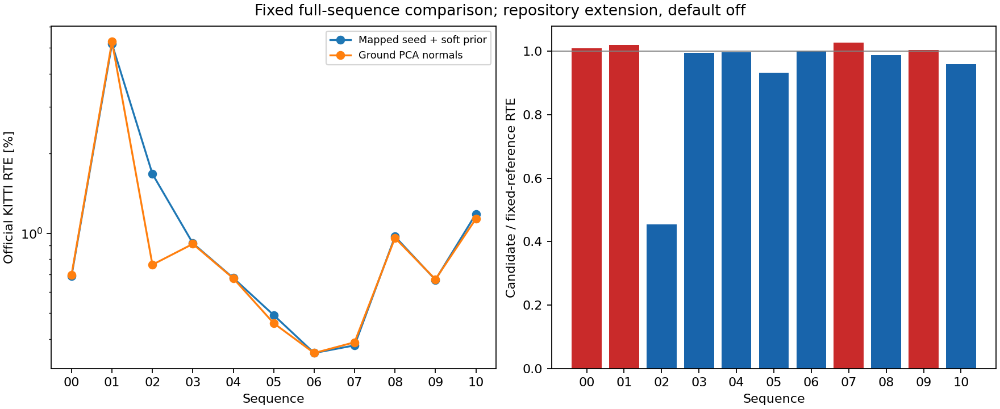

# Full iterative S2S ground PCA intervention

This actual odometry comparison follows the fixed-system diagnostics in
[the geometry study](../inten_plane_correspondences/README.md). It tests whether
the nearest-anchor ground PCA normal helps the complete repeated association,
optimization, mapped prediction and map trajectory. A smaller first update
alone was not a trajectory improvement.

## Frozen intervention and provenance

Only `s2s_ground_pca` differs. Ground support must first pass every original
triangle acceptance test. PCA uses exactly the gated native ten-neighbour
query; the plane passes through the original closest point. Collinear or
insufficient PCA support retains the original triangle. Facade, edge and
intensity equations at a fixed pose are unchanged. The unchanged data-adaptive soft prior recomputes its information from the
changed ground equations, including at the first iteration; its ratio and
anchor rule stay fixed. Later support may diverge because motion changes. This repository extension is outside the paper and
default off. It does not infer physical laser rings.

Both arms inherit mapped-motion prediction, the soft translation prior and
acceleration; row completion remains off. Profile selected on07;00 informed
earlier diagnosis. The prior fraction came from DiLO KITTI01 tuning. Ground
PCA was selected from previously committed known-failure first-system controls
on01/02/10, including negative cases on every sequence. The PCA numerical
degeneracy criterion is inherited from that control. All prior outcomes are
development evidence, not held-out accuracy. No retuning after collection
begins, and every full00-10 sequence is run even if07 is negative.

[Protocol](protocol.json), all manifests, native source, tests and collector
are committed before native execution. Reporting sources and the separate
[postprocessing protocol](postprocessing_protocol.json) are committed before
numerical derivation. The forward-information diagnostic was added during
collection as descriptive analysis; it was not registered before acquisition.
[Binary hashes and dependency pins](binaries.json),
[actual configure/build/CTest/link receipts](checks/build/) and runtime capture
identify the executable. A full07 immutable-parent control and every inherited
default-off pair check protect earlier behavior. Each owned official sequence
is verified, archived, round-trip checked, committed and normally pushed before
scan deletion; cleanup is committed and pushed before fetching the next.

## Test failure retained before acquisition

The initial focused CTest exited8: a synthetic-road test required more than30
accepted ground constraints, but that exact-flat fixture supplied2. This was
an unnecessary per-class requirement; the solver cutoff applies to the joint
system. The revised mechanism test adds a small world-fixed road ripple,
requires nonzero ground support, checks actual ground-equation change and exact
non-ground equations/counts at the same seed. Production PCA code and all KITTI
parameters remain unchanged by that test repair. Both the initial failure and
the definitive configure/build/CTest/link exits0 are retained under `checks/`.

## Outcomes

Geometric mean of option / reference official RTE: **0.924765x** across all sequences.
Lower RTE: 02, 03, 04, 05, 06, 08, 10. Higher RTE: 00, 01, 07, 09. Unchanged RTE: none.
This is a fixed experimental comparison; no per-sequence default is adopted.
Bad-length labels use the inherited local 20% threshold for GT motion at least 0.1 m,
separate from official KITTI 100–800 m RTE. Raw paired timing is not an FPS benchmark.

Numerical sources committed before prose: `a9603c00e7a47700b490e6a91785ca0891c90fb5`.

| Sequence | Reference RTE [%] | Option RTE [%] | Reference ATE [m] | Option ATE [m] | Bad-length steps, reference / option |
|---|---:|---:|---:|---:|---:|
| 00 | 0.691786 | 0.698468 | 17.064446 | 17.664608 | 12 / 13 |
| 01 | 5.173517 | 5.276027 | 100.493982 | 103.447496 | 50 / 50 |
| 02 | 1.674736 | 0.761893 | 48.906265 | 42.445818 | 66 / 2 |
| 03 | 0.917374 | 0.912470 | 6.449763 | 6.441482 | 2 / 2 |
| 04 | 0.678960 | 0.676872 | 1.543638 | 1.550584 | 0 / 0 |
| 05 | 0.491912 | 0.458453 | 9.886842 | 9.416840 | 0 / 0 |
| 06 | 0.354019 | 0.353991 | 1.924468 | 1.906228 | 0 / 0 |
| 07 | 0.378295 | 0.388674 | 1.660935 | 1.571423 | 0 / 0 |
| 08 | 0.973072 | 0.961094 | 28.286838 | 28.631257 | 19 / 19 |
| 09 | 0.668254 | 0.671125 | 11.133601 | 11.037572 | 0 / 0 |
| 10 | 1.183142 | 1.134467 | 9.901906 | 8.884908 | 0 / 0 |

Every adverse comparison (reference → option):

- 00: official RTE [%] 0.691786 → 0.698468; rotation [deg/100 m] 0.310482 → 0.317554; ATE [m] 17.064446 → 17.664608; bad-length steps 12 → 13.
- 01: official RTE [%] 5.173517 → 5.276027; ATE [m] 100.493982 → 103.447496.
- 03: bad-vector steps 2 → 3.
- 04: rotation [deg/100 m] 0.321024 → 0.324937; ATE [m] 1.543638 → 1.550584.
- 06: rotation [deg/100 m] 0.140441 → 0.140748.
- 07: official RTE [%] 0.378295 → 0.388674.
- 08: ATE [m] 28.286838 → 28.631257; bad-vector steps 97 → 98.
- 09: official RTE [%] 0.668254 → 0.671125.

New local bad labels in the candidate relative to the reference (all frames):

| Sequence | Newly bad length steps | Reference-only bad length steps | Newly bad vector steps | Reference-only bad vector steps |
|---|---:|---:|---:|---:|
| 00 | 1 | 0 | 1 | 1 |
| 01 | 1 | 1 | 1 | 1 |
| 02 | 0 | 64 | 0 | 65 |
| 03 | 0 | 0 | 1 | 0 |
| 04 | 0 | 0 | 0 | 0 |
| 05 | 0 | 0 | 0 | 0 |
| 06 | 0 | 0 | 0 | 0 |
| 07 | 0 | 0 | 0 | 0 |
| 08 | 0 | 0 | 3 | 2 |
| 09 | 0 | 0 | 0 | 0 |
| 10 | 0 | 0 | 0 | 0 |

Each pair uses the same input frame and GT labels but different realized
trajectories. These are outcome differences, not matched-seed interventions.
Every affected frame index is retained in the numerical report.

Failure-sequence observations along each realized trajectory:

- 01: final bad-length frames 204–253 → 204–252, 433; raw S2S bad-length outputs 51 → 50; S2S fallbacks 0 → 0; final rejected S2M 0 → 0.
- 02: final bad-length frames 1787, 3308, 4463–4526 → 1787, 3308; raw S2S bad-length outputs 68 → 2; S2S fallbacks 0 → 0; final rejected S2M 0 → 0.
- 10: final bad-length frames none → none; raw S2S bad-length outputs 0 → 0; S2S fallbacks 0 → 0; final rejected S2M 0 → 0.

Candidate sequences exceeding twice the cited paper RTE:

| Sequence | Option RTE [%] | Paper RTE [%] | Option / paper | Largest position-error growth block | Position error start → end [m] | Local block error [%] |
|---|---:|---:|---:|---|---:|---:|
| 01 | 5.276027 | 0.640000 | 8.243792 | 200–300 | 2.308217 → 102.925821 | 38.058200 |
| 01 | 5.276027 | 0.640000 | 8.243792 | 400–500 | 105.191008 → 110.615886 | 0.945119 |
| 01 | 5.276027 | 0.640000 | 8.243792 | 600–700 | 114.737458 → 119.589849 | 0.744108 |
| 10 | 1.134467 | 0.450000 | 2.521038 | 700–800 | 8.391421 → 13.454283 | 0.902068 |
| 10 | 1.134467 | 0.450000 | 2.521038 | 600–700 | 6.058322 → 8.391421 | 2.085537 |
| 10 | 1.134467 | 0.450000 | 2.521038 | 800–900 | 13.454283 → 15.702794 | 0.515080 |

These fixed-size motion blocks locate error growth; their relative errors are
not official distance-segment RTE and do not establish the solver-level cause.
Paper values are cited context; this extension is not the paper algorithm.

These are natural full-run observations, not matched-seed causal interventions.
The complete report retains every step and all motion-error blocks. The option
remains outside the paper and default off; earlier results are preserved.

## Known diagnostic entries along natural runs

| Sequence / frame | Mode | Input length / GT | S2S length / GT | Final length / GT | First ground pairs | First facade pairs | Data forward information | Prior forward information |
|---|---|---:|---:|---:|---:|---:|---:|---:|
| 01 / 204 | baseline | 0.848225 | 0.480498 | 0.421876 | 32 | 531 | 29.721406 | 0.000000 |
| 01 / 217 | baseline | 0.288536 | 0.365378 | 0.374365 | 86 | 417 | 38.858665 | 0.000000 |
| 01 / 253 | baseline | 0.286361 | 0.663680 | 0.715937 | 29 | 322 | 9.652519 | 0.000000 |
| 01 / 420 | baseline | 1.019718 | 0.714400 | 0.995517 | 66 | 361 | 26.525531 | 0.000000 |
| 01 / 204 | candidate | 0.842659 | 0.453615 | 0.417265 | 34 | 523 | 27.822712 | 0.000000 |
| 01 / 217 | candidate | 0.279898 | 0.367051 | 0.381278 | 89 | 422 | 37.798146 | 0.000000 |
| 01 / 253 | candidate | 0.323665 | 0.882383 | 0.944763 | 31 | 329 | 9.571871 | 0.000000 |
| 01 / 420 | candidate | 1.022974 | 0.713008 | 1.013524 | 63 | 357 | 25.897953 | 0.000000 |
| 02 / 1876 | baseline | 0.964708 | 0.861693 | 0.952853 | 253 | 556 | 11.201485 | 1.292355 |
| 02 / 4460 | baseline | 1.018508 | 0.889568 | 0.965580 | 256 | 470 | 7.729138 | 3.128453 |
| 02 / 4463 | baseline | 1.036705 | 0.616911 | 0.577531 | 256 | 516 | 11.334624 | 0.366946 |
| 02 / 4526 | baseline | 0.131278 | 0.450399 | 0.443807 | 139 | 472 | 20.983997 | 0.000000 |
| 02 / 1876 | candidate | 0.997530 | 0.927945 | 1.022570 | 238 | 569 | 9.722716 | 2.632754 |
| 02 / 4460 | candidate | 0.952265 | 0.939158 | 1.009021 | 251 | 485 | 5.440152 | 5.390064 |
| 02 / 4463 | candidate | 1.057748 | 0.964138 | 0.987610 | 274 | 534 | 7.855732 | 4.125815 |
| 02 / 4526 | candidate | 0.985697 | 1.008189 | 0.981827 | 171 | 460 | 26.154284 | 0.000000 |

Forward information projects the first sensor-centered data Schur matrix
and fixed prior information along the GT motion direction. GT is used only
in offline diagnosis, never as an estimator input. Different realized
trajectories make these descriptive observations, not matched-seed causal
comparisons. The soft-prior rule is identical while its information may
change immediately with the ground equations.

## Active prior and native solve checks

| Sequence | Frames with active prior | Recorded S2S systems checked | Maximum prior-information reconstruction error | Maximum relative damped-system residual |
|---|---:|---:|---:|---:|
| 00 | 0 | 43365 | 0 | 1.43181e-16 |
| 01 | 4 | 9768 | 5.77316e-15 | 1.16827e-16 |
| 02 | 140 | 44490 | 1.5099e-14 | 1.46872e-16 |
| 03 | 0 | 7577 | 0 | 1.1399e-16 |
| 04 | 0 | 2597 | 0 | 8.3036e-17 |
| 05 | 0 | 26425 | 0 | 1.58255e-16 |
| 06 | 0 | 10965 | 0 | 1.36627e-16 |
| 07 | 0 | 10544 | 0 | 1.04284e-16 |
| 08 | 0 | 38779 | 0 | 1.33725e-16 |
| 09 | 0 | 15144 | 0 | 1.33957e-16 |
| 10 | 0 | 11247 | 0 | 1.26352e-16 |

The stored information is independently reconstructed from the first
data Hessian after subtracting the recorded prior. Every recorded finite
update is checked against its total damped H/g using relative backward error.
Independent LAPACK/Eigen step differences are retained without treating
poorly conditioned world-coordinate forward errors as implementation drift.
This checks the declared
implementation, not the correctness of its correspondences.

The candidate changes the preceding trajectory as well as the current seed.
Support counts alone do not establish the cause of a change.



Every fresh PCA-off reference exactly reproduces the preceding soft-prior candidate RTE.

## Commands and interpretation

From the recorded checkout/environment (the capture receipts preserve actual
cwd, argv, source/binary hashes, thread settings, exit codes and times):

```bash
python3 experiments/results/inten_ground_pca/build.py
python3 experiments/results/inten_ground_pca/collect.py
python3 experiments/results/inten_ground_pca/report.py --output-dir experiments/results/inten_ground_pca/report
python3 experiments/results/inten_ground_pca/import_results.py
python3 experiments/results/inten_ground_pca/finalize_docs.py
```

Official KITTI distance-segment RTE, local step labels, ATE and first-system
controls answer different questions. Error-growth blocks locate drift without
proving surface correctness. Every adverse metric and newly bad local frame is
retained; no per-sequence winner is adopted. Native timings are preserved but
paired runs share CPUs, so no standalone FPS claim is made.
