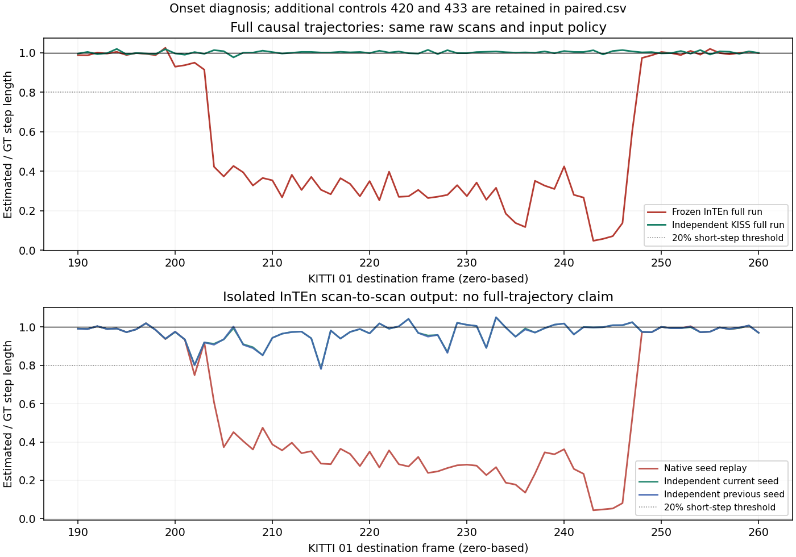

# Independent initialization diagnosis on KITTI 01

The frozen InTEn scan-to-scan solver usually retains an independently supplied
motion estimate through the onset interval. This gives a concrete reason to
prioritize initialization/history over another scalar feature filter. It does
**not** establish an improved full InTEn trajectory or a production hybrid.

The prospective [protocol](protocol.json) was committed at `6e4c1308` before
execution. Executed evidence was committed at `3653c434` before this numerical
interpretation. All KITTI sequences are development data.

## Full trajectories

| Method / input policy | Frames | Official KITTI RTE (%) | ATE (m) | Steps with length error >20% |
|---|---:|---:|---:|---:|
| Frozen opt-in InTEn reference, 0.17°, 1–120 m | 1101 | 4.481189 | 88.786456 | 44 |
| Official KISS-ICP 1.3.0, same input policy | 1101 | 0.949387 | 26.990444 | 0 |
| Historical Zoo KISS, different 0.205° / 80 m policy | 1101 | 0.759350 | 7.947183 | 0 |

The new upstream run starts at frame zero, keeps its own causal map/history,
uses no GT seed or deskew, and consumes the same raw scan hashes as InTEn.
The native float correction/range arithmetic is reproduced in
[preprocess.cpp](preprocess.cpp); point counts agree with the frozen native
loader for every intervention pair. This is shared input policy, not a claim
that the two algorithms use the same internal features or map.
The upstream voxel size is its default 1 m, loaded before the inherited range
is set to 120 m; all remaining upstream defaults are retained, with one thread.
Elevation/range were inherited from the earlier InTEn selection on 07/00;
there was no parameter search on 01. The historical Zoo KISS row is context,
not a controlled before/after or a claim that this input policy improves KISS.

In poses 200–300, the block-local translation error is 31.650624% for InTEn
and 0.738259% for independent KISS. These are diagnostic block errors, not
additional official KITTI scores. InTEn's short-step run spans 204–247.

## Matched scan-to-scan interventions

Frames 190–260 plus 420 and 433 were fixed before execution. The frozen
`inten_facade_pca` probe uses the same scans, feature extraction and solver;
the forced pose is the intervention. In the frozen implementation this pose
also sets the weak translation-prior target (`s2s_translation_prior_ratio=0.03`)
and affects its first-iteration information matrix. Thus this tests the
**joint initializer/prior input**, not the optimizer basin with an unchanged
objective. The original prospective protocol's initialization/objective
question is only partially separated by this experiment. Its native-seed controls exactly
reproduce the archived full-run S2S outputs (maximum matrix difference 0).
All 219 outputs, including failures, are retained.

| Initial pose / prior source | Pairs | Seeds with >20% length error | Outputs with >20% length error |
|---|---:|---:|---:|
| Actual native full-run S2S input | 73 | 44 | 46 |
| Independent current KISS increment | 73 | 0 | 2 |
| Independent previous KISS increment | 73 | 0 | 3 |

The vector-error counts are the same. Current-increment initialization needs
an additional current-frame registration; it is not a free motion prediction.
Previous-increment initialization uses the independent estimator's history,
not the previous InTEn intervention output. The paired trials do not chain
and do not update an InTEn map.

The remaining failures matter: current KISS seeds at 215 and 420 have length
ratios 1.000569 and 0.995565, but InTEn outputs 0.783427 and 0.557228. At 420,
that output is worse than the native-seed output 0.606071. Previous KISS seeds
fail at 202, 215 and 420. Frame 202 is a threshold boundary: current/previous
seed outputs are 0.801870/0.799391; crossing the descriptive 20% threshold is
not a robust success criterion. All continuous values are in
[paired.csv](report/paired.csv), with complete full-run steps in
[steps.csv](report/steps.csv).

## Decision and limits

The sensor input contains enough information for an independent geometric
estimator to avoid the long collapse. Most paired failures are strongly
dependent on the joint initializer/prior input. A smaller set still pulls a good estimate toward
a bad solution, so initialization alone does not solve every failure.

The next implementation experiment should supply a **GT-free geometric motion
initializer independent of the InTEn feature-history loop**, explicitly including the prior target, behind a default-off
option, then run one fixed configuration across all paper sequences. Evaluate
full official RTE and severe regressions; report residual failures such as 215
and 420 separately. Do not turn the diagnostic KISS injection into a paper
implementation claim or revive previously failed masks/thresholds. This study
changes no estimator, default, benchmark aggregate, Table 6 or paper ratio.

## Reproduction and checks

[commands/](commands/) retains exact argv, working directories, source commits,
environment, logs and real exit codes. The runtime configuration, upstream
Python/extension hashes and input hashes are under [kiss/](kiss/).
[probe/commands.json](probe/commands.json) retains every transfer hash, native
stdin and native output; [probe/raw.jsonl.gz](probe/raw.jsonl.gz) preserves the
same raw outputs compactly. The original probe hash is fixed in the protocol.
Frozen reference trajectories, trace and input pins remain in
`../inten_facade_pca`; the old KISS trajectory remains in `../shared_near_range`.

Execution order: compile `preprocess.cpp` as a shared library; fetch only 01
with `evaluation/scripts/fetch_kitti_odometry_sequences.py`; run `run_kiss.py`,
`run_probe.py`, `analyze.py`, then `validate_evidence.py` using the arguments in
the corresponding command receipts. `run_kiss.py` deliberately has no GT input.
Install upstream `kiss-icp==1.3.0` in an isolated Python environment and point
`--package-root` to it. The native probe is the earlier frozen build, whose
source/build provenance is in `../inten_facade_pca`. Exact reproduction of
binary-level equality requires that preserved native build/runtime.

Interrupted downloads, the initial Docker-copy failure, and a verifier label
mistake remain in the receipts. Their later successful retries do not erase
them. The acquired raw scans were deleted only after the complete evidence
and input-hash verification were committed. Regeneration runs in a disposable
copy, compares the full-variant and paper-ratio tables byte-for-byte, and runs
the affected evaluation/input/publication checks. Native production sources
are unchanged; this study does not claim a fresh full native/ROS2 CI run.
