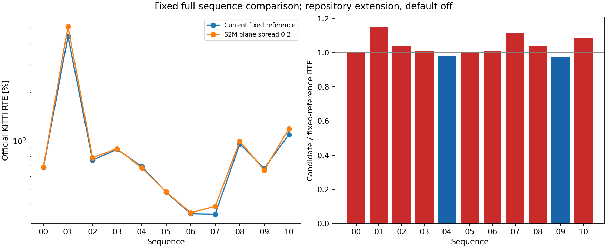

# Full fixed S2M plane-spread comparison

Current01 continuous native map-prefix controls are committed before the full
comparison. They reproduce the prior candidate's actual S2M stage, then split
its initial data equations by class. A hypothetical existing-ratio translation
prior is diagnosed offline, not fitted or evaluated as a new estimator.

The single candidate enables the already implemented, default-off, outside-paper
`s2m_plane_min_spread=0.2` check. This value comes unchanged from the existing
synthetic street mechanism test; earlier07 exploratory exposure is disclosed.
No threshold sweep or per-sequence adoption is performed. Both full arms use
the unchanged immutablePR159 binary, same07-selected profile, rigid mapped
motion seed, S2S soft prior0.03 (borrowed from DiLO01 tuning), ground and facade
PCA and acceleration, row completion off.00 informed diagnosis. Current01 and
all previous KITTI observations are development evidence, with no held-out claim.
This is an actual uniform full iterative comparison, not a representative-window
score. No production source is changed and no default is promoted.

Matched terminal S2M controls replay identical native normal prefixes and the
actual S2M input. A separate diagnostic native copy changes only the parameter
expression to a stage-local scalar, zero throughout prefixes/base endpoint,
0.2 at the candidate forced endpoint. Baseline numerical trace, systems and outputs must
match the immutable original producer. Full-sequence accuracy NEVER uses this
instrumented copy; it uses the real preexisting CLI option of the original
runner. Rejected plane support does not establish physical correspondence truth.
Endpoint gains/losses are retained separately from future trajectory feedback.

Initial diagnosis source was committed at3ea4ad88 under inten_s2m_prior before
this directory was renamed: use that exact historical source/header checkout
with immutable159 library to reproduce its recorded compile command. The
later diagnostic transformed copy has its own explicit source/binary receipts.
No historical build or binary is overwritten. Fresh full reference traces are
compared byte-for-byte after replacing only the declared absolute scan-root
prefix; every other body byte (including all numeric bytes), header parameters
and loader fields must match. Saved poses/GT are byte-identical without
normalization. Original old and new trace archives remain unchanged.

Official scans are acquired one owned full sequence at a time. Full hashes,
commands/cwd/environment/exits and every trace/pose are retained. Lossless trace
archives are round-tripped, committed and normally pushed BEFORE owned scan
removal; cleanup is committed/pushed before the next acquisition. Owned01 is
retained from initial diagnosis through the first full pair after revalidation.
Acquisition failures are retained. Raw paired timing is preserved without a
standalone FPS or proxy-score claim. All old logical evidence files/binaries
are preserved; verified identical inherited checkout copies may share storage.

Commands (actual absolute argv/cwd/source/binary hashes/exits in receipts):

```bash
python3 experiments/results/inten_map_plane_spread/spread.py
python3 experiments/results/inten_map_plane_spread/collect.py
python3 experiments/results/inten_map_plane_spread/report.py --output-dir experiments/results/inten_map_plane_spread/report
python3 experiments/results/inten_map_plane_spread/import_results.py
python3 experiments/results/inten_map_plane_spread/finalize_docs.py
```

Each phase's source/protocol is committed before execution. Numerical outcomes
are committed before this prose. Every negative result, new local failure and
above-twice-paper error-growth block is retained. Complete Native and ROS2 CI
must pass on the final head before Ready. No merge is authorized this turn.

The evaluated fixed plane-spread check does not resolve the current01 collapse: official RTE changes 4.481189% → 5.161510% and bad-length labels 44 → 51. It is not adopted as a remedy; the existing default remains off.

Geometric mean of option / reference official RTE: **1.036694x** across all sequences.
Lower RTE: 04, 09. Higher RTE: 00, 01, 02, 03, 05, 06, 07, 08, 10. Unchanged RTE: none.
This is a fixed experimental comparison; no per-sequence default is adopted.
Bad-length labels use the inherited local 20% threshold for GT motion at least 0.1 m,
separate from official KITTI 100–800 m RTE. Raw paired timing is not an FPS benchmark.

Numerical sources committed before prose: `da4c325bfef98f313c9b713373ad5ba1f05d0aa4`.

| Sequence | Reference RTE [%] | Option RTE [%] | Reference ATE [m] | Option ATE [m] | Bad-length steps, reference / option |
|---|---:|---:|---:|---:|---:|
| 00 | 0.683293 | 0.686572 | 17.051301 | 16.463229 | 13 / 14 |
| 01 | 4.481189 | 5.161510 | 88.786456 | 95.223329 | 44 / 51 |
| 02 | 0.756938 | 0.784905 | 40.602835 | 42.046057 | 2 / 3 |
| 03 | 0.884094 | 0.892626 | 6.251484 | 6.235477 | 1 / 1 |
| 04 | 0.692176 | 0.678339 | 1.563220 | 1.525585 | 0 / 0 |
| 05 | 0.477296 | 0.479307 | 9.639439 | 9.672226 | 0 / 0 |
| 06 | 0.350792 | 0.355452 | 1.952842 | 1.829934 | 0 / 0 |
| 07 | 0.348742 | 0.389882 | 1.391385 | 1.605666 | 0 / 0 |
| 08 | 0.955307 | 0.992090 | 29.422940 | 29.167324 | 19 / 19 |
| 09 | 0.672321 | 0.656127 | 11.508132 | 9.680980 | 0 / 0 |
| 10 | 1.093310 | 1.187067 | 8.851550 | 9.891833 | 0 / 0 |

Every adverse comparison (reference → option):

- 00: official RTE [%] 0.683293 → 0.686572; rotation [deg/100 m] 0.317055 → 0.321560; RPE [%] 0.794246 → 0.808481; bad-length steps 13 → 14.
- 01: official RTE [%] 4.481189 → 5.161510; rotation [deg/100 m] 0.289430 → 0.333664; ATE [m] 88.786456 → 95.223329; RPE [%] 3.760742 → 4.270054; bad-length steps 44 → 51; bad-vector steps 44 → 51.
- 02: official RTE [%] 0.756938 → 0.784905; rotation [deg/100 m] 0.262615 → 0.269418; ATE [m] 40.602835 → 42.046057; RPE [%] 0.813418 → 0.823649; bad-length steps 2 → 3.
- 03: official RTE [%] 0.884094 → 0.892626; rotation [deg/100 m] 0.632477 → 0.634652.
- 04: rotation [deg/100 m] 0.295843 → 0.330865.
- 05: official RTE [%] 0.477296 → 0.479307; ATE [m] 9.639439 → 9.672226; RPE [%] 0.424881 → 0.432947.
- 06: official RTE [%] 0.350792 → 0.355452; rotation [deg/100 m] 0.143796 → 0.146560; RPE [%] 0.506118 → 0.520961.
- 07: official RTE [%] 0.348742 → 0.389882; rotation [deg/100 m] 0.254061 → 0.296193; ATE [m] 1.391385 → 1.605666.
- 08: official RTE [%] 0.955307 → 0.992090; rotation [deg/100 m] 0.342667 → 0.353814; RPE [%] 1.301395 → 1.321008.
- 09: RPE [%] 0.690141 → 0.721705.
- 10: official RTE [%] 1.093310 → 1.187067; rotation [deg/100 m] 0.352714 → 0.395578; ATE [m] 8.851550 → 9.891833; RPE [%] 0.825808 → 0.860329.

New local bad labels in the candidate relative to the reference (all frames):

| Sequence | Newly bad length steps | Reference-only bad length steps | Newly bad vector steps | Reference-only bad vector steps |
|---|---:|---:|---:|---:|
| 00 | 1 | 0 | 0 | 0 |
| 01 | 7 | 0 | 7 | 0 |
| 02 | 1 | 0 | 1 | 1 |
| 03 | 0 | 0 | 0 | 1 |
| 04 | 0 | 0 | 0 | 0 |
| 05 | 0 | 0 | 0 | 0 |
| 06 | 0 | 0 | 0 | 0 |
| 07 | 0 | 0 | 0 | 0 |
| 08 | 0 | 0 | 1 | 2 |
| 09 | 0 | 0 | 0 | 0 |
| 10 | 0 | 0 | 0 | 0 |

Each pair uses the same input frame and GT labels but different realized
trajectories. These are outcome differences, not matched-seed interventions.
Every affected frame index is retained in the numerical report.

Failure-sequence observations along each realized trajectory:

- 01: final bad-length frames 204–247 → 204–253, 836; raw S2S bad-length outputs 48 → 54; S2S fallbacks 0 → 0; final rejected S2M 0 → 0.
- 02: final bad-length frames 1787, 3308 → 1787, 1789, 3308; raw S2S bad-length outputs 2 → 2; S2S fallbacks 0 → 0; final rejected S2M 0 → 0.
- 10: final bad-length frames none → none; raw S2S bad-length outputs 0 → 0; S2S fallbacks 0 → 0; final rejected S2M 0 → 0.

Candidate sequences exceeding twice the cited paper RTE:

| Sequence | Option RTE [%] | Paper RTE [%] | Option / paper | Largest position-error growth block | Position error start → end [m] | Local block error [%] |
|---|---:|---:|---:|---|---:|---:|
| 01 | 5.161510 | 0.640000 | 8.064859 | 200–300 | 2.126038 → 100.919396 | 37.291114 |
| 01 | 5.161510 | 0.640000 | 8.064859 | 900–1000 | 109.857427 → 113.504959 | 0.347276 |
| 01 | 5.161510 | 0.640000 | 8.064859 | 400–500 | 102.704939 → 105.485207 | 0.323911 |
| 10 | 1.187067 | 0.450000 | 2.637927 | 700–800 | 9.473954 → 14.850155 | 0.933261 |
| 10 | 1.187067 | 0.450000 | 2.637927 | 800–900 | 14.850155 → 17.374717 | 0.471364 |
| 10 | 1.187067 | 0.450000 | 2.637927 | 600–700 | 7.015885 → 9.473954 | 2.154312 |

These fixed-size motion blocks locate error growth; their relative errors are
not official distance-segment RTE and do not establish the solver-level cause.
Paper values are cited context; this extension is not the paper algorithm.

These are natural full-run observations, not matched-seed causal interventions.
The complete report retains every step and all motion-error blocks. The option
remains outside the paper and default off; earlier results are preserved.

Matched current01 S2M controls (identical normal map prefix and S2M input; terminal endpoints only):

| Frame | Input length / GT | Native output / GT | Spread output / GT | Absolute length error change | Ground pairs, native / spread | Facade pairs, native / spread |
|---|---:|---:|---:|---:|---:|---:|
| 190 | 0.990767 | 0.987433 | 0.986651 | 0.000781 | 700 / 497 | 432 / 234 |
| 200 | 0.975241 | 0.928945 | 0.926470 | 0.002475 | 735 / 541 | 626 / 334 |
| 202 | 0.748598 | 0.949347 | 0.966487 | -0.017140 | 782 / 532 | 693 / 357 |
| 203 | 0.918730 | 0.913917 | 0.921279 | -0.007362 | 785 / 543 | 644 / 396 |
| 204 | 0.607064 | 0.422811 | 0.419806 | 0.003005 | 806 / 594 | 681 / 417 |
| 205 | 0.372446 | 0.373720 | 0.375160 | -0.001440 | 811 / 590 | 682 / 446 |
| 247 | 0.522727 | 0.601911 | 0.625859 | -0.023948 | 810 / 668 | 414 / 289 |
| 433 | 0.926498 | 0.926296 | 0.884662 | 0.041634 | 795 / 601 | 507 / 324 |

Matched absolute length error: 4 lower, 4 higher, 0 equal.
These controls use a separately instrumented diagnostic producer whose
only native expression change is the stage-local plane-spread parameter.
Every normal prefix and baseline solver/output/system matches immutable
native controls. Full accuracy uses the unchanged original runner and
its actual existing CLI option, never the diagnostic copy.
Rejected support is not proof of physically incorrect correspondences.
Matched endpoint changes do not include future trajectory/map feedback.

Native first-system class contributions, percent of the GT step:

| Frame | S2M input / GT | S2M output / GT | Edge | Ground | Facade | Intensity | Total | Translation min / max | Hypothetical prior norm |
|---|---:|---:|---:|---:|---:|---:|---:|---:|---:|
| 190 | 0.990767 | 0.987433 | 0.055309 | -0.279965 | 0.466967 | -0.017671 | 0.224641 | 0.064883 | 0.000000 |
| 200 | 0.975241 | 0.928945 | -0.218160 | -0.140740 | -0.904542 | -0.004096 | -1.267537 | 0.065223 | 0.000000 |
| 202 | 0.748598 | 0.949347 | -0.585034 | 0.263467 | 1.128713 | -0.028683 | 0.778464 | 0.043028 | 0.000000 |
| 203 | 0.918730 | 0.913917 | 0.162635 | -0.043414 | -0.399552 | 0.010248 | -0.270083 | 0.086744 | 0.000000 |
| 204 | 0.607064 | 0.422811 | -0.606950 | -0.244870 | -5.106962 | -0.036492 | -5.995275 | 0.048378 | 0.000000 |
| 205 | 0.372446 | 0.373720 | 0.044474 | 0.012637 | -0.158986 | -0.001062 | -0.102938 | 0.092035 | 0.000000 |
| 247 | 0.522727 | 0.601911 | 0.417860 | 0.076522 | 0.749463 | -0.098218 | 1.145626 | 0.025797 | 3.304968 |
| 433 | 0.926498 | 0.926296 | 0.630915 | -0.316993 | -0.373560 | 0.002701 | -0.056936 | 0.030258 | 0.000000 |

Class contributions are initial joint-system linear contributions, not
independent reassociated solves. All class H/g, trace iterations,
roundoff maxima and negative endpoints are retained. Rank or support
counts alone do not prove correctness. The hypothetical existing-ratio
prior is offline diagnosis, not an additional evaluated estimator.


