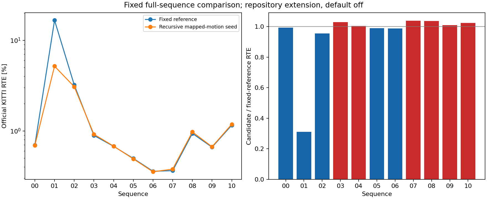

# Recursive mapped-motion S2S seed: full KITTI comparison

This is a repository extension **outside the paper, default off**:
`--inten-loam-paper-set s2s_mapped_prior=1`.

S2S normally reuses its own preceding accepted relative estimate, before S2M
correction. The candidate instead seeds it with the preceding final mapped
relative pose (`previous_pose.inverse() * current_pose`), updated recursively.
The relative rotation is restored through a normalized quaternion, with a
homogeneous bottom row; translation is preserved. Startup uses identity. The accepted S2S cache, deskew, low-count fallback,
associations, robust weights, solver budgets and mapping remain unchanged.
Skipped or rejected S2M still contributes the actual final relative motion.
Mapping-off and forced-pose diagnostic paths keep their original behavior.
The [initial unprojected trial](../inten_mapped_prior/README.md) completed 07
with worse accuracy and aborted 00 after non-rigid roundoff amplified. That
trial and every original command remain stored.00 informed this numerical
correction; this revision restarts every sequence.

No new threshold is chosen; failed row-support completion remains off in both arms.

The hypothesis is that S2M corrections could stop an S2S prediction deficit
from feeding back into the next registration. The earlier one-shot mapped-seed
[interventions](../inten_seed_intervention/README.md) use an already collapsed
trajectory and do not test prevention by recursive feedback. The GT-seeded
negative controls also show why initialization alone may not fix the solver.

The inherited range/elevation/S2M profile was chosen on 07;00 influenced its
diagnosis. Known 01/02/10 failures motivated this boolean. These are development
data, with **no independent held-out claim**. Full 07 ran first, then all other
sequences, with the same parameters and existing acceleration in every arm.
Both arms use continuous natural prediction, passive traces and `--no-gt-seed`.
The candidate is not selected separately per sequence.

The initial unprojected trial is a retained negative result: full 07 official
RTE 0.364131 → 0.379537%,
ATE 1.461444 → 1.668590 m;00 aborted with
exit 134 after 2355 frame records
(no full 00 RTE). Its non-rigid rotation feedback informed the fixed rotation
restoration used here. All 11 sequences restart with the revised setting.
[Original source, commands and diagnosis](../inten_mapped_prior/README.md).

Geometric mean of option / reference official RTE: **0.904792x** across all sequences.
Lower RTE: 00, 01, 02, 05, 06. Higher RTE: 03, 04, 07, 08, 09, 10.
This is a fixed experimental comparison; no per-sequence default is adopted.
Bad-length labels use the inherited local 20% threshold for GT motion at least 0.1 m,
separate from official KITTI 100–800 m RTE. Raw paired timing is not an FPS benchmark.

Numerical sources committed before prose: `d62570b78d2707cc9c7d0629592c193986a57a29`.

| Sequence | Reference RTE [%] | Option RTE [%] | Reference ATE [m] | Option ATE [m] | Bad-length steps, reference / option |
|---|---:|---:|---:|---:|---:|
| 00 | 0.696720 | 0.691786 | 17.644136 | 17.064446 | 13 / 12 |
| 01 | 16.613803 | 5.180428 | 275.593270 | 100.875751 | 136 / 50 |
| 02 | 3.221230 | 3.073932 | 122.844508 | 119.531515 | 133 / 128 |
| 03 | 0.890601 | 0.917374 | 6.262153 | 6.449763 | 2 / 2 |
| 04 | 0.676097 | 0.678960 | 1.539561 | 1.543638 | 0 / 0 |
| 05 | 0.497289 | 0.491912 | 9.976094 | 9.886842 | 0 / 0 |
| 06 | 0.358642 | 0.354019 | 1.917879 | 1.924468 | 0 / 0 |
| 07 | 0.364131 | 0.378295 | 1.461444 | 1.660935 | 0 / 0 |
| 08 | 0.937938 | 0.973072 | 27.673206 | 28.286838 | 20 / 19 |
| 09 | 0.661434 | 0.668254 | 11.000039 | 11.133601 | 0 / 0 |
| 10 | 1.155652 | 1.183142 | 9.669713 | 9.901906 | 0 / 0 |

Every adverse comparison (reference → option):

- 03: official RTE [%] 0.890601 → 0.917374; rotation [deg/100 m] 0.627926 → 0.660957; ATE [m] 6.262153 → 6.449763.
- 04: official RTE [%] 0.676097 → 0.678960; ATE [m] 1.539561 → 1.543638.
- 06: ATE [m] 1.917879 → 1.924468.
- 07: official RTE [%] 0.364131 → 0.378295; rotation [deg/100 m] 0.274943 → 0.298015; ATE [m] 1.461444 → 1.660935.
- 08: official RTE [%] 0.937938 → 0.973072; rotation [deg/100 m] 0.324577 → 0.339552; ATE [m] 27.673206 → 28.286838.
- 09: official RTE [%] 0.661434 → 0.668254; rotation [deg/100 m] 0.232926 → 0.249751; ATE [m] 11.000039 → 11.133601.
- 10: official RTE [%] 1.155652 → 1.183142; rotation [deg/100 m] 0.386538 → 0.393581; ATE [m] 9.669713 → 9.901906.

New local bad labels in the candidate relative to the reference (all frames):

| Sequence | Newly bad length steps | Reference-only bad length steps | Newly bad vector steps | Reference-only bad vector steps |
|---|---:|---:|---:|---:|
| 00 | 0 | 1 | 0 | 1 |
| 01 | 13 | 99 | 13 | 99 |
| 02 | 1 | 6 | 1 | 7 |
| 03 | 0 | 0 | 0 | 0 |
| 04 | 0 | 0 | 0 | 0 |
| 05 | 0 | 0 | 0 | 0 |
| 06 | 0 | 0 | 0 | 0 |
| 07 | 0 | 0 | 0 | 0 |
| 08 | 0 | 1 | 2 | 4 |
| 09 | 0 | 0 | 0 | 0 |
| 10 | 0 | 0 | 0 | 0 |

Each pair uses the same input frame and GT labels but different realized
trajectories. These are outcome differences, not matched-seed interventions.
Every affected frame index is retained in the numerical report.

Failure-sequence observations along each realized trajectory:

- 01: final bad-length frames 217–253, 420–518 → 204–253; S2S bad-length outputs 139 → 51; final rejected S2M 0 → 0.
- 02: final bad-length frames 1787, 1878–1943, 3308, 4460–4524 → 1787, 1883–1942, 3308, 4460–4525; S2S bad-length outputs 136 → 131; final rejected S2M 0 → 0.
- 10: final bad-length frames none → none; S2S bad-length outputs 0 → 0; final rejected S2M 0 → 0.

Candidate sequences exceeding twice the cited paper RTE:

| Sequence | Option RTE [%] | Paper RTE [%] | Option / paper | Largest position-error growth block | Position error start → end [m] | Local block error [%] |
|---|---:|---:|---:|---|---:|---:|
| 01 | 5.180428 | 0.640000 | 8.094419 | 200–300 | 2.277764 → 100.942226 | 37.317870 |
| 01 | 5.180428 | 0.640000 | 8.094419 | 600–700 | 111.147016 → 116.310783 | 0.813662 |
| 01 | 5.180428 | 0.640000 | 8.094419 | 700–800 | 116.310783 → 120.549185 | 0.371765 |
| 02 | 3.073932 | 0.540000 | 5.692467 | 1900–2000 | 57.507917 → 117.070449 | 49.417329 |
| 02 | 3.073932 | 0.540000 | 5.692467 | 4400–4500 | 105.465085 → 164.579579 | 38.262206 |
| 02 | 3.073932 | 0.540000 | 5.692467 | 2300–2400 | 55.084337 → 113.862431 | 0.460583 |
| 10 | 1.183142 | 0.450000 | 2.629204 | 700–800 | 9.445875 → 14.984990 | 0.947132 |
| 10 | 1.183142 | 0.450000 | 2.629204 | 600–700 | 6.908792 → 9.445875 | 1.995964 |
| 10 | 1.183142 | 0.450000 | 2.629204 | 800–900 | 14.984990 → 17.466513 | 0.485612 |

These fixed-size motion blocks locate error growth; their relative errors are
not official distance-segment RTE and do not establish the solver-level cause.
Paper values are cited context; this extension is not the paper algorithm.

These are natural full-run observations, not matched-seed causal interventions.
The complete report retains every step and all motion-error blocks. The option
remains outside the paper and default off; earlier results are preserved.

## Known diagnostic entries along natural runs

| Sequence / frame | Mode | Input length / GT | S2S length / GT | Final length / GT | First ground pairs | First facade pairs |
|---|---|---:|---:|---:|---:|---:|
| 01 / 420 | baseline | 0.780476 | 0.349374 | 0.456349 | 86 | 374 |
| 01 / 420 | candidate | 1.019718 | 0.714400 | 0.995517 | 66 | 361 |
| 02 / 1876 | baseline | 0.924384 | 0.775259 | 0.933978 | 246 | 518 |
| 02 / 4460 | baseline | 0.939735 | 0.342471 | 0.359038 | 251 | 481 |
| 02 / 1876 | candidate | 0.993027 | 0.790239 | 0.936190 | 243 | 559 |
| 02 / 4460 | candidate | 1.034424 | 0.461825 | 0.660376 | 255 | 463 |

The candidate changes the preceding trajectory as well as the current seed.
Support counts alone do not establish the cause of a change.



Every fresh default-off official RTE exactly equals the historical primary aggregate.

## Reproduce and audit

- [Frozen protocol](protocol.json) and its hashed full-sequence manifests.
- [Native binaries/dependencies](binaries.json), [build/tests](checks/build/),
  [CLI trace parity](checks/cli_preflight/), [actual runtime](runtime.json).
- `collect.py`: official acquisition one sequence at a time, exact scan/GT
  hashes, full native invocation, trace validation and saved-motion diagnosis.
  Every raw archive is committed and normally pushed before deleting owned
  scans; cleanup is committed and pushed before the next acquisition.
- [Collection execution](collection_execution/command.json) and
  [backup execution receipts](backup_execution/) retain actual exits.
- Full 07 default-off control matches the immutable PR155 runner. All inherited
  natural-seed fixed-pair controls on 01/02/10 check default-off estimates,
  first class normal equations and counts; these are compatibility controls,
  not accuracy measurements.
- [Postprocessing protocol](postprocessing_protocol.json): sources committed
  before derivation, full numerical report committed before README prose.
- [Report invocation](report_execution/command.json),
  [import invocation](import_execution/command.json),
  [derived document generation](docs_execution/) and [final checks](checks/final/).
- Earlier aggregates, scientific studies and publication files are preserved.
  Both arms remain non-default and unscored. Raw timing survives in summaries,
  but concurrent processes do not support a standalone FPS comparison.

```bash
OMP_NUM_THREADS=1 OPENBLAS_NUM_THREADS=1 PYTHONDONTWRITEBYTECODE=1 \
  /workspace/localization-env/host-venv/bin/python experiments/results/inten_mapped_prior_rigid/build.py
OMP_NUM_THREADS=1 OPENBLAS_NUM_THREADS=1 PYTHONDONTWRITEBYTECODE=1 \
  /workspace/localization-env/host-venv/bin/python experiments/results/inten_mapped_prior_rigid/collect.py
OMP_NUM_THREADS=1 OPENBLAS_NUM_THREADS=1 PYTHONDONTWRITEBYTECODE=1 \
  /workspace/localization-env/host-venv/bin/python experiments/results/inten_mapped_prior_rigid/report.py \
  --output-dir experiments/results/inten_mapped_prior_rigid/report
OMP_NUM_THREADS=1 OPENBLAS_NUM_THREADS=1 PYTHONDONTWRITEBYTECODE=1 \
  /workspace/localization-env/host-venv/bin/python experiments/results/inten_mapped_prior_rigid/import_results.py
OMP_NUM_THREADS=1 OPENBLAS_NUM_THREADS=1 PYTHONDONTWRITEBYTECODE=1 \
  /workspace/localization-env/host-venv/bin/python experiments/results/inten_mapped_prior_rigid/write_docs.py
```

Build and collection require fresh isolated paths and stop on failed checks.
Original commands, working directories, source commits, hashes and actual exit
codes are stored alongside their execution logs. Do not rerun into old evidence.
