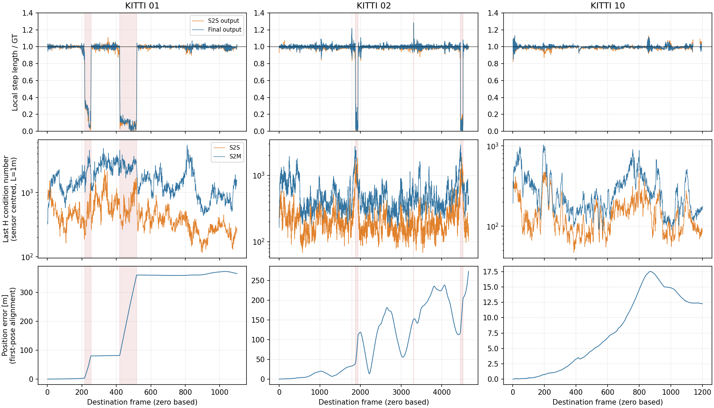

# Continuous natural InTEn failure traces

Full KITTI 01/02/10 traces locate the sustained motion collapse in the realized
S2S output, before S2M correction. They exclude the low-count fallback hypothesis
on these executions, but do not identify the correspondence-level cause or an
accuracy-improving fix. All estimator code, defaults and historical paper numbers
are preserved.

## Execution and provenance

The unchanged `paper_odometry_plane_check` setting was selected on KITTI07;
KITTI00 influenced the earlier plane-check diagnosis and is not held out.
No setting is selected on these failure sequences. The [protocol](protocol.json)
pins the manifests, native source, existing tools, thread environment and
spectral convention before execution (`7b395822`). Fresh Release build and the
existing InTEn/serializer CTest entries exit 0 (`b5c18d73`). The native source
is main `ad7d2081`; the executable SHA256 is in [binary.json](binary.json).

Each sequence runs continuously from initialization with no forced pose,
GT seed, window restart or acceleration. The same executable runs trace-off
then trace-on, one sequence at a time. All 6 native calls exit 0; all available
accuracy/frame fields agree exactly within each pair, and all saved pose/GT
files are byte-identical. FPS is excluded: recording overhead is not a speed
measurement. The structural checker reports no skipped inputs or nonfinite
trace values. Complete raw evidence was committed before analysis/prose:
01 `04417e46`, 02 `e117e876`, 10 `1fe4bc54`.

| Sequence | Processed frames | Official RTE [%] | ATE [m] | Joined S2S / S2M iterations |
|---|---:|---:|---:|---:|
| 01 | 1101 | 16.613803 | 275.593270 | 9859 / 10520 |
| 02 | 4661 | 3.221230 | 122.844508 | 44669 / 40502 |
| 10 | 1201 | 1.155652 | 9.669713 | 11238 / 10178 |

These are diagnostic replays, not replacements for the historical benchmark
cells or Table 6. The official fetch script obtains each sequence separately.
For each sequence the first fetch exits 1 with an incomplete download; the
bounded second attempt exits 0. Both receipts/logs are retained. Official scan
and GT hashes match the prior committed input manifests and are rechecked before
deleting only the owned scan directory. Each [cleanup record](sequences/01/cleanup.json)
confirms deletion; no raw scans are committed.

## Full-step diagnosis

The [offline diagnosis protocol](diagnosis_protocol.json) was committed at
`83f63ebf` before running. Results and command/exit receipts were committed at
`2a65d382`, before this prose. The join verifies every archived file, every
iteration's indices and native H/g/delta/pose/class counts, complete GT indexing,
prediction composition and saved-pose agreement at saved precision. It exactly
reproduces the previously saved step diagnostics. The CSVs contain every step,
including nonmoving steps with unavailable relative errors.

The inherited bad-length label is a local step-length error greater than 20%
for GT motion of at least 0.1 m. Frame indices below are zero-based destination
frames, inclusive. S2S output and the final accepted S2M pose are compared with
GT in the previous accepted sensor frame; these observations depend on the
realized prior state and are not independent S2S-only/S2M-only trajectories.

| Sequence / final bad-length range | Steps | Median S2S length / GT | Median final length / GT |
|---|---:|---:|---:|
| 01: 217–253 | 37 | 0.236199 | 0.258888 |
| 01: 420–518 | 99 | 0.089893 | 0.104688 |
| 02: 1787 | 1 | 1.161876 | 1.216550 |
| 02: 1878–1943 | 66 | 0.047178 | 0.056479 |
| 02: 3308 | 1 | 1.276501 | 1.283396 |
| 02: 4460–4524 | 65 | 0.044211 | 0.037301 |
| 10 | 0 | — | — |

All 136 bad-length steps in 01 are already bad at S2S output. In 02, 132 of
133 are already bad there; at frame 1787, S2M changes the ratio from 1.161876
to 1.216550 and crosses the criterion. S2M brings 3 other S2S-bad steps in 01
and 4 in 02 within the criterion. It does not recover any of the sustained
bad-length runs. The S2S input ratios are also already short for most bad steps
(medians 0.093879 in 01 and 0.047068 in 02), which documents persistence through
the prediction; it does not by itself identify the initiating correspondence.

Across all 6960 non-initialization steps, S2S fallback occurs 0 times and S2M
acceptance occurs every time. This fills the gaps in the historical sparse-log
analysis. At the bad-length steps, minimum returned S2S/S2M pairs are
633/1336 in 01 and 724/1358 in 02, above the existing count cutoff of 30.
Thus neither an earlier low-count fallback nor rejection of S2M explains these
natural failures.

## Spectra and stopping: negative and mixed results

Every one of the 126966 stored systems has status `ok`, numerical rank 6 and
a finite applied update, under the inherited sensor-centred convention
`L=1 m`, relative cutoff `1e-9`. This excludes numerical rank loss **under that
convention**; it does not exclude weak observability or wrong associations.
The full H/g/delta/residual/class counts remain available in the archives.

The last stored H is before the last update. The following condition numbers
are descriptive and add no estimator gate. The comparison group is every
other moving step, including less severe errors.

| Sequence / group | Steps | Median last S2S condition | Median last S2M condition | S2S / S2M stops marked converged |
|---|---:|---:|---:|---:|
| 01 bad length | 136 | 510.42 | 2602.98 | 50 / 10 |
| 01 other moving | 964 | 383.04 | 1341.87 | 427 / 226 |
| 02 bad length | 133 | 1017.85 | 998.52 | 19 / 4 |
| 02 other moving | 4527 | 185.38 | 420.94 | 973 / 2177 |
| 10 moving | 1153 | 129.55 | 249.52 | 330 / 590 |

Conditions tend to be higher in the bad groups but their ranges overlap: for
example, 01 S2M spans 1012.32–4557.06 at bad-length steps and 322.48–5476.98 at
the other moving steps. Convergence is also not a correctness certificate:
50/19 S2S bad-length steps in 01/02 are marked converged. Conversely, S2M hits
the iteration limit at 738/2350 other moving steps. Neither rank, condition
alone, the stop label nor a count threshold provides a demonstrated fix.

KITTI10 has 0 bad-length or bad-vector steps among 1153 moving steps; 47 shorter
steps are excluded only from relative-error labels. Median length ratios are
0.988111 at S2S and 0.995839 after S2M. Its largest inherited 100-step block
translation error is 2.027488% over frames 600–700, without a 20% step event.
That block diagnostic is not official distance-segment KITTI RTE. The gradual
drift cannot be attributed to a sudden-collapse branch by this evidence.



Shading marks every final bad-length interval, including singletons. Relative
step errors are unavailable on nonmoving steps. Axes have independent condition
and position-error scales by sequence; no smoothing or selected time crop is
used. [Plot source](plot_diagnosis.py) and its
[execution receipt](diagnosis_execution/plot_command.json) are retained.

## Reproduction and evidence layout

Run collection only in a fresh workspace with the recorded dependencies,
paths, binary build and official dataset access. The study driver refuses an
existing build/staging/results directory; it must not restart an interrupted
native trajectory. Preserve failed receipts and inputs for review.

```bash
python3 experiments/results/inten_natural_traces/run_sequences.py
```

Exact actual native/fetch/tool commands, working directories, source and binary
hashes, environment and exit codes are in each `sequences/NN/*_command.json`
and nested command folders. The trace checker, conditioning analyzer and saved
step diagnostics are the existing evaluation scripts, unchanged. Their
rotation length and motion criteria are fixed in [protocol.json](protocol.json).

Each `archive.json` maps logical originals to storage paths, original sizes and
SHA256, with additional compressed/chunk hashes. Large JSONL is losslessly
split into ordered gzip shards. Boundaries can split a JSON line: concatenate
the decompressed chunks **before** parsing. The actual command receipts still
name the original execution paths, which need not exist after cleanup.

The offline join reconstructs and verifies those bytes in a temporary directory;
it does not fetch scans or open the original input paths. Re-run into a new
output directory using the locked Python dependencies:

```bash
OMP_NUM_THREADS=1 OPENBLAS_NUM_THREADS=1 python3 experiments/results/inten_natural_traces/diagnose.py --output-dir /tmp/new-inten-natural-diagnosis
python3 experiments/results/inten_natural_traces/plot_diagnosis.py /tmp/inten-natural-timelines.png
```

[Machine-readable diagnosis](diagnosis/summary.json), per-sequence
[01](diagnosis/01_frames.csv), [02](diagnosis/02_frames.csv),
[10](diagnosis/10_frames.csv) step CSVs and [actual exit receipt](diagnosis_execution/command.json)
retain the full result. The initial CSV writer emitted CRLF, causing a whitespace
check to exit 2; its complete failed log is retained compressed. The recorded
normalization changes only CRLF to LF, preserves row content/counts and fixes
the writer. Scientific values and the initial execution receipt are unchanged.

## Remaining question

The finite collection and stage-localization milestone is complete. A causal
explanation and improvement of the paper gap remain open. The next useful
experiment must distinguish association/prediction failure in S2S from the
inability of S2M to recover on the realized collapse entries, while also
preserving KITTI10's separate gradual-drift behavior. The earlier origin
experiment establishes a property, not its causal role here. No alternative
solver, damping, extra processing or retuned setting is selected by this study.
