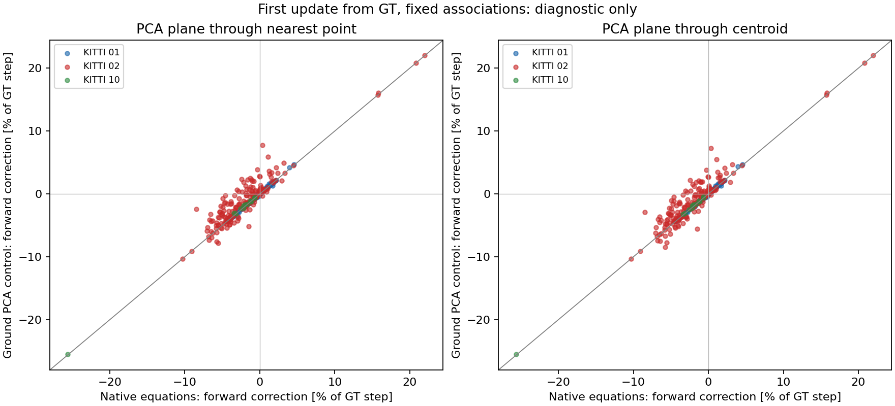

# Actual S2S plane correspondences and fixed-system controls

Actual correspondence geometry explains a part of the initial backward update,
but ground-normal replacement is not a general fix. The bounded neighbour query
also rejects available same-row support. These findings identify concrete
mechanisms to test; they do not establish recovery of the iterative solver or
an improved trajectory.

## Frozen inputs and actual execution

This follows [seed interventions](../inten_seed_intervention/README.md),
parent `eee61c7f` / PR #153. It uses exactly the same selected raw pairs and
current-GT seeds on KITTI01/02/10. Selection includes every inherited S2S/final
bad-length step and neighbours, first steps and predetermined block endpoints.
These are known failure development data, not held-out or representative
accuracy samples. The original fixed plane/elevation settings were selected on
07, with 00 influencing earlier diagnosis. No new setting is selected here.

[Protocol](protocol.json), [probe](probe.cpp), [driver](run.py) and
[geometry analysis](geometry.py) were committed at `0d1b7e2d` before execution.
The separate manually invoked executable links the unchanged pinned native
library; [binary pin](binary.json) and [actual build](build/) were committed
at `eb9017a1`. The harness, estimator, defaults and historical scores are intact.
The existing forced-pose API, with mapping disabled identically to isolate S2S,
remains a diagnostic outside the paper and unavailable to a deployable method.

The probe uses the public extractor, unchanged feature tree and a
[verbatim native plane lambda](native_plane.h). It saves every target/source
plane feature, each ordered candidate query, its distances, acceptance,
normal and residual. The offline calculation reconstructs the same/adjacent-row
triangle, Jacobian, Huber weights and class H/g. No raw scan is committed.

| Sequence | Selected pairs | Moving pairs | Ground accepted / queried | Facade accepted / queried |
|---|---:|---:|---:|---:|
| 01 | 155 | 155 | 8667 / 155000 | 54657 / 120053 |
| 02 | 192 | 192 | 34340 / 192000 | 87452 / 226140 |
| 10 | 13 | 12 | 3107 / 13000 | 7515 / 16690 |

All native evaluations exit 0. For every selected pair, the final S2S output,
feature counts and all initial class H/g/counts are **exactly** equal to the
parent oracle execution. Reconstructing plane equations from recorded geometry
has maximum absolute error `5.456968e-12` in H and `3.730349e-14` in g;
triangle normal/residual differences are below `8e-15`. These are arithmetic
checks, not surface-correctness guarantees.

The existing official fetch script obtains one full sequence at a time. Every
input hash matches the natural-run archive and is rechecked before removal.
Lossless archives are committed and backed up before owned scans are deleted;
cleanup is committed before the next fetch. Raw-result commits are
01 `2a583b85`, 02 `ac28d11f`, 10 `d6d157c6`; cleanup commits are
`82619b2b` / `0004a820` / `242148d3`. The [collector receipt](collection_execution/command.json)
records its actual command and exit 0.

## Ground-normal intervention, including adverse outcomes

For each accepted ground query, compute a PCA normal using the **same in-gate
neighbours**. Two predeclared controls place that plane through the original
nearest point or through the neighbourhood centroid. Numerical PCA degeneracy
keeps the original residual. Neither control adds support. Recompute the
ground H/g and robust weights; keep edge, facade and intensity systems fixed.
Solve the joint damped system with the unchanged `1e-6 I` penalty.

The initial sensor-origin correction is `v + w × seed_translation`, projected
along GT motion and divided by GT step length. This is an offline first-system
calculation. The report also retains the reconstructed native finite update
(rotation exponential plus direct translation); it is not a repeated native
solve or an exact SE(3) exponential. Per-residual/class contributions use the
same total damped H; they are not independent class solves or class removal.

The following corrections are percentages of GT step length; negative is
backward. Ground-PCA replacement reduces but does not eliminate the initial
backward update at both sustained-collapse entries in 02. KITTI01 retains a
different edge/facade pattern.

| Oracle case | Edge pairs | Native equations [%] | Ground PCA through nearest [%] | Ground PCA through centroid [%] |
|---|---:|---:|---:|---:|
| 01 / 420 | 79 | -3.947608 | -3.919565 | -4.022629 |
| 02 / 1876 | 0 | -5.426342 | -3.815493 | -4.002539 |
| 02 / 4460 | 0 | -4.777499 | -3.630112 | -3.904649 |

Across **all selected moving pairs**, each cell below counts smaller / larger
absolute first forward correction relative to native equations. Zero is the
GT-seeded first-update target. These are not recovered-output or accuracy counts.

| Sequence | Moving pairs | PCA through nearest: smaller / larger | PCA through centroid: smaller / larger |
|---|---:|---:|---:|
| 01 | 155 | 74 / 81 | 69 / 86 |
| 02 | 192 | 121 / 71 | 117 / 75 |
| 10 | 12 | 10 / 2 | 10 / 2 |

In the 33 selected 02 oracle bad-length pairs, the nearest-point control makes
the first forward correction smaller in 22 and larger in 11. The adverse cases
rule out a universal benefit. At 01 / 420, the centroid control worsens the
initial correction. No PCA candidate is adopted and no trajectory benefit is
claimed. All vector errors, cases, groups and oracle length/vector failures
are retained in [the complete report](report/summary.json) and sequence CSVs.

Ground triangle/PCA normal-angle medians over accepted residuals are
2.282433 / 3.446183 / 3.599948 degrees on 01/02/10. Facade medians are
23.011480 / 22.776519 / 29.151377 degrees. The retained triangle sine, PCA
spread/planarity, up-oriented radial tilt and residual distributions describe
actual geometry; disagreement does not establish which normal is correct.
GT timing/calibration and nonplanar surfaces remain possible contributors.



## Native query rejection and available support

Every stored acceptance/rejection is independently reconstructed in
`report/NN_query_support.json`. A frequent rejection is absence of another point
on the nearest point's scan line **among the native ten candidates within the
unchanged distance gate**. This does not mean the target has no such point.

After observing that complete rejection report (`5373bf0d`), an additional
[query-scope protocol](support_scope_protocol.json) and
[offline analysis](support_scope.py) were committed at `52ddb0d2` before their
execution. This checks all retained target features on the required rows under
the same native squared-distance and triangle gates, using float query/target
coordinates. It changes no native result and fits no threshold. Results were
committed at `6218139a` before this prose.

| Sequence / class | Native row-support rejections | Extra constructible triangles beyond ten | Same-row support still absent in full gated target |
|---|---:|---:|---:|
| 01 / ground | 120629 | 15230 | 105327 |
| 01 / facade | 48427 | 6510 | 39634 |
| 02 / ground | 147296 | 64767 | 82382 |
| 02 / facade | 132953 | 69593 | 61932 |
| 10 / ground | 9114 | 3045 | 6034 |
| 10 / facade | 8748 | 4570 | 4090 |

The last column is a subset of native same-row rejections, including cases also
missing an adjacent row; it is not the complement of the preceding column.
At 02 / 1876 and 4460, native ground support is 247 and 260, while the same
retained targets contain 379 and 337 extra constructible ground triangles
outside the ten-candidate query. Thus candidate truncation demonstrably discards
available geometric support at the failure entries. Many other rejections still
lack same-row support even in the full gated target, especially in 01.

Additional triangles are not necessarily correct constraints. This count-only
scope intervention does not re-solve H/g, repeat association, restore motion or
prove that a broader search improves accuracy. It motivates a separately tested
opt-in row-aware matcher; a general ground-only cause is not established.

## Commands and retained failures

Native collection from the pre-execution checkout and fresh recorded runtime:

```bash
python3 experiments/results/inten_plane_correspondences/run.py
```

It requires the pinned parent library/CMake metadata and refuses an existing
collection. `collection_execution/`, `build/` and each sequence's `*_command.json`
retain exact argv, cwd, source, stdin hash, environment policy and exit codes.
Each `archive.json` retains sizes/hashes and lossless ordered gzip shards;
concatenate decoded shards in manifest order before parsing, since a shard may
split a JSON line. Cleanup is separately recorded after raw evidence backup.

Both offline commands need only committed evidence, pinned Python dependencies
and fresh output directories:

```bash
env -u OMP_NUM_THREADS -u OPENBLAS_NUM_THREADS -u MKL_NUM_THREADS python3 experiments/results/inten_plane_correspondences/report.py --output-dir /tmp/new-inten-plane-report
OMP_NUM_THREADS=1 OPENBLAS_NUM_THREADS=1 python3 experiments/results/inten_plane_correspondences/support_scope.py --output-dir /tmp/new-inten-row-scope
```

The main report restores archives, repeats all geometry/PCA calculations and
requires **exact equality** with the collection summaries. Its source/protocol
was committed before execution; result `5373bf0d` records exit 0. Native
subprocesses always used one thread. Collection Python inherited unset BLAS/OpenMP
selectors; the offline wrapper initially forced one-thread BLAS and failed the
exact check (exit 1). That attempt is retained under [report_failures/](report_failures/).
Matching the actual collection Python policy restores exact equality without
weakening the assertion or changing any formula/data. The first official 01
fetch also ended early (exit 1); its retry succeeds, and all hashes match.

## Validation and remaining work

The required generators, Python discovery, showcase, leaderboard, paper-ready
and preservation commands are recorded under `checks/`. Preservation compares
against the actual parent `eee61c7f`, including historical aggregate/publication
hashes, all earlier evidence, native source, manifests and pinned binaries.

This completes actual plane geometry, fixed-first-system and query-support
diagnosis. It does not complete an accuracy fix. Next, evaluate a uniformly
configured opt-in row-aware search using the existing gates, with settings
selected on 07 and full-sequence checks before any improvement claim. Keep the
known 01/02 development role explicit. KITTI10's gradual drift also remains open.
