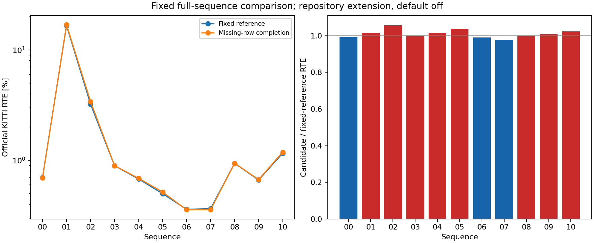

# InTEn-LOAM: fixed S2S missing-row support experiment

This study evaluates an actual opt-in matcher change on every complete KITTI
Odometry sequence, with one candidate configuration throughout. It follows the
[actual-correspondence diagnosis](../inten_plane_correspondences/README.md).
The extension stays **outside the paper and off by default**.

The geometric mean of candidate / reference official RTE is **1.010678x** across all full sequences.
Lower RTE: 00, 06, 07. Higher RTE: 01, 02, 03, 04, 05, 08, 09, 10.
The highway/corridor failure is not resolved. All adverse metrics and every
step remain in [the report](report/summary.json) and [comparison CSV](report/comparison.csv).
The extension is not adopted as a general accuracy fix or promoted per sequence.

Numerical sources were committed at `7a0005906938224c31cc4087dd6f194624943f14` before this prose.

| Sequence | Reference RTE [%] | Option RTE [%] | Reference ATE [m] | Option ATE [m] | Bad-length steps, reference / option |
|---|---:|---:|---:|---:|---:|
| 00 | 0.696720 | 0.691005 | 17.644136 | 17.589408 | 13 / 14 |
| 01 | 16.613803 | 16.877996 | 275.593270 | 280.153484 | 136 / 139 |
| 02 | 3.221230 | 3.405644 | 122.844508 | 129.507562 | 133 / 146 |
| 03 | 0.890601 | 0.891361 | 6.262153 | 6.255589 | 2 / 1 |
| 04 | 0.676097 | 0.685563 | 1.539561 | 1.557560 | 0 / 0 |
| 05 | 0.497289 | 0.515348 | 9.976094 | 9.878900 | 0 / 0 |
| 06 | 0.358642 | 0.355531 | 1.917879 | 1.928044 | 0 / 0 |
| 07 | 0.364131 | 0.355810 | 1.461444 | 1.428673 | 0 / 0 |
| 08 | 0.937938 | 0.939354 | 27.673206 | 28.737019 | 20 / 19 |
| 09 | 0.661434 | 0.667787 | 11.000039 | 11.454099 | 0 / 0 |
| 10 | 1.155652 | 1.183674 | 9.669713 | 9.507559 | 0 / 0 |

Bad-length labels inherit the local 20% threshold at GT motion at least 0.1 m.
They are distinct from official 100–800 m segment RTE.



All adverse comparisons (reference → option):

- 00: rotation [deg/100 m] 0.315468 → 0.316669; bad-length steps 13 → 14.
- 01: official RTE [%] 16.613803 → 16.877996; rotation [deg/100 m] 0.379025 → 0.380166; ATE [m] 275.593270 → 280.153484; bad-length steps 136 → 139; bad-vector steps 136 → 139.
- 02: official RTE [%] 3.221230 → 3.405644; rotation [deg/100 m] 1.003073 → 1.092187; ATE [m] 122.844508 → 129.507562; bad-length steps 133 → 146; bad-vector steps 139 → 151.
- 03: official RTE [%] 0.890601 → 0.891361; bad-vector steps 2 → 3.
- 04: official RTE [%] 0.676097 → 0.685563; ATE [m] 1.539561 → 1.557560.
- 05: official RTE [%] 0.497289 → 0.515348.
- 06: ATE [m] 1.917879 → 1.928044.
- 08: official RTE [%] 0.937938 → 0.939354; rotation [deg/100 m] 0.324577 → 0.326680; ATE [m] 27.673206 → 28.737019; bad-vector steps 99 → 100.
- 09: official RTE [%] 0.661434 → 0.667787; rotation [deg/100 m] 0.232926 → 0.255413; ATE [m] 11.000039 → 11.454099.
- 10: official RTE [%] 1.155652 → 1.183674; rotation [deg/100 m] 0.386538 → 0.388731.

## Natural observations at the known diagnostic entries

These are observations along each complete run, not GT-seeded or matched-seed
interventions. The row option changes the prior trajectory as well as the
current solve. Support counts alone cannot establish the cause of a change.

| Sequence / frame | Mode | S2S input length / GT | S2S output length / GT | Final length / GT | First ground pairs | First facade pairs |
|---|---|---:|---:|---:|---:|---:|
| 01 / 420 | baseline | 0.780476 | 0.349374 | 0.456349 | 86 | 374 |
| 01 / 420 | candidate | 0.594984 | 0.037003 | 0.212662 | 266 | 446 |
| 02 / 1876 | baseline | 0.924384 | 0.775259 | 0.933978 | 246 | 518 |
| 02 / 4460 | baseline | 0.939735 | 0.342471 | 0.359038 | 251 | 481 |
| 02 / 1876 | candidate | 0.856374 | 0.818596 | 0.982713 | 629 | 927 |
| 02 / 4460 | candidate | 0.966222 | 0.676970 | 0.919952 | 598 | 952 |

Every step, full error-growth blocks, all class support, stage stops and failure
intervals are retained in the report and per-sequence motion diagnostics.
Every fresh option-off reference official RTE exactly equals the existing
fixed paper-comparison aggregate for the same sequence.

## What changes

`InTenLoamPaperParams.s2s_row_support` / CLI
`--inten-loam-paper-set s2s_row_support=1` applies only to S2S ground/facade
plane support. The existing ten-neighbour query still chooses the closest point
and keeps any support it already found. If same-row or adjacent-row support is
missing, a read-only row index searches the same retained target features for
the nearest eligible point inside the unchanged float squared-distance gate.
Equal-distance additions choose the lowest original feature index. The normal
and triangle test, robust weighting, solver/update rules, iteration budgets,
S2M, mapping and feature extraction are unchanged. There is no PCA replacement,
new input feature, motion prior or GT feedback.

Rows are elevation bins inferred by the extractor, not measured ring IDs.
Completing a triangle does not establish that it represents the correct surface.
Some rows still have no eligible support, as the parent diagnosis established.

## Frozen protocol and selection

- [`protocol.json`](protocol.json) and all manifests were committed before
  acquisition at `49894124`. Native source is `20c09c46`; binary hashes,
  unchanged static libraries, compiler/link flags and build receipts are in
  [`binaries.json`](binaries.json) and [`checks/build/`](checks/build/).
- The numerical profile is the inherited 07-selected `paper_odometry_plane_check`
  setting: input maximum range 120 m, elevation correction 0.17 deg and S2M
  plane check 0.05 m. 00 informed earlier diagnosis. The new boolean was
  motivated by known 01/02 failures; the preceding diagnosis also inspected 10.
  This study makes no independent held-out claim. No new
  numerical threshold was selected. Full 07 ran first, then every remaining
  sequence without retuning, including after adverse results.
- Both arms use the same new native binary, the same existing acceleration,
  `OMP_NUM_THREADS=1`, `OPENBLAS_NUM_THREADS=1`, passive tracing and
  `--no-gt-seed`. Only `s2s_row_support=0/1` differs. No restart/window or forced
  diagnostic seed contributes to the full-sequence accuracy scores.
- [`collect.py`](collect.py) verifies effective parameters and loaders across
  all sequences. All inputs and GT hashes match the committed official-input
  audit. It fetches one sequence at a time with
  `evaluation/scripts/fetch_kitti_odometry_sequences.py`, archives and backs up
  results before deleting its scans, verifies hashes again before removal,
  and commits/backups cleanup before fetching the next sequence. Failed fetch
  attempts and their actual exits are retained. Native failures are not retried.
- Each `sequences/NN/{baseline,candidate}/native_command.json` records the actual
  Docker command, native argv/cwd, binary SHA, source, thread environment and
  exit. Whole-collector invocation/output/exit are in
  [`collection_execution/`](collection_execution/). The shared runtime snapshot
  [`runtime.json`](runtime.json) was captured during full 00; its timestamp is
  not presented as a per-run capture time.
- Paired native processes share the available CPUs. Full 07 reference shares
  CPUs with its parent control, while the 07 candidate runs alone. Raw native
  summaries retain all timings, but neither aggregate arm publishes standalone
  FPS/time or uses timing to rank a per-sequence winner.

## Compatibility and mechanism checks

The full fresh 07 option-off run is compared with the immutable parent runner:
accuracy/frame fields agree, saved pose/GT files are byte-identical, and the
entire passive trace body is byte-identical. On 01/02/10, all inherited natural-
seed fixed pairs are replayed with the fresh library's default-off,
unaccelerated path. Outputs, first class H/g and exact class counts are
compared with the parent. These pair controls establish compatibility, not
full-sequence accuracy or an alternative initialization result.

The native build runs mechanism tests for support beyond ten neighbours,
nearest eligible adjacent-row support while preserving existing choices, and
the unchanged distance gate / closest-point exclusion / index rebuild. Moving
trace-on/off pose and future-state parity runs with both row settings and both
acceleration settings. The CLI preflight also checks trace-on/off equality and
that the option is effective. Full native and ROS validation is required by CI.

## Evidence, derivation and import

Original summaries and poses are retained. Each sequence's `archive.json` maps
losslessly compressed logs and ordered trace shards to their original sizes
and SHA-256. A shard may split a JSON line; restore and concatenate in the
recorded order before parsing. Reuse `inten_natural_traces/diagnose.py::restore`.
The round trip is verified before deleting scans. Raw scans are not committed.

`report.py` restores the committed archives, checks complete unskipped traversal,
joins native traces with saved poses, verifies prediction flow, and checks that
feature counts and evaluated GT are identical between arms. It exports every
step, complete error-growth blocks, stage stops/support and all adverse metrics.
Its stage statistics condition on each run's realized trajectory and are not a
same-seed causal intervention. Local bad-length/vector labels inherit the
0.1 m / 20% definitions; they are distinct from official 100–800 m segment RTE.

The postprocessing sources and protocol are committed before execution. Results
are committed before numerical README prose. The complete command/exit records
are in `report_execution/`, `import_execution/`, `documentation_execution/`
and `checks/`. Equivalent postprocessing commands, from the repository root:

```bash
export OMP_NUM_THREADS=1 OPENBLAS_NUM_THREADS=1
python3 experiments/results/inten_row_support/report.py --output-dir experiments/results/inten_row_support/report
python3 experiments/results/inten_row_support/import_results.py
python3 experiments/results/inten_row_support/write_docs.py
python3 evaluation/scripts/refresh_study_docs.py
python3 evaluation/scripts/generate_full_variant_table.py
python3 evaluation/scripts/generate_paper_ratio_table.py
python3 experiments/results/inten_row_support/verify.py --output experiments/results/inten_row_support/checks/preservation.json
```

Use fresh output directories for report/import; do not overwrite committed raw
results. `import_results.py` preserves original native summary bytes, imports
all paired sequences, and reuses complete aggregates with the existing matrix
renderer. It deliberately leaves the experiment unscored, all candidates
experimental and all defaults unselected, rather than choosing a winner per
sequence. Timing fields are uniformly unavailable in both aggregate arms;
original timing and the reason remain adjacent in the metadata.

`verify.py` checks all earlier aggregate hashes and full-variant rows, older
scientific studies, frozen binaries/dependencies, publication files and source
pins; it also checks complete paired traversal, effective settings, native
receipts, archive hashes, compatibility controls and verified scan deletion.
The canonical paper baseline, Table 6, README leaderboard and paper metadata
retain their existing values. The full variant table adds the new experimental
pairs. This study does not close the paper gap or validate another sensor.
