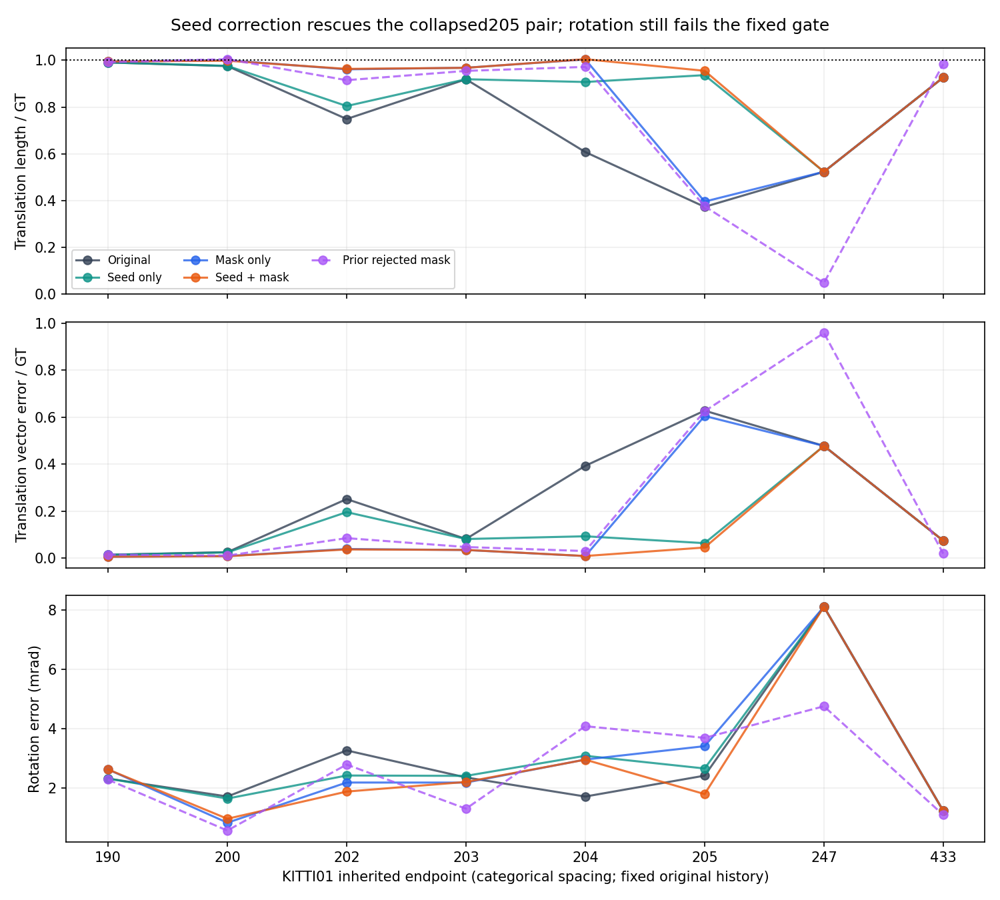
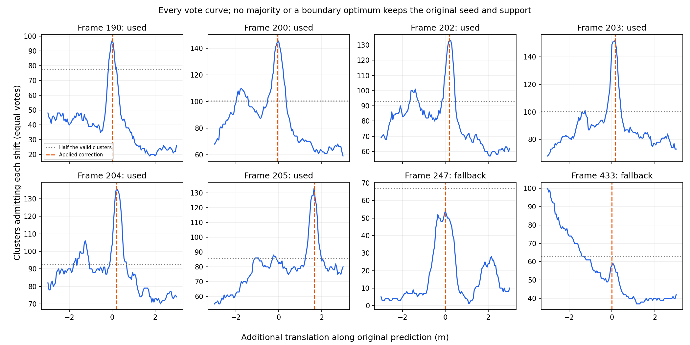

# InTEn-LOAM: shared-translation consensus factorial

Shared geometric correction can rescue the already collapsed205 terminal pair,
and the majority check avoids the preceding247 filtering regression. **The fixed
combined mechanism still fails its predeclared progression condition because204
rotation worsens. It does not advance to a production accuracy candidate.**
No threshold or acceptance condition is changed after these results.

This is a completed conditional S2S diagnosis at every inherited endpoint, not a
recursive01 trajectory, official RTE, paper ratio, or proof of moving/static truth.
Production source/API/defaults and every historical result remain unchanged.

Numerical snapshot `ca5bccf94960f2cdf2a1b24dd40139193b0aa5dd` precedes this interpretation. The full
[report](analysis/report.json), [frozen protocol](protocol.json), all vote curves,
native traces and actual first-query residuals retain every result.

## Frozen mechanism and controls

Reuse every preceding full-point cluster profile at its original natural estimated
seed. A cluster admits every shift whose trimmed squared NN cost is within0.1²m²
of its own minimum. That band uses the unchanged native Huber0.1m scale with a new
cost interpretation; it is not a paper rule. Give each cluster one vote at every
admissible shift. A plane with ambiguous translation can admit multiple shifts.
Choose maximum votes, breaking ties toward zero then negative motion. Require a
strict majority and an interior grid optimum. Otherwise keep the original seed
and all source facade support. Unavailable profiles are kept and do not vote.

For usable consensus, add the selected displacement along the archived original
seed translation direction, preserving rotation. Exclude source facade clusters
that do not admit that common shift. Grid(-3..3m,0.05m) and80percent point trimming
stay identical to the previous diagnostic. No hand region, GT, parameter sweep,
per-case winner or recomputation after the seed change is used.

All inherited endpoints190/200/202/203/204/205/247/433 and the complete2×2 are
retained: original, corrected seed only, consensus mask only, corrected seed with
mask. The fifth arm exactly repeats the preceding rejected mask as a negative
and producer-parity control. Only the combined arm was eligible for progression.

The original profile was selected on07, diagnosed on00, and inherits the prior
fraction0.03 chosen on DiLO01. Every prior KITTI observation is development;
there is no independent held-out claim. Both previous PCA extensions remain on;
Cauchy, predicted-DOR, row completion and map-plane spread remain off.

The seed is also the center of the native adaptive translation prior. Therefore
seed correction changes the prior center, first associations and potentially
every data class; it is not merely a different initialization. Masking changes
the data Hessian and adaptive-prior information. Other parameters stay fixed.

## Every outcome

### Translation length / GT

| Endpoint | Original | Seed only | Mask only | Seed + mask | Prior rejected mask |
|---:|---:|---:|---:|---:|---:|
| 190 | 0.990767 | 0.990767 | 0.994919 | 0.994919 | 0.991896 |
| 200 | 0.975241 | 0.976224 | 1.000597 | 0.998189 | 1.004744 |
| 202 | 0.748598 | 0.804125 | 0.961299 | 0.963182 | 0.914806 |
| 203 | 0.918730 | 0.918938 | 0.968091 | 0.967792 | 0.954679 |
| 204 | 0.607064 | 0.907108 | 1.003770 | 1.004613 | 0.971692 |
| 205 | 0.372446 | 0.936491 | 0.394997 | 0.955054 | 0.375024 |
| 247 | 0.522727 | 0.522727 | 0.522727 | 0.522727 | 0.046618 |
| 433 | 0.926498 | 0.926498 | 0.926498 | 0.926498 | 0.983740 |

### Translation vector error / GT

| Endpoint | Original | Seed only | Mask only | Seed + mask | Prior rejected mask |
|---:|---:|---:|---:|---:|---:|
| 190 | 0.014508 | 0.014508 | 0.006148 | 0.006148 | 0.015141 |
| 200 | 0.025618 | 0.024571 | 0.009101 | 0.008479 | 0.010923 |
| 202 | 0.251434 | 0.195906 | 0.039079 | 0.037221 | 0.085286 |
| 203 | 0.081779 | 0.081542 | 0.034858 | 0.035110 | 0.047482 |
| 204 | 0.392957 | 0.093144 | 0.009031 | 0.009234 | 0.030332 |
| 205 | 0.627582 | 0.063952 | 0.605012 | 0.045419 | 0.625054 |
| 247 | 0.477580 | 0.477580 | 0.477580 | 0.477580 | 0.957949 |
| 433 | 0.074390 | 0.074390 | 0.074390 | 0.074390 | 0.019433 |

### Rotation error (mrad)

| Endpoint | Original | Seed only | Mask only | Seed + mask | Prior rejected mask |
|---:|---:|---:|---:|---:|---:|
| 190 | 2.320873 | 2.320873 | 2.629751 | 2.629751 | 2.285065 |
| 200 | 1.717553 | 1.647800 | 0.833664 | 0.966837 | 0.569798 |
| 202 | 3.270653 | 2.424751 | 2.188376 | 1.882814 | 2.794870 |
| 203 | 2.359487 | 2.412608 | 2.186429 | 2.208206 | 1.305914 |
| 204 | 1.716533 | 3.090307 | 2.963199 | 2.958909 | 4.087598 |
| 205 | 2.419936 | 2.661693 | 3.414474 | 1.798922 | 3.694301 |
| 247 | 8.113092 | 8.113092 | 8.113092 | 8.113092 | 4.759058 |
| 433 | 1.232359 | 1.232359 | 1.232359 | 1.232359 | 1.096354 |

At205, original length/GT0.372446 becomes0.936491 with seed correction alone,
0.394997 with support removal alone, and0.955054 with both. Combined vector error
falls0.627582→0.045419 and rotation2.419936→1.798922mrad. Under this original
history, the seed/prior-center intervention is the larger conditional rescue.
This does not certify a physical object label or a recovered recursive trajectory.

At204, original length/GT0.607064 becomes0.907108 with seed only,1.003770 with
mask only, and1.004613 with both. Combined vector error falls0.392957→0.009234,
but rotation worsens1.716533→2.958909mrad. At190 combined rotation also worsens,
2.320873→2.629751mrad. Every adverse arm/metric is retained above.

At247 only54 of134 valid clusters admit the most-supported shift, so no strict
majority is found. The new arms preserve the original0.522727 length/GT instead
of the preceding rejected mask's0.046618. This avoids additional harm but does
not repair the original failure. At433 the vote optimum lies on the search
boundary; fallback similarly retains the original result and forfeits the
preceding mask's local improvement.

Combined length and vector errors are lower at6 endpoints and equal at2, with
no higher values; combined rotation is lower at4, higher at2 and equal at2.
These selected development endpoint counts are not a sequence accuracy score.



### Every consensus decision

| Endpoint | Applied shift (m) | Peak support / valid clusters | Excluded clusters | Used / fallback |
|---:|---:|---:|---:|---|
| 190 | 0.00 | 97/155 | 58 | Used |
| 200 | -0.05 | 146/201 | 55 | Used |
| 202 | 0.20 | 133/186 | 53 | Used |
| 203 | 0.15 | 152/201 | 49 | Used |
| 204 | 0.20 | 136/185 | 49 | Used |
| 205 | 1.65 | 133/171 | 38 | Used |
| 247 | 0.00 | 54/134 | 0 | Fallback |
| 433 | 0.00 | 100/126 | 0 | Fallback |



## Predeclared progression condition and limits

Before output, the protocol required: lower204 length and vector errors, no
higher204 rotation, no higher205/247 length or vector errors, and no new20percent
bad-length label among these endpoints. The204 rotation condition fails. Retain
that negative result rather than relaxing the condition to promote a favorable
translation outcome. No full-sequence candidate or default is introduced here.

Cluster majority is not object majority or static truth. Fragmentation, repeated
geometry, one-way trimming, occlusion, point sampling and aperture can bias votes;
independent motions may dominate. The original prediction determines the search
direction/range, and these cached profiles do not change after correction. Only
one translation direction is corrected. These controls establish conditional
mechanism effects; they cannot establish full01 recovery or explain10 drift.

The next mechanism must retain the demonstrated seed-rescue effect while addressing
the rotation/support tradeoff. A future setting must be frozen opt-in/default-off,
evaluated with one configuration on every full00–10 sequence, and retain all
regressions before any official RTE or paper-ratio claim.

## Numerical integrity and reproduction

All40 terminal registrations finish with native exit0. Every original and prior
rejected-mask output, first H/g/count and full solver iteration/state matches the
corresponding committed preceding arm exactly. Within each fixed seed, masked
non-facade first systems remain exact and facade queries are ordered subsets.
Every actually accepted first-query residual in every arm is retained; independent
reconstruction gives maximum relative H error1.558953e-16 and g error0. The first
joint Hessian including the adaptive prior is reconstructed; maximum relative
error1.629545e-15. Every finite damped update passes backward-error checks,
maximum5.343795e-17. Forced returned counts are independently checked as first
class-count sums. Majority/boundary/empty/tie/ambiguous-profile mechanism tests
and the independent equation analysis retain actual zero exits.

Use an isolated producer checkout `99062a08` with the compiler, pinned libraries
and existing development container specified in [controls](controls/), then run:

```bash
PYTHONDONTWRITEBYTECODE=1 /workspace/localization-env/host-venv/bin/python experiments/results/inten_translation_consensus/execute.py
```

The command restores losslessly verified committed extracted frames and profiles;
it fetches no raw scans and reads no GT in consensus or native input. GT is read
only by offline error analysis. Feature serialization exactly matches the prior
producer. Source commits, cwd/environment, compiler/link commands, binary/object/
static-library hashes, linked-library metadata, input hashes, stdin, full traces,
actual query logs and actual exits are retained with byte-roundtrip archives.
The isolated diagnostic source is an exact declared transformation of the archived
native source; no production source is modified. Portable evidence checks use
that snapshot, while full local checks also verify live production pins and the
entire historical diff.

Fresh native checks, Python discovery and publication/preservation checks are
recorded at `completion/`. The roadmap's study/variant/paper-ratio generators are
rerun, restoring only proved generation-clock differences. No historical result,
primary Table6, root README/index or paper-number JSON is promoted by this trial.
