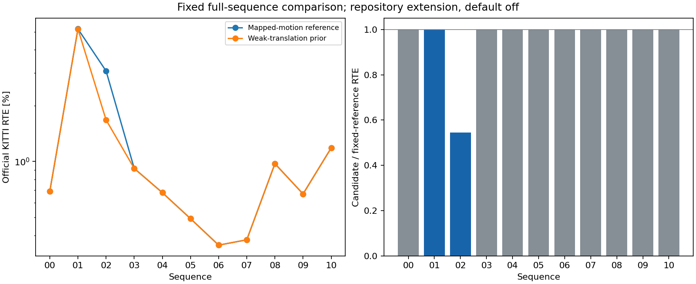

# Weak-translation prediction prior: full KITTI comparison

This repository extension is outside the paper and default off:
`--inten-loam-paper-set s2s_translation_prior_ratio=0.03`.
The default is zero, preserving the original execution path. This experiment
compares ratio zero with the one fixed ratio declared in the protocol.
Both arms enable the preceding recursive rigid mapped-motion seed and the
same acceleration. Failed row-support completion remains off.

The prior raises only weak sensor-centered marginal translation information
to a fraction of its strongest eigenvalue. Its anchor is the initial S2S
prediction, not ground truth; its information stays fixed throughout that
solve. It can preserve a biased prediction and oppose actual acceleration.
It changes no association, iteration budget or S2M term. See the source and
protocol for the position Jacobian and rotation marginalization convention.
Total passive H/g and residual cost include the prior. Feature counts and
forced class equations still report data terms only. Nonzero prior information
is retained in the optional solver field; disabled/default trace bytes match
the parent format.

The original numerical profile was selected on KITTI07 with00 influencing
earlier diagnosis. The dimensionless fraction0.03 is borrowed from the
[existing DiLO KITTI01-tuned control](../../../papers/dilo/README.md). Here it
sets a soft information floor after rotation marginalization, rather than
DiLO's hard remapping of the raw translation block. It was fixed before all
new InTEn accuracy runs and not retuned on a new sequence score. All inherited
GT-seeded01/02/10 systems
were inspected; known failures and prior full results are development data,
not independent held-out evaluation. Full07 runs first, then all00-10 without
retuning, including negative outcomes. Both arms use continuous natural
prediction, passive traces and `--no-gt-seed`.

Geometric mean of option / reference official RTE: **0.946172x** across all sequences.
Lower RTE: 01, 02. Higher RTE: none. Unchanged RTE: 00, 03, 04, 05, 06, 07, 08, 09, 10.
This is a fixed experimental comparison; no per-sequence default is adopted.
Bad-length labels use the inherited local 20% threshold for GT motion at least 0.1 m,
separate from official KITTI 100–800 m RTE. Raw paired timing is not an FPS benchmark.

Numerical sources committed before prose: `16577120f8e0b525446692d51ac26ea3367fb501`.

| Sequence | Reference RTE [%] | Option RTE [%] | Reference ATE [m] | Option ATE [m] | Bad-length steps, reference / option |
|---|---:|---:|---:|---:|---:|
| 00 | 0.691786 | 0.691786 | 17.064446 | 17.064446 | 12 / 12 |
| 01 | 5.180428 | 5.173517 | 100.875751 | 100.493982 | 50 / 50 |
| 02 | 3.073932 | 1.674736 | 119.531515 | 48.906265 | 128 / 66 |
| 03 | 0.917374 | 0.917374 | 6.449763 | 6.449763 | 2 / 2 |
| 04 | 0.678960 | 0.678960 | 1.543638 | 1.543638 | 0 / 0 |
| 05 | 0.491912 | 0.491912 | 9.886842 | 9.886842 | 0 / 0 |
| 06 | 0.354019 | 0.354019 | 1.924468 | 1.924468 | 0 / 0 |
| 07 | 0.378295 | 0.378295 | 1.660935 | 1.660935 | 0 / 0 |
| 08 | 0.973072 | 0.973072 | 28.286838 | 28.286838 | 19 / 19 |
| 09 | 0.668254 | 0.668254 | 11.133601 | 11.133601 | 0 / 0 |
| 10 | 1.183142 | 1.183142 | 9.901906 | 9.901906 | 0 / 0 |

Every adverse comparison (reference → option):

- 01: rotation [deg/100 m] 0.281769 → 0.288675.

New local bad labels in the candidate relative to the reference (all frames):

| Sequence | Newly bad length steps | Reference-only bad length steps | Newly bad vector steps | Reference-only bad vector steps |
|---|---:|---:|---:|---:|
| 00 | 0 | 0 | 0 | 0 |
| 01 | 0 | 0 | 0 | 0 |
| 02 | 1 | 63 | 2 | 63 |
| 03 | 0 | 0 | 0 | 0 |
| 04 | 0 | 0 | 0 | 0 |
| 05 | 0 | 0 | 0 | 0 |
| 06 | 0 | 0 | 0 | 0 |
| 07 | 0 | 0 | 0 | 0 |
| 08 | 0 | 0 | 0 | 0 |
| 09 | 0 | 0 | 0 | 0 |
| 10 | 0 | 0 | 0 | 0 |

Each pair uses the same input frame and GT labels but different realized
trajectories. These are outcome differences, not matched-seed interventions.
Every affected frame index is retained in the numerical report.

Failure-sequence observations along each realized trajectory:

- 01: final bad-length frames 204–253 → 204–253; S2S bad-length outputs 51 → 51; final rejected S2M 0 → 0.
- 02: final bad-length frames 1787, 1883–1942, 3308, 4460–4525 → 1787, 3308, 4463–4526; S2S bad-length outputs 131 → 68; final rejected S2M 0 → 0.
- 10: final bad-length frames none → none; S2S bad-length outputs 0 → 0; final rejected S2M 0 → 0.

Candidate sequences exceeding twice the cited paper RTE:

| Sequence | Option RTE [%] | Paper RTE [%] | Option / paper | Largest position-error growth block | Position error start → end [m] | Local block error [%] |
|---|---:|---:|---:|---|---:|---:|
| 01 | 5.173517 | 0.640000 | 8.083620 | 200–300 | 2.277764 → 100.942226 | 37.317870 |
| 01 | 5.173517 | 0.640000 | 8.083620 | 600–700 | 111.197578 → 116.048415 | 0.682695 |
| 01 | 5.173517 | 0.640000 | 8.083620 | 500–600 | 106.987368 → 111.197578 | 1.194564 |
| 02 | 1.674736 | 0.540000 | 3.101363 | 4500–4600 | 97.187460 → 151.135803 | 29.264134 |
| 02 | 1.674736 | 0.540000 | 3.101363 | 4400–4500 | 44.569258 → 97.187460 | 35.612773 |
| 02 | 1.674736 | 0.540000 | 3.101363 | 4600–4660 | 151.135803 → 183.965499 | 0.984333 |
| 10 | 1.183142 | 0.450000 | 2.629204 | 700–800 | 9.445875 → 14.984990 | 0.947132 |
| 10 | 1.183142 | 0.450000 | 2.629204 | 600–700 | 6.908792 → 9.445875 | 1.995964 |
| 10 | 1.183142 | 0.450000 | 2.629204 | 800–900 | 14.984990 → 17.466513 | 0.485612 |

These fixed-size motion blocks locate error growth; their relative errors are
not official distance-segment RTE and do not establish the solver-level cause.
Paper values are cited context; this extension is not the paper algorithm.

These are natural full-run observations, not matched-seed causal interventions.
The complete report retains every step and all motion-error blocks. The option
remains outside the paper and default off; earlier results are preserved.

## Known diagnostic entries along natural runs

| Sequence / frame | Mode | Input length / GT | S2S length / GT | Final length / GT | First ground pairs | First facade pairs |
|---|---|---:|---:|---:|---:|---:|
| 01 / 420 | baseline | 1.019718 | 0.714400 | 0.995517 | 66 | 361 |
| 01 / 420 | candidate | 1.019718 | 0.714400 | 0.995517 | 66 | 361 |
| 02 / 1876 | baseline | 0.993027 | 0.790239 | 0.936190 | 243 | 559 |
| 02 / 4460 | baseline | 1.034424 | 0.461825 | 0.660376 | 255 | 463 |
| 02 / 1876 | candidate | 0.964708 | 0.861693 | 0.952853 | 253 | 556 |
| 02 / 4460 | candidate | 1.018508 | 0.889568 | 0.965580 | 256 | 470 |

## Inherited first-system control before new accuracy runs

All inherited GT-seeded first systems are development controls, not trajectories.
The same fixed ratio reduces the absolute first-forward correction in
01: 4 of 155 moving pairs, 02: 110 of 192 moving pairs, 10: 0 of 12 moving pairs.
Every unchanged/adverse case and its eigenvalues are retained in information.json.
These controls alone do not establish recovery by iterative registration.

The inherited oracle entry controls use exactly the same first data system:

| Oracle case | Smallest / largest translation information | Weak dimensions | Forward in weak subspace | First forward correction [%] | With soft prior [%] |
|---|---:|---:|---:|---:|---:|
| 01 / 420 | 0.096707 | 0 | 0.000000 | -3.947608 | -3.947608 |
| 02 / 1876 | 0.027552 | 1 | 0.999555 | -5.426342 | -4.987502 |
| 02 / 4460 | 0.022271 | 1 | 0.999605 | -4.777499 | -3.551866 |

01 / 420 is an inherited case from the earlier reference, not the remaining
collapse interval of the current mapped reference (shown above). At this
selected control the criterion supplies no extra information. The
02 controls retain a backward correction even with the soft prior; these
controls neither establish a normal-bias remedy nor predict the full-run outcome.

## Active prior and native solve checks

| Sequence | Frames with active prior | Recorded S2S systems checked | Maximum prior-information reconstruction error | Maximum relative damped-system residual |
|---|---:|---:|---:|---:|
| 00 | 0 | 43430 | 0 | 1.46474e-16 |
| 01 | 6 | 9784 | 6.32827e-15 | 8.4115e-17 |
| 02 | 124 | 44661 | 1.95399e-14 | 1.34228e-16 |
| 03 | 0 | 7595 | 0 | 9.12525e-17 |
| 04 | 0 | 2563 | 0 | 7.74159e-17 |
| 05 | 0 | 26519 | 0 | 1.39067e-16 |
| 06 | 0 | 10964 | 0 | 1.39468e-16 |
| 07 | 0 | 10531 | 0 | 1.10869e-16 |
| 08 | 0 | 38843 | 0 | 1.26409e-16 |
| 09 | 0 | 15143 | 0 | 1.38953e-16 |
| 10 | 0 | 11181 | 0 | 1.57129e-16 |

The stored information is independently reconstructed from the first
data Hessian after subtracting the recorded prior. Every recorded finite
update is checked against its total damped H/g using relative backward error.
Independent LAPACK/Eigen step differences are retained without treating
poorly conditioned world-coordinate forward errors as implementation drift.
This checks the declared
implementation, not the correctness of its correspondences.

The candidate changes the preceding trajectory as well as the current seed.
Support counts alone do not establish the cause of a change.



Every fresh ratio-zero reference exactly reproduces the preceding mapped-prior candidate RTE.

## Commands and evidence

- [Protocol](protocol.json) includes hashed manifests, fixed settings and limits.
- [Inherited information inspection](information_command.json), all cases in
  [information.json](information.json), source in inspect_information.py.
- [Fresh native build and tests](checks/build/), [binary pins](binaries.json),
  [runtime capture command](runtime_command.json), [CLI trace parity](checks/cli_preflight/).
  The first test attempt is retained in checks/initial_build: class-wise sums
  differed from serial totals at double-precision roundoff, and the test now
  compares a relative tolerance. Native behavior was not changed for this test.
- [Collection invocation](collection_execution/command.json) and every native
  receipt retain argv, working directory, source, thread settings and exits.
  The official fetch script acquires only one sequence at a time. Inputs are
  hashed against the earlier official audit; complete lossless evidence is
  round-trip checked, committed and normally pushed before scan deletion.
  Cleanup is committed and pushed before acquiring the next sequence.
- Full07 ratio-zero control exactly matches the immutable PR156 enabled runner.
  Inherited natural-seed controls check the original default-off pair behavior.
- [Postprocessing protocol](postprocessing_protocol.json),
  [report command](report_execution/command.json), [import command](import_execution/command.json),
  [document generation](docs_execution/), [final checks](checks/final/).
  Sources are committed before execution, and numerical evidence before prose.
- Old aggregates, published paper comparisons and prior studies remain intact.
  Neither arm is adopted per sequence. Both remain unscored and non-default;
  native timing is retained but paired processes are not a standalone FPS test.

```bash
OMP_NUM_THREADS=1 OPENBLAS_NUM_THREADS=1 PYTHONDONTWRITEBYTECODE=1 \
  /workspace/localization-env/host-venv/bin/python experiments/results/inten_translation_prior/build.py
OMP_NUM_THREADS=1 OPENBLAS_NUM_THREADS=1 PYTHONDONTWRITEBYTECODE=1 \
  /workspace/localization-env/host-venv/bin/python experiments/results/inten_translation_prior/collect.py
OMP_NUM_THREADS=1 OPENBLAS_NUM_THREADS=1 PYTHONDONTWRITEBYTECODE=1 \
  /workspace/localization-env/host-venv/bin/python experiments/results/inten_translation_prior/report.py \
  --output-dir experiments/results/inten_translation_prior/report
OMP_NUM_THREADS=1 OPENBLAS_NUM_THREADS=1 PYTHONDONTWRITEBYTECODE=1 \
  /workspace/localization-env/host-venv/bin/python experiments/results/inten_translation_prior/import_results.py
OMP_NUM_THREADS=1 OPENBLAS_NUM_THREADS=1 PYTHONDONTWRITEBYTECODE=1 \
  /workspace/localization-env/host-venv/bin/python experiments/results/inten_translation_prior/write_docs.py
```

Build and collection require fresh isolated paths. Do not rerun into frozen
evidence. Every command retains its actual exit; failures are never read as
passes through a shell pipeline. Local checks precede full native/ROS PR CI.
