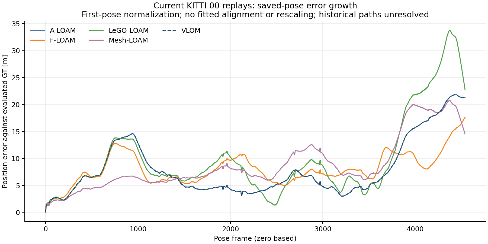

# KITTI 00: current replay error growth

Diagnostics were committed at `61c1f26e1019aa3f0b05b100404c8bb117448b41` before these numeric notes. Inputs are the completed candidate replay poses at `e527c8340158a643be9faf3a7b165cb2f94cb705`; native source is `0b079dbbcb7c6f58c1d8367ade881c15f003e525`. No estimator is rerun and no setting is selected.

The five cells below differ from historical stored metrics. This report locates error growth in their **current replay trajectories**. The referenced historical per-run summaries are absent at the inspected revision and were not found in this checkout's reachable history. The search is limited to this checkout and revision; no paired old-path comparison can be made from these artifacts. Their historical causes remain unresolved.

The existing `diagnose_kitti_steps.py` definitions are used unchanged for every method: 100-frame blocks (including the final shorter block), moving GT steps at least 0.1 m, and a 20% length/vector error threshold. The displayed block maximizes position-error end minus start over all blocks. It is a diagnostic choice, not parameter tuning or official KITTI RTE. The tool normalizes the first pose without fitting or rescaling.

| Method | Length-error steps >20% | Vector-error steps >20% | Moving steps | Largest-growth pose interval | GT travel [m] | Position error start [m] | End [m] | Increase [m] |
|---|---:|---:|---:|---|---:|---:|---:|---:|
| A-LOAM | 13 | 42 | 4514 | 600–700 | 98.739614 | 7.208486 | 11.810234 | 4.601748 |
| F-LOAM | 12 | 42 | 4514 | 600–700 | 98.739614 | 6.940767 | 11.452315 | 4.511548 |
| LeGO-LOAM | 12 | 41 | 4514 | 3800–3900 | 105.799422 | 12.616529 | 19.496309 | 6.879780 |
| Mesh-LOAM | 14 | 43 | 4514 | 3800–3900 | 105.799422 | 13.138734 | 18.361150 | 5.222416 |
| VLOM | 13 | 42 | 4514 | 600–700 | 98.739614 | 7.208486 | 11.810234 | 4.601748 |

[Numeric per-frame trace](trace.csv), [SVG](trace.svg), [all blocks, source hashes, legacy-path probes and definitions](summary.json). A-LOAM and VLOM curves overlap; the input manifests record identical saved-estimate hashes for these two current runs.

Each method folder retains the exact `diagnose_kitti_steps.py --estimate ... --gt ... --summary ... --method ... --output ...` command, actual exit, full block diagnostics and saved-pose metric checks. Recomputed ATE, 100 m RPE and official translation/rotation RTE agree with their committed summaries within the recorded absolute tolerance. These checks do not replace the original historical audit exit 1 or establish full-study completion.

Run `diagnose_current00.py --output-dir <fresh directory>` using the recorded command in `../../checks/diagnose00/diagnose00_command.json`. The SVG line-end padding initially fails the branch whitespace check with exit 2; original output and SVG are preserved as gzip archives in `../../checks/diagnose00/`. The recorded `normalize_svg.py` command removes only line-end padding, preserves every non-whitespace token and parses both XML forms; the corrected check exits 0. No new whitespace exception is added.

Frozen-control completion and input cleanup are tracked separately in the [study README](../../README.md). These current-path diagnostics do not establish completion of those gates or fresh NCLT validation.
