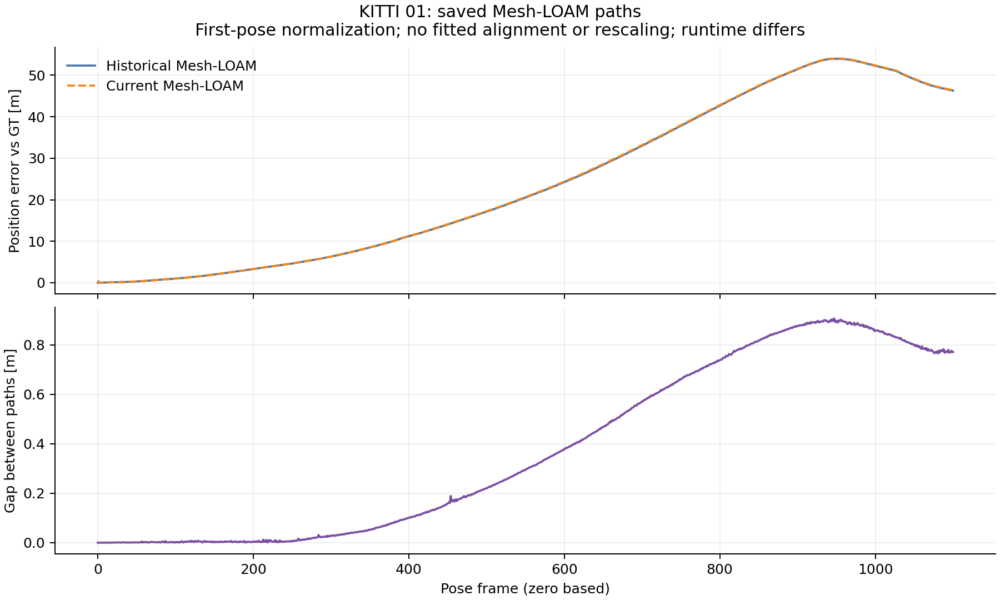

# KITTI 01: saved paths and historical differences

These offline diagnostics read the committed candidate results and available
historical poses. They do not run an estimator, select a setting, establish
an extraction effect or replace a published result. The historical audit retains
its exit 1; full frozen comparison and scan cleanup are tracked in the
[current study](../../README.md).

## Current error growth

The [protocol](../01_protocol.json) inherits the existing 100-step blocks,
0.1 m moving-step threshold and 20% step-error threshold. The displayed block
maximizes position-error end minus start; all blocks remain in the step JSONs.
Estimates and GT are normalized at their first pose, without fitted alignment
or rescaling. These endpoint diagnostics are not official KITTI RTE.

| Method | Current error-growth block | Error at block start [m] | Error at block end [m] | Historical path paired? |
|---|---|---:|---:|---|
| CT-ICP | 700-800 | 61.594297 | 81.754537 | no |
| Mesh-LOAM | 700-800 | 33.154975 | 42.799191 | yes |

CT-ICP's referenced historical per-run summary is absent in the inspected
revision and was not found by the recorded reachable-history query. Its current
error growth cannot locate a difference from that unavailable historical path.
This is a statement about this checkout, not global absence.

## Paired Mesh-LOAM paths

Historical/current evaluated GT files are byte-identical. Their path gap is
the Euclidean position difference after the same first-pose normalization.
It reaches **0.906842 m** at frame **947**,
ending at **0.770865 m**. The largest gap increase among
the fixed blocks is **600-700**:
**0.378576 to 0.569314 m**
(increase **0.190738 m**).



[Full Mesh trace CSV](mesh_loam/trace.csv), [historical steps](mesh_loam/historical_steps.json),
[current steps](mesh_loam/current_steps.json), [CT current trace](ct_icp/trace.csv)
and [complete summary](summary.json) retain all frames and blocks.

The source/header match the original recorded source
`d1b7288ff46964bde86ef15ab34b2ae8b4f389da`. Original/current recorded OpenMP
thread counts are 2 / 1 (OpenBLAS remains 1). This runtime difference is a
confounding factor, not a demonstrated cause. No controlled rerun with changed
thread count is performed, and the compiled binaries/loaders are not claimed
to be identical to the original execution. Frozen pre-extraction controls
are separate comparisons with matched current runtime settings.

## Commands and evidence

```bash
python3 experiments/results/shared_near_range/diagnose_saved01.py --output-dir <fresh-directory>
```

The actual command, analysis/input/source commits, executable and file hashes,
legacy availability probes, paired blocks and saved-pose metric checks are in
[summary.json](summary.json) and [analysis_command.json](analysis_command.json).
The exact analysis output is losslessly retained in [analysis.log.gz](analysis.log.gz).
All current/historical metric checks pass the recorded 0.001 absolute tolerance.
Raw diagnostic evidence was committed at `1426a851c9f021cbffae239e814b6379a5788b25` before this
numeric prose; source and protocol were committed before execution.
