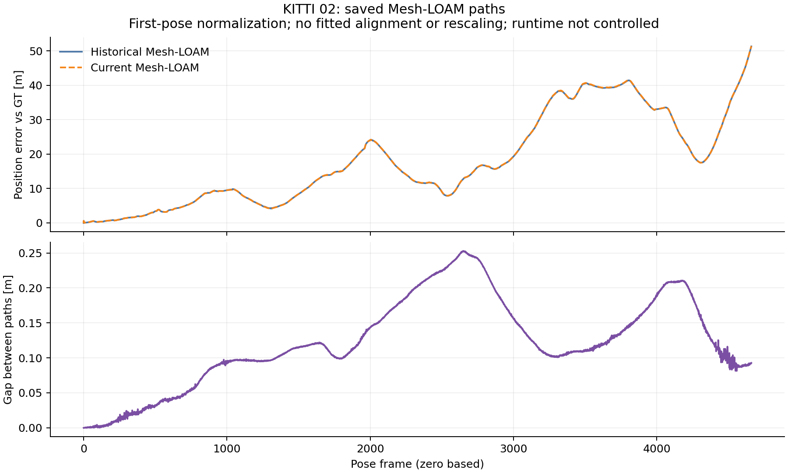

# KITTI02: committed saved-path diagnosis

Source/protocol precede execution. Numerical evidence was committed at `8f5841e3946995cedfa9c0e2fc484dbd2c02373e`
before this prose. Candidate/frozen reports, actual native receipts, matching
paths and hash-verified cleanup are committed. Owned scans and alias are absent;
the historical audit retains exit **1**.

## Current error growth

The [inherited protocol](../02_protocol.json) fixes 100-step blocks, a 0.1 m
moving-step threshold and 20% relative-step threshold. The displayed block
maximizes position-error end minus start; every block and frame is retained.
First-pose normalization uses no fitting or rescaling. These endpoint errors are
distinct from official KITTI RTE.

| Method | Current error-growth block | Error at start [m] | Error at end [m] | Historical path paired? |
|---|---|---:|---:|---|
| A-LOAM | 0-100 | 0.000000 | 19.558007 | no |
| CT-ICP | 4400-4500 | 19.888348 | 30.148291 | no |
| F-LOAM | 3000-3100 | 36.432333 | 53.883664 | no |
| LeGO-LOAM | 4400-4500 | 40.384993 | 60.227505 | no |
| Mesh-LOAM | 4400-4500 | 22.548455 | 33.673883 | yes |

The A-LOAM, CT-ICP, F-LOAM and LeGO-LOAM referenced historical per-run paths are
unavailable in the inspected tree/reachable-history probes. Current error growth
cannot locate where those unavailable paths differ. This describes the checkout,
rather than global absence.

## Paired Mesh-LOAM paths

Evaluated GT bytes match. The Euclidean path gap reaches **0.252810 m**
at frame **2649** and ends at **0.092806 m**.
Its largest fixed-block increase is frames **1900-2000**,
from **0.116048 to 0.143659 m**
(increase **0.027611 m**).



The method source/header match the recorded original source. Original/current
OpenMP counts are **2 / 1**, with OpenBLAS **1**. This is a runtime confound, not
a controlled thread-count experiment or a cause attribution. The separate,
matched-runtime frozen pre-extraction controls reproduce the current paths exactly.

## Commands and retained checks

```bash
python3 experiments/results/shared_near_range/diagnose_saved02.py --output-dir <fresh-directory>
```

[Summary and input/source hashes](summary.json), [actual command/exit](analysis_command.json),
[full lossless output](analysis.log.gz), step JSONs and trace CSVs retain all
blocks/frames. Saved-pose metrics match summaries within the inherited **0.001**
absolute tolerance.

The initial diagnosis rejected the real checkpoint with exit **2**: it confused
the audit-wrapper hash with the native executable hash. The [failure and gate
regressions](../../checks/diagnose02_wrapper_fix/) precede correction `869dd694`.
The reports now pin the committed wrapper; each native receipt independently pins
the candidate/frozen executable. The successful analysis exits **0**.
Registration settings, saved results and diagnostic definitions are unchanged.
