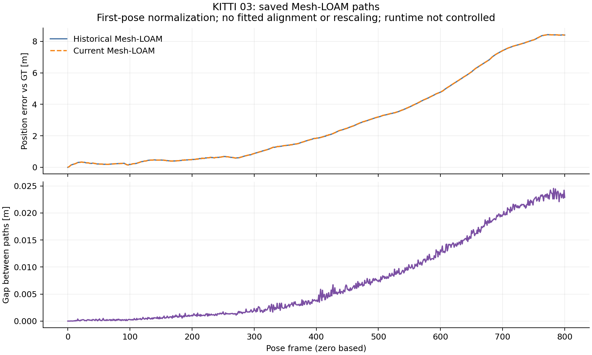

# KITTI03: saved Mesh-LOAM replay difference

Numerical evidence was committed at `bfad039e961ead539c590b07f918169bf1450afc` before this report.
Analysis source `ef820fbdb7164cb5ed0d314e7f317ffe9089cb70` and the
[protocol](../03_protocol.json) precede execution. Candidate and frozen-control
reports, native receipts, matching saved paths and hash-verified input cleanup
are committed. The historical audit retains exit **1**; its frozen comparison
and this offline diagnosis return **0**.

## Where the saved paths differ

The historical and replayed paths use byte-identical evaluated GT. After
first-pose normalization, their Euclidean position gap reaches **0.024541 m**
at frame **782**, and ends at **0.022879 m**.
The first differing saved text row is **1**.
Frame indices are zero based; no fitted alignment or rescaling is applied.

The diagnostic parameters transfer unchanged from 02/01: fixed **100**-step blocks,
a **0.1 m** moving-step threshold and **20%** relative-step threshold.
The largest block increase in the gap is **600-700**:
**0.013161 to 0.019651 m**
(increase **0.006490 m**). Every block and frame is retained.

| Block | Gap at start [m] | Gap at end [m] | Increase [m] |
|---|---:|---:|---:|
| 0-100 | 0.000000 | 0.000289 | 0.000289 |
| 100-200 | 0.000289 | 0.001108 | 0.000819 |
| 200-300 | 0.001108 | 0.002344 | 0.001235 |
| 300-400 | 0.002344 | 0.003725 | 0.001381 |
| 400-500 | 0.003725 | 0.007296 | 0.003571 |
| 500-600 | 0.007296 | 0.013161 | 0.005865 |
| 600-700 | 0.013161 | 0.019651 | 0.006490 |
| 700-800 | 0.019651 | 0.022879 | 0.003228 |



Current position error against GT also grows most in block
**600-700**, from **4.782073 to 7.415219 m**.
That endpoint error and the gap between estimates measure different quantities;
neither replaces official KITTI RTE. Saved-pose metrics reproduce both summaries
within the inherited **0.001** absolute tolerance.

## Provenance and limits

The selected historical 03 variant `paper_odometry_elevation` and its registration
arguments are unchanged. The original replay uses frozen native source
`0b079dbbcb7c6f58c1d8367ade881c15f003e525`. The frozen pre-extraction control
has identical saved poses and recorded metrics, so the historical difference
predates extraction. This diagnosis reads committed artifacts only; the active 05
scans, executables and controller are untouched. The whole replay retains each
historical cell's original arguments and its existing incomplete coverage.

The recorded original Mesh source/header match the replay's. Original/replay
OpenMP counts are **2 / 1**, with OpenBLAS **1**. Runtime differs; this pair does
not establish a thread-count cause. The matched-runtime frozen control remains
the separate check of the extraction. Current-main acceleration and passive
tracing are outside this frozen replay's validation scope.

## Commands and retained checks

```bash
python3 experiments/results/shared_near_range/diagnose_saved02.py \
  --sequence 03 --output-dir /absolute/path/to/fresh-saved03
```

The existing analyzer defaults to 02 and now accepts the explicitly closed 03
cohort. Recorded absolute execution paths resolve to committed repository-relative
artifacts in a separate worktree. [Actual command and exit](analysis_command.json),
[input/source hashes and all blocks](summary.json), [step details](mesh_loam/),
[full lossless output](analysis.log.gz) and [import hashes](import.json) preserve
the execution. The publication gates reject uncommitted inputs, a mismatched
sequence/cohort, different native/wrapper pins, failed comparisons and incomplete
cleanup before accepting the diagnosis.

[Source checks](../../checks/saved03/source/) retain the initial resolver-name
collision and its failing test output. The corrected **12** gate tests pass in
normal and optimized Python, including relocated 03 artifacts and rejection of
active 05. Existing 02 gate cases and recorded numerical results are preserved.

[Local regeneration, regression and publication checks](../../checks/saved03/docs/commands.json)
retain their actual exits. [Preservation](../../checks/saved03/docs/preservation.json)
checks historical aggregates, published tables, original diagnostic inputs, the
Mesh core Git blobs and the sealed completion renderer. The separate worktree
has no evaluator build, so native evaluation-guard skips remain visible in the
unit-test transcript; full native/Python and ROS checks run in final-head CI.
