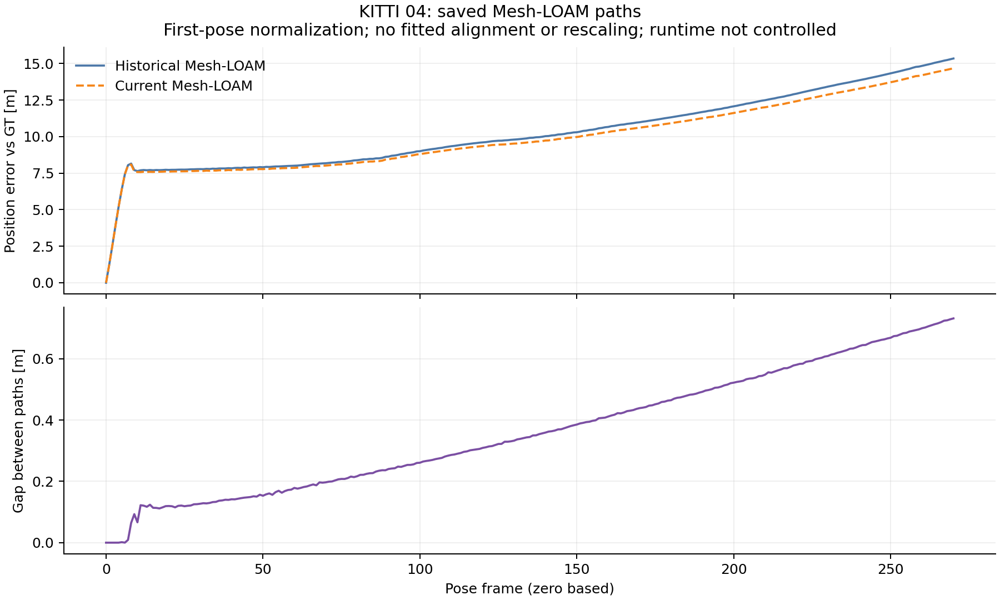

# KITTI04: committed CT-ICP and Mesh-LOAM saved-path diagnosis

Analysis source/protocol `84d7978675d99c6cbc63005307a18eeddd5d6aa0` precede execution.
Numerical evidence was committed at `4cb636eedcd614cb15e2b63121bb39d5966e55bb` before this prose.
The historical audit retains exit **1**. Frozen comparison and offline analysis
return **0**; candidate/frozen receipts and hash-verified input cleanup are
committed. The diagnostic cohort includes every historical 04 difference.
The additional already-recorded DiLO/ELO controls are validated too, with their
native receipts and complete comparison cohort retained.

## Historical differences remain recorded

| Method | Stored 100 m RPE [%] | Replayed RPE [%] | Stored ATE [m] | Replayed ATE [m] |
|---|---:|---:|---:|---:|
| CT-ICP | 0.713006 | 0.733247 | 2.184636 | 2.191953 |
| Mesh-LOAM | 0.523782 | 0.520627 | 10.602073 | 10.252902 |

CT-ICP worsens; Mesh-LOAM improves. Every differing path matches its frozen
pre-extraction control byte for byte, with zero recorded metric differences.
Both historical differences therefore predate extraction and their causes remain
open. Improvements are retained without crediting the shared filter or replacing
published aggregates.

## Current position-error growth

Parameters transfer unchanged from 02/01: **100**-step blocks, **0.1 m**
moving-step threshold and **20%** relative-step threshold. The displayed block
maximizes position-error end minus start. First-pose normalization uses no fitted
alignment or rescaling. Endpoint position error is distinct from official KITTI RTE.

| Method | Current error-growth block | Error at start [m] | Error at end [m] | Historical path paired? |
|---|---|---:|---:|---|
| CT-ICP | 0-100 | 0.000000 | 1.537809 | no |
| Mesh-LOAM | 0-100 | 0.000000 | 8.793566 | yes |

The referenced CT-ICP per-run summary and trajectory are absent from the inspected
tree and reachable-history probe. This describes that checkout, rather than global
absence. Current error growth cannot locate the difference from an unavailable
historical path.

## Paired Mesh-LOAM paths

Evaluated GT bytes match. Their Euclidean position gap reaches **0.731906 m**
at the final frame **270**. The first differing saved text row is
**1**. Frame indices are zero based. The largest
inherited fixed-block gap increase is **100-200**,
from **0.260850 to 0.522191 m**
(increase **0.261341 m**). Every block and frame is retained.

| Block | Gap at start [m] | Gap at end [m] | Increase [m] |
|---|---:|---:|---:|
| 0-100 | 0.000000 | 0.260850 | 0.260850 |
| 100-200 | 0.260850 | 0.522191 | 0.261341 |
| 200-270 | 0.522191 | 0.731906 | 0.209715 |



Recorded Mesh source/header match. Original/replay OpenMP counts are **2 / 1**,
with OpenBLAS **1**. Runtime differs; these data do not establish a thread-count
cause. The matched-runtime frozen control is the separate extraction check.

## Commands, checks and scope

```bash
python3 experiments/results/shared_near_range/diagnose_saved02.py \
  --sequence 04 --output-dir /absolute/path/to/fresh-saved04
```

The existing analyzer keeps default 02 and the closed 03 path, and now accepts the
explicit closed 04 cohort. [Protocol](../04_protocol.json), [summary/source hashes](summary.json),
[actual command and exit](analysis_command.json), [lossless output](analysis.log.gz),
step JSONs and trace CSVs retain the execution. Saved-pose metrics reproduce their
summaries within the inherited **0.001** absolute tolerance.

All **4** recorded 04 frozen controls remain checked; the diagnosis covers only
the **2** historical differences. The [source gate checks](../../checks/saved04/source/)
include both older 02/03 cases and extra-control receipt/comparison corruption;
all **16** pass in normal and optimized Python. Missing or changed additional
controls fail before diagnostic output is created.

[Documentation and preservation checks](../../checks/saved04/docs/) retain full
logs and actual exits. The local checkout has no built evaluator, so native
evaluation guards are left to the final-head CI build.

The later [main-integration checks](../../checks/saved04/main145/) retain the
original diagnosis and the merged InTEn conditioning analysis together. Existing
raw diagnostic/input bytes and native settings are preserved; this integration
adds no estimator execution or reinterpretation of the historical results.

The replay retains frozen native source `0b079dbbcb7c6f58c1d8367ade881c15f003e525`,
historical per-cell arguments and incomplete whole-zoo coverage. Native algorithms,
settings, defaults, existing accuracy tables and the active 05 source/binary/scan
ownership are unchanged. This is an offline diagnosis of committed artifacts;
current-main acceleration and passive tracing retain their separate validation scope.
