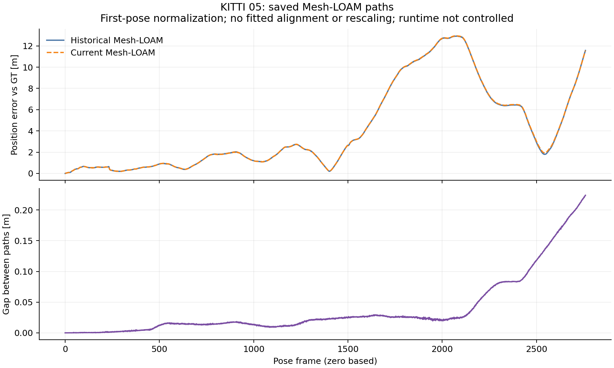

# KITTI05: committed historical differences and saved-path diagnosis

The fresh full05 replay and input cleanup are committed in original run
`e9822bcf`, imported without changing bytes as `1d4a37a4`. Pre-execution
analysis source/protocol `35bd3ecf` extends the existing guarded analyzer to the
closed05 cohort. Raw checkpoint, diagnostics, commands and gate-test logs are
committed at `6285c60b` before this interpretation.

## Historical differences

All **18** selected historical cells complete **2,761** frames with native exits
**0**; **13** match stored RPE, ATE and frame count. The following **5** differ,
retaining historical audit exit **1**, including improvements.

| Method | Stored 100 m RPE [%] | Replay RPE [%] | Stored ATE [m] | Replay ATE [m] |
|---|---:|---:|---:|---:|
| A-LOAM | 0.528651 | 0.512096 | 4.839948 | 5.192731 |
| CT-ICP | 0.469581 | 0.469523 | 4.264453 | 4.079794 |
| F-LOAM | 0.537259 | 0.538788 | 6.035067 | 6.038695 |
| LeGO-LOAM | 0.559431 | 0.515567 | 6.449096 | 5.218196 |
| Mesh-LOAM | 0.397437 | 0.397399 | 5.757510 | 5.772741 |

The frozen pre-extraction executable reproduces every difference: **0** metric
deltas in RPE, ATE, frames and official translation/rotation RTE, and
byte-identical saved poses. Its historical audit also exits **1**; the frozen
comparison exits **0**. This establishes that the differences predate extraction,
not why the original historical runs differ. Historical per-cell arguments can
differ; this replay is not a new single-setting accuracy study.

## Where current error grows

All diagnostic parameters transfer unchanged from the existing02/01 protocol:
**100**-step blocks, **0.1 m** moving-step threshold and **20%** relative-step
threshold. Each method's largest block increase in current position error
against GT occurs at **2600-2700**:

| Method | Error at block start [m] | Error at block end [m] |
|---|---:|---:|
| A-LOAM | 9.331710 | 14.176748 |
| CT-ICP | 3.264133 | 7.011568 |
| F-LOAM | 12.187404 | 16.211867 |
| LeGO-LOAM | 8.956928 | 14.455088 |
| Mesh-LOAM | 3.348537 | 8.166636 |

These are first-pose-normalized position errors, with zero-based frame indices,
no fitted alignment and no rescaling. They locate error growth in the current
paths; they neither locate a missing historical path's difference nor replace
official KITTI RTE. Every block and frame is retained in each method directory.

## Available Mesh historical pair

The historical/replayed Mesh paths use byte-identical evaluated GT. Their
position gap reaches **0.223972 m** at final frame **2760**. The first differing
saved text row is **1**. Its largest inherited block increase is **2500-2600**:
**0.118088 to 0.158530 m**, an increase of **0.040442 m**. This is a difference
between estimates, distinct from either path's error against GT.

| Block | Gap at start [m] | Gap at end [m] | Increase [m] |
|---|---:|---:|---:|
| 2300-2400 | 0.080702 | 0.083804 | 0.003103 |
| 2400-2500 | 0.083804 | 0.118088 | 0.034284 |
| 2500-2600 | 0.118088 | 0.158530 | 0.040442 |
| 2600-2700 | 0.158530 | 0.197953 | 0.039423 |
| 2700-2760 | 0.197953 | 0.223972 | 0.026019 |



The recorded original Mesh source/header match the replay's. Original/replay
OpenMP counts are **2 / 1**, with OpenBLAS **1**. Runtime differs, so this is
not a controlled thread-count comparison and establishes no runtime cause.
The matched-runtime frozen control separately tests the extraction.

For A-LOAM, CT-ICP, F-LOAM and LeGO-LOAM the exact referenced historical
summary/path is absent in the inspected tree and its exact-path reachable-history
probe finds no commit. This is local availability evidence, not proof of global
absence. No paired historical gap is manufactured for those methods.

## Commands, gates and scope

```bash
python3 experiments/results/shared_near_range/checkpoint_report.py \
  --output-dir /absolute/path/to/fresh-checkpoint05
python3 experiments/results/shared_near_range/diagnose_saved02.py \
  --sequence 05 --output-dir /absolute/path/to/fresh-saved05
```

[Actual diagnostic command and exit](analysis_command.json),
[checkpoint command and exit](../../checkpoints/05/analysis_command.json),
[all input hashes and results](summary.json),
[lossless imports](../../checks/saved05/import.json) and
[complete execution receipts](../../checks/saved05/commands.json) retain the run.
The existing saved-path gates require committed candidate/frozen reports,
actual native receipts, matching saved poses and completed input cleanup before
creating output. The new closed05 fixture retains the full difference cohort;
missing controls and even dangling owned-input aliases are rejected. All **19**
gate tests pass with actual exit **0** in normal and optimized Python.

[Repository checks and exact commands](../../checks/saved05/docs/commands.json)
retain complete, losslessly compressed logs. Required document generators,
showcase, leaderboard, paper-ready and whitespace checks exit **0**. Full Python
runs **334** tests with **5** built-evaluator skips in this separate checkout,
exiting **0**; final-head CI provides native coverage. The
[preservation receipt](../../checks/saved05/docs/preservation.json) verifies all
**688** historical aggregate hashes, unchanged publication/paper-number bytes,
lossless raw05 import, prior method README content and the running primary's
frozen native source, sealed scripts and both executable hashes. Timestamp-only
generator changes retain prior bytes with an explicit disposition receipt.

The new [cleaned checkpoint](../../checkpoints/05/summary.json) covers **97/177**
cells across 04/00/01/02/03/05: **77** historical matches and **20** differences.
All **22** frozen controls have zero metric differences and identical saved
poses. All six historical audits retain exit **1**; checkpoint verification and
this offline diagnosis exit **0**. Full coverage remains incomplete.

Native source stays `0b079dbb`, with the original binary hashes and selected
historical arguments. No estimator or scan is rerun by this analysis. Active06
scans, frozen binaries, controller and sealed source are untouched. Current-main
acceleration/passive tracing and the pending InTEn failure-cause investigation
retain their separate scope. Existing accuracy tables and defaults are preserved.
