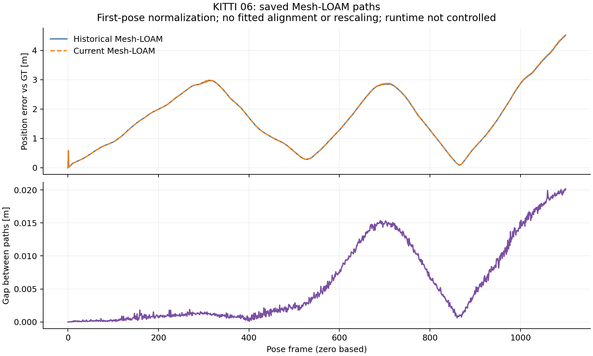

# KITTI06: committed historical differences and saved-path diagnosis

The complete06 replay, frozen comparison and verified input cleanup are
committed in original run `27354aa4`, imported without changing bytes as
`54eaeab6`. Pre-execution analysis source/protocol `45cbb341` extends the
existing guarded analyzer to the closed06 cohort. Raw checkpoint, diagnostics,
commands and gate-test logs are committed at `e4c528fe` before this interpretation.

## Historical differences

All **14** selected historical cells complete **1,101** frames with native exits
**0**; **12** match stored RPE, ATE and frame count. These **2** differ,
retaining historical audit exit **1**, including the improving metrics:

| Method | Stored 100 m RPE [%] | Replay RPE [%] | Stored ATE [m] | Replay ATE [m] |
|---|---:|---:|---:|---:|
| CT-ICP | 0.388505 | 0.391531 | 3.963097 | 3.891527 |
| Mesh-LOAM | 0.505393 | 0.505226 | 2.018974 | 2.024646 |

CT-ICP RPE worsens while ATE improves. Mesh RPE improves while ATE worsens.
The frozen pre-extraction executable reproduces both pairs: **0** differences
in RPE, ATE, frames and official translation/rotation RTE, and byte-identical
saved poses. Its historical audit also exits **1**; the frozen comparison exits
**0**. The differences predate extraction; their original causes remain open.
Historical per-cell arguments can differ; this is not a new fixed-setting study.

## Where current error grows

Diagnostic parameters transfer unchanged from the existing02/01 protocol:
**100**-step blocks, **0.1 m** moving-step threshold and **20%** relative-step
threshold. Both methods' largest inherited block increase in current position
error against GT occurs at **900-1000**:

| Method | Error at block start [m] | Error at block end [m] |
|---|---:|---:|
| CT-ICP | 1.082154 | 5.860882 |
| Mesh-LOAM | 0.712329 | 2.878683 |

These are first-pose-normalized position errors, with zero-based indices,
no fitted alignment and no rescaling. They locate current error growth;
they neither locate a missing historical path's difference nor replace
official KITTI RTE. Every inherited block and frame is retained.

## Available Mesh historical pair

Historical/replayed Mesh paths use byte-identical evaluated GT. Their position
gap reaches **0.020146 m** at final frame **1100**. The first differing saved
text row is **1**. The largest inherited block increase is **900-1000**:
**0.004242 to 0.014212 m**, an increase of **0.009970 m**. This gap between
estimates is distinct from either path's error against GT.



The recorded original Mesh source/header match the replay's. Original/replay
OpenMP counts are **2 / 1**, with OpenBLAS **1**. Runtime differs, so this is
not a controlled thread-count comparison or a runtime cause attribution.
The matched-runtime frozen control separately tests the extraction.

CT-ICP's exact referenced historical summary/path is absent in the inspected
tree and its exact-path reachable-history probe finds no commit. This is local
availability evidence, not proof of global absence. No paired historical gap
is manufactured for CT-ICP.

## Commands, gates and scope

```bash
python3 experiments/results/shared_near_range/checkpoint_report.py \
  --output-dir /absolute/path/to/fresh-checkpoint06
python3 experiments/results/shared_near_range/diagnose_saved02.py \
  --sequence 06 --output-dir /absolute/path/to/fresh-saved06
```

[Actual diagnostic command and exit](analysis_command.json),
[checkpoint command and exit](../../checkpoints/06/analysis_command.json),
[all input hashes and results](summary.json),
[lossless imports](../../checks/saved06/import.json) and
[complete execution receipts](../../checks/saved06/commands.json) retain the run.
The existing gates require committed candidate/frozen reports, actual native
receipts, matching saved poses and completed input cleanup before output.
Closed06 retains its complete CT/Mesh cohort without inheriting04's additional
controls; unexpected controls are rejected before output. All **21** gate tests
pass with actual exit **0** in normal and optimized Python.

The new [cleaned checkpoint](../../checkpoints/06/summary.json) covers **111/177**
cells across 04/00/01/02/03/05/06: **89** historical matches and **22** differences.
All **24** frozen controls have zero metric differences and identical saved
poses. All seven historical audits retain exit **1**; checkpoint verification
and this offline diagnosis exit **0**. Full coverage remains incomplete.

Native source stays `0b079dbb`, with the original executable hashes and selected
historical arguments. No estimator or scan is rerun by this analysis. Active07
scans, binaries, controller and sealed source are untouched. Current-main
acceleration/passive tracing and the pending InTEn failure-cause investigation
retain their separate scope. Existing accuracy tables and defaults are preserved.
