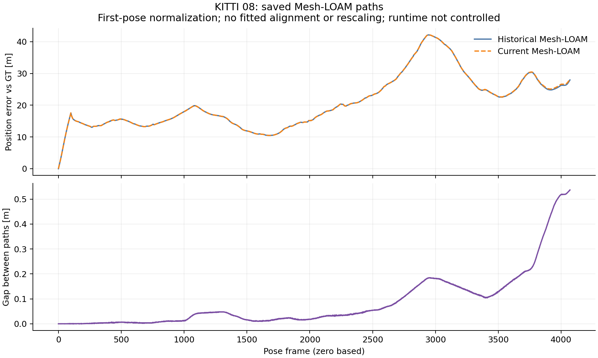

# KITTI08: committed historical differences and saved-path diagnosis

Native/cleanup commit `15157bab` is imported byte-for-byte as `d0a76218`,
with import identity committed at `34b93d2a`. Analysis source/protocol `d969608e`
precedes execution; preparation checks `9f94c9c4` retain the synthetic gates and
real incomplete-input refusal. Raw checkpoint, diagnostics and actual commands
are committed at `9197f428` before this interpretation.

## Historical differences

All **18** selected cells complete **4,071** frames with native exits **0**;
**14** match stored RPE, ATE and frames. These **4** differ:

| Method | Stored 100 m RPE [%] | Replay RPE [%] | Stored ATE [m] | Replay ATE [m] |
|---|---:|---:|---:|---:|
| A-LOAM | 1.390107 | 1.394630 | 18.110228 | 18.661434 |
| F-LOAM | 1.399647 | 1.372876 | 20.440418 | 17.318202 |
| LeGO-LOAM | 1.375340 | 1.374146 | 17.896468 | 19.120563 |
| Mesh-LOAM | 1.331902 | 1.332030 | 22.402218 | 22.431217 |

A-LOAM and Mesh worsen in both metrics. F-LOAM improves in both. LeGO-LOAM
RPE improves while ATE worsens. All outcomes remain reported. The candidate and
frozen historical audits retain exit **1**. Every frozen pre-extraction control
has **0** recorded differences in RPE, ATE, frames and official translation/rotation
RTE, with byte-identical saved poses. Comparison exits **0**. These differences
predate extraction; their original causes remain unresolved. Each historical
cell retains its recorded arguments; no new fixed-setting study is claimed.

## Where current error grows

Existing parameters transfer unchanged from02/01: **100**-step blocks,
**0.1 m** moving-step threshold and **20%** relative-step threshold. All four
largest inherited increases in current position error occur at **0-100**:

| Method | Pose frames | Error at block start [m] | Error at block end [m] |
|---|---|---:|---:|
| A-LOAM | 0-100 | 0.000000 | 17.406467 |
| F-LOAM | 0-100 | 0.000000 | 17.420110 |
| LeGO-LOAM | 0-100 | 0.000000 | 17.480118 |
| Mesh-LOAM | 0-100 | 0.000000 | 17.435078 |

GT travels **50.647955 m** in this block, shorter than the **100-800 m** segments
used by official KITTI RTE. A block-relative error here is not official RTE.
These position errors use first-pose normalization, zero-based indices, no fitted
alignment and no rescaling. They locate current error growth, not the cause of
a historical difference. All inherited blocks and every frame are retained.

## Available Mesh historical pair

Historical/replayed Mesh paths use byte-identical evaluated GT. Their position
gap reaches **0.536423 m** at final frame **4070**; the first differing saved
text row is **1**. The largest inherited gap-growth block is **3800-3900**:
**0.263674 to 0.412219 m**, an increase of **0.148544 m**. A gap between
estimates is distinct from either estimate's error against GT.



The recorded original Mesh source/header bytes match the checked core.
Original/replay OpenMP counts are **2 / 1**, with OpenBLAS **1**. This is a
runtime confound, not a controlled thread-count comparison or a cause finding.
The matched-runtime frozen control separately tests the extraction.

The exact referenced A-LOAM/F-LOAM/LeGO-LOAM historical summaries/paths are
absent in the inspected tree, and their exact-path reachable-history probes find
no commit. This describes local availability, not global absence; no historical
gap or runtime cause is manufactured for those methods.

## Commands, gates and scope

```bash
python3 experiments/results/shared_near_range/checkpoint_report.py \
  --output-dir /absolute/path/to/fresh-checkpoint08
python3 experiments/results/shared_near_range/diagnose_saved02.py \
  --sequence 08 --output-dir /absolute/path/to/fresh-saved08
```

[Actual diagnostic command and exit](analysis_command.json),
[checkpoint command and exit](../../checkpoints/08/analysis_command.json),
[input hashes and full results](summary.json),
[lossless native import](../../checks/saved08/import.json) and
[execution receipts](../../checks/saved08/commands.json) retain the analysis.
All **25** synthetic publication-gate tests pass with actual exit **0** in
normal and optimized Python. The expected four-method08 cohort is confirmed by
committed reports, without inheriting CT-ICP as an extra control or changing
older cohorts. A real incomplete08 invocation exits **2** as expected before
output at the committed-input gate; no diagnosis or coverage is credited to that
[preparation check](../../checks/saved08_preparation/scope.json).

[Repository checks and exact commands](../../checks/saved08/docs/commands.json),
committed at `ffca75b8`, retain full losslessly compressed logs and the
[actual full-driver invocation](../../checks/saved08/docs/driver_invocation.json).
Required document generators, showcase, leaderboard, paper-ready and whitespace
checks exit **0**. Full Python runs **340** tests with **5** built-evaluator skips
in this separate checkout and exits **0**. The full logs retain intentional
negative test fixtures; actual process exits determine the result. Final-head
native and ROS CI will validate the completed integration PR.

The [preservation receipt](../../checks/saved08/docs/preservation.json) verifies
all **688** historical aggregate hashes, unchanged published/table/paper-number
bytes, all **167** original native08 files, prior method README content and the
active primary's frozen source, sealed files and executable hashes. Timestamp-only
generator changes retain prior bytes with an explicit disposition receipt.

The [cleaned checkpoint](../../checkpoints/08/summary.json) covers **149/177**
cells across 04/00/01/02/03/05/06/07/08: **117** historical matches and **32**
differences, reproduced by **34** exact frozen controls. All nine historical
audits retain exit **1**; checkpoint verification and diagnosis exit **0**.
Whole-zoo coverage remains incomplete;09/10 are excluded until committed cleanup.

Official08 hashes were verified before deleting the owned scans and alias.
The controller advances to09. Native source remains `0b079dbb`, with frozen
executable hashes and original selected arguments. No estimator, scan read or
setting selection occurs in this offline analysis. Active09 source/binaries/data
remain untouched. Published accuracy, paper numbers and defaults are preserved;
current-main acceleration/passive tracing and the later InTEn cause investigation
retain their separate scope. The final integration protocol groups the remaining
results into one audit-completion PR after the full terminal gate passes.
