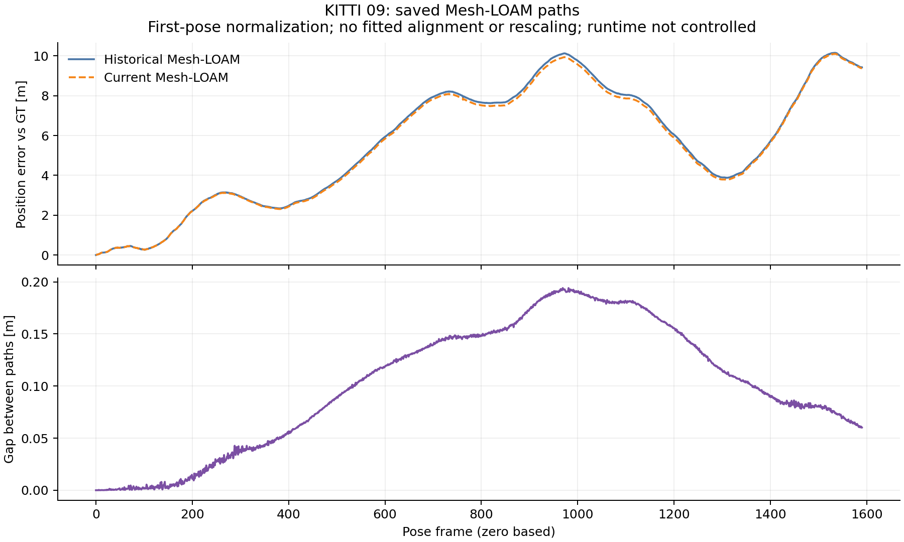

# KITTI09: committed Mesh-LOAM replay difference

Original native/cleanup `a11683e1` is imported unchanged as `609c585c`;
import identity `3ca99d81` verifies every original file. Analysis source/protocol
`ac18dd30` precedes execution. Raw checkpoint, saved-path diagnosis and actual
commands are committed at `008f5321` before this interpretation.

## Historical difference

All **14** selected cells complete **1,591** frames with native exits **0**.
**13** match stored RPE, ATE and frames; Mesh-LOAM differs:

| Method | Stored 100 m RPE [%] | Replay RPE [%] | Stored ATE [m] | Replay ATE [m] |
|---|---:|---:|---:|---:|
| Mesh-LOAM | 0.629359 | 0.628839 | 6.346767 | 6.245887 |

Both metrics improve, but the historical audit still exits **1**. The frozen
pre-extraction control reproduces all recorded metrics, frame count and official
translation/rotation RTE with **0** differences and byte-identical saved poses.
Its historical audit also exits **1**; comparison exits **0**. The difference
predates extraction; its original cause remains unresolved. This historical
per-cell replay retains the original arguments and does not select a new setting
or replace published results.

## Where the saved paths differ

Diagnostic parameters transfer unchanged from02/01: **100**-step blocks,
**0.1 m** moving-step threshold and **20%** relative-step threshold. Current
position error grows most at poses **1400-1500**, from **5.653022 to 9.673839 m**;
GT travels **138.461331 m** in that block. These first-pose-normalized position
errors use zero-based indices, no fitted alignment and no rescaling. A fixed
pose-index block is distinct from the official KITTI distance-segment RTE.

Historical/current Mesh paths use byte-identical evaluated GT. Their position
gap reaches **0.194094 m** at frame **969**, ending at **0.060169 m**. The first
differing saved text row is **1**. The largest inherited gap-growth block is
**400-500**: **0.056554 to 0.089540 m**, an increase of **0.032986 m**.
All blocks and every frame remain in the committed summary/trace. A gap between
estimates is distinct from either estimate's error against GT.



The recorded Mesh source/header bytes match. Historical/replay OpenMP counts
are **2 / 1**, with OpenBLAS **1**. This runtime difference is a confound,
not a controlled thread-count comparison or a cause finding. The matched-runtime
frozen comparison separately checks the extraction. Saved-pose rescoring matches
both summaries within the inherited **0.001** absolute tolerance.

## Commands, gates and scope

```bash
python3 experiments/results/shared_near_range/checkpoint_report.py \
  --output-dir /absolute/path/to/fresh-checkpoint09
python3 experiments/results/shared_near_range/diagnose_saved02.py \
  --sequence 09 --output-dir /absolute/path/to/fresh-saved09
```

[Actual diagnostic command](analysis_command.json),
[checkpoint command](../../checkpoints/09/analysis_command.json),
[full results and input hashes](summary.json),
[lossless import](../../checks/saved09/import.json) and
[actual execution receipts](../../checks/saved09/commands.json) retain the
execution. Checkpoint verification and diagnosis exit **0**.

The [preparation receipts](../../checks/saved09_preparation/commands.json),
committed at `28ce56aa`, retain **27** synthetic publication-gate tests in normal
and optimized Python, each exiting **0**. A real incomplete09 probe exits **2**
as expected before output. That probe earns no diagnosis or coverage. Committed
reports confirm the exact Mesh-only cohort; CT-ICP is not an extra control.

The [cleaned checkpoint](../../checkpoints/09/summary.json) covers **163/177**
cells across 04/00/01/02/03/05/06/07/08/09: **130** historical matches and
**33** differences, reproduced by **35** exact frozen controls. All ten historical
audits retain exit **1**. Sequence10 remains excluded until committed cleanup.

Official09 input hashes were verified before deleting **1,592** owned files
and the alias. The existing controller advances to10. This offline analysis
reads committed saved paths, invokes no estimator and selects no setting.
Native source `0b079dbb`, frozen binaries, sealed files and active10 inputs remain
untouched. Current-main acceleration/tracing and the later InTEn cause study
remain outside this historical replay's validation scope. Published accuracy,
paper numbers and default-off preprocessing are preserved. All remaining results
belong to the single audit-completion PR after the full terminal gate passes.
