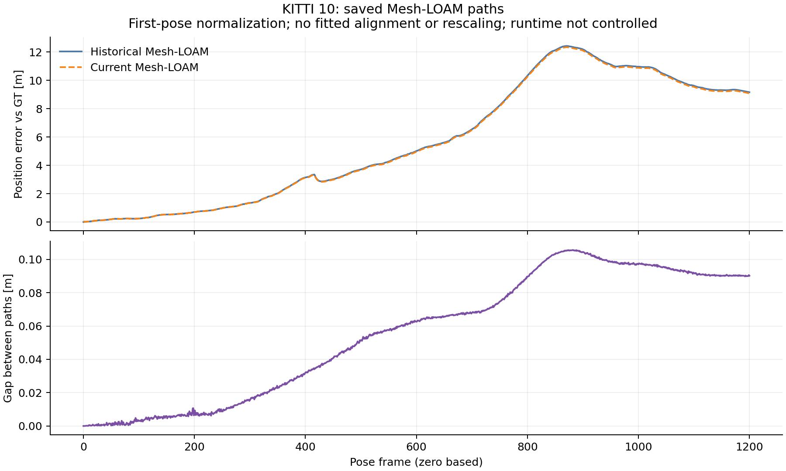

# KITTI10: committed CT-ICP/Mesh replay differences

Original native/cleanup `7b5e7372` is imported unchanged as `7a7b53eb`;
import identity `33a5c412` verifies every original file. Analysis source/protocol
`a5145ae9` precedes execution. Raw checkpoint, saved-path diagnosis and actual
commands are committed at `0f073a4d` before this interpretation.

## Historical differences

All **14** selected cells complete **1,201** frames with native exits **0**.
**12** match stored RPE, ATE and frames; these **2** differ:

| Method | Stored 100 m RPE [%] | Replay RPE [%] | Stored ATE [m] | Replay ATE [m] |
|---|---:|---:|---:|---:|
| CT-ICP | 0.781185 | 0.789307 | 5.317129 | 5.349091 |
| Mesh-LOAM | 0.725109 | 0.724637 | 7.086086 | 7.032033 |

CT-ICP worsens in both metrics; Mesh improves in both. Both historical audits
retain exit **1**. Both frozen pre-extraction controls reproduce every recorded
metric, frame count and official translation/rotation RTE with **0** differences
and byte-identical saved poses. Comparison exits **0**. These differences
predate extraction; their original causes remain unresolved. Historical per-cell
arguments are unchanged; this replay selects no new setting or paper value.

## Where current error grows

Diagnostic parameters transfer unchanged from02/01: **100**-step blocks,
**0.1 m** moving-step threshold and **20%** relative-step threshold. Both
largest current position-error increases occur at poses **700-800**:

| Method | Error at block start [m] | Error at block end [m] |
|---|---:|---:|
| CT-ICP | 5.242407 | 8.040990 |
| Mesh-LOAM | 6.493900 | 10.262039 |

GT travels **127.160950 m** in this block. These first-pose-normalized position
errors use zero-based indices, no fitted alignment and no rescaling. Fixed
pose-index blocks are distinct from official KITTI distance-segment RTE and
cannot establish a cause. Every block and frame is retained.

## Available Mesh historical pair

Historical/current Mesh paths use byte-identical evaluated GT. Their position
gap reaches **0.105631 m** at frame **882**, ending at **0.090142 m**. The first
differing saved text row is **1**. The largest inherited gap-growth block is
**700-800**: **0.067888 to 0.089419 m**, an increase of **0.021531 m**.
A gap between estimates is distinct from either estimate's error against GT.



Recorded Mesh source/header bytes match. Historical/replay OpenMP counts are
**2 / 1**, with OpenBLAS **1**. Runtime is a confound, not a controlled
thread-count experiment or a cause finding. The matched-runtime frozen
comparison separately checks extraction. Saved-pose rescoring matches both
summaries within the inherited **0.001** absolute tolerance.

The exact referenced CT historical summary/path is unavailable in the inspected
tree and its exact-path reachable-history probe finds no commit. This describes
local availability, not global absence. Its current error-growth block does not
locate a historical gap or establish the original cause.

## Commands, gates and scope

```bash
python3 experiments/results/shared_near_range/checkpoint_report.py \
  --output-dir /absolute/path/to/fresh-checkpoint10
python3 experiments/results/shared_near_range/diagnose_saved02.py \
  --sequence 10 --output-dir /absolute/path/to/fresh-saved10
```

[Actual diagnostic command](analysis_command.json),
[checkpoint command](../../checkpoints/10/analysis_command.json),
[full results and input hashes](summary.json),
[lossless import](../../checks/saved10/import.json) and
[execution receipts](../../checks/saved10/commands.json) retain the execution.
Checkpoint verification and diagnosis exit **0**.

The [preparation receipts](../../checks/saved10_preparation/commands.json),
committed at `f4df2866`, retain **29** synthetic publication-gate tests in normal
and optimized Python, each exiting **0**. A real incomplete10 probe exits **2**
before output as expected; it earns no diagnosis or coverage. Committed reports
confirm CT and Mesh as the complete cohort, with no extra04 controls.

The [cleaned checkpoint](../../checkpoints/10/summary.json) covers **177/177**
cells: **142** historical matches and **35** differences, reproduced by **37**
exact frozen controls. All eleven historical audits retain exit **1**.
The [full report](../../completion/03/report/summary.json), originally committed
at `28406fe8` and imported as `b07958a4`, retains the complete selection.

Official10 hashes were verified before deleting **1,202** owned files and the
alias. Controller terminal completion exits **0** with the exact sequence order.
This offline analysis reads committed saved paths, invokes no estimator and
selects no setting. Native source remains `0b079dbb`. Current-main acceleration
and tracing, NCLT accuracy and the later InTEn cause study remain outside this
historical replay's validation scope. Published accuracy, paper numbers and
default-off preprocessing are preserved.
