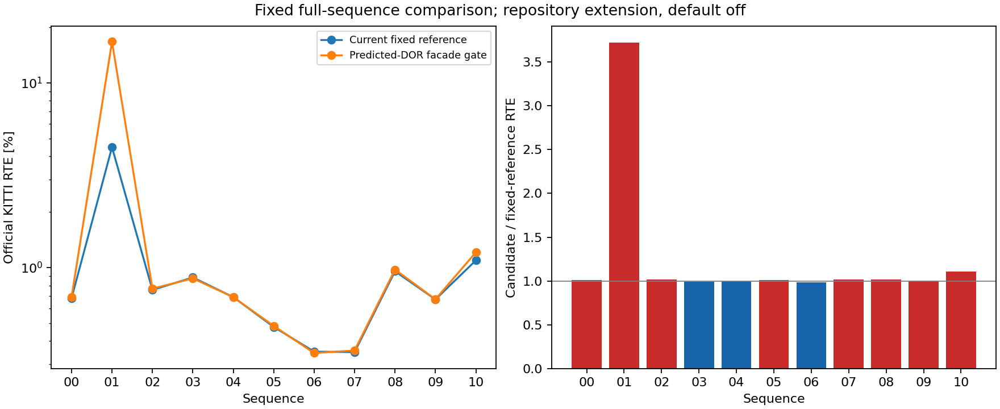
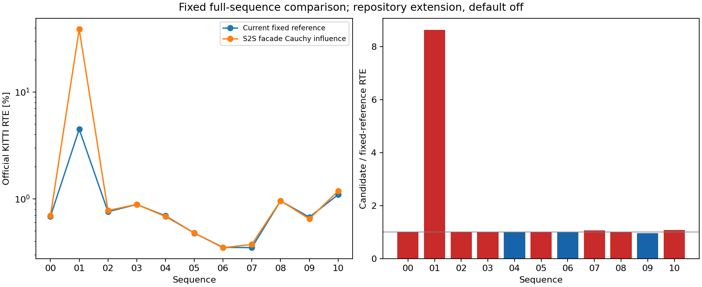
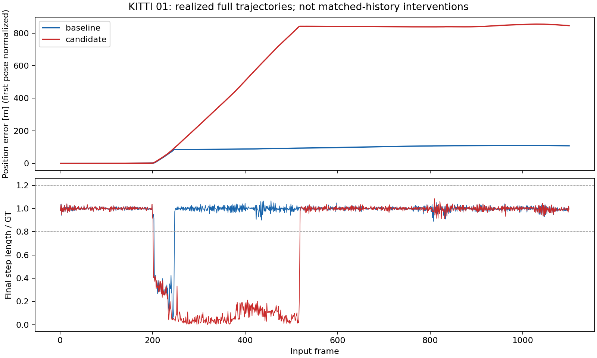
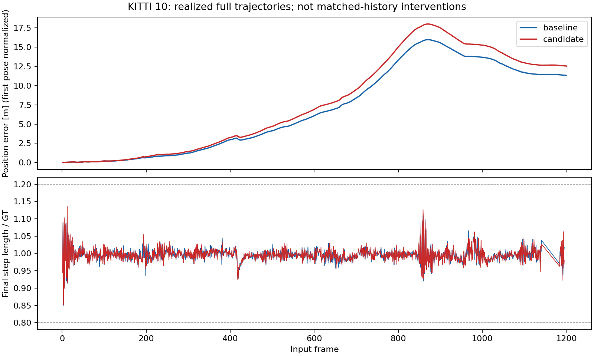
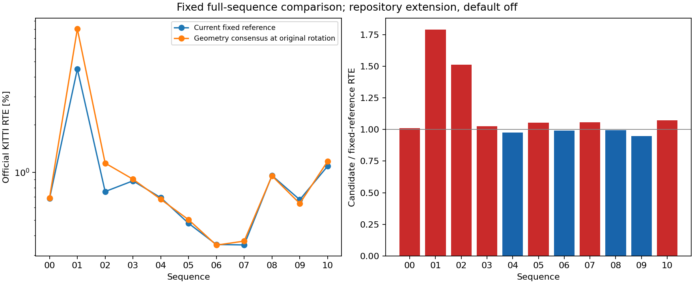
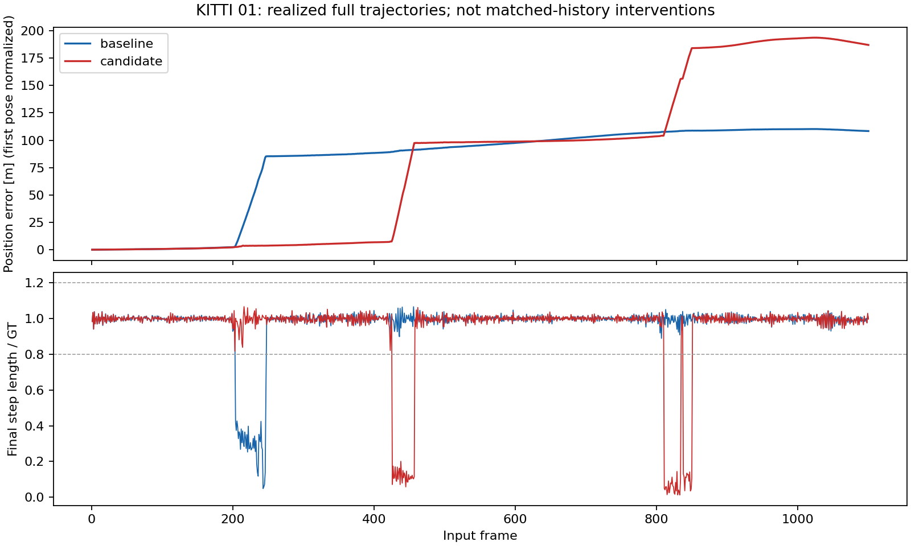
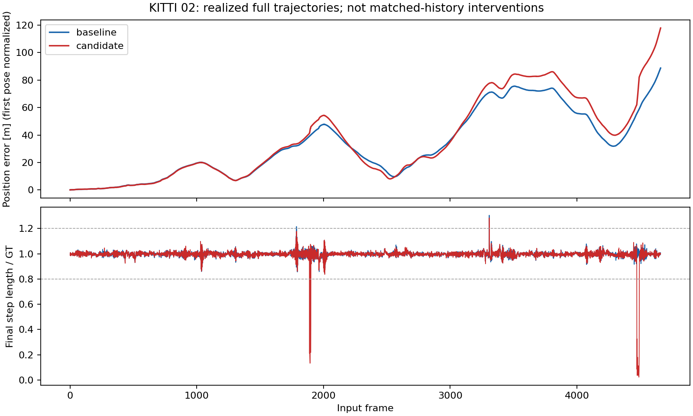
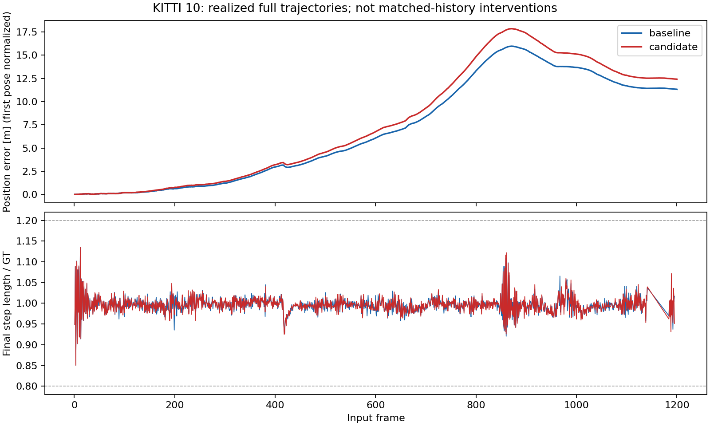

# InTEn-LOAM: Intensity and Temporal Enhanced LOAM (from-paper reimplementation)

**Paper:** Shuaixin Li, Bin Tian, Zhu Xiaozhou, Gui Jianjian, Yao Wen, Guangyun Li,
*"InTEn-LOAM: Intensity and Temporal Enhanced LiDAR Odometry and Mapping"*，
Remote Sensing / arXiv:2209.05708 (2022/23). No public author code found.
Reconstructed from the paper.

## Core idea

InTEn-LOAM exploits **geometric + intensity + temporal** information in LiDAR sweeps:

1. **Cylindrical-image feature extraction (FEF).** Points are projected to range +
   intensity cylindrical images (paper eq. 2). Ground (column-wise line fit),
   facade, edge (range curvature), and reflector (intensity delta + absolute
   threshold) features are adaptively extracted.
2. **Intensity-based scan registration.** Reflector features are aligned by
   minimizing intensity residuals on a local **B-spline intensity surface**
   (simplified here as trilinear interpolation over 8 voxel control points; paper
   eq. 6–7).
3. **Joint scan-to-scan LO.** Geometric edge (point-to-line) and ground/facade
   (point-to-plane) factors are combined with intensity factors in Ceres.
4. **Temporal voxel filter (TVF) + dynamic object removal (DOR)** (2026-06-09):
   voxel occupancy ages features over time; DOR drops voxels with high motion
   inconsistency before mapping updates.
5. **Scan-to-map mapping** (2026-06-09): local voxel map + Ceres scan-to-map
   refinement after scan-to-scan odometry (paper §3.3 mapping thread, simplified).

## Scope / approximations for KITTI

- KITTI Odometry velodyne scans are **unordered** (not native HDL-64 ring order);
  cylindrical projection uses spherical angles from `(x,y,z)` directly.
- TVF/DOR/mapping are simplified approximations of the paper's full pipeline.

## Parameters

| Param | Meaning | Default |
|---|---|---|
| `cylindrical.width/height` | Cylindrical image size | 1024 × 64 |
| `use_intensity_registration` | B-spline intensity factors | true |
| `enable_tvf` | Temporal voxel filter | true |
| `enable_dor` | Dynamic object removal | true |
| `enable_mapping` | Scan-to-map refinement | true |
| `max_edge/surface/reflector_features` | Feature caps | 200 / 400 / 120 |
| `intensity_voxel_size` | Local intensity model voxel [m] | 0.5 |

Ablation flags: `--inten-loam-no-intensity`, `--inten-loam-no-tvf`,
`--inten-loam-no-dor`, `--inten-loam-no-mapping`.

## Paper pipeline

`--inten-loam-paper-odometry` runs `InTenLoamPaper`
(`include/inten_loam/inten_loam_paper.h`), written against the paper after an
audit of the pipeline below found why it does not track:

- it associated the **untransformed** current points once per frame, so every
  correspondence assumed zero motion (trajectory 0.83x the true length
  scan-to-scan);
- scan-to-map repeated that bias against a denser map and **overwrote** the
  scan-to-scan motion (0.60x);
- DOR ran before feature extraction with the previous pose and a fixed 0.6 m
  range test, removing ~40 % of the valid pixels, mostly ahead of and behind
  the car (0.40x overall);
- `EdgeFactor` used a wrong cross product (nonzero on inclined lines; fixed
  for both pipelines).

The paper pipeline:

- **FEF** (Sec. 3.1): 2048 x 64 range image (smallest range, largest
  intensity); segment image of the lowest z per azimuth segment (512) and
  0.5 m radial bin with per-segment ground lines (Himmelsbach, Th_g 0.2 m);
  angle-based clustering (10 deg), clusters under 15 points masked;
  curvature C = sum(D - D_nb) / (N D) along the row, edges |C| > 0.3, facades
  |C| < 0.1 (Sec. 4.1.1) per row sector with non-maximum suppression, points
  behind an occluder skipped; reflectors from the row intensity difference
  (Th_dI 80 / 255) or the 16 x 4 block median.
- **S2S** (Alg. 1): edge residual to the line through the closest point and
  its neighbour on an adjacent scan line, plane residual from the closest
  point and neighbours on the same and an adjacent line, cubic B-spline
  intensity residual (eqs. 6-7, 0.3 m knots); Gauss-Newton on se(3) with
  association redone at every iteration from the previous relative motion.
- **S2M** (Alg. 2): prediction dT_{k-1} T_w'k, local map (100 m) of keyframe
  features in a temporal voxel filter (voxel mean position, intensity
  averaged over the last 50 frames), 5-NN PCA lines and planes.
- **DOR** (Sec. 3.3): after S2M, the local map and the previous scan are
  rendered into a range image; a cluster is dynamic when half of its pixels
  differ by more than 10 % of the range; ground never is. Dynamic points are
  only kept out of the map.
- No motion compensation: KITTI scans are used as given.

Official KITTI RTE, full sequences, no GT seed, 0.2 deg vertical-angle
correction (Sec. 4.2.1), `experiments/inten_loam_kitti_seq_{00,07}_full_paper_comp_matrix.json`:

| variant | seq 00 | seq 07 | FPS |
|---|---:|---:|---:|
| previous pipeline (`--inten-loam-dense-profile`, edge factor fixed) | 47.783 % | 42.158 % | 9 |
| paper pipeline (`paper_odometry`) | 0.769 % | **0.352 %** | 2.4 |
| plane check 0.05 m, 0.17 deg correction (`paper_odometry_plane_check`, below) | **0.697 %** | 0.364 % | 1.6-1.7 |
| without the correction | 1.464 % | 0.905 % | 2.4 |
| without the intensity residual | 0.772 % | 0.351 % | 2.6 |
| S2S only (no S2M, map, DOR) | 3.048 % | 1.895 % | 8 |
| paper, Table 1 | 0.52 % | 0.34 % | |

Two values the paper does not give for KITTI were chosen on seq 07 only, with
seq 00 held out: the plane map voxel (0.8 m: 0.803 %, 0.4 m: 0.444 %, 0.2 m:
0.368 %, 0.1 m: 0.358 %) and the edge threshold (the paper's Th_E = 0.3 is for
its 32-beam data; 0.15 with 4 edges per sector: 0.352 % on 07, and 0.816 ->
0.769 % on 00). That gives 1.04x on 07 and 1.48x on 00 (geometric mean 1.24x).
With the plane check below, 00 goes to 0.697 % (1.34x) and 07 to 0.364 %
(1.07x): 1.20x with one setting for both, 1.18x taking the better variant per
sequence in the historical 00/07 comparison.
Mapping and the correction matter most; the intensity residual is worth
0-1 %.

**Where seq 00 loses accuracy.** Per 100-frame segment the translational
error ranges from 0.2 % to 2.8 %, with no single failure; the worst stretches
are the start and the faster section around frames 4000-4300 (12-13 m/s,
about 90 edge features per scan instead of 150-250). The yaw error has a
consistent sign: summed per frame it reaches -5.95 deg over the sequence
(-0.0013 deg per frame), independent of the turn direction. About -3.3 deg of that also shows
up in KISS-ICP on the same scans (0.544 %), so it comes from the data; the
part specific to InTEn-LOAM is the fast section, where yaw drifts by +0.5 to
+1.0 deg per 100 frames with too few edges (a 400-frame window there: 1.88 %
with Th_E 0.3, 1.38 % with 0.08 and 4 per sector; S2M, DOR and intensity do
not change it). With the 0.15 / 4 edge setting chosen on 07, seq 00 goes
from 0.816 to 0.769 %. Other free parameters move seq 00 within +-5 % (2000
ground points: 0.775 %, facade threshold 0.05: 0.819 %, 0.1 m plane voxels:
0.822 %). The paper's motion compensation (Sec. 3.1.1) is available as
`--inten-loam-paper-set deskew=+-1` (point time from the azimuth, constant
velocity); both spin directions make seq 07 much worse (1.502 / 1.835 %), so
the KITTI odometry scans are treated as already compensated. Free parameters can be changed with `--inten-loam-paper-set key=value`
(`map_plane_voxel`, `max_ground`, `huber`, ...).

### KITTI 00-10 with one configuration

The coverage variant is `paper_odometry_plane_check` on every sequence:
`--no-gt-seed --inten-loam-paper-odometry --input-max-range-m 120
--input-vertical-angle-correction-deg 0.17 --inten-loam-paper-set
s2m_plane_max_dist=0.05`. The plane check and correction values were chosen
on 07 windows. Diagnosing 00 frames 4000-4399 suggested which plane check
to investigate, so 00 is not fully held out. The added sequences 01-06 and
08-10 are evaluation only and do not influence these values.

The stricter plane acceptance and the 0.17-degree correction are KITTI
choices, not the paper's stated settings. They are enabled explicitly by
the arguments above; this coverage run does not change the defaults.
The added manifests are
`experiments/inten_loam_kitti_seq_NN_full_paper_comp_matrix.json`, each with
only the fixed variant. The 00/07 comparison manifests also contain
historical ablations. To run just the fixed setting on any sequence:

```bash
./build/evaluation/pcd_dogfooding dogfooding_results/kitti_seq_NN_full \
  experiments/reference_data/kitti_seq_NN_full_gt.csv 0 \
  --methods inten_loam --no-gt-seed --inten-loam-paper-odometry \
  --input-max-range-m 120 --input-vertical-angle-correction-deg 0.17 \
  --inten-loam-paper-set s2m_plane_max_dist=0.05 --summary-json inten_seq_NN.json
```

See [the roadmap](../../docs/roadmap.md#experiments) for one-sequence-at-a-time
fetching, result import and regeneration of the derived tables.

<!-- FIXED-KITTI-RESULTS:START -->

Full sequences, official KITTI translational RTE (100-800 m), no GT seed.
The 00/07 rows retain their existing committed results; the other rows are
the added coverage runs. Every row below uses the same fixed variant.

| Seq | Paper RTE [%] | Fixed RTE [%] | Repo / paper | FPS |
|---|---:|---:|---:|---:|
| 00 (development) | 0.52 | 0.697 | 1.34x | 1.736 |
| 01 | 0.64 | 16.614 | 25.96x | 1.655 |
| 02 | 0.54 | 3.221 | 5.97x | 1.822 |
| 03 | 0.63 | 0.891 | 1.41x | 1.552 |
| 04 | 0.37 | 0.676 | 1.83x | 1.708 |
| 05 | 0.36 | 0.497 | 1.38x | 1.215 |
| 06 | 0.24 | 0.359 | 1.49x | 1.789 |
| 07 (development) | 0.34 | 0.364 | 1.07x | 1.555 |
| 08 | 0.71 | 0.938 | 1.32x | 1.264 |
| 09 | 0.48 | 0.661 | 1.38x | 2.111 |
| 10 | 0.45 | 1.156 | 2.57x | 1.835 |

Geometric mean over all sequences with paper values: **2.19x**
with the fixed setting. Table 6 is restricted to this same variant by
`repo_variants` in `evaluation/data/paper_reported_numbers.json`.
The historical 00/07 ablations above remain available in their original
result aggregates.

FPS describes the recorded execution: the new runs use two OpenMP
threads per method and may overlap on the same sequence. The 00/07 FPS
comes from the historical runs.

Sources: `experiments/results/inten_loam_kitti_seq_NN_full_paper_comp_matrix.json`.
New per-run summaries, host records, logs, estimated poses, evaluated GT
and step diagnostics are committed under the corresponding
`experiments/results/runs/` directory. Exact execution commands and the
isolated-output launcher used for overlapping the two methods are recorded
in `experiments/results/mesh_inten_kitti_coverage/`.

#### Sequences above twice the paper value

**01: 16.614 % vs 0.64 % (25.96x).**
The estimated path length is 0.872 of GT.
For GT steps of at least 0.1 m,
136 of 1100 steps differ in length by more than 20 %;
the local translation-vector error exceeds 20 % on 136 steps.
The longest runs of step length errors have destination-frame indices 217-253, 420-518 (zero-based; inclusive).
All intervals are retained in the diagnostic JSON.

The largest relative-translation-error blocks locate where drift grows.
Each block contains up to 100 consecutive steps; these endpoint errors
are diagnostics, not official KITTI RTE.

Blocks spanning at least 1 m of GT travel are ranked below; the JSON
also retains blocks with less travel.

| Pose interval | GT distance [m] | Est / GT path | Position error start / end [m] | Block error [%] |
|---|---:|---:|---:|---:|
| 400-500 | 263.2 | 0.276 | 81.7 / 312.5 | 88.13 |
| 200-300 | 268.1 | 0.705 | 2.3 / 80.8 | 29.77 |
| 500-600 | 256.6 | 0.834 | 312.5 / 360.3 | 18.84 |

Diagnostic source: `experiments/results/runs/inten_loam_kitti_seq_01_full_paper_comp_matrix/paper_odometry_plane_check/step_diagnostics.json`.

**02: 3.221 % vs 0.54 % (5.97x).**
The estimated path length is 0.965 of GT.
For GT steps of at least 0.1 m,
133 of 4660 steps differ in length by more than 20 %;
the local translation-vector error exceeds 20 % on 139 steps.
The longest runs of step length errors have destination-frame indices 1787-1787, 1878-1943, 4460-4524 (zero-based; inclusive).
All intervals are retained in the diagnostic JSON.

The largest relative-translation-error blocks locate where drift grows.
Each block contains up to 100 consecutive steps; these endpoint errors
are diagnostics, not official KITTI RTE.

Blocks spanning at least 1 m of GT travel are ranked below; the JSON
also retains blocks with less travel.

| Pose interval | GT distance [m] | Est / GT path | Position error start / end [m] | Block error [%] |
|---|---:|---:|---:|---:|
| 1900-2000 | 115.0 | 0.519 | 58.8 / 119.2 | 50.28 |
| 4400-4500 | 137.0 | 0.605 | 112.8 / 173.8 | 40.83 |
| 4500-4600 | 131.9 | 0.765 | 173.8 / 225.4 | 27.20 |

Diagnostic source: `experiments/results/runs/inten_loam_kitti_seq_02_full_paper_comp_matrix/paper_odometry_plane_check/step_diagnostics.json`.

**10: 1.156 % vs 0.45 % (2.57x).**
The estimated path length is 0.996 of GT.
For GT steps of at least 0.1 m,
0 of 1153 steps differ in length by more than 20 %;
the local translation-vector error exceeds 20 % on 0 steps.
No step length error exceeds that threshold.
All intervals are retained in the diagnostic JSON.

The largest relative-translation-error blocks locate where drift grows.
Each block contains up to 100 consecutive steps; these endpoint errors
are diagnostics, not official KITTI RTE.

Blocks spanning at least 1 m of GT travel are ranked below; the JSON
also retains blocks with less travel.

| Pose interval | GT distance [m] | Est / GT path | Position error start / end [m] | Block error [%] |
|---|---:|---:|---:|---:|
| 600-700 | 50.7 | 0.990 | 6.7 / 9.2 | 2.03 |
| 400-500 | 97.1 | 0.990 | 3.3 / 4.6 | 1.42 |
| 1100-1200 | 17.1 | 0.999 | 12.7 / 12.3 | 1.28 |

Diagnostic source: `experiments/results/runs/inten_loam_kitti_seq_10_full_paper_comp_matrix/paper_odometry_plane_check/step_diagnostics.json`.


Saved-pose diagnostics are generated with
`evaluation/scripts/diagnose_kitti_steps.py --estimate <trajectory_kitti.txt>
--gt <evaluated_gt_kitti.txt> --summary <summary.json> --method "InTEn-LOAM"
--output <step_diagnostics.json>`; each JSON records the exact command.
The script checks its full-sequence RTE against the original run summary.

<!-- FIXED-KITTI-RESULTS:END -->

The 01/02 failures contain bursts of underestimated motion: for example,
01 frames 400-500 cover only 0.276 of the GT path length while position
error grows from 81.7 to 312.5 m. Sequence 10 has a different pattern:
its overall path ratio is 0.996 and no moving step exceeds either 20 %
threshold, but smaller errors accumulate (6.7 to 9.2 m over frames
600-700). These measurements locate the drift; they do not establish
which association or optimization mechanism causes it. No new setting
was selected to repair these evaluation sequences.

### Remaining KITTI gap (400-frame windows)

This earlier diagnosis concerns the 00/07 development data. A scratch
driver ran the pipeline on 400-frame windows (official KITTI RTE
over the window's 100-200 m segments, so the numbers are higher than full
runs and only show direction). Choices were made on 07 (frames 0-399,
400-799, 700-1099, plus 07 at every second scan, about 1.3 m per scan, as a
stand-in for the fast part of 00); 00 (0-399, 400-799, 1600-1999, 4000-4399)
was initially treated as held out. Its 4000-4399 diagnosis subsequently
influenced which plane check was investigated, so it is not fully held out
for the final choice. The full sequences were run afterwards (last two
lines of the table).

| variant | 07 windows | 07 every 2nd scan | 00 windows (selection note above) | 00 4000-4399 |
|---|---:|---:|---:|---:|
| current (0.2 deg, plane check 0.2 m) | 0.402 | 0.444 | 0.957 | 1.393 |
| plane check 0.05 m | 0.375 | - | 0.841 | 0.923 |
| correction 0.17 deg | 0.364 | 0.346 | 0.951 | 1.413 |
| plane check 0.05 m, correction 0.17 deg | **0.364** | **0.339** | **0.847** | **1.007** |
| KISS-ICP, 0.205 deg (07: official 1.3.0, full 0.375 %; 00: repository run, full 0.544 %) | 0.500 | - | 0.744 | 0.480 |
| IMLS-SLAM, 0.22 deg (repository run, full 00 0.529 %) | - | - | 0.822 | 0.826 |

| full sequences: current | | | 0.769 (00) | |
| full sequences: plane check 0.05 m, correction 0.17 deg | | | 0.697 (00) | |

On full 07 the setting gives 0.364 % against 0.352 % for the current one, so
the gain on the 07 windows (where the values were chosen) does not carry over
to the full sequence; 00 gains 0.769 -> 0.697 %. The setting is the
manifest variant `paper_odometry_plane_check`: `--input-vertical-angle-correction-deg 0.17
--input-max-range-m 120 --inten-loam-paper-set s2m_plane_max_dist=0.05`.

What the windows show, per axis of the frame-to-frame increment (estimate
minus ground truth):

- **Lateral drift is the data.** Every method moves 0.25-0.9 cm per frame to
  the left of the ground truth (5-7.5 mrad of the step): InTEn-LOAM, KISS-ICP,
  IMLS-SLAM and point-to-plane ICP between consecutive scans started at the
  ground truth all show it, on straight road too, so it is an angle between
  the lidar and the ground-truth frame. It dominates the window RTE of all
  methods.
- **Pitch follows the correction angle.** InTEn-LOAM's pitch error on 07 is
  linear in the angle (0.15 / 0.20 / 0.25 deg: 0.000 / -0.032 /
  -0.066 mrad per frame; KISS-ICP at 0.205 deg: -0.001 to -0.015), the
  estimate climbing (100 m segments 15-20 cm too high). Pitch comes from the
  ground (69 % of the ground features lie within 8 m): against a map placed
  with ground-truth poses, the ground 20-80 m behind the car sits 14-38 mm
  above the map at 0.2 deg (3-18 mm at 0.15 deg) and the ground ahead below
  it, a bowl rising with range that the forward motion turns into pitch.
  The near ground (lower laser block) prefers a larger angle (lower block
  at 0.3 deg, upper at 0.2: -0.021). The angle without pitch drift is about 0.16 deg
  on 07 and on three of the four 00 windows (0-399 starts with the ground
  truth artefacts); 0.17 deg was chosen on 07 (0.15: 0.367 / 0.379 with the
  0.05 m check). On those 00 windows the pitch error is -0.035 to
  -0.065 mrad per frame with the current setting and -0.006 to -0.009 with
  the recommended one, but the window RTE does not change; whether the full
  sequence (segments up to 800 m) gains is untested.
- **The fast section's yaw came from loose plane fits.** On 00 4000-4399
  InTEn-LOAM turned left by +0.053 mrad per frame (KISS-ICP -0.031, IMLS-SLAM
  +0.010). Placing every frame at the ground truth (yaw-corrected by 7 mrad)
  and taking one Gauss-Newton step per feature class there, the facades
  pulled yaw by +0.32 mrad per frame. The S2M plane check (all 5 neighbours
  within 0.2 m of the PCA plane) passes curved and mixed neighbourhoods; at
  0.05 m 40 % of the facade pairs drop out, the facade pull falls to
  +0.19 mrad, S2M from the ground truth goes from +0.198 to -0.048 mrad, and
  the running yaw error from +0.053 to -0.004 mrad per frame. 0.05 m was
  chosen on 07 (0.402 -> 0.375 at 0.2 deg; 0.03 m: 0.376, 0.1 m: 0.367 at
  0.17 deg). This diagnosis was made on the held-out 00 window (it decided
  which parameter to look at, not its value).
- **The estimate is 0.2-0.35 % short.** On 07 the scale is 0.996-0.998 of the
  ground truth while KISS-ICP and consecutive-scan ICP are 1.0007-1.0018 (the
  07 ground truth itself is about 0.15 % shorter than the scans). The edges
  cause it: against a ground-truth map, the scan's edge points lie 15 mm
  ahead of the map lines (23 mm on vertical lines such as poles and trunks,
  growing with the residual) and the S2M edge step is -0.4 to -0.8 cm per
  frame. Removing the forward component of the edge residuals brings the
  scale to 0.998-0.9997 but makes 07 worse (0.364 -> 0.375) and the 00 fast window
  worse (1.007 -> 1.235, yaw drift returns), so it is not used. In the fast
  section the shortfall is now the largest InTEn-specific error (100 m
  segments 37-42 cm short, KISS-ICP 13 cm).
- **00 frames 0-399** carry the ground-truth artefacts at the start; no
  variant changed that window by more than 5 %.

Tried on 07 without gain (scratch code, window mean). Against the current
setting (0.402): ground residuals without their forward component 0.402; at
most one facade per 32 x 4 / 16 x 2 pixel cell 0.442 / 0.401; ground
features within 20 / 40 m only 0.524 / 0.430; edge weight 0.5 0.431; edge
map from the last 10 frames only 0.409. Against the recommended setting
(0.364): one edge per 16 x 2 cell 0.366; edge weight 0.7 0.371; edge map
from the last 2 / 5 frames only 0.377 / 0.382; edge map voxel 0.2 m 0.355
(2nd scan 0.335); plane map voxel 0.1 m 0.350 at 3 fps; Huber 0.05 0.365;
S2M gate 0.5 m 0.377; line check 10:1 0.389; 30 S2M iterations 0.352
(2nd scan 0.344).
`s2m_plane_min_spread` (planes need a two-dimensional spread of the five
neighbours, opt-in) removes a backward pull from neighbours along one line
on the unit-test street (3.2 -> 1.2 cm) but is neutral to slightly worse on 07
(0.365, 2nd scan 0.359).

`InTenLoamPaperDiagnostics` (pass to `process`) places a frame at a given
pose and returns the S2S / S2M estimates from it and the normal equations of
each feature class there; the window analysis above used it with the
ground truth.

<!-- INTEN_SUPPORT_DIAGNOSTICS -->
#### Pair support at the failure steps

An offline join of the committed native progress logs and saved poses covers
the fixed-setting runs 01-06 and 08-10. In 01, 14
of the 136 bad-length steps have progress records; their
minimum returned S2S / S2M pair counts are
**694 / 1381**.
In 02, 14 of 133 have
records, with minima **927 / 1413**.
None of these sampled bad steps has a count below 30. At those frames the
code keeps the returned S2S transform without low-count replacement and the
S2M pose passes its count-based acceptance test. The low-count branches do
not explain those individual steps; this does not establish solver convergence.

This historical negative check leaves 122 bad steps unlogged in 01 and 119
in 02. Their decisions were unavailable in these sparse logs. The subsequent
complete natural-trace study below fills that coverage and excludes low-count
fallback throughout those executions. High pair counts do not establish
geometric conditioning or correct associations; the causal explanation of the
paper gap remains open.

[Protocol, all sequence counts, CSVs, commands and limits](../../experiments/results/inten_support_diagnostics/README.md)
derive from evidence committed at `283bc86fa939062d80b36057ccca2ce42a891f9c`. No native replay or new
accuracy measurement is performed.
For continuous solver observations, use the opt-in
[passive trace workflow](../../docs/inten_loam_passive_trace.md). Complete
failure-sequence observations are reported below; they do not alter these
historical records or establish a causal fix.
<!-- /INTEN_SUPPORT_DIAGNOSTICS -->

<!-- INTEN_NATURAL_FAILURE_TRACES -->
#### Continuous natural failure diagnosis

Full continuous KITTI01/02/10 trace-off/on pairs complete with all 6 native
exits 0, no skipped inputs, matching accuracy/frame fields and byte-identical
saved poses within each pair. The unchanged `paper_odometry_plane_check`
setting was selected on 07; 00 influenced the earlier diagnosis and is not
held out. Acceleration is off. Raw commits `04417e46` / `e117e876` / `1fe4bc54`
and offline result `2a65d382` precede these numbers.

The inherited bad-length label is a step error above 20% with GT motion at
least 0.1 m. Indices are zero-based destination frames, inclusive. The table
compares the realized S2S output with the final S2M-corrected local motion;
these are not independently integrated trajectories.

| Sequence / bad-length range | Steps | Median S2S length / GT | Median final length / GT |
|---|---:|---:|---:|
| 01: 217–253 | 37 | 0.236199 | 0.258888 |
| 01: 420–518 | 99 | 0.089893 | 0.104688 |
| 02: 1787 | 1 | 1.161876 | 1.216550 |
| 02: 1878–1943 | 66 | 0.047178 | 0.056479 |
| 02: 3308 | 1 | 1.276501 | 1.283396 |
| 02: 4460–4524 | 65 | 0.044211 | 0.037301 |
| 10 | 0 | — | — |

All 136 final bad-length steps in 01 and 132 of 133 in 02 are already bad at
S2S output. S2M crosses the criterion at 02 frame 1787 and brings 3/4 other
S2S-bad steps in 01/02 within it, but does not recover the sustained collapse
runs. Across all 6960 non-initialization steps, S2S fallback occurs 0 times
and S2M acceptance occurs every time. Minimum returned S2S/S2M support at bad
steps is 633/1336 in 01 and 724/1358 in 02, above the existing cutoff of 30.
This excludes an earlier low-count fallback as well as rejection of S2M in
these executions.

All 126966 stored systems have numerical rank 6 and finite applied updates
at the inherited sensor-centred `L=1 m`, `rank_rtol=1e-9` convention. Full rank
does not prove correct associations or sufficient observability. Last-H
condition medians at bad versus other moving steps are 510.42/383.04 (01 S2S),
2602.98/1341.87 (01 S2M), 1017.85/185.38 (02 S2S) and 998.52/420.94 (02 S2M);
the ranges overlap. S2S also marks 50/19 bad steps in 01/02 as converged, while
S2M reaches the iteration limit at 738/2350 other moving steps. Neither rank,
support nor the stop label supplies a demonstrated rejection rule or fix.

KITTI10 has 0 bad-length or bad-vector steps among 1153 moving steps;
47 shorter steps are excluded from relative labels. Its median S2S/final
length ratios are 0.988111/0.995839. Its largest inherited 100-step block error
is 2.027488% over frames 600–700, illustrating accumulated smaller errors;
this diagnostic is not official KITTI distance-segment RTE.

[Protocol, all frames/iterations, commands, timelines and limits](../../experiments/results/inten_natural_traces/README.md)
document the complete observation milestone. Correspondence-level cause,
the relevance of origin dependence and an accuracy-improving change remain
unproven. Estimator defaults, settings and historical paper results are unchanged.
<!-- /INTEN_NATURAL_FAILURE_TRACES -->

<!-- INTEN_SEED_INTERVENTION -->
#### Same-pair initialization interventions

The next [fixed-pair experiment](../../experiments/results/inten_seed_intervention/README.md)
uses the existing forced-pose diagnostic API to change only the S2S initial
transform on the same real scan pair. It replays every S2S/final bad-length
step and its neighbours, plus predetermined block endpoints on 01/02/10.
This is an explicit intervention outside the paper, not a trajectory benchmark
or deployable GT-seeded method. The 07-selected settings are unchanged;
00 influenced the earlier diagnosis. Raw commits `e30917d1` / `35d3f87b` /
`fd085cb5` and report `9b4051fd` precede these numbers.

Across 360 selected pairs, the natural-seed control reproduces the original
continuous S2S output exactly, with matching initial class counts and only
floating-point reduction differences in summed H/g. The alternate seeds are
the previous accepted mapped-motion increment from the same baseline and the
current saved-GT increment. All modes use the same unchanged S2S solver.

Counts below are **bad length / bad vector** outputs among selected moving
pairs, using the inherited 20% criterion and GT motion of at least 0.1 m.

| Sequence (selected moving pairs) | Natural seed | Previous mapped seed | Current GT oracle |
|---|---:|---:|---:|
| 01 (155) | 139 / 139 | 136 / 136 | 1 / 1 |
| 02 (192) | 136 / 137 | 134 / 135 | 33 / 34 |
| 10 (12) | 0 / 0 | 0 / 0 | 0 / 0 |

One additional nonmoving 10 pair is retained without relative-error labels.
Most already-bad baseline pairs do not recover with a one-shot mapped seed;
the prior mapped increment is often already short. This does not reject a
recursive predictor that might prevent entry earlier, and no such candidate
is selected. At 02 frame 1876, the GT-seeded output length ratio is 0.785598;
at frame 4460 it is 0.404926. At 01 frame 420 it is 0.712260. Wrong initial
motion alone therefore cannot explain these fixed-pair failures.

At the GT seed in 02 frames 1876/4460, initial edge support is 0 and the
ground gradient contributes a backward first-order sensor-origin correction
of 3.724821%/4.308664% of GT step length. Contributions use the same total
damped H and sum to the joint step; they are not class-removal ablations or
the final reassociated trajectory. In 01 frame 420, edge/facade contributions
are -1.536647%/-2.484957%, showing a different pattern. This motivates actual
association/normal inspection; a general ground-only cause or fix is unproven.

The linked study retains all oracle failures, every boundary, full initial
class systems, commands/exits and verified scan deletion. Its offline angular
metric handles rounded GT rotations without altering solver seeds. No default,
historical accuracy cell, paper ratio or full-trajectory benefit changes.
<!-- /INTEN_SEED_INTERVENTION -->

<!-- INTEN_PLANE_CORRESPONDENCES -->
#### Actual plane geometry and query support

The [actual-correspondence study](../../experiments/results/inten_plane_correspondences/README.md)
replays all 360 inherited pairs at the current-GT diagnostic seed. Native
outputs and every initial class system/count exactly match the parent study;
all plane equations are reconstructed from retained feature coordinates and
ordered queries. Raw commits `2a583b85` / `ac28d11f` / `d6d157c6`, report
`5373bf0d` and scope result `6218139a` precede these numbers. The original
07-selected setting is unchanged; 00 influenced earlier diagnosis, and known
01/02 failures are development data.

Replacing only ground-plane representation in the **fixed first system** gives
the following joint forward corrections, in percent of GT step. These are
outside-paper offline diagnostics, not iterative solves or trajectory scores.

| Oracle case | Edge pairs | Native equations [%] | Ground PCA through nearest [%] | Ground PCA through centroid [%] |
|---|---:|---:|---:|---:|
| 01 / 420 | 79 | -3.947608 | -3.919565 | -4.022629 |
| 02 / 1876 | 0 | -5.426342 | -3.815493 | -4.002539 |
| 02 / 4460 | 0 | -4.777499 | -3.630112 | -3.904649 |

Both 02 entries retain a backward correction after replacement. Across selected
moving pairs, smaller / larger absolute first-forward corrections are:

| Sequence | Moving pairs | PCA through nearest: smaller / larger | PCA through centroid: smaller / larger |
|---|---:|---:|---:|
| 01 | 155 | 74 / 81 | 69 / 86 |
| 02 | 192 | 121 / 71 | 117 / 75 |
| 10 | 12 | 10 / 2 | 10 / 2 |

The mixed result does not justify adopting ground PCA; 01 retains its distinct
edge/facade pattern. All adverse cases and vector errors remain in the report.
Per-class/per-residual attribution shares the total damped H and is not a
class-removal experiment.

Actual query inspection also identifies a support loss: the ten-neighbour search
rejects same/adjacent-row triangles even when the same target has suitable rows
inside the existing distance gate. At 02 / 1876 and 4460, native ground support
is 247/260, and 379/337 extra triangles are constructible beyond those ten
candidates. Across all selected pairs, extra ground/facade triangles total
15230/6510 (01), 64767/69593 (02), 3045/4570 (10). Many same-row rejections still
have no support anywhere in the gated target, so truncation is only part of the
support loss. Constructibility does not establish correspondence correctness
or motion recovery; no broader-search solver is evaluated here.

The study retains actual commands/exits, full geometric evidence, exact offline
reproduction, all failures and verified official scan deletion. It changes no
estimator/default, prior score or paper ratio. A uniformly configured opt-in
row-aware matcher was subsequently evaluated on every full sequence; see
[the optional missing-row completion results](#optional-s2s-missing-row-completion).
<!-- /INTEN_PLANE_CORRESPONDENCES -->


<!-- INTEN_ROW_SUPPORT -->
## Optional S2S missing-row completion

`--inten-loam-paper-set s2s_row_support=1` enables a repository extension
**outside the paper, off by default**. For ground and facade planes, the
original ten-neighbour query still chooses the closest point and any
available same-row / adjacent-row support. Only a missing support point is
completed from the same retained feature cloud, using nearest eligible
points under the original distance gate and row gaps. Existing choices,
triangle checks, residuals, solver budgets and S2M remain unchanged.
Rows are elevation bins inferred by the extractor, not measured laser rings.
No new points, PCA model or ground-truth feedback are introduced.

The [full fixed-setting experiment](../../experiments/results/inten_row_support/README.md)
uses the inherited 07-selected profile on every KITTI 00–10 sequence.
00 influenced earlier diagnosis, and known 01/02 failures motivated this
boolean option; these are development data. The preceding diagnosis also
inspected 10; this study makes no independent held-out claim. Full 07 ran first, followed
by every remaining sequence without retuning. No numerical threshold was
selected anew. Existing acceleration is enabled identically in both arms;
both use passive traces, continuous natural prediction and `--no-gt-seed`.
Committed numerical evidence: `7a000590`, [all metrics and steps](../../experiments/results/inten_row_support/report/summary.json).

| Sequence | Reference RTE [%] | Option RTE [%] | Reference ATE [m] | Option ATE [m] | Bad-length steps, reference / option |
|---|---:|---:|---:|---:|---:|
| 00 | 0.696720 | 0.691005 | 17.644136 | 17.589408 | 13 / 14 |
| 01 | 16.613803 | 16.877996 | 275.593270 | 280.153484 | 136 / 139 |
| 02 | 3.221230 | 3.405644 | 122.844508 | 129.507562 | 133 / 146 |
| 03 | 0.890601 | 0.891361 | 6.262153 | 6.255589 | 2 / 1 |
| 04 | 0.676097 | 0.685563 | 1.539561 | 1.557560 | 0 / 0 |
| 05 | 0.497289 | 0.515348 | 9.976094 | 9.878900 | 0 / 0 |
| 06 | 0.358642 | 0.355531 | 1.917879 | 1.928044 | 0 / 0 |
| 07 | 0.364131 | 0.355810 | 1.461444 | 1.428673 | 0 / 0 |
| 08 | 0.937938 | 0.939354 | 27.673206 | 28.737019 | 20 / 19 |
| 09 | 0.661434 | 0.667787 | 11.000039 | 11.454099 | 0 / 0 |
| 10 | 1.155652 | 1.183674 | 9.669713 | 9.507559 | 0 / 0 |

The geometric mean of option / reference official RTE is **1.010678x** across all sequences.
This is an experimental paired comparison, not a replacement paper ratio.
Bad-length labels mean a local step-length error above 20% with GT motion
at least 0.1 m; they are distinct from official KITTI 100–800 m RTE.

Every adverse comparison is retained (reference → option):

- 00: rotation [deg/100 m] 0.315468 → 0.316669; bad-length steps 13 → 14.
- 01: official RTE [%] 16.613803 → 16.877996; rotation [deg/100 m] 0.379025 → 0.380166; ATE [m] 275.593270 → 280.153484; bad-length steps 136 → 139; bad-vector steps 136 → 139.
- 02: official RTE [%] 3.221230 → 3.405644; rotation [deg/100 m] 1.003073 → 1.092187; ATE [m] 122.844508 → 129.507562; bad-length steps 133 → 146; bad-vector steps 139 → 151.
- 03: official RTE [%] 0.890601 → 0.891361; bad-vector steps 2 → 3.
- 04: official RTE [%] 0.676097 → 0.685563; ATE [m] 1.539561 → 1.557560.
- 05: official RTE [%] 0.497289 → 0.515348.
- 06: ATE [m] 1.917879 → 1.928044.
- 08: official RTE [%] 0.937938 → 0.939354; rotation [deg/100 m] 0.324577 → 0.326680; ATE [m] 27.673206 → 28.737019; bad-vector steps 99 → 100.
- 09: official RTE [%] 0.661434 → 0.667787; rotation [deg/100 m] 0.232926 → 0.255413; ATE [m] 11.000039 → 11.454099.
- 10: official RTE [%] 1.155652 → 1.183674; rotation [deg/100 m] 0.386538 → 0.388731.

Full failure-sequence observations:

- 01: final bad-length frames 217–253, 420–518 → 209, 216–253, 420–519; S2S bad-length outputs 139 → 140. These are each run’s realized trajectory, not matched-seed interventions.
- 02: final bad-length frames 1787, 1878–1943, 3308, 4460–4524 → 1787, 1789, 1879–1948, 3308, 4461–4533; S2S bad-length outputs 136 → 152. These are each run’s realized trajectory, not matched-seed interventions.
- 10: final bad-length frames none → none; S2S bad-length outputs 0 → 0. These are each run’s realized trajectory, not matched-seed interventions.

More support does not establish correct surfaces or resolve the highway
failure. The option remains experimental and is not promoted per sequence.
All earlier aggregates, published paper values and defaults are preserved.
Raw timings are retained, but concurrent runners are not a standalone FPS
benchmark. Full 07 legacy-off compatibility and all inherited default-off
pair controls, native tests and command/execution records are linked in
the study. Sensor-transfer behavior and the remaining solver failure are open.
<!-- /INTEN_ROW_SUPPORT -->

<!-- INTEN_MAPPED_PRIOR -->
## Optional recursive mapped-motion S2S seed

`--inten-loam-paper-set s2s_mapped_prior=1` is a repository extension
**outside the paper, off by default**. It replaces only the normal S2S
initial value with the previous final mapped relative pose, updated recursively.
Its rotation uses a normalized quaternion; translation is preserved.
The initial unprojected trial completed 07 worse and aborted 00; see the
[preserved failure](../../experiments/results/inten_mapped_prior/README.md).
00 informed this numerical correction; this fixed revision restarts every sequence.
The original accepted S2S motion still controls low-count fallback and deskew.
Startup is identity; mapping-off and forced-pose diagnostics are unchanged.
Skipped/rejected S2M uses the actual final relative pose for the next seed.
No association, gate, residual, damping or budget changes; row completion stays off.

The inherited profile was chosen on 07 with 00 influencing diagnosis.
Known 01/02/10 failures motivated this parameter-free boolean, so no independent
held-out claim is made. Every KITTI 00–10 sequence uses the same settings,
acceleration and passive trace, with continuous prediction and no GT seed.
The earlier one-shot mapped-seed control did not test recursive prevention.

[Full study and commands](../../experiments/results/inten_mapped_prior_rigid/README.md);
[complete numerical report](../../experiments/results/inten_mapped_prior_rigid/report/summary.json).

The initial unprojected trial is a retained negative result: full 07 official
RTE 0.364131 → 0.379537%,
ATE 1.461444 → 1.668590 m;00 aborted with
exit 134 after 2355 frame records
(no full 00 RTE). Its non-rigid rotation feedback informed the fixed rotation
restoration used here. All 11 sequences restart with the revised setting.
[Original source, commands and diagnosis](../../experiments/results/inten_mapped_prior/README.md).

Geometric mean of option / reference official RTE: **0.904792x** across all sequences.
Lower RTE: 00, 01, 02, 05, 06. Higher RTE: 03, 04, 07, 08, 09, 10.
This is a fixed experimental comparison; no per-sequence default is adopted.
Bad-length labels use the inherited local 20% threshold for GT motion at least 0.1 m,
separate from official KITTI 100–800 m RTE. Raw paired timing is not an FPS benchmark.

Numerical sources committed before prose: `d62570b78d2707cc9c7d0629592c193986a57a29`.

| Sequence | Reference RTE [%] | Option RTE [%] | Reference ATE [m] | Option ATE [m] | Bad-length steps, reference / option |
|---|---:|---:|---:|---:|---:|
| 00 | 0.696720 | 0.691786 | 17.644136 | 17.064446 | 13 / 12 |
| 01 | 16.613803 | 5.180428 | 275.593270 | 100.875751 | 136 / 50 |
| 02 | 3.221230 | 3.073932 | 122.844508 | 119.531515 | 133 / 128 |
| 03 | 0.890601 | 0.917374 | 6.262153 | 6.449763 | 2 / 2 |
| 04 | 0.676097 | 0.678960 | 1.539561 | 1.543638 | 0 / 0 |
| 05 | 0.497289 | 0.491912 | 9.976094 | 9.886842 | 0 / 0 |
| 06 | 0.358642 | 0.354019 | 1.917879 | 1.924468 | 0 / 0 |
| 07 | 0.364131 | 0.378295 | 1.461444 | 1.660935 | 0 / 0 |
| 08 | 0.937938 | 0.973072 | 27.673206 | 28.286838 | 20 / 19 |
| 09 | 0.661434 | 0.668254 | 11.000039 | 11.133601 | 0 / 0 |
| 10 | 1.155652 | 1.183142 | 9.669713 | 9.901906 | 0 / 0 |

Every adverse comparison (reference → option):

- 03: official RTE [%] 0.890601 → 0.917374; rotation [deg/100 m] 0.627926 → 0.660957; ATE [m] 6.262153 → 6.449763.
- 04: official RTE [%] 0.676097 → 0.678960; ATE [m] 1.539561 → 1.543638.
- 06: ATE [m] 1.917879 → 1.924468.
- 07: official RTE [%] 0.364131 → 0.378295; rotation [deg/100 m] 0.274943 → 0.298015; ATE [m] 1.461444 → 1.660935.
- 08: official RTE [%] 0.937938 → 0.973072; rotation [deg/100 m] 0.324577 → 0.339552; ATE [m] 27.673206 → 28.286838.
- 09: official RTE [%] 0.661434 → 0.668254; rotation [deg/100 m] 0.232926 → 0.249751; ATE [m] 11.000039 → 11.133601.
- 10: official RTE [%] 1.155652 → 1.183142; rotation [deg/100 m] 0.386538 → 0.393581; ATE [m] 9.669713 → 9.901906.

New local bad labels in the candidate relative to the reference (all frames):

| Sequence | Newly bad length steps | Reference-only bad length steps | Newly bad vector steps | Reference-only bad vector steps |
|---|---:|---:|---:|---:|
| 00 | 0 | 1 | 0 | 1 |
| 01 | 13 | 99 | 13 | 99 |
| 02 | 1 | 6 | 1 | 7 |
| 03 | 0 | 0 | 0 | 0 |
| 04 | 0 | 0 | 0 | 0 |
| 05 | 0 | 0 | 0 | 0 |
| 06 | 0 | 0 | 0 | 0 |
| 07 | 0 | 0 | 0 | 0 |
| 08 | 0 | 1 | 2 | 4 |
| 09 | 0 | 0 | 0 | 0 |
| 10 | 0 | 0 | 0 | 0 |

Each pair uses the same input frame and GT labels but different realized
trajectories. These are outcome differences, not matched-seed interventions.
Every affected frame index is retained in the numerical report.

Failure-sequence observations along each realized trajectory:

- 01: final bad-length frames 217–253, 420–518 → 204–253; S2S bad-length outputs 139 → 51; final rejected S2M 0 → 0.
- 02: final bad-length frames 1787, 1878–1943, 3308, 4460–4524 → 1787, 1883–1942, 3308, 4460–4525; S2S bad-length outputs 136 → 131; final rejected S2M 0 → 0.
- 10: final bad-length frames none → none; S2S bad-length outputs 0 → 0; final rejected S2M 0 → 0.

Candidate sequences exceeding twice the cited paper RTE:

| Sequence | Option RTE [%] | Paper RTE [%] | Option / paper | Largest position-error growth block | Position error start → end [m] | Local block error [%] |
|---|---:|---:|---:|---|---:|---:|
| 01 | 5.180428 | 0.640000 | 8.094419 | 200–300 | 2.277764 → 100.942226 | 37.317870 |
| 01 | 5.180428 | 0.640000 | 8.094419 | 600–700 | 111.147016 → 116.310783 | 0.813662 |
| 01 | 5.180428 | 0.640000 | 8.094419 | 700–800 | 116.310783 → 120.549185 | 0.371765 |
| 02 | 3.073932 | 0.540000 | 5.692467 | 1900–2000 | 57.507917 → 117.070449 | 49.417329 |
| 02 | 3.073932 | 0.540000 | 5.692467 | 4400–4500 | 105.465085 → 164.579579 | 38.262206 |
| 02 | 3.073932 | 0.540000 | 5.692467 | 2300–2400 | 55.084337 → 113.862431 | 0.460583 |
| 10 | 1.183142 | 0.450000 | 2.629204 | 700–800 | 9.445875 → 14.984990 | 0.947132 |
| 10 | 1.183142 | 0.450000 | 2.629204 | 600–700 | 6.908792 → 9.445875 | 1.995964 |
| 10 | 1.183142 | 0.450000 | 2.629204 | 800–900 | 14.984990 → 17.466513 | 0.485612 |

These fixed-size motion blocks locate error growth; their relative errors are
not official distance-segment RTE and do not establish the solver-level cause.
Paper values are cited context; this extension is not the paper algorithm.

These are natural full-run observations, not matched-seed causal interventions.
The complete report retains every step and all motion-error blocks. The option
remains outside the paper and default off; earlier results are preserved.
<!-- /INTEN_MAPPED_PRIOR -->

<!-- INTEN_TRANSLATION_PRIOR -->
## Optional weak-translation prediction prior

`--inten-loam-paper-set s2s_translation_prior_ratio=0.03` is a repository
extension **outside the paper, off by default** (default ratio zero).
At the first S2S iteration, the data Hessian is expressed at the sensor
origin and rotation is marginalized. The prior adds only the information
needed to raise weak translation eigenvalues to the declared fraction
of the strongest. Its quadratic position residual is anchored to the
initial predicted translation; its information stays fixed during the solve.
It may also resist real acceleration or preserve an incorrect prediction.
Data associations, feature weights, iteration budgets, S2M and the original
damped solve remain unchanged. Trace systems/cost include the added prior;
feature counts and forced diagnostic class equations remain data-only.

Both arms enable the preceding rigid mapped-motion seed and acceleration;
row completion stays off. The new ratio alone differs: zero versus 0.03.
The range/elevation/plane/edge profile was selected on 07, with 00 informing
earlier diagnosis. The fraction was borrowed from the existing
[DiLO KITTI01-tuned control](../dilo/README.md) and fixed before any new
InTEn accuracy run. Here it is a soft information floor after rotation
marginalization, whereas DiLO hard-remaps the raw translation block.
It was not retuned on a new InTEn sequence score. Known 01/02/10 failures
and prior whole-sequence outcomes are
development evidence, so there is no independent held-out claim.
Every sequence uses the same settings, continuous prediction and no GT seed.

[Full study and commands](../../experiments/results/inten_translation_prior/README.md);
[complete numerical report](../../experiments/results/inten_translation_prior/report/summary.json).

Geometric mean of option / reference official RTE: **0.946172x** across all sequences.
Lower RTE: 01, 02. Higher RTE: none. Unchanged RTE: 00, 03, 04, 05, 06, 07, 08, 09, 10.
This is a fixed experimental comparison; no per-sequence default is adopted.
Bad-length labels use the inherited local 20% threshold for GT motion at least 0.1 m,
separate from official KITTI 100–800 m RTE. Raw paired timing is not an FPS benchmark.

Numerical sources committed before prose: `16577120f8e0b525446692d51ac26ea3367fb501`.

| Sequence | Reference RTE [%] | Option RTE [%] | Reference ATE [m] | Option ATE [m] | Bad-length steps, reference / option |
|---|---:|---:|---:|---:|---:|
| 00 | 0.691786 | 0.691786 | 17.064446 | 17.064446 | 12 / 12 |
| 01 | 5.180428 | 5.173517 | 100.875751 | 100.493982 | 50 / 50 |
| 02 | 3.073932 | 1.674736 | 119.531515 | 48.906265 | 128 / 66 |
| 03 | 0.917374 | 0.917374 | 6.449763 | 6.449763 | 2 / 2 |
| 04 | 0.678960 | 0.678960 | 1.543638 | 1.543638 | 0 / 0 |
| 05 | 0.491912 | 0.491912 | 9.886842 | 9.886842 | 0 / 0 |
| 06 | 0.354019 | 0.354019 | 1.924468 | 1.924468 | 0 / 0 |
| 07 | 0.378295 | 0.378295 | 1.660935 | 1.660935 | 0 / 0 |
| 08 | 0.973072 | 0.973072 | 28.286838 | 28.286838 | 19 / 19 |
| 09 | 0.668254 | 0.668254 | 11.133601 | 11.133601 | 0 / 0 |
| 10 | 1.183142 | 1.183142 | 9.901906 | 9.901906 | 0 / 0 |

Every adverse comparison (reference → option):

- 01: rotation [deg/100 m] 0.281769 → 0.288675.

New local bad labels in the candidate relative to the reference (all frames):

| Sequence | Newly bad length steps | Reference-only bad length steps | Newly bad vector steps | Reference-only bad vector steps |
|---|---:|---:|---:|---:|
| 00 | 0 | 0 | 0 | 0 |
| 01 | 0 | 0 | 0 | 0 |
| 02 | 1 | 63 | 2 | 63 |
| 03 | 0 | 0 | 0 | 0 |
| 04 | 0 | 0 | 0 | 0 |
| 05 | 0 | 0 | 0 | 0 |
| 06 | 0 | 0 | 0 | 0 |
| 07 | 0 | 0 | 0 | 0 |
| 08 | 0 | 0 | 0 | 0 |
| 09 | 0 | 0 | 0 | 0 |
| 10 | 0 | 0 | 0 | 0 |

Each pair uses the same input frame and GT labels but different realized
trajectories. These are outcome differences, not matched-seed interventions.
Every affected frame index is retained in the numerical report.

Failure-sequence observations along each realized trajectory:

- 01: final bad-length frames 204–253 → 204–253; S2S bad-length outputs 51 → 51; final rejected S2M 0 → 0.
- 02: final bad-length frames 1787, 1883–1942, 3308, 4460–4525 → 1787, 3308, 4463–4526; S2S bad-length outputs 131 → 68; final rejected S2M 0 → 0.
- 10: final bad-length frames none → none; S2S bad-length outputs 0 → 0; final rejected S2M 0 → 0.

Candidate sequences exceeding twice the cited paper RTE:

| Sequence | Option RTE [%] | Paper RTE [%] | Option / paper | Largest position-error growth block | Position error start → end [m] | Local block error [%] |
|---|---:|---:|---:|---|---:|---:|
| 01 | 5.173517 | 0.640000 | 8.083620 | 200–300 | 2.277764 → 100.942226 | 37.317870 |
| 01 | 5.173517 | 0.640000 | 8.083620 | 600–700 | 111.197578 → 116.048415 | 0.682695 |
| 01 | 5.173517 | 0.640000 | 8.083620 | 500–600 | 106.987368 → 111.197578 | 1.194564 |
| 02 | 1.674736 | 0.540000 | 3.101363 | 4500–4600 | 97.187460 → 151.135803 | 29.264134 |
| 02 | 1.674736 | 0.540000 | 3.101363 | 4400–4500 | 44.569258 → 97.187460 | 35.612773 |
| 02 | 1.674736 | 0.540000 | 3.101363 | 4600–4660 | 151.135803 → 183.965499 | 0.984333 |
| 10 | 1.183142 | 0.450000 | 2.629204 | 700–800 | 9.445875 → 14.984990 | 0.947132 |
| 10 | 1.183142 | 0.450000 | 2.629204 | 600–700 | 6.908792 → 9.445875 | 1.995964 |
| 10 | 1.183142 | 0.450000 | 2.629204 | 800–900 | 14.984990 → 17.466513 | 0.485612 |

These fixed-size motion blocks locate error growth; their relative errors are
not official distance-segment RTE and do not establish the solver-level cause.
Paper values are cited context; this extension is not the paper algorithm.

These are natural full-run observations, not matched-seed causal interventions.
The complete report retains every step and all motion-error blocks. The option
remains outside the paper and default off; earlier results are preserved.
<!-- /INTEN_TRANSLATION_PRIOR -->

<!-- INTEN_GROUND_PCA -->
## Optional S2S ground PCA normals

`--inten-loam-paper-set s2s_ground_pca=1` enables a repository extension
**outside the paper, off by default**. For a ground query that already passes
all native triangle tests, replace its normal with the smallest-eigenvalue
PCA normal of the same in-gate ten queried neighbours. Keep the original
nearest point as the plane anchor; numerically degenerate PCA retains the
triangle. This changes neither acceptance nor any non-ground equation at a
fixed pose. The unchanged soft-prior rule recomputes information from these ground equations, including at the first iteration; its ratio and anchor rule stay fixed. Subsequent poses, associations and mapping may diverge.
No feature, gate, iteration-budget or S2M rule is changed. Rows remain uniform
elevation bins, not measured laser rings; this does not fix or establish a
physical-ring assignment error.

Both arms use the preceding rigid mapped-motion seed, soft translation prior
0.03 and acceleration; row completion stays off. Ground PCA alone differs.
The fixed inherited profile was chosen on07, with00 informing diagnosis.
The soft-prior fraction came from DiLO KITTI01 tuning. This normal construction
was chosen from the previously committed GT-seeded ground-PCA first-system
development controls on01/02/10, which included adverse cases on every sequence.
The numerical PCA degeneracy tolerance is inherited from that diagnostic.
No new score-based tuning occurs; all prior failures/full runs are development
evidence, with no independent held-out claim. Each full sequence starts from
an empty map and uses one continuous configuration without GT seeds.

[Full study and execution commands](../../experiments/results/inten_ground_pca/README.md);
[complete numerical report](../../experiments/results/inten_ground_pca/report/summary.json).

Geometric mean of option / reference official RTE: **0.924765x** across all sequences.
Lower RTE: 02, 03, 04, 05, 06, 08, 10. Higher RTE: 00, 01, 07, 09. Unchanged RTE: none.
This is a fixed experimental comparison; no per-sequence default is adopted.
Bad-length labels use the inherited local 20% threshold for GT motion at least 0.1 m,
separate from official KITTI 100–800 m RTE. Raw paired timing is not an FPS benchmark.

Numerical sources committed before prose: `a9603c00e7a47700b490e6a91785ca0891c90fb5`.

| Sequence | Reference RTE [%] | Option RTE [%] | Reference ATE [m] | Option ATE [m] | Bad-length steps, reference / option |
|---|---:|---:|---:|---:|---:|
| 00 | 0.691786 | 0.698468 | 17.064446 | 17.664608 | 12 / 13 |
| 01 | 5.173517 | 5.276027 | 100.493982 | 103.447496 | 50 / 50 |
| 02 | 1.674736 | 0.761893 | 48.906265 | 42.445818 | 66 / 2 |
| 03 | 0.917374 | 0.912470 | 6.449763 | 6.441482 | 2 / 2 |
| 04 | 0.678960 | 0.676872 | 1.543638 | 1.550584 | 0 / 0 |
| 05 | 0.491912 | 0.458453 | 9.886842 | 9.416840 | 0 / 0 |
| 06 | 0.354019 | 0.353991 | 1.924468 | 1.906228 | 0 / 0 |
| 07 | 0.378295 | 0.388674 | 1.660935 | 1.571423 | 0 / 0 |
| 08 | 0.973072 | 0.961094 | 28.286838 | 28.631257 | 19 / 19 |
| 09 | 0.668254 | 0.671125 | 11.133601 | 11.037572 | 0 / 0 |
| 10 | 1.183142 | 1.134467 | 9.901906 | 8.884908 | 0 / 0 |

Every adverse comparison (reference → option):

- 00: official RTE [%] 0.691786 → 0.698468; rotation [deg/100 m] 0.310482 → 0.317554; ATE [m] 17.064446 → 17.664608; bad-length steps 12 → 13.
- 01: official RTE [%] 5.173517 → 5.276027; ATE [m] 100.493982 → 103.447496.
- 03: bad-vector steps 2 → 3.
- 04: rotation [deg/100 m] 0.321024 → 0.324937; ATE [m] 1.543638 → 1.550584.
- 06: rotation [deg/100 m] 0.140441 → 0.140748.
- 07: official RTE [%] 0.378295 → 0.388674.
- 08: ATE [m] 28.286838 → 28.631257; bad-vector steps 97 → 98.
- 09: official RTE [%] 0.668254 → 0.671125.

New local bad labels in the candidate relative to the reference (all frames):

| Sequence | Newly bad length steps | Reference-only bad length steps | Newly bad vector steps | Reference-only bad vector steps |
|---|---:|---:|---:|---:|
| 00 | 1 | 0 | 1 | 1 |
| 01 | 1 | 1 | 1 | 1 |
| 02 | 0 | 64 | 0 | 65 |
| 03 | 0 | 0 | 1 | 0 |
| 04 | 0 | 0 | 0 | 0 |
| 05 | 0 | 0 | 0 | 0 |
| 06 | 0 | 0 | 0 | 0 |
| 07 | 0 | 0 | 0 | 0 |
| 08 | 0 | 0 | 3 | 2 |
| 09 | 0 | 0 | 0 | 0 |
| 10 | 0 | 0 | 0 | 0 |

Each pair uses the same input frame and GT labels but different realized
trajectories. These are outcome differences, not matched-seed interventions.
Every affected frame index is retained in the numerical report.

Failure-sequence observations along each realized trajectory:

- 01: final bad-length frames 204–253 → 204–252, 433; raw S2S bad-length outputs 51 → 50; S2S fallbacks 0 → 0; final rejected S2M 0 → 0.
- 02: final bad-length frames 1787, 3308, 4463–4526 → 1787, 3308; raw S2S bad-length outputs 68 → 2; S2S fallbacks 0 → 0; final rejected S2M 0 → 0.
- 10: final bad-length frames none → none; raw S2S bad-length outputs 0 → 0; S2S fallbacks 0 → 0; final rejected S2M 0 → 0.

Candidate sequences exceeding twice the cited paper RTE:

| Sequence | Option RTE [%] | Paper RTE [%] | Option / paper | Largest position-error growth block | Position error start → end [m] | Local block error [%] |
|---|---:|---:|---:|---|---:|---:|
| 01 | 5.276027 | 0.640000 | 8.243792 | 200–300 | 2.308217 → 102.925821 | 38.058200 |
| 01 | 5.276027 | 0.640000 | 8.243792 | 400–500 | 105.191008 → 110.615886 | 0.945119 |
| 01 | 5.276027 | 0.640000 | 8.243792 | 600–700 | 114.737458 → 119.589849 | 0.744108 |
| 10 | 1.134467 | 0.450000 | 2.521038 | 700–800 | 8.391421 → 13.454283 | 0.902068 |
| 10 | 1.134467 | 0.450000 | 2.521038 | 600–700 | 6.058322 → 8.391421 | 2.085537 |
| 10 | 1.134467 | 0.450000 | 2.521038 | 800–900 | 13.454283 → 15.702794 | 0.515080 |

These fixed-size motion blocks locate error growth; their relative errors are
not official distance-segment RTE and do not establish the solver-level cause.
Paper values are cited context; this extension is not the paper algorithm.

These are natural full-run observations, not matched-seed causal interventions.
The complete report retains every step and all motion-error blocks. The option
remains outside the paper and default off; earlier results are preserved.
<!-- /INTEN_GROUND_PCA -->

<!-- INTEN_FACADE_PCA -->
## Optional S2S facade PCA normals

`--inten-loam-paper-set s2s_facade_pca=1` enables an outside-paper, default-off
extension. For already accepted facade triangles only, use the existing
ground-PCA normal construction on exactly the same gated ten neighbours.
Keep the original nearest-point anchor; insufficient or numerically
degenerate PCA keeps the native triangle normal. No support, acceptance,
gate, feature, iteration-budget, S2M or update rule changes. At a fixed pose,
only facade data equations change. The unchanged adaptive soft-prior rule
can change its information immediately; later associations/maps diverge.
Ground PCA, mapped-motion seed, soft prior0.03 and acceleration are on in
both full arms; row completion stays off. Uniform elevation bins remain
unchanged and are not measured physical rings.

The original profile was chosen on07;00 informed diagnosis. Prior fraction
came from DiLO KITTI01 tuning. This candidate was selected after committed
current01 onset controls reproduced the continuous native S2S output and
showed facade backward first-update contributions with inactive prior.
Oracle initialization changed the onset result. These observations motivate
a hypothesis, not a proof of wrong wall normals or an isolated S2M cause.
The PCA construction/tolerance is inherited unchanged; no new numeric
parameter was fitted. Current01 and every earlier KITTI outcome are
development data; no independent held-out claim. One setting is frozen
before all full runs and every outcome is retained without retuning.

[Full study and execution commands](../../experiments/results/inten_facade_pca/README.md);
[complete numerical report](../../experiments/results/inten_facade_pca/report/summary.json).

Geometric mean of option / reference official RTE: **0.971379x** across all sequences.
Lower RTE: 00, 01, 02, 03, 06, 07, 08, 10. Higher RTE: 04, 05, 09. Unchanged RTE: none.
This is a fixed experimental comparison; no per-sequence default is adopted.
Bad-length labels use the inherited local 20% threshold for GT motion at least 0.1 m,
separate from official KITTI 100–800 m RTE. Raw paired timing is not an FPS benchmark.

Numerical sources committed before prose: `f6e023be5786c20eabaffbe35cfc9781a4bd55d0`.

| Sequence | Reference RTE [%] | Option RTE [%] | Reference ATE [m] | Option ATE [m] | Bad-length steps, reference / option |
|---|---:|---:|---:|---:|---:|
| 00 | 0.698468 | 0.683293 | 17.664608 | 17.051301 | 13 / 13 |
| 01 | 5.276027 | 4.481189 | 103.447496 | 88.786456 | 50 / 44 |
| 02 | 0.761893 | 0.756938 | 42.445818 | 40.602835 | 2 / 2 |
| 03 | 0.912470 | 0.884094 | 6.441482 | 6.251484 | 2 / 1 |
| 04 | 0.676872 | 0.692176 | 1.550584 | 1.563220 | 0 / 0 |
| 05 | 0.458453 | 0.477296 | 9.416840 | 9.639439 | 0 / 0 |
| 06 | 0.353991 | 0.350792 | 1.906228 | 1.952842 | 0 / 0 |
| 07 | 0.388674 | 0.348742 | 1.571423 | 1.391385 | 0 / 0 |
| 08 | 0.961094 | 0.955307 | 28.631257 | 29.422940 | 19 / 19 |
| 09 | 0.671125 | 0.672321 | 11.037572 | 11.508132 | 0 / 0 |
| 10 | 1.134467 | 1.093310 | 8.884908 | 8.851550 | 0 / 0 |

Every adverse comparison (reference → option):

- 00: bad-vector steps 41 → 42.
- 01: rotation [deg/100 m] 0.287500 → 0.289430.
- 02: RPE [%] 0.808386 → 0.813418; bad-vector steps 7 → 8.
- 03: RPE [%] 0.578998 → 0.586278.
- 04: official RTE [%] 0.676872 → 0.692176; ATE [m] 1.550584 → 1.563220; RPE [%] 0.700809 → 0.715182.
- 05: official RTE [%] 0.458453 → 0.477296; rotation [deg/100 m] 0.291415 → 0.302184; ATE [m] 9.416840 → 9.639439.
- 06: rotation [deg/100 m] 0.140748 → 0.143796; ATE [m] 1.906228 → 1.952842.
- 07: RPE [%] 0.426869 → 0.432137.
- 08: rotation [deg/100 m] 0.337706 → 0.342667; ATE [m] 28.631257 → 29.422940; bad-vector steps 98 → 99.
- 09: official RTE [%] 0.671125 → 0.672321; rotation [deg/100 m] 0.238239 → 0.261265; ATE [m] 11.037572 → 11.508132.

New local bad labels in the candidate relative to the reference (all frames):

| Sequence | Newly bad length steps | Reference-only bad length steps | Newly bad vector steps | Reference-only bad vector steps |
|---|---:|---:|---:|---:|
| 00 | 0 | 0 | 1 | 0 |
| 01 | 0 | 6 | 0 | 6 |
| 02 | 0 | 0 | 1 | 0 |
| 03 | 0 | 1 | 1 | 1 |
| 04 | 0 | 0 | 0 | 0 |
| 05 | 0 | 0 | 0 | 0 |
| 06 | 0 | 0 | 0 | 0 |
| 07 | 0 | 0 | 0 | 0 |
| 08 | 0 | 0 | 1 | 0 |
| 09 | 0 | 0 | 0 | 0 |
| 10 | 0 | 0 | 0 | 0 |

Each pair uses the same input frame and GT labels but different realized
trajectories. These are outcome differences, not matched-seed interventions.
Every affected frame index is retained in the numerical report.

Failure-sequence observations along each realized trajectory:

- 01: final bad-length frames 204–252, 433 → 204–247; raw S2S bad-length outputs 50 → 48; S2S fallbacks 0 → 0; final rejected S2M 0 → 0.
- 02: final bad-length frames 1787, 3308 → 1787, 3308; raw S2S bad-length outputs 2 → 2; S2S fallbacks 0 → 0; final rejected S2M 0 → 0.
- 10: final bad-length frames none → none; raw S2S bad-length outputs 0 → 0; S2S fallbacks 0 → 0; final rejected S2M 0 → 0.

Candidate sequences exceeding twice the cited paper RTE:

| Sequence | Option RTE [%] | Paper RTE [%] | Option / paper | Largest position-error growth block | Position error start → end [m] | Local block error [%] |
|---|---:|---:|---:|---|---:|---:|
| 01 | 4.481189 | 0.640000 | 7.001858 | 200–300 | 2.343195 → 85.894160 | 31.650624 |
| 01 | 4.481189 | 0.640000 | 7.001858 | 600–700 | 97.526384 → 102.790044 | 0.868889 |
| 01 | 4.481189 | 0.640000 | 7.001858 | 400–500 | 88.288483 → 93.216990 | 0.701984 |
| 10 | 1.093310 | 0.450000 | 2.429578 | 700–800 | 8.398529 → 13.327142 | 0.948694 |
| 10 | 1.093310 | 0.450000 | 2.429578 | 600–700 | 6.086614 → 8.398529 | 2.125897 |
| 10 | 1.093310 | 0.450000 | 2.429578 | 800–900 | 13.327142 → 15.558974 | 0.526846 |

These fixed-size motion blocks locate error growth; their relative errors are
not official distance-segment RTE and do not establish the solver-level cause.
Paper values are cited context; this extension is not the paper algorithm.

These are natural full-run observations, not matched-seed causal interventions.
The complete report retains every step and all motion-error blocks. The option
remains outside the paper and default off; earlier results are preserved.
<!-- /INTEN_FACADE_PCA -->

<!-- INTEN_MAP_PLANE_SPREAD -->
## Optional S2M plane-spread check: full uniform evaluation

`--inten-loam-paper-set s2m_plane_min_spread=0.2` tests the existing
outside-paper plane-spread check; its default remains zero (off).
Five-neighbour plane PCA must have middle/largest eigenvalue at least
the stated ratio, in addition to the existing distance/planarity checks.
The ratio is inherited unchanged from the existing synthetic street
mechanism test, with earlier07 exploratory exposure disclosed. No sweep
or per-sequence option selection is used. Profile selected07;00 informed
diagnosis; inherited S2S prior fraction came from DiLO01 tuning.
Current01 and all earlier KITTI outcomes are development evidence,
with no independent held-out claim.

Both full arms retain mapped-motion prediction, S2S soft prior0.03,
ground/facade PCA and acceleration, row completion off. No production
source, feature extraction, solver budget or stored result changes.
Only S2M plane acceptance changes at a fixed pose; later map/seed
feedback also changes S2S outcomes. More restrictive support is not
proof of correspondence truth or a general failure remedy.

[Full study and commands](../../experiments/results/inten_map_plane_spread/README.md).

The evaluated fixed plane-spread check does not resolve the current01 collapse: official RTE changes 4.481189% → 5.161510% and bad-length labels 44 → 51. It is not adopted as a remedy; the existing default remains off.

Geometric mean of option / reference official RTE: **1.036694x** across all sequences.
Lower RTE: 04, 09. Higher RTE: 00, 01, 02, 03, 05, 06, 07, 08, 10. Unchanged RTE: none.
This is a fixed experimental comparison; no per-sequence default is adopted.
Bad-length labels use the inherited local 20% threshold for GT motion at least 0.1 m,
separate from official KITTI 100–800 m RTE. Raw paired timing is not an FPS benchmark.

Numerical sources committed before prose: `da4c325bfef98f313c9b713373ad5ba1f05d0aa4`.

| Sequence | Reference RTE [%] | Option RTE [%] | Reference ATE [m] | Option ATE [m] | Bad-length steps, reference / option |
|---|---:|---:|---:|---:|---:|
| 00 | 0.683293 | 0.686572 | 17.051301 | 16.463229 | 13 / 14 |
| 01 | 4.481189 | 5.161510 | 88.786456 | 95.223329 | 44 / 51 |
| 02 | 0.756938 | 0.784905 | 40.602835 | 42.046057 | 2 / 3 |
| 03 | 0.884094 | 0.892626 | 6.251484 | 6.235477 | 1 / 1 |
| 04 | 0.692176 | 0.678339 | 1.563220 | 1.525585 | 0 / 0 |
| 05 | 0.477296 | 0.479307 | 9.639439 | 9.672226 | 0 / 0 |
| 06 | 0.350792 | 0.355452 | 1.952842 | 1.829934 | 0 / 0 |
| 07 | 0.348742 | 0.389882 | 1.391385 | 1.605666 | 0 / 0 |
| 08 | 0.955307 | 0.992090 | 29.422940 | 29.167324 | 19 / 19 |
| 09 | 0.672321 | 0.656127 | 11.508132 | 9.680980 | 0 / 0 |
| 10 | 1.093310 | 1.187067 | 8.851550 | 9.891833 | 0 / 0 |

Every adverse comparison (reference → option):

- 00: official RTE [%] 0.683293 → 0.686572; rotation [deg/100 m] 0.317055 → 0.321560; RPE [%] 0.794246 → 0.808481; bad-length steps 13 → 14.
- 01: official RTE [%] 4.481189 → 5.161510; rotation [deg/100 m] 0.289430 → 0.333664; ATE [m] 88.786456 → 95.223329; RPE [%] 3.760742 → 4.270054; bad-length steps 44 → 51; bad-vector steps 44 → 51.
- 02: official RTE [%] 0.756938 → 0.784905; rotation [deg/100 m] 0.262615 → 0.269418; ATE [m] 40.602835 → 42.046057; RPE [%] 0.813418 → 0.823649; bad-length steps 2 → 3.
- 03: official RTE [%] 0.884094 → 0.892626; rotation [deg/100 m] 0.632477 → 0.634652.
- 04: rotation [deg/100 m] 0.295843 → 0.330865.
- 05: official RTE [%] 0.477296 → 0.479307; ATE [m] 9.639439 → 9.672226; RPE [%] 0.424881 → 0.432947.
- 06: official RTE [%] 0.350792 → 0.355452; rotation [deg/100 m] 0.143796 → 0.146560; RPE [%] 0.506118 → 0.520961.
- 07: official RTE [%] 0.348742 → 0.389882; rotation [deg/100 m] 0.254061 → 0.296193; ATE [m] 1.391385 → 1.605666.
- 08: official RTE [%] 0.955307 → 0.992090; rotation [deg/100 m] 0.342667 → 0.353814; RPE [%] 1.301395 → 1.321008.
- 09: RPE [%] 0.690141 → 0.721705.
- 10: official RTE [%] 1.093310 → 1.187067; rotation [deg/100 m] 0.352714 → 0.395578; ATE [m] 8.851550 → 9.891833; RPE [%] 0.825808 → 0.860329.

New local bad labels in the candidate relative to the reference (all frames):

| Sequence | Newly bad length steps | Reference-only bad length steps | Newly bad vector steps | Reference-only bad vector steps |
|---|---:|---:|---:|---:|
| 00 | 1 | 0 | 0 | 0 |
| 01 | 7 | 0 | 7 | 0 |
| 02 | 1 | 0 | 1 | 1 |
| 03 | 0 | 0 | 0 | 1 |
| 04 | 0 | 0 | 0 | 0 |
| 05 | 0 | 0 | 0 | 0 |
| 06 | 0 | 0 | 0 | 0 |
| 07 | 0 | 0 | 0 | 0 |
| 08 | 0 | 0 | 1 | 2 |
| 09 | 0 | 0 | 0 | 0 |
| 10 | 0 | 0 | 0 | 0 |

Each pair uses the same input frame and GT labels but different realized
trajectories. These are outcome differences, not matched-seed interventions.
Every affected frame index is retained in the numerical report.

Failure-sequence observations along each realized trajectory:

- 01: final bad-length frames 204–247 → 204–253, 836; raw S2S bad-length outputs 48 → 54; S2S fallbacks 0 → 0; final rejected S2M 0 → 0.
- 02: final bad-length frames 1787, 3308 → 1787, 1789, 3308; raw S2S bad-length outputs 2 → 2; S2S fallbacks 0 → 0; final rejected S2M 0 → 0.
- 10: final bad-length frames none → none; raw S2S bad-length outputs 0 → 0; S2S fallbacks 0 → 0; final rejected S2M 0 → 0.

Candidate sequences exceeding twice the cited paper RTE:

| Sequence | Option RTE [%] | Paper RTE [%] | Option / paper | Largest position-error growth block | Position error start → end [m] | Local block error [%] |
|---|---:|---:|---:|---|---:|---:|
| 01 | 5.161510 | 0.640000 | 8.064859 | 200–300 | 2.126038 → 100.919396 | 37.291114 |
| 01 | 5.161510 | 0.640000 | 8.064859 | 900–1000 | 109.857427 → 113.504959 | 0.347276 |
| 01 | 5.161510 | 0.640000 | 8.064859 | 400–500 | 102.704939 → 105.485207 | 0.323911 |
| 10 | 1.187067 | 0.450000 | 2.637927 | 700–800 | 9.473954 → 14.850155 | 0.933261 |
| 10 | 1.187067 | 0.450000 | 2.637927 | 800–900 | 14.850155 → 17.374717 | 0.471364 |
| 10 | 1.187067 | 0.450000 | 2.637927 | 600–700 | 7.015885 → 9.473954 | 2.154312 |

These fixed-size motion blocks locate error growth; their relative errors are
not official distance-segment RTE and do not establish the solver-level cause.
Paper values are cited context; this extension is not the paper algorithm.

These are natural full-run observations, not matched-seed causal interventions.
The complete report retains every step and all motion-error blocks. The option
remains outside the paper and default off; earlier results are preserved.

Matched current01 S2M controls (identical normal map prefix and S2M input; terminal endpoints only):

| Frame | Input length / GT | Native output / GT | Spread output / GT | Absolute length error change | Ground pairs, native / spread | Facade pairs, native / spread |
|---|---:|---:|---:|---:|---:|---:|
| 190 | 0.990767 | 0.987433 | 0.986651 | 0.000781 | 700 / 497 | 432 / 234 |
| 200 | 0.975241 | 0.928945 | 0.926470 | 0.002475 | 735 / 541 | 626 / 334 |
| 202 | 0.748598 | 0.949347 | 0.966487 | -0.017140 | 782 / 532 | 693 / 357 |
| 203 | 0.918730 | 0.913917 | 0.921279 | -0.007362 | 785 / 543 | 644 / 396 |
| 204 | 0.607064 | 0.422811 | 0.419806 | 0.003005 | 806 / 594 | 681 / 417 |
| 205 | 0.372446 | 0.373720 | 0.375160 | -0.001440 | 811 / 590 | 682 / 446 |
| 247 | 0.522727 | 0.601911 | 0.625859 | -0.023948 | 810 / 668 | 414 / 289 |
| 433 | 0.926498 | 0.926296 | 0.884662 | 0.041634 | 795 / 601 | 507 / 324 |

Matched absolute length error: 4 lower, 4 higher, 0 equal.
These controls use a separately instrumented diagnostic producer whose
only native expression change is the stage-local plane-spread parameter.
Every normal prefix and baseline solver/output/system matches immutable
native controls. Full accuracy uses the unchanged original runner and
its actual existing CLI option, never the diagnostic copy.
Rejected support is not proof of physically incorrect correspondences.
Matched endpoint changes do not include future trajectory/map feedback.

Native first-system class contributions, percent of the GT step:

| Frame | S2M input / GT | S2M output / GT | Edge | Ground | Facade | Intensity | Total | Translation min / max | Hypothetical prior norm |
|---|---:|---:|---:|---:|---:|---:|---:|---:|---:|
| 190 | 0.990767 | 0.987433 | 0.055309 | -0.279965 | 0.466967 | -0.017671 | 0.224641 | 0.064883 | 0.000000 |
| 200 | 0.975241 | 0.928945 | -0.218160 | -0.140740 | -0.904542 | -0.004096 | -1.267537 | 0.065223 | 0.000000 |
| 202 | 0.748598 | 0.949347 | -0.585034 | 0.263467 | 1.128713 | -0.028683 | 0.778464 | 0.043028 | 0.000000 |
| 203 | 0.918730 | 0.913917 | 0.162635 | -0.043414 | -0.399552 | 0.010248 | -0.270083 | 0.086744 | 0.000000 |
| 204 | 0.607064 | 0.422811 | -0.606950 | -0.244870 | -5.106962 | -0.036492 | -5.995275 | 0.048378 | 0.000000 |
| 205 | 0.372446 | 0.373720 | 0.044474 | 0.012637 | -0.158986 | -0.001062 | -0.102938 | 0.092035 | 0.000000 |
| 247 | 0.522727 | 0.601911 | 0.417860 | 0.076522 | 0.749463 | -0.098218 | 1.145626 | 0.025797 | 3.304968 |
| 433 | 0.926498 | 0.926296 | 0.630915 | -0.316993 | -0.373560 | 0.002701 | -0.056936 | 0.030258 | 0.000000 |

Class contributions are initial joint-system linear contributions, not
independent reassociated solves. All class H/g, trace iterations,
roundoff maxima and negative endpoints are retained. Rank or support
counts alone do not prove correctness. The hypothetical existing-ratio
prior is offline diagnosis, not an additional evaluated estimator.


<!-- /INTEN_MAP_PLANE_SPREAD -->

## Result of the simplified pipeline (KITTI Odometry full, `--no-gt-seed`)

Post-fix ablation artifacts (2026-07-03, quaternion-layout fix applied):
`docs/benchmarks/kitti_full_new_methods/seq{00,07}_inten_loam_ablation.json`

Canonical default-pipeline artifacts (TVF+DOR+mapping, dense profile):
`docs/benchmarks/kitti_full_new_methods/seq{00,07}_inten_loam.json`

The 2026-06-19 evaluator build fixes the Ceres/Eigen quaternion layout used by
the geometric and intensity residuals. Earlier artifacts interpreted Eigen
`{x,y,z,w}` parameter blocks as Ceres `{w,x,y,z}` inside
`QuaternionRotatePoint`, so the identity initial guess was not actually
identity inside the residuals.

### Post-fix ablation (7 variants, `--inten-loam-dense-profile`)

| Sequence | Variant | Drift | ATE [m] | FPS | Notes |
|----------|---------|------:|--------:|----:|-------|
| 07 (1101 fr) | **no_mapping** | **29.597%** | 129 | 39.7 | best seq07 RPE |
| 07 | mapping_only | 50.131% | 143 | 14.1 | TVF/DOR off |
| 07 | no_dor | 52.318% | 109 | 13.3 | |
| 07 | no_intensity | 63.511% | 124 | 10.4 | intensity near-redundant |
| 07 | **full** (default) | 64.599% | 126 | 10.3 | TVF+DOR+mapping |
| 07 | no_tvf | 69.874% | 96 | 10.9 | |
| 00 (4541 fr) | **full** (default) | **63.008%** | 455 | 10.6 | best stable seq00 row |
| 00 | no_intensity | 68.624% | 423 | 11.1 | |
| 00 | no_tvf | 71.336% | 349 | 11.0 | |
| 00 | no_mapping | 218.170% | 13265 | 47.5 | severe divergence |
| 00 | no_dor | 299.979% | 11569 | 15.5 | severe divergence |
| 00 | mapping_only | 4362.094% | 223579 | 21.3 | severe divergence |
| 00 | no_tvf_no_dor | 4362.094% | 223579 | 21.6 | severe divergence |

Per-variant raw JSON:
`docs/benchmarks/kitti_full_new_methods/seq{00,07}_inten_loam_{variant}.json`.

**Honest negative (T3).** Post-fix, the simplified pipeline remains far from the paper's
reported ~0.54% drift on KITTI. seq07 scan-to-scan without mapping is the
least-bad local row (~30% RPE), but seq00 scan-to-scan diverges catastrophically
while the default full pipeline stays merely high-drift (~63% RPE). Mapping +
TVF/DOR without each other is unstable on seq00. Intensity on/off is
near-redundant on both sequences. **Not promoted to the README from-paper
leaderboard** (high-drift policy); raw artifacts and ablation bundles are kept
for reproducibility.

## Cross-dataset (`--no-gt-seed`)

| Dataset | Drift | ATE | Notes |
|---------|------:|----:|---|
| MulRan 120 | **185.4%** | 32 m | TVF/DOR/mapping ON |
| NCLT 600 | **46.5%** | 40 m | ICPSC/MCC ~0.5% drift on same data |

See `docs/benchmarks/cross_dataset/`.

## Reproduce

Full ablation (7 variants × seq00 + seq07):

```sh
python3 evaluation/scripts/run_inten_loam_ablation.py --sequence seq07 --sequence seq00
```

Single run (default = TVF+DOR+mapping ON, dense profile):

```sh
./build/evaluation/pcd_dogfooding dogfooding_results/kitti_seq_07_full \
  experiments/reference_data/kitti_seq_07_full_gt.csv \
  --methods inten_loam --no-gt-seed --inten-loam-dense-profile
```

Scan-to-scan ablation (seq07 least-bad RPE; seq00 diverges on long runs):

```sh
./build/evaluation/pcd_dogfooding dogfooding_results/kitti_seq_07_full \
  experiments/reference_data/kitti_seq_07_full_gt.csv \
  --methods inten_loam --no-gt-seed --inten-loam-dense-profile \
  --inten-loam-no-mapping
```

## Tests

`test_inten_loam`: cylindrical projection validity; reflector labeling pipeline;
intensity residual scaling; Eigen/Ceres quaternion layout in residual factors;
edge factor on an inclined line; short-sequence pipeline stability; `clear()`
reset.

`test_inten_loam_paper`: ground segmentation and feature classes on a
ray-cast street; the B-spline intensity field on a linear ramp; 1 m per scan
tracked at full scale (also with the 5 cm plane check); ground-truth-placed
frames with their per-class normal equations; the plane spread check
against neighbours along one line.

<!-- INTEN_PASSIVE_TRACE -->
## Optional passive solver trace

The C++ `InTenLoamPaper::process` API accepts an optional fourth argument,
`InTenLoamPaperTrace*`. It observes the normal S2S/S2M path, accepted poses,
fallback decisions, iteration normal equations, weighted residual sums and
stop reasons. This repository analysis tool is outside the paper and off by
default. Combining it with `forced_pose` throws before estimator state changes;
the older forced-pose diagnostic remains an intervention.

All 125 CTest entries pass, including moving trace-on/off
pose and retained-map parity. The default and unchanged 07-selected plane-check
settings also match the pinned old executable on the committed short MCD
fixture: all 4 native calls exit 0, available accuracy/frame
differences are zero and saved poses are byte-identical. Short-fixture KITTI
segment RTE remains unavailable. Evidence was committed at `ad6010cf1c1cecb5c7012f37d92558126132a83e` before
this prose. These checks preserve behavior; the full KITTI solver-level cause
remains open.

The initial whole-suite run exits 8 because an
unrelated existing test tries to overwrite a root-owned shared temporary file.
Its failure is retained; the same tests and binaries pass after selecting a
fresh user-owned `TEST_TMPDIR`. The study documents both attempts.

[API semantics](../../docs/inten_loam_passive_trace.md) and
[protocol, complete evidence, commands and limits](../../experiments/results/inten_passive_trace/README.md)
describe the scope. Published results and estimator defaults are unchanged.
<!-- /INTEN_PASSIVE_TRACE -->

<!-- INTEN_TRACE_EXPORT -->
## Optional runner trace export

The paper runner accepts `--inten-loam-paper-trace-jsonl NEW.jsonl` with
`--methods inten_loam --inten-loam-paper-odometry`. It streams the passive
observations and explicit skipped-input records, with a final traversal
record. This repository diagnostic is outside the paper and default off.
It changes no estimator setting, decision or map input.

[Usage, coordinates and incomplete/nonfinite record handling](../../docs/inten_loam_passive_trace.md#streaming-export-from-the-evaluation-runner)
and the [separate validation record](../../experiments/results/inten_trace_export/README.md)
describe its scope. On the committed short MCD fixture, all 6 native comparisons exit 0:
reference, new trace-off and trace-on have zero available metric differences
and byte-identical poses with both the default and unchanged 07-selected
plane-check setting. Segment RTE is unavailable. A separate empty-middle-input
lifecycle check also has identical poses across all 3 calls; its GT timing
makes accuracy fields unsuitable for interpretation. The initial lifecycle
attempt exits 1 because its builder omitted timestamps; the corrected builder
copies the committed timestamps without relaxing association. Evidence was
committed at `4f235364` / `086d70d0` before these results.

The later [natural-trace study](../../experiments/results/inten_natural_traces/README.md)
completes failure-sequence tracing; the causal solver explanation remains open.
This export validation is not an accuracy result.
The separate fresh Release full build and all 126 CTest entries also
exit 0. [Native evidence](../../experiments/results/inten_trace_export/evidence/full_native/summary.json)
was committed at `c679dde4837dc097b697f18654c6cc51da0ffa0f` before this statement. The postprocessor's
initial exit 120, closed-stdout reproduction and regular-file recovery exit 0
are retained separately; the successful native tests were not rerun.
<!-- /INTEN_TRACE_EXPORT -->

<!-- INTEN_TRACE_VALIDATION -->
## Offline trace validation

The manually invoked `evaluation/scripts/check_inten_trace.py` streams a
saved passive trace with its native summary and command/exit receipt.
It checks completion, input/call indices, stage/iteration structure and run
consistency before publishing counters. This analysis tool is outside the
paper and leaves native code/settings unchanged.

All 9 unit/CLI tests pass with exit 0. All 3 committed normal/lifecycle traces
validate with exit 0; all 7 explicit synthetic corruptions return exit 1
and create no report. Evidence was committed at `e27ff091` before these
numbers. [Results, negative cases and exact commands](../../experiments/results/inten_trace_validation/README.md)
retain the scope: accuracy, GT indexing, conditioning and solver cause
require separate evidence. The later natural-trace study localizes failures by
stage; the causal explanation remains open.
<!-- /INTEN_TRACE_VALIDATION -->
## Optional execution acceleration

`--paper-pipeline-accelerated` enables repository implementation optimizations
for `--inten-loam-paper-odometry`. It is not a processing step from the paper and
is **off by default**. Independent ground fits, image-row stages, tree builds
and residual queries use OpenMP; constant beam-angle trigonometry is reused.
Residuals are reduced in the original feature order, including the Huber weights
and diagnostic class systems. Small-k queries use the same float FLANN single-
tree index and exact search/result-set parameters as PCL, bypassing its per-query
allocation and OpenMP wrapper. Nonfinite index data use the PCL path. KD-trees
used only to hold points for rendering
or spline construction are omitted; their point data are retained. Feature
counts, gates, S2S/S2M iterations, TVF and DOR settings are unchanged.

The initial candidate (`fe607199`) took 18.661 s against 45.685 s for the
frozen baseline on the first 120 KITTI 07 frames (**2.45x**). The changed
binary's default path took 34.105 s. Both saved trajectories match the control
exactly. This development-window attempt falls short of the speed target; it
is not a full-sequence claim. Raw evidence and exact commands were committed in
`8fe732a7` under
[`candidates/fe607199/`](../../experiments/results/paper_pipeline_speed/candidates/fe607199/).

A later soft-pause scheduling candidate (`fe03ed88`) took 26.305 s against
35.078 s for its frozen control (**1.33x**); the changed default took 32.961 s.
Saved poses still matched. The repeat at `67867d0b` used the same InTEn implementation and produced a
larger ratio with a much slower control, as the table below shows. Scheduling
benefit remains uncertain; the final candidate excludes soft-pause calls. These single-window timings vary with the
host; final speed ratios use a fresh full control immediately before each
accelerated run. The rejected candidate's raw screening was committed in
`21935329` under
[`candidates/fe03ed88/`](../../experiments/results/paper_pipeline_speed/candidates/fe03ed88/).

Repeated development windows (first 120 KITTI 07 frames, four workers,
profiler disabled; every source and exact command is in the linked evidence):

| Source | Frozen control [s] | Changed default [s] | Opt-in [s] | Control / opt-in |
|---|---:|---:|---:|---:|
| `fe607199` | 45.685 | 34.105 | 18.661 | 2.45x |
| `fe03ed88` | 35.078 | 32.961 | 26.305 | 1.33x |
| `67867d0b` | 74.308 | 32.637 | 15.464 | 4.81x |

All saved poses agree with the frozen control at the saved precision (nine
significant digits). Execution time varies substantially, including between
unchanged method implementations. These windows do not establish the full
speed target. The primary full comparison uses fresh immediately preceding
controls. Source `67867d0b` raw screening is committed in `f3c6b9f3`.

[Execution protocol and CPU profiles](../../experiments/results/paper_pipeline_speed/README.md)
and [full comparison](../../experiments/results/paper_pipeline_speed/comparisons/f4755573.json).

Full KITTI 07 at measured candidate `f4755573` and control `134ead2f`,
identical selected registration arguments, four OpenMP workers, one method at a
time on the same recorded host; the profiler is disabled. These times belong
to those revisions and are not remeasured by the later shared-component integration:

| Execution | Time [s] | FPS | Official RTE [%] | ATE [m] |
|---|---:|---:|---:|---:|
| Paired frozen control | 636.65 | 1.729 | 0.364131 | 1.461444 |
| Opt-in acceleration | 373.48 | 2.948 | 0.364131 | 1.461444 |

Measured speedup: **1.70x**. Maximum translation difference from the
paired frozen control: 0.000000000 m.
Pose differences use the saved KITTI matrices (nine significant digits).
Official RTE agrees to the third decimal.

**Negative result:** this attempt does not meet the roadmap speed target.
The option remains off by default.
The roadmap item is still open.

KITTI 07 guided implementation and is not held out. This comparison uses a
frozen-source full control run immediately before acceleration on the same host
and thread count. Historical
Table 6 results retain their original evidence and are not replaced.

## Acceleration integration with shared components

The current-main compatibility evidence, committed in `7619f198`, compares
frozen main, merged default and merged global-flag modes on the same 3 real
MCD scans with the historical fixed arguments. Both merged modes have zero
recorded accuracy/frame differences from main and byte-identical saved poses.
The acceleration kernels are unchanged; the option stays off by default.
These short executions check compatibility; they do not establish long-segment
KITTI RTE or remeasure full-sequence throughput. The speed figures above remain
tied to their recorded sources. [Commands, binary/input hashes, comparison and
limits](../../experiments/results/paper_pipeline_speed/README.md#integration-with-merged-shared-components).

<!-- INTEN_TRACE_EXPORT_ACCELERATION -->
## Passive export with optional acceleration

The integrated runner records `params.accelerated` in its trace header. All 12
real-fixture calls exit 0, with zero available metric differences and identical
saved poses within each default/accelerated registration profile (`2e6d7689`).
All 7 expected negative CLI exits are retained. The full incremental Release
build, all 126 CTest entries and four-worker InTEn/serializer checks also exit 0
(`79cd80a3`). Settings are reused unchanged from KITTI07, with KITTI00 influencing
the earlier diagnosis. These short checks provide no new speed or long-segment
accuracy result; the full failure cause remains open.
[Exact commands, hashes, traces and limits](../../experiments/results/inten_trace_export/integration/README.md).
<!-- /INTEN_TRACE_EXPORT_ACCELERATION -->

<!-- INTEN_PASSIVE_TRACE_ACCELERATION -->
## Passive trace and acceleration integration

The source conflict with optional acceleration is resolved while retaining the
original residual-addition order. All 125 CTest entries pass, and the InTEn entry
also passes with four workers; every passive lifecycle case runs in both
execution modes (`7aa83cff`). All 8 short real-fixture native calls exit 0,
with zero available metric differences and byte-identical saved poses against
each mode's prior executable (`fb9318f3`). These are compatibility checks;
long-segment RTE is unavailable, no speed is remeasured, and the full failure
cause remains open. Defaults and historical numbers are unchanged.
[Commands, settings provenance, evidence and limits](../../experiments/results/inten_passive_trace/integration/README.md).
<!-- /INTEN_PASSIVE_TRACE_ACCELERATION -->

<!-- INTEN_TRACE_VALIDATION_ACCELERATION -->
## Offline validation of accelerated exports

The unchanged reader accepts all 4 committed default/accelerated export tuples
with exit 0, preserving their input bytes (`b1ef79df`). The original legacy
corpus and synthetic corruptions remain separate. No estimator or raw scan is
opened by these checks. [Commands, hashes and limits](../../experiments/results/inten_trace_validation/integration/README.md)
cover consistency only; full-sequence accuracy and solver cause remain open.
<!-- /INTEN_TRACE_VALIDATION_ACCELERATION -->

<!-- INTEN-CONDITIONING:START -->
## Passive normal-equation conditioning

An [offline analyzer](../../experiments/results/inten_conditioning/README.md)
now expresses recorded H/g about the current sensor centre and its axes, with
a required explicit rotation length. This analysis tooling is outside the paper
and adds no estimator gate or default behaviour.

Raw evidence `6f96bf4702f2cb6a923a99ac85031bf559ebedce` precedes this statement.
All **7** existing positive trace tuples analyze successfully: every one of
**231** systems has numerical rank **6** at the declared **1 m** rotation length
and **1e-9** relative cutoff. The short fixtures show no rank deficit under that
convention. Full rank/high support cannot establish correct associations, motion
or the cause of the saved KITTI failures.

Singular, zero, nonfinite, asymmetric and indefinite systems retain explicit
results or unavailable markers; failed deltas are not zero-filled.
[Coordinates, spectra, commands and limits](../../docs/inten_loam_passive_trace.md#analyze-normal-equation-conditioning)
describe the first-order convention. The later natural-trace study completes
continuous failure-sequence collection. In this short-fixture analysis, no scans
were read, estimator rerun or registration setting
selected; stored accuracy and opt-in defaults are preserved.
<!-- INTEN-CONDITIONING:END -->

<!-- INTEN-ORIGIN-INVARIANCE:START -->
## Origin dependence of a fixed update

An [equation-level experiment](../../experiments/results/inten_origin_invariance/README.md)
replays every stored short-fixture normal equation with fixed target-origin
translations. The native `expSe3` uses rotation plus direct translation rather
than the exact SE(3) exponential; transporting the same step therefore changes
the finite update. With a **1,000 m** shift, the maximum updated-position
difference is **0.0696058 m** in S2M and **0.966418 m** in S2S. The latter shifts
the local target scan for a mathematical control; it is not an actual S2S world
origin. These are single-iteration differences, not trajectory errors.

The separate native damping comparison changes sensor-centred infinitesimal
translation by at most **0.000526911 m** and rotation by **0.000376920 rad**
over the stored fixtures. The transported-damping numerical control stays
within **7.56956e-13 m / 4.33051e-13 rad**. The independent exact-exponential
same-step control stays within **2.15111e-13 m**. Raw evidence `80cfaf23` and
aggregation `c316b4df` precede these statements; all commands and actual exits
are retained in the linked experiment.

This negative result establishes an origin-dependent implementation property.
It does not explain KITTI 01/02/10 or demonstrate that an alternative update
improves accuracy. The later natural-trace study completes observation but does
not establish origin dependence as the KITTI cause or select an opt-in candidate.
In this fixed-equation experiment no scans or estimator are rerun, no setting is
selected, and existing defaults and published results are preserved.
<!-- INTEN-ORIGIN-INVARIANCE:END -->

<!-- SHARED_NEAR_RANGE_REPLAY -->
## Shared-loader full KITTI replay

All 11 selected stored InTEn-LOAM full-sequence cells complete with native exits 0. 11 match historical 100 m RPE, ATE and frame count; 0 differ. Each cell uses its original recorded arguments, which may differ by sequence. This audit does not select a new fixed setting or paper value. The optional near-range cut still defaults to zero/off.

[Complete report and commands](../../experiments/results/shared_near_range/completion/03/report/summary.json) retain all original audit exits, summaries, logs, saved poses, frozen comparisons and verified input cleanup. KITTI replay does not establish fresh NCLT accuracy.
<!-- /SHARED_NEAR_RANGE_REPLAY -->

### Current01 scene-motion diagnosis (terminal controls; no new accuracy setting)

[Actual-prefix correspondence evidence](../../experiments/results/inten_current_correspondences/README.md)
reproduces every pose and S2S/S2M trace over434 normal-prefix frames exactly.
The inherited fixed eight endpoints retain all2766 terminal matched-seed calls.
At204, removing facade sources in one inspected right-side box changes S2S
length/GT0.607064→1.004733 and vector error/GT0.392957→0.008495. Independent
full-point GT-aligned profiles require an additional-1.60m x shift on the
right (MSE0.631819→0.007759m²), versus+0.05m on the opposite side (trimmed0m).
This supports moving right-side surface correspondences as a local cause of
this onset; it does not certify a semantic object or resolve the whole trajectory.

The same box **worsens247**, length/GT0.522727→0.039218 and vector
error0.477580→0.967765. It barely repairs the already collapsed natural205
seed,0.372446→0.383909; all-facade removal also worsens202,
0.748598→0.417119. Every natural/oracle endpoint, individual-cluster adverse
result, empty-region failure and all full-point profiles are retained in the
linked report. The box was chosen after inspecting committed204 geometry;
all endpoints are development, not held out. It is a terminal diagnostic,
not a deployable filter or proposed parameter, and no full-sequence or
paper-ratio improvement is claimed. Production code/defaults and all stored
full00–10 results stay unchanged. Numerical commits96197955/59925767 precede
this interpretation. Next: infer static registration support automatically;
any outside-paper change stays opt-in/default-off and needs full00–10 evidence.

<!-- INTEN_PREDICTION_DOR -->
## Predicted-DOR facade gating: one fixed full 00–10 comparison

`--inten-loam-paper-set s2s_predicted_dor_facade=1` is an outside-paper extension, default off. It runs existing DOR at the initial motion prediction with the prior local map, then gates only source facade S2S queries. Raw feature extraction, other query classes and S2M/post-S2M insertion rules are preserved at fixed history; later trajectory/map feedback can change all classes. Mapping and DOR must be on; forced diagnostics remain unchanged.

The Boolean was chosen on committed current 01 full detector and terminal controls. Existing DOR thresholds 0.1/0.5 were not tuned. Original 07 profile selection,00 diagnosis, inherited DiLO 01 prior tuning and all prior KITTI development exposure are disclosed; no independent held-out claim or per-sequence adoption. Both full arms use the same new native binary and retain mapped prediction, S2S prior 0.03, ground/facade PCA and acceleration. Spread/row completion stay off.

[All protocols, commands/cwd/environment, source/library/binary hashes, failures, local cases and full data](../../experiments/results/inten_prediction_dor/README.md).

The evaluated predicted-DOR facade gate does not resolve the current 01 collapse: official RTE changes 4.481189% → 16.682628% and bad-length labels 44 → 140. It is not adopted as a remedy; the existing default remains off.

Geometric mean of option / reference official RTE: **1.142753x** across all sequences.
Lower RTE: 03, 04, 06. Higher RTE: 00, 01, 02, 05, 07, 08, 09, 10. Unchanged RTE: none.
This is a fixed experimental comparison; no per-sequence default is adopted.
Bad-length labels use the inherited local 20% threshold for GT motion at least 0.1 m,
separate from official KITTI 100–800 m RTE. Raw paired timing is not an FPS benchmark.

Numerical sources committed before prose: `993b539fc1fae6cdea663a406a3b11ec7c4d357c`.

| Sequence | Reference RTE [%] | Option RTE [%] | Reference ATE [m] | Option ATE [m] | Bad-length steps, reference / option |
|---|---:|---:|---:|---:|---:|
| 00 | 0.683293 | 0.692676 | 17.051301 | 17.125431 | 13 / 13 |
| 01 | 4.481189 | 16.682628 | 88.786456 | 276.606530 | 44 / 140 |
| 02 | 0.756938 | 0.768594 | 40.602835 | 43.011557 | 2 / 1 |
| 03 | 0.884094 | 0.873913 | 6.251484 | 6.206519 | 1 / 1 |
| 04 | 0.692176 | 0.691799 | 1.563220 | 1.565672 | 0 / 0 |
| 05 | 0.477296 | 0.483211 | 9.639439 | 9.812135 | 0 / 0 |
| 06 | 0.350792 | 0.344722 | 1.952842 | 1.930538 | 0 / 0 |
| 07 | 0.348742 | 0.355733 | 1.391385 | 1.458557 | 0 / 0 |
| 08 | 0.955307 | 0.974813 | 29.422940 | 28.344228 | 19 / 19 |
| 09 | 0.672321 | 0.673126 | 11.508132 | 10.886310 | 0 / 0 |
| 10 | 1.093310 | 1.208837 | 8.851550 | 9.861123 | 0 / 0 |

Every adverse comparison (reference → option):

- 00: official RTE [%] 0.683293 → 0.692676; ATE [m] 17.051301 → 17.125431; RPE [%] 0.794246 → 0.797955.
- 01: official RTE [%] 4.481189 → 16.682628; rotation [deg/100 m] 0.289430 → 0.402297; ATE [m] 88.786456 → 276.606530; RPE [%] 3.760742 → 13.763909; bad-length steps 44 → 140; bad-vector steps 44 → 140.
- 02: official RTE [%] 0.756938 → 0.768594; rotation [deg/100 m] 0.262615 → 0.271366; ATE [m] 40.602835 → 43.011557.
- 04: rotation [deg/100 m] 0.295843 → 0.308928; ATE [m] 1.563220 → 1.565672; RPE [%] 0.715182 → 0.716071.
- 05: official RTE [%] 0.477296 → 0.483211; rotation [deg/100 m] 0.302184 → 0.314142; ATE [m] 9.639439 → 9.812135; RPE [%] 0.424881 → 0.436951.
- 07: official RTE [%] 0.348742 → 0.355733; rotation [deg/100 m] 0.254061 → 0.266232; ATE [m] 1.391385 → 1.458557.
- 08: official RTE [%] 0.955307 → 0.974813; RPE [%] 1.301395 → 1.315598; bad-vector steps 99 → 100.
- 09: official RTE [%] 0.672321 → 0.673126; RPE [%] 0.690141 → 0.697834.
- 10: official RTE [%] 1.093310 → 1.208837; rotation [deg/100 m] 0.352714 → 0.406639; ATE [m] 8.851550 → 9.861123; RPE [%] 0.825808 → 0.862694.

New local bad labels in the candidate relative to the reference (all frames):

| Sequence | Newly bad length steps | Reference-only bad length steps | Newly bad vector steps | Reference-only bad vector steps |
|---|---:|---:|---:|---:|
| 00 | 0 | 0 | 0 | 1 |
| 01 | 101 | 5 | 101 | 5 |
| 02 | 0 | 1 | 0 | 2 |
| 03 | 0 | 0 | 0 | 1 |
| 04 | 0 | 0 | 0 | 0 |
| 05 | 0 | 0 | 0 | 0 |
| 06 | 0 | 0 | 0 | 0 |
| 07 | 0 | 0 | 0 | 0 |
| 08 | 0 | 0 | 3 | 2 |
| 09 | 0 | 0 | 0 | 0 |
| 10 | 0 | 0 | 0 | 0 |

Each pair uses the same input frame and GT labels but different realized
trajectories. These are outcome differences, not matched-seed interventions.
Every affected frame index is retained in the numerical report.

Failure-sequence observations along each realized trajectory:

- 01: final bad-length frames 204–247 → 209–252, 424–519; raw S2S bad-length outputs 48 → 139; S2S fallbacks 0 → 0; final rejected S2M 0 → 0.
- 02: final bad-length frames 1787, 3308 → 3308; raw S2S bad-length outputs 2 → 2; S2S fallbacks 0 → 0; final rejected S2M 0 → 0.
- 10: final bad-length frames none → none; raw S2S bad-length outputs 0 → 0; S2S fallbacks 0 → 0; final rejected S2M 0 → 0.

Candidate sequences exceeding twice the cited paper RTE:

| Sequence | Option RTE [%] | Paper RTE [%] | Option / paper | Largest position-error growth block | Position error start → end [m] | Local block error [%] |
|---|---:|---:|---:|---|---:|---:|
| 01 | 16.682628 | 0.640000 | 26.066606 | 400–500 | 94.940296 → 312.408711 | 83.331503 |
| 01 | 16.682628 | 0.640000 | 26.066606 | 200–300 | 2.243831 → 93.170017 | 34.407945 |
| 01 | 16.682628 | 0.640000 | 26.066606 | 500–600 | 312.408711 → 361.425592 | 19.320268 |
| 10 | 1.208837 | 0.450000 | 2.686304 | 700–800 | 9.274950 → 15.002735 | 1.041882 |
| 10 | 1.208837 | 0.450000 | 2.686304 | 600–700 | 6.691982 → 9.274950 | 2.120652 |
| 10 | 1.208837 | 0.450000 | 2.686304 | 800–900 | 15.002735 → 17.532306 | 0.501119 |

These fixed-size motion blocks locate error growth; their relative errors are
not official distance-segment RTE and do not establish the solver-level cause.
Paper values are cited context; this extension is not the paper algorithm.

These are natural full-run observations, not matched-seed causal interventions.
The complete report retains every step and all motion-error blocks. The option
remains outside the paper and default off; earlier results are preserved.

## Detector and terminal controls

The unmodified reference traverses all 1101 frames. Every unanchored estimator/solver/count/DOR field matches; the display-anchor and scan-path conventions are declared separately. Detailed range samples independently reproduce native covered/flagged counts.

| Endpoint | First accepted facades | Source prediction mask | Source final mask | Any previous-final-masked target support |
|---|---:|---:|---:|---:|
| 190 | 296 | 0 | 0 | 5 |
| 200 | 465 | 4 | 4 | 20 |
| 202 | 499 | 4 | 5 | 22 |
| 203 | 579 | 6 | 7 | 31 |
| 204 | 548 | 11 | 10 | 42 |
| 205 | 614 | 2 | 0 | 7 |
| 247 | 371 | 11 | 5 | 12 |
| 433 | 352 | 0 | 0 | 39 |

These are native detector labels on accepted first-iteration queries, not motion precision/recall or semantic-object truth. Stage0 prediction/prior-local support is available before S2S. Stage1 uses the same prediction with the later current local map and is retrospective only. Stage2 uses the final pose/current local map. Map and pose effects must not be conflated.

| Reference frame group | Frames | Accepted first-iteration facades | Marked at prediction/prior map | Extracted facades in clusters with insufficient render coverage |
|---|---:|---:|---:|---:|
| all_moving | 1100 | 395497 | 1583 | 154882 |
| s2s_bad_length | 48 | 21795 | 459 | 5831 |
| final_bad_length | 44 | 20204 | 351 | 5318 |
| other_moving | 1052 | 373702 | 1124 | 149051 |

The last column counts extracted features over frames, not accepted pairs or unique physical points. Because native DOR divides flagged points by all cluster points, render coverage below the existing object threshold prevents that cluster from being marked. Adequate coverage alone does not ensure the radial threshold flags most points.

| Current01 frame 204 cluster | Accepted facade pairs | Conditional joint first forward update [% of GT step] | Prediction/prior map: total / covered / flagged / dynamic | Same prediction/current map | Final pose/same current map |
|---|---:|---:|---|---|---|
| 600 | 19 | -1.195503 | 341 / 299 / 67 / 0 | 341 / 299 / 67 / 0 | 341 / 258 / 21 / 0 |
| 249 | 27 | -0.087402 | 1657 / 449 / 137 / 0 | 1657 / 452 / 137 / 0 | 1657 / 926 / 19 / 0 |
| 506 | 3 | -0.498831 | 47 / 40 / 35 / 1 | 47 / 40 / 35 / 1 | 47 / 33 / 2 / 0 |

These committed onset examples distinguish inadequate coverage, weak radial-majority response despite coverage, and pose-feedback changes. The conditional update uses the unchanged joint damped first system; it is not an isolated re-solve or a motion label. Comparing the last two columns holds the rendered local map fixed. No coverage denominator or detector threshold change is selected from these observations.

| Endpoint | Baseline terminal S2S length / GT | Source prediction gate | Previous-final target filter | Baseline vector error / GT | Source gate vector error / GT |
|---|---:|---:|---:|---:|---:|
| 190 | 0.990767 | 0.990767 | 0.990170 | 0.014508 | 0.014508 |
| 200 | 0.975241 | 0.982577 | 0.972703 | 0.025618 | 0.018657 |
| 202 | 0.748598 | 0.805956 | 0.875927 | 0.251434 | 0.194065 |
| 203 | 0.918730 | 0.935184 | 0.919566 | 0.081779 | 0.065452 |
| 204 | 0.607064 | 0.921199 | 0.814394 | 0.392957 | 0.079145 |
| 205 | 0.372446 | 0.372427 | 0.373116 | 0.627582 | 0.627601 |
| 247 | 0.522727 | 0.556361 | 0.594366 | 0.477580 | 0.443942 |
| 433 | 0.926498 | 0.926769 | 0.927609 | 0.074390 | 0.074162 |

Every one of 3300 terminal calls completed successfully. All unchanged natural-seed outputs and non-facade initial data equations match. Source/target masks are the original detector decisions from identical prefixes; no GT or hand box enters either arm.

| Group | Arm | Length error: lower / higher / equal | Vector error: lower / higher / equal |
|---|---|---:|---:|
| all_moving | Source prediction gate | 194 / 199 / 707 | 185 / 208 / 707 |
| all_moving | Previous-final target filter | 229 / 221 / 650 | 234 / 215 / 651 |
| baseline_bad_length | Source prediction gate | 17 / 30 / 1 | 18 / 29 / 1 |
| baseline_bad_length | Previous-final target filter | 17 / 31 / 0 | 17 / 31 / 0 |
| other_moving | Source prediction gate | 177 / 169 / 706 | 167 / 179 / 706 |
| other_moving | Previous-final target filter | 212 / 190 / 650 | 217 / 184 / 651 |

All adverse and neutral terminal cases are retained. The source gate was selected after these committed development controls, before all full runs. A terminal repair does not include future map/prediction feedback. Target filtering is a diagnostic comparator and is not the implemented option. Ground truth appears only in offline errors.

## Where full-run errors grow

| Sequence | Arm | Boundary frame | S2S input / GT | S2S output / GT | Final step / GT | Raw masked facade features |
|---|---|---:|---:|---:|---:|---:|
| 01 | baseline | 204 | 0.915358 | 0.607064 | 0.422811 | 0 |
| 01 | candidate | 209 | 0.915602 | 0.814828 | 0.747275 | 95 |
| 01 | candidate | 424 | 0.875388 | 0.510718 | 0.347111 | 33 |
| 02 | baseline | 1787 | 1.177768 | 1.190148 | 1.216228 | 0 |
| 02 | baseline | 3308 | 1.363143 | 1.271465 | 1.305844 | 0 |
| 02 | candidate | 3308 | 1.366155 | 1.271412 | 1.276677 | 0 |

Every bad-interval boundary and adjacent frame is retained in the report, and every native step is retained in the CSVs. These stage errors are along different realized trajectories, not matched-history class ablations. The fixed-size growth blocks above also cover gradual drift without a local threshold crossing.


<!-- /INTEN_PREDICTION_DOR -->

<!-- INTEN_FACADE_LOSS -->
## S2S facade Cauchy influence: one fixed full00–10 comparison

`--inten-loam-paper-set s2s_facade_cauchy=1` is outside the paper and default off. It replaces only S2S facade Huber IRLS influence by Cauchy at the same inherited native scale0.1. It changes no extraction or association gate. Other classes and S2M retain Huber definitions; changed first information also changes the adaptive prior, and later trajectory/map feedback can affect all classes.

One Boolean at the original scale was selected after committed current01 matched-seed controls f52b84a0, before all full runs. Every adverse case is retained, including247 and204 rotation error. No scale fitting, sweep, GT seed/input, hand region or per-sequence winner. Original07 profile selection,00 diagnosis, inherited DiLO01 prior tuning and all prior KITTI development exposure are disclosed; no independent held-out claim. Both full arms use the same new binary, with mapped seed/prior0.03/ground-facadePCA/acceleration on, predictedDOR/spread/row completion off.

[All commands, phase-specific sources, hashes, failures and full results](../../experiments/results/inten_facade_loss/README.md).

The evaluated S2S facade Cauchy influence does not resolve the current 01 collapse: official RTE changes 4.481189% → 38.696732% and bad-length labels 44 → 317. It is not adopted as a remedy; the existing default remains off.

Geometric mean of option / reference official RTE: **1.231530x** across all sequences.
Lower RTE: 04, 06, 09. Higher RTE: 00, 01, 02, 03, 05, 07, 08, 10. Unchanged RTE: none.
This is a fixed experimental comparison; no per-sequence default is adopted.
Bad-length labels use the inherited local 20% threshold for GT motion at least 0.1 m,
separate from official KITTI 100–800 m RTE. Raw paired timing is not an FPS benchmark.

Numerical sources committed before prose: `c2775241564cfc41d669710bb7d3b706999f56bf`.

| Sequence | Reference RTE [%] | Option RTE [%] | Reference ATE [m] | Option ATE [m] | Bad-length steps, reference / option |
|---|---:|---:|---:|---:|---:|
| 00 | 0.683293 | 0.693417 | 17.051301 | 17.323192 | 13 / 13 |
| 01 | 4.481189 | 38.696732 | 88.786456 | 663.848572 | 44 / 317 |
| 02 | 0.756938 | 0.776016 | 40.602835 | 41.654381 | 2 / 2 |
| 03 | 0.884094 | 0.886578 | 6.251484 | 6.256227 | 1 / 0 |
| 04 | 0.692176 | 0.681660 | 1.563220 | 1.551919 | 0 / 0 |
| 05 | 0.477296 | 0.478345 | 9.639439 | 9.530742 | 0 / 0 |
| 06 | 0.350792 | 0.347947 | 1.952842 | 1.973790 | 0 / 0 |
| 07 | 0.348742 | 0.373458 | 1.391385 | 1.559166 | 0 / 0 |
| 08 | 0.955307 | 0.958029 | 29.422940 | 28.620505 | 19 / 19 |
| 09 | 0.672321 | 0.648465 | 11.508132 | 11.066699 | 0 / 0 |
| 10 | 1.093310 | 1.182742 | 8.851550 | 9.920418 | 0 / 0 |

Every adverse comparison (reference → option):

- 00: official RTE [%] 0.683293 → 0.693417; ATE [m] 17.051301 → 17.323192; RPE [%] 0.794246 → 0.797602.
- 01: official RTE [%] 4.481189 → 38.696732; rotation [deg/100 m] 0.289430 → 0.545806; ATE [m] 88.786456 → 663.848572; RPE [%] 3.760742 → 31.124457; bad-length steps 44 → 317; bad-vector steps 44 → 317.
- 02: official RTE [%] 0.756938 → 0.776016; rotation [deg/100 m] 0.262615 → 0.267973; ATE [m] 40.602835 → 41.654381.
- 03: official RTE [%] 0.884094 → 0.886578; rotation [deg/100 m] 0.632477 → 0.636698; ATE [m] 6.251484 → 6.256227.
- 04: rotation [deg/100 m] 0.295843 → 0.320329.
- 05: official RTE [%] 0.477296 → 0.478345; RPE [%] 0.424881 → 0.426088.
- 06: ATE [m] 1.952842 → 1.973790.
- 07: official RTE [%] 0.348742 → 0.373458; rotation [deg/100 m] 0.254061 → 0.284914; ATE [m] 1.391385 → 1.559166.
- 08: official RTE [%] 0.955307 → 0.958029; RPE [%] 1.301395 → 1.313902.
- 10: official RTE [%] 1.093310 → 1.182742; rotation [deg/100 m] 0.352714 → 0.388060; ATE [m] 8.851550 → 9.920418; RPE [%] 0.825808 → 0.851294.

New local bad labels in the candidate relative to the reference (all frames):

| Sequence | Newly bad length steps | Reference-only bad length steps | Newly bad vector steps | Reference-only bad vector steps |
|---|---:|---:|---:|---:|
| 00 | 0 | 0 | 0 | 1 |
| 01 | 273 | 0 | 273 | 0 |
| 02 | 1 | 1 | 0 | 1 |
| 03 | 0 | 1 | 0 | 2 |
| 04 | 0 | 0 | 0 | 0 |
| 05 | 0 | 0 | 0 | 0 |
| 06 | 0 | 0 | 0 | 0 |
| 07 | 0 | 0 | 0 | 0 |
| 08 | 0 | 0 | 1 | 1 |
| 09 | 0 | 0 | 0 | 0 |
| 10 | 0 | 0 | 0 | 0 |

Each pair uses the same input frame and GT labels but different realized
trajectories. These are outcome differences, not matched-seed interventions.
Every affected frame index is retained in the numerical report.

Failure-sequence observations along each realized trajectory:

- 01: final bad-length frames 204–247 → 202–518; raw S2S bad-length outputs 48 → 317; S2S fallbacks 0 → 0; final rejected S2M 0 → 0.
- 02: final bad-length frames 1787, 3308 → 3308–3309; raw S2S bad-length outputs 2 → 3; S2S fallbacks 0 → 0; final rejected S2M 0 → 0.
- 10: final bad-length frames none → none; raw S2S bad-length outputs 0 → 0; S2S fallbacks 0 → 0; final rejected S2M 0 → 0.

Candidate sequences exceeding twice the cited paper RTE:

| Sequence | Option RTE [%] | Paper RTE [%] | Option / paper | Largest position-error growth block | Position error start → end [m] | Local block error [%] |
|---|---:|---:|---:|---|---:|---:|
| 01 | 38.696732 | 0.640000 | 60.463644 | 400–500 | 506.462623 → 794.731143 | 109.630871 |
| 01 | 38.696732 | 0.640000 | 60.463644 | 300–400 | 232.493919 → 506.462623 | 103.116440 |
| 01 | 38.696732 | 0.640000 | 60.463644 | 200–300 | 2.199079 → 232.493919 | 86.403641 |
| 10 | 1.182742 | 0.450000 | 2.628316 | 700–800 | 9.482345 → 15.021287 | 0.916655 |
| 10 | 1.182742 | 0.450000 | 2.628316 | 600–700 | 6.921797 → 9.482345 | 2.067136 |
| 10 | 1.182742 | 0.450000 | 2.628316 | 800–900 | 15.021287 → 17.501691 | 0.465098 |

These fixed-size motion blocks locate error growth; their relative errors are
not official distance-segment RTE and do not establish the solver-level cause.
Paper values are cited context; this extension is not the paper algorithm.

These are natural full-run observations, not matched-seed causal interventions.
The complete report retains every step and all motion-error blocks. The option
remains outside the paper and default off; earlier results are preserved.

## Matched-seed loss controls before full evaluation

Every one of 2200 terminal calls completes; all 1100 unchanged outputs and first data-class systems match the archived reference. Every baseline solver iteration and state field also matches, with only the explicitly checked forced diagnostic first-count convention separated from the normal caller last count.
The Cauchy arm keeps every first association/count and non-facade first data equation. Later reassociation and the adaptive S2S prior can change. GT appears only in offline errors/directions. No GT seed, hand region, DOR mask or fitted scale enters either terminal arm. These are terminal solves from identical prefixes, without future map/prediction feedback.
Terminal bad labels refer to the S2S estimate. Full-run table labels refer to the final mapped increment, so their baseline counts need not agree.

| Reference group | Frames | Length error: lower / higher / equal | Vector error: lower / higher / equal | Rotation error: lower / higher / equal | Remaining bad length / vector | Newly bad length / vector |
|---|---:|---:|---:|---:|---:|---:|
| all_moving | 1100 | 500 / 600 / 0 | 527 / 573 / 0 | 584 / 516 / 0 | 44 / 44 | 0 / 0 |
| baseline_bad_length | 48 | 12 / 36 / 0 | 12 / 36 / 0 | 24 / 24 / 0 | 44 / 44 | 0 / 0 |
| other_moving | 1052 | 488 / 564 / 0 | 515 / 537 / 0 | 560 / 492 / 0 | 0 / 0 | 0 / 0 |

| Endpoint | Reference length / GT | Cauchy length / GT | Reference vector error / GT | Cauchy vector error / GT | Reference rotation error [mrad] | Cauchy rotation error [mrad] |
|---|---:|---:|---:|---:|---:|---:|
| 190 | 0.990767 | 0.992208 | 0.014508 | 0.010651 | 2.320873 | 2.276540 |
| 200 | 0.975241 | 0.989548 | 0.025618 | 0.012604 | 1.717553 | 1.163835 |
| 202 | 0.748598 | 0.753723 | 0.251434 | 0.246340 | 3.270653 | 1.821137 |
| 203 | 0.918730 | 0.930111 | 0.081779 | 0.070957 | 2.359487 | 1.654489 |
| 204 | 0.607064 | 0.992481 | 0.392957 | 0.010956 | 1.716533 | 3.142477 |
| 205 | 0.372446 | 0.372472 | 0.627582 | 0.627542 | 2.419936 | 1.904926 |
| 247 | 0.522727 | 0.046692 | 0.477580 | 0.955662 | 8.113092 | 6.873531 |
| 433 | 0.926498 | 0.962924 | 0.074390 | 0.037970 | 1.232359 | 0.575256 |

The unchanged first-query set contains 395497 accepted facades; 329263 are inside the native Huber scale. Median absolute residual is 0.036666 m. Median Huber/Cauchy influence is 1.000000/0.881494. Cauchy changes weights inside the Huber inlier region too; residual magnitude is not a static/moving or correct-correspondence label.
Independent reconstruction of every first facade H/g has maximum relative error 4.168e-16; maximum recorded native linear-solve backward error is 7.192e-17. Weighted squared residual is the native IRLS surrogate, not a robust loss energy comparable across the two loss definitions.

| Current01 frame204 cluster | Accepted pairs | Reference joint first forward contribution [% of GT step] | Cauchy weights through fixed reference system | Cauchy weights through its own joint system |
|---|---:|---:|---:|---:|
| 600 | 19 | -1.195503 | -0.248013 | -0.371743 |
| 249 | 27 | -0.087402 | -0.033865 | -0.048261 |
| 506 | 3 | -0.498831 | -0.061329 | -0.092141 |

These are inherited onset examples, not selected detector rules. The fixed reference inverse isolates the algebraic weight change; the alternative inverse also includes changed information and adaptive prior. Conditional first-system contributions are not independent nonlinear interventions or physical-motion truth. Every cluster and every pair, including adverse and neutral outcomes, is retained. The improved204 and adverse247 controls motivated an unchanged-scale recursive trial; they did not establish recovery.

## Full-run error boundaries

| Sequence | Arm | Bad-interval start | S2S input / GT | S2S output / GT | Final step / GT | First accepted facades |
|---|---|---:|---:|---:|---:|---:|
| 01 | baseline | 204 | 0.915358 | 0.607064 | 0.422811 | 548 |
| 01 | candidate | 202 | 0.916279 | 0.649875 | 0.406279 | 520 |
| 02 | baseline | 1787 | 1.177768 | 1.190148 | 1.216228 | 296 |
| 02 | baseline | 3308 | 1.363143 | 1.271465 | 1.305844 | 276 |
| 02 | candidate | 3308 | 1.379070 | 1.272026 | 1.260654 | 274 |

Every bad-interval boundary and adjacent frame is retained in the numerical report; every native step is in its CSV. These full-run stages use different realized histories and are not matched-history causal interventions. Fixed-size error-growth blocks above also locate gradual drift without a local threshold crossing.







Position-error curves normalize the first pose and are distinct from globally aligned ATE. Step ratios include only the declared moving frames; dashed lines show the same local20% label boundaries, not official KITTI distance-segment RTE.
<!-- /INTEN_FACADE_LOSS -->

## Automatic cluster-geometry feasibility (outside paper; not adopted)

The [fixed cluster-motion diagnostic](../../experiments/results/inten_cluster_motion/README.md)
tests full-point geometric profiles at every inherited current01 endpoint, using
the original natural estimated seed and no hand region or GT in mask decisions.
Numerical evidence `58240931` precedes this interpretation. It profiles1359 clusters
and completes16 matched-seed terminal registrations, with exact baseline native
controls and independently reconstructed first equations. Every endpoint follows
one fixed rule; all prior KITTI is development, not held out.

| Endpoint | Excluded / profiled clusters | Translation length / GT, reference → mask | Translation vector error / GT, reference → mask | Rotation error (mrad), reference → mask |
|---:|---:|---:|---:|---:|
| 190 | 48/155 | 0.990767 → 0.991896 | 0.014508 → 0.015141 | 2.320873 → 2.285065 |
| 200 | 93/201 | 0.975241 → 1.004744 | 0.025618 → 0.010923 | 1.717553 → 0.569798 |
| 202 | 92/186 | 0.748598 → 0.914806 | 0.251434 → 0.085286 | 3.270653 → 2.794870 |
| 203 | 86/201 | 0.918730 → 0.954679 | 0.081779 → 0.047482 | 2.359487 → 1.305914 |
| 204 | 90/185 | 0.607064 → 0.971692 | 0.392957 → 0.030332 | 1.716533 → 4.087598 |
| 205 | 104/171 | 0.372446 → 0.375024 | 0.627582 → 0.625054 | 2.419936 → 3.694301 |
| 247 | 51/134 | 0.522727 → 0.046618 | 0.477580 → 0.957949 | 8.113092 → 4.759058 |
| 433 | 82/126 | 0.926498 → 0.983740 | 0.074390 → 0.019433 | 1.232359 → 1.096354 |

Length error improves at7 endpoints and worsens at1, but204 rotation worsens
1.716533→4.087598mrad,247 vector error/GT worsens0.477580→0.957949, and205 remains
collapsed. At190 vector error worsens despite the small length improvement.
The prediction-centered geometric rule can remove useful support; it is rejected
as a safe remedy. No production option/default or stored accuracy changes. This
is terminal conditional sensitivity, not recursive01 recovery or10 drift resolution.
A future mechanism must distinguish shared prediction error from independent
motion and complete full00–10 fixed-setting evaluation before accuracy claims.

## Shared-translation consensus factorial (outside paper; not adopted)

The [fixed consensus diagnostic](../../experiments/results/inten_translation_consensus/README.md)
compares original, corrected-seed-only, consensus-mask-only and both, with the
preceding rejected mask as a fifth control. Every inherited current01 endpoint
uses one frozen rule, no GT/region in decisions, and no per-case winner. Numerical
commit `ca5bccf9` precedes interpretation. All40 terminal calls and every
first-query residual are retained; original and prior negative controls reproduce
exactly. All prior KITTI is development, not independent held out.

### Translation length / GT

| Endpoint | Original | Seed only | Mask only | Seed + mask | Prior rejected mask |
|---:|---:|---:|---:|---:|---:|
| 190 | 0.990767 | 0.990767 | 0.994919 | 0.994919 | 0.991896 |
| 200 | 0.975241 | 0.976224 | 1.000597 | 0.998189 | 1.004744 |
| 202 | 0.748598 | 0.804125 | 0.961299 | 0.963182 | 0.914806 |
| 203 | 0.918730 | 0.918938 | 0.968091 | 0.967792 | 0.954679 |
| 204 | 0.607064 | 0.907108 | 1.003770 | 1.004613 | 0.971692 |
| 205 | 0.372446 | 0.936491 | 0.394997 | 0.955054 | 0.375024 |
| 247 | 0.522727 | 0.522727 | 0.522727 | 0.522727 | 0.046618 |
| 433 | 0.926498 | 0.926498 | 0.926498 | 0.926498 | 0.983740 |

### Rotation error (mrad)

| Endpoint | Original | Seed only | Mask only | Seed + mask | Prior rejected mask |
|---:|---:|---:|---:|---:|---:|
| 190 | 2.320873 | 2.320873 | 2.629751 | 2.629751 | 2.285065 |
| 200 | 1.717553 | 1.647800 | 0.833664 | 0.966837 | 0.569798 |
| 202 | 3.270653 | 2.424751 | 2.188376 | 1.882814 | 2.794870 |
| 203 | 2.359487 | 2.412608 | 2.186429 | 2.208206 | 1.305914 |
| 204 | 1.716533 | 3.090307 | 2.963199 | 2.958909 | 4.087598 |
| 205 | 2.419936 | 2.661693 | 3.414474 | 1.798922 | 3.694301 |
| 247 | 8.113092 | 8.113092 | 8.113092 | 8.113092 | 4.759058 |
| 433 | 1.232359 | 1.232359 | 1.232359 | 1.232359 | 1.096354 |

At205, seed correction alone reaches0.936491 length/GT, versus0.394997 for mask
alone and0.955054 combined, from0.372446 original. Combined vector error/GT falls
0.627582→0.045419. At247 the majority fallback keeps0.522727 rather than the prior
mask's0.046618, avoiding extra harm without repairing the original failure.
At433 a boundary optimum falls back. Combined length/vector error counts are
6 lower/2 equal; rotation4 lower/2 higher/2 equal.

The fixed progression condition fails because204 rotation worsens
1.716533→2.958909mrad despite length/GT0.607064→1.004613. At190 rotation also
worsens2.320873→2.629751mrad. No condition is relaxed after output, no production
option/default is added, and no full-sequence accuracy is claimed. A corrected
seed also moves the adaptive translation-prior center; this is conditional
seed/prior/support sensitivity, not recursive01 recovery or10 drift resolution.


## Fixed estimated rotation: conditional translation factorial

Numerical snapshot `0e2ab939` precedes interpretation. The
[complete study](../../experiments/results/inten_fixed_rotation/README.md) retains all
48 terminal calls and first-query equations at every inherited01 endpoint.
Outside-paper diagnostic only: no production/default/profile change or full-sequence
accuracy claim. GT is used only for offline errors; original estimated rotation is
held fixed while translation actually re-associates and solves. Seed also changes
the adaptive-prior center. Original07/00/DiLO01 provenance is inherited, and every
previous KITTI observation remains development.

| Endpoint | Original length/GT | Previous joint length/GT | Candidate length/GT | Original vector/GT | Candidate vector/GT | Original / previous / candidate rotation mrad | Candidate arm |
|---:|---:|---:|---:|---:|---:|---|---|
| 190 | 0.990767 | 0.994919 | 0.995748 | 0.014508 | 0.006534 | 2.320873 / 2.629751 / 2.320873 | combined fixed rotation |
| 200 | 0.975241 | 0.998189 | 1.002987 | 0.025618 | 0.008546 | 1.717553 / 0.966837 / 1.717553 | combined fixed rotation |
| 202 | 0.748598 | 0.963182 | 0.952965 | 0.251434 | 0.047452 | 3.270653 / 1.882814 / 3.270653 | combined fixed rotation |
| 203 | 0.918730 | 0.967792 | 0.965060 | 0.081779 | 0.037781 | 2.359487 / 2.208206 / 2.359487 | combined fixed rotation |
| 204 | 0.607064 | 1.004613 | 1.002040 | 0.392957 | 0.007531 | 1.716533 / 2.958909 / 1.716533 | combined fixed rotation |
| 205 | 0.372446 | 0.955054 | 0.954865 | 0.627582 | 0.045511 | 2.419936 / 1.798922 / 2.419936 | combined fixed rotation |
| 247 | 0.522727 | 0.522727 | 0.522727 | 0.477580 | 0.477580 | 8.113092 / 8.113092 / 8.113092 | original fallback |
| 433 | 0.926498 | 0.926498 | 0.926498 | 0.074390 | 0.074390 | 1.232359 / 1.232359 / 1.232359 | original fallback |

The fixed necessary local gate passes: translation improves at6 endpoints, ties
at2, with original rotation bit-for-bit. At204 length/GT0.607064→1.002040
without the prior joint rotation worsening1.716533→2.958909mrad. At205
seed-only0.927375, mask-only0.387723 and combined0.954865 retain seed/prior-center
rescue, but forfeit the previous joint rotation gain2.419936→1.798922mrad
and slightly worsen its vector error0.045419→0.045511. This does not dominate
the previous joint solution.

Negative controls remain material: uncorrected translation-only worsens length
and vector errors at4 endpoints; seed-only at2. At247 the raw combined arm
worsens length/GT0.522727→0.420339 and vector0.477580→0.579843. The inherited
majority fallback avoids this extra harm but leaves the original failure. At433
boundary fallback forfeits the raw slight length improvement0.926498→0.926734.
All six arms and errors are in the study table. Cluster consensus is not static
object truth; fixed estimated rotation retains its original bias. Full01 recovery
and10 drift remain open. Next is a separately frozen recursive all00-10 experiment
with one setting; no RTE or paper-ratio claim follows from these local controls.


<!-- INTEN_RECURSIVE_CONSENSUS -->
## Recursive geometry consensus at the original estimated rotation

`s2s_geometry_consensus=1` is outside the paper and default off. The frozen consensus seed/support rule re-solves translation at the original joint estimated rotation, with native re-association and adaptive prior. It keeps the original on unavailable consensus/failed refinement. S2M/map feedback can change global rotation. The original 07/00/DiLO 01 provenance and every prior KITTI observation are development; no GT seed, hand region, sweep, retuning or per-sequence adoption.

[Complete commands, controls, failures, every step and all outcomes](../../experiments/results/inten_consensus_query_acceleration/README.md).

Numerical evidence `b64bbf82291aee39308d757db5a1f4b40403e4ed` precedes this interpretation.

Geometric mean candidate/reference official RTE: **1.106697x**.
Lower: 04, 06, 08, 09. Higher: 00, 01, 02, 03, 05, 07, 10. Equal: none.
Every sequence and every adverse metric is retained. The option stays default off; no per-sequence default is adopted.

| Sequence | Official RTE ref → candidate [%] | Rotation ref → candidate [deg/100m] | ATE ref → candidate [m] | RPE ref → candidate [%] | Bad length ref → candidate | Bad vector ref → candidate |
|---|---:|---:|---:|---:|---:|---:|
| 00 | 0.683293 → 0.690181 | 0.317055 → 0.316955 | 17.051301 → 17.306201 | 0.794246 → 0.799513 | 13 → 13 | 42 → 40 |
| 01 | 4.481189 → 8.021836 | 0.289430 → 0.258104 | 88.786456 → 110.696528 | 3.760742 → 7.681170 | 44 → 69 | 44 → 69 |
| 02 | 0.756938 → 1.143779 | 0.262615 → 0.347104 | 40.602835 → 46.557283 | 0.813418 → 1.302706 | 2 → 30 | 8 → 34 |
| 03 | 0.884094 → 0.905656 | 0.632477 → 0.649018 | 6.251484 → 6.415721 | 0.586278 → 0.585667 | 1 → 0 | 3 → 3 |
| 04 | 0.692176 → 0.676220 | 0.295843 → 0.329046 | 1.563220 → 1.541896 | 0.715182 → 0.700470 | 0 → 0 | 0 → 0 |
| 05 | 0.477296 → 0.503103 | 0.302184 → 0.309691 | 9.639439 → 10.076314 | 0.424881 → 0.413982 | 0 → 0 | 0 → 0 |
| 06 | 0.350792 → 0.347652 | 0.143796 → 0.137419 | 1.952842 → 1.881950 | 0.506118 → 0.505452 | 0 → 0 | 0 → 0 |
| 07 | 0.348742 → 0.368622 | 0.254061 → 0.273701 | 1.391385 → 1.434512 | 0.432137 → 0.430667 | 0 → 0 | 0 → 0 |
| 08 | 0.955307 → 0.950314 | 0.342667 → 0.334579 | 29.422940 → 28.896896 | 1.301395 → 1.305430 | 19 → 19 | 99 → 98 |
| 09 | 0.672321 → 0.636656 | 0.261265 → 0.243284 | 11.508132 → 10.404056 | 0.690141 → 0.696794 | 0 → 0 | 0 → 0 |
| 10 | 1.093310 → 1.172497 | 0.352714 → 0.388468 | 8.851550 → 9.812784 | 0.825808 → 0.834861 | 0 → 0 | 0 → 0 |

Local bad labels use the inherited 20% threshold when GT translation is at least 0.1 m. They are distinct from official distance-segment RTE.

## Every adverse comparison

- 00: RTE [%] 0.683293 → 0.690181; ATE [m] 17.051301 → 17.306201; RPE [%] 0.794246 → 0.799513.
- 01: RTE [%] 4.481189 → 8.021836; ATE [m] 88.786456 → 110.696528; RPE [%] 3.760742 → 7.681170; bad length 44 → 69; bad vector 44 → 69.
- 02: RTE [%] 0.756938 → 1.143779; rotation [deg/100m] 0.262615 → 0.347104; ATE [m] 40.602835 → 46.557283; RPE [%] 0.813418 → 1.302706; bad length 2 → 30; bad vector 8 → 34.
- 03: RTE [%] 0.884094 → 0.905656; rotation [deg/100m] 0.632477 → 0.649018; ATE [m] 6.251484 → 6.415721.
- 04: rotation [deg/100m] 0.295843 → 0.329046.
- 05: RTE [%] 0.477296 → 0.503103; rotation [deg/100m] 0.302184 → 0.309691; ATE [m] 9.639439 → 10.076314.
- 07: RTE [%] 0.348742 → 0.368622; rotation [deg/100m] 0.254061 → 0.273701; ATE [m] 1.391385 → 1.434512.
- 08: RPE [%] 1.301395 → 1.305430.
- 09: RPE [%] 0.690141 → 0.696794.
- 10: RTE [%] 1.093310 → 1.172497; rotation [deg/100m] 0.352714 → 0.388468; ATE [m] 8.851550 → 9.812784; RPE [%] 0.825808 → 0.834861.

| Sequence | New bad length frames | Reference-only bad length | New bad vector frames | Reference-only bad vector |
|---|---:|---:|---:|---:|
| 00 | 0 | 0 | 0 | 2 |
| 01 | 69 | 44 | 69 | 44 |
| 02 | 29 | 1 | 28 | 2 |
| 03 | 0 | 1 | 1 | 1 |
| 04 | 0 | 0 | 0 | 0 |
| 05 | 0 | 0 | 0 | 0 |
| 06 | 0 | 0 | 0 | 0 |
| 07 | 0 | 0 | 0 | 0 |
| 08 | 0 | 0 | 0 | 1 |
| 09 | 0 | 0 | 0 | 0 |
| 10 | 0 | 0 | 0 | 0 |

Every affected frame index is retained in the numerical report. These are realized-trajectory comparisons, not matched-history causal interventions.

## Consensus use and remaining motion deficits

| Sequence | Evaluated | Usable | Applied | Original-result fallbacks | Excluded cluster decisions |
|---|---:|---:|---:|---:|---:|
| 00 | 4540 | 4539 | 4539 | 1 | 82799 |
| 01 | 1100 | 1094 | 1094 | 6 | 36942 |
| 02 | 4660 | 4655 | 4655 | 5 | 64672 |
| 03 | 800 | 799 | 799 | 1 | 13085 |
| 04 | 270 | 269 | 269 | 1 | 5496 |
| 05 | 2760 | 2759 | 2759 | 1 | 47112 |
| 06 | 1100 | 1099 | 1099 | 1 | 17455 |
| 07 | 1100 | 1099 | 1099 | 1 | 16216 |
| 08 | 4070 | 4069 | 4069 | 1 | 80100 |
| 09 | 1590 | 1582 | 1582 | 8 | 40049 |
| 10 | 1200 | 1199 | 1199 | 1 | 24491 |

Counts condition on this realized trajectory. The original joint trace remains in `s2s`; actual conditional refinement is in `s2s_consensus.refinement`. S2S error statistics use the accepted relative motion. First ground/facade counts and prior-information statistics describe the original joint solve; the refinement has separate complete equations and checks.

## Error before and after each applied refinement

| Sequence | Moving applied frames | Vector error lower / higher / equal | Absolute length error lower / higher / equal |
|---|---:|---|---|
| 00 | 4513 | 2531 / 1982 / 0 | 2350 / 2163 / 0 |
| 01 | 1094 | 568 / 526 / 0 | 562 / 532 / 0 |
| 02 | 4655 | 2491 / 2164 / 0 | 2425 / 2230 / 0 |
| 03 | 784 | 430 / 354 / 0 | 407 / 377 / 0 |
| 04 | 269 | 142 / 127 / 0 | 136 / 133 / 0 |
| 05 | 2682 | 1609 / 1073 / 0 | 1421 / 1261 / 0 |
| 06 | 1099 | 595 / 504 / 0 | 540 / 559 / 0 |
| 07 | 1009 | 615 / 394 / 0 | 589 / 420 / 0 |
| 08 | 4039 | 2302 / 1737 / 0 | 2097 / 1942 / 0 |
| 09 | 1582 | 902 / 680 / 0 | 799 / 783 / 0 |
| 10 | 1152 | 688 / 464 / 0 | 661 / 491 / 0 |

These compare the valid original joint estimate with the actually accepted refinement at the same frame and realized history, restricted to applied refinements and GT steps of at least 0.1 m. Rotation is held at the original estimate. GT is used only for this diagnostic. The comparison measures the immediate local change; it does not reconstruct a counterfactual full baseline or attribute later map drift to one cause. Exact joint/accepted errors and every frame remain in the step CSVs.

- 01: final bad-length intervals 204–247 → 426–457, 811–834, 838–850; accepted S2S bad-length steps 48 → 69; original S2S fallbacks 0 → 0; rejected S2M 0 → 0.
- 02: final bad-length intervals 1787, 3308 → 1890, 1892–1896, 1899–1900, 3308–3309, 4473–4492; accepted S2S bad-length steps 2 → 30; original S2S fallbacks 0 → 0; rejected S2M 0 → 0.
- 10: final bad-length intervals none → none; accepted S2S bad-length steps 0 → 0; original S2S fallbacks 0 → 0; rejected S2M 0 → 0.

## Error growth above twice paper

| Sequence | Candidate RTE [%] | Paper RTE [%] | Ratio | Growth block | Position error start → end [m] | Block translation error [%] |
|---|---:|---:|---:|---|---:|---:|
| 01 | 8.021836 | 0.640000 | 12.534119 | 400–500 | 6.776122 → 98.089424 | 35.950948 |
| 01 | 8.021836 | 0.640000 | 12.534119 | 800–900 | 103.560733 → 185.965371 | 42.406730 |
| 01 | 8.021836 | 0.640000 | 12.534119 | 900–1000 | 185.965371 → 193.034094 | 0.314913 |
| 02 | 1.143779 | 0.540000 | 2.118109 | 4400–4500 | 48.546976 → 84.199441 | 18.306659 |
| 02 | 1.143779 | 0.540000 | 2.118109 | 4600–4660 | 100.727345 → 117.904186 | 1.027465 |
| 02 | 1.143779 | 0.540000 | 2.118109 | 4500–4600 | 84.199441 → 100.727345 | 0.623028 |
| 10 | 1.172497 | 0.450000 | 2.605549 | 700–800 | 9.309239 → 14.859270 | 0.981912 |
| 10 | 1.172497 | 0.450000 | 2.605549 | 600–700 | 6.770395 → 9.309239 | 2.044933 |
| 10 | 1.172497 | 0.450000 | 2.605549 | 800–900 | 14.859270 → 17.360337 | 0.503191 |

These blocks locate error growth, including gradual drift without a local label crossing. They do not establish a solver-level physical cause. Block errors are not official distance-segment RTE; paper values contextualize an outside-paper extension. All steps, boundary observations and error blocks remain in the complete report.








<!-- /INTEN_RECURSIVE_CONSENSUS -->


<!-- INTEN_CONSENSUS_FAILURE_ORIGIN -->
## Where recursive consensus introduces short steps

These are **observed stage crossings on the candidate's own realized history**.
The original joint solve is retained in the same frame. A good original joint
output followed by a bad accepted output localizes an immediate intervention
failure. It does not reconstruct what later mapping would have done without the
intervention. A bad corrected seed that remains bad after refinement distinguishes
an unsafe seed selection from a new crossing after an initially good corrected
seed; it does not prove which physical surface or correspondence caused it.

Local labels keep the inherited threshold: translation length/vector error above
20% for GT steps at least 0.1 m. Signed forward ratios are also retained, so a
reversed vector is not mistaken for correct motion just because its length agrees.
GT is used only offline. There is no estimator change, native rerun, new trajectory,
accuracy score, parameter sweep, per-sequence adoption or held-out claim. Original
07 calibration, 00 diagnosis, inherited DiLO 01 prior and all earlier KITTI exposure
remain development. Inspecting the previous committed 01/426 and 02/4473 records
motivated this diagnosis; coverage is every frame of both fixed arms on 00–10.

| Sequence | Moving applied | Length crossing already at corrected seed | Length crossing after good corrected seed | Vector crossings | Joint bad to accepted good (length) | New final bad length vs reference |
|---|---:|---:|---:|---:|---:|---:|
| 00 | 4513 | 0 | 0 | 0 | 1 | 0 |
| 01 | 1094 | 3 | 0 | 3 | 11 | 69 |
| 02 | 4655 | 4 | 0 | 4 | 4 | 29 |
| 03 | 784 | 0 | 0 | 0 | 0 | 0 |
| 04 | 269 | 0 | 0 | 0 | 0 | 0 |
| 05 | 2682 | 0 | 0 | 0 | 0 | 0 |
| 06 | 1099 | 0 | 0 | 0 | 0 | 0 |
| 07 | 1009 | 0 | 0 | 0 | 0 | 0 |
| 08 | 4039 | 7 | 0 | 0 | 0 | 0 |
| 09 | 1582 | 0 | 0 | 0 | 0 | 0 |
| 10 | 1152 | 0 | 0 | 0 | 0 | 0 |

| Sequence | Final bad-length interval | Prediction / GT | Joint / GT | Corrected seed / GT | Accepted / GT | Final / GT | Chosen shift [m] | Chosen / zero / valid clusters | Refinement stop |
|---|---|---:|---:|---:|---:|---:|---:|---|---|
| 01 | 426–457 | 1.025837 | 0.966919 | 0.095879 | 0.054142 | 0.071003 | -2.950000 | 56 / 51 / 91 | converged |
| 01 | 811–834 | 1.022060 | 0.963182 | 0.066643 | 0.044600 | 0.049303 | -2.400000 | 69 / 66 / 97 | converged |
| 01 | 838–850 | 0.999113 | 0.975336 | 0.039713 | 0.013883 | 0.129892 | -2.200000 | 75 / 73 / 111 | iteration_limit |
| 02 | 1890–1890 | 1.014227 | 0.997321 | 0.178329 | 0.165588 | 0.209606 | -1.100000 | 57 / 55 / 61 | converged |
| 02 | 1892–1896 | 1.034645 | 1.015129 | 0.125218 | 0.125855 | 0.192460 | -1.200000 | 47 / 41 / 50 | iteration_limit |
| 02 | 1899–1900 | 1.010196 | 1.016934 | 0.149338 | 0.142927 | 0.217370 | -1.150000 | 70 / 68 / 74 | converged |
| 02 | 4473–4492 | 1.061591 | 1.047970 | 0.092329 | 0.087818 | 0.084815 | -1.350000 | 65 / 60 / 67 | converged |

Commands, every adverse/neutral/rescue event, complete stage traces and limits: [full diagnosis](../../experiments/results/inten_consensus_failure_origin/README.md). Numerical `f391d551` precedes this interpretation. The option remains default off; this diagnosis does not remedy full-sequence accuracy.


## Portability correction after the initial CI failure

The initial Native CI passed its build, CTest and fixture checks, then the new Python diagnostic failed an internal ratio comparison at relative/absolute 1e-12. The complete failure and successful ROS2 logs remain in `../../experiments/results/inten_consensus_failure_origin/checks/ci_initial_failure/`.

Forced Haswell/Sandybridge kernels reproduced 21/32 strict differences among 137424 comparisons each; maximum absolute differences were 2.42728059873798e-12/2.352229522273319e-12. Every original label, stage count and native metric remained exactly equal. These measured probes were committed before the correction.

The internal comparison now uses the same already documented portable bound as the complete-report verifier: relative 1e-10, absolute 1e-12. This is a verification tolerance, not a motion-label threshold or estimator parameter. All original scientific report bytes are SHA-256 pinned and retained unchanged; original diagnostic/test source bytes and the original protocol are preserved. `../../experiments/results/inten_consensus_failure_origin/portability_source_update.json` records the explicit source amendment and measured evidence. Regression tests accept the reproduced roundoff and reject a substantially different ratio. Actual corrected kernel/full-suite command exits are retained under `../../experiments/results/inten_consensus_failure_origin/checks/portability_correction/`. The original probe commands reproduce at their recorded source commit; the current diagnostic uses the bounded correction.

### Native zero-majority safeguard: rejected

The [prospective native controls](../../experiments/results/inten_zero_consensus_control/README.md)
test keeping zero shift whenever it already has strict-majority cluster support,
then recomputing the facade mask and really refining translation at the original
estimated rotation. This is a diagnostic outside-paper intervention; it adds no
production option. All31 endpoints/248 calls,8 factorial modes, original-history
rescues/fallbacks, every new immediate-damage entry and preceding controls remain
available. Exact original/old-consensus same-history solver parity is required.
Numerical `883aa3d6` precedes this interpretation; all prior KITTI observations
remain development (original07/00/DiLO01 provenance included).

| Conditional history | Endpoint | Old length/GT | New length/GT | Old vector error/GT | New vector error/GT |
|---|---:|---:|---:|---:|---:|
| original01 | 200 | 1.002987 | 1.005762 | 0.008546 | 0.010444 |
| original01 | 202 | 0.952965 | 0.934458 | 0.047452 | 0.065800 |
| original01 | 203 | 0.965060 | 0.961275 | 0.037781 | 0.041354 |
| original01 | 204 | 1.002040 | 0.999256 | 0.007531 | 0.007153 |
| actual candidate01 | 426 | 0.054142 | 0.990705 | 1.052997 | 0.013023 |
| actual candidate02 | 1891 (preceding control) | 0.980923 | 0.196111 | 0.026097 | 0.803917 |
| actual candidate08 | 39 | 0.704652 | 0.704652 | 1.029104 | 1.029104 |

All7 immediate01/02 length collapses become non-bad, and204/205 rescues plus247/433
fallbacks remain. However200/202/203 worsen versus old consensus,02/1891 becomes
newly bad, and none of7 immediate08 length-damage entries is fixed. At02/1891,
old seed-only reaches0.981551 while old mask-only reaches0.198159: the correction
is necessary there despite zero-majority support. At08/39 zero was already the
old chosen shift; original joint length/GT0.801802 had vector error1.122369, so
length alone understated the inherited direction error. The frozen gate fails;
no new recursive trial, trajectory/RTE/paper-ratio claim or default change.
Every native command exited0; raw scans were fetched/deleted one sequence at a
time only after complete archival, round-trip checks, numerical commit and push.

### Native non-facade common-support veto: rejected

The [native common-support study](../../experiments/results/inten_nonfacade_consensus_support/README.md)
compares unchanged consensus proposals against the original joint estimate using
fixed original line/plane support and the previous intensity field. It requires
lower non-facade Huber loss and complete original reflector coverage. All31
inherited endpoints,93 terminal calls and62 separately frozen passive attribution
queries are retained. Original/old controls are exact. This outside-paper diagnostic
adds no production option; its frozen gate fails. Numerical `82c98752` precedes
interpretation. All past KITTI observations remain development.

| Conditional history / endpoint | Original length/GT | Old consensus length/GT | Guard length/GT | Outcome |
|---|---:|---:|---:|---|
| original01 / 204 | 0.607064 | 1.002040 | 0.607064 | necessary rescue vetoed |
| original01 / 205 | 0.372446 | 0.954865 | 0.372446 | necessary rescue vetoed |
| actual candidate01 / 426 | 0.966919 | 0.054142 | 0.966919 | harmful proposal vetoed |
| actual candidate02 / 1891 | 0.199499 | 0.980923 | 0.199499 | necessary rescue vetoed |
| actual candidate02 / 1892 | 1.015129 | 0.125855 | 0.125855 | collapse accepted with complete support |
| actual candidate08 / 39 | 0.801802 | 0.704652 | 0.704652 | length damage remains |

At02/1892, edge Huber loss rises0.037364→0.367419 and ground0.300246→0.350088,
but reflector loss falls2.806192→2.396195, so total3.143803→3.113702 accepts a
wrong motion; vector error/GT worsens0.022428→0.874305. Non-facade features are
not verified static evidence. Passive re-association also exposes fixed-support
bias:204 proposal edge loss6.685981 becomes1.810439 with counts66→59;205
9.323254 becomes1.251646 with counts88→64. Changed supports prevent interpreting
raw sums as an accuracy winner. Even fresh204 mean edge loss worsens despite
its true-motion rescue. Next examine longitudinal information, intensity ambiguity
and support changes; no further full recursive run or new accuracy claim follows.

### Native intensity-field continuity defect (passive audit)

The [native continuity audit](../../experiments/results/inten_intensity_continuity/README.md)
confirms that query-stencil mean fill does not define a continuous cubic field
across valid sparse cells. The unmodified public native grid reproduces all
17658 inherited endpoint values/coverage and original reflector gradients.
All31 endpoints and8829 original-valid reflector paths remain, including rescues,
adverse proposals and zero-displacement fallbacks. Numerical `63951376` precedes
this interpretation; the original profile07, diagnosis00, borrowed DiLO01 prior
and every later KITTI observation remain development evidence.

| Native control / conditional history | Both-valid crossed faces | Jumps above1e-8 | Largest absolute intensity jump |
|---|---:|---:|---:|
| sparse nonconstant synthetic, each axis | 1 | 1 | 0.023746193 |
| dense ramp synthetic, each axis | 1 | 0 | 0.000000000 |
| sparse constant synthetic, each axis | 1 | 0 | <1e-12 |
| original01 / 204 | 993 | 985 | 0.134201627 |
| original01 / 205 | 1430 | 1404 | 0.163630951 |
| actual candidate02 / 1892 | 1142 | 1141 | 0.072155544 |
| all inherited real fields | 15763 | 15428 | 0.163630951 |

All208565 real native queries reconstruct independently. All26487 within-cell
derivative controls pass, with maximum absolute error2.912435e-10. Cell-interior
gradients are correct; discontinuity occurs when shared empty control points
receive different means after the stencil changes. Of16138 crossed faces,
184 have only one valid side and191 neither; these negative support controls
are retained. All three-node synthetic supports remain invalid. The complete
[sequence/endpoint table](../../experiments/results/inten_intensity_continuity/cases.md)
retains every result.

This establishes a representation defect, not how much it caused trajectory
collapse or that a remedy improves motion. No production source, option, default,
old result or paper-table value changes. The next candidate must define consistent
controls and an explicit coverage policy, remain opt-in/default-off, and pass
native invariants plus every inherited rescue/adverse control before any fresh
fixed-setting full KITTI00-10 trial. The rejected consensus gates stay rejected.

### Normalized S2S intensity: covered-field continuity, negative motion result

The [complete normalized-intensity trial](../../experiments/results/inten_intensity_normalized/README.md)
adds `--inten-loam-paper-set s2s_intensity_normalized=1`, default off, for the
paper pipeline. This repository extension normalizes cubic weights over observed
nodes and uses the quotient-rule gradient. It is a rational field, not the
paper's unchanged cubic construction. S2M keeps the legacy field. The existing
observed-node count rule remains; zero occupied weight is invalid, with no
epsilon or extrapolation. Common positive basis factors cancel before division
to keep gradients stable near a vanishing factor. The initial execution and
independent reconstruction failure remain archived, followed by a complete rerun.

Numerical `3055bb2e` precedes this interpretation. All31 inherited rescue/adverse/
fallback endpoints produce all124 legacy/normalized joint/consensus outcomes.
All4 replay and5 field-probe subprocesses exit0; all62 legacy traces reproduce
the parent exactly.
Every208565 real query on8829 inherited reflector paths reconstructs, as do all
26487 interior derivative controls. At15758 both-valid positive-weight faces,
no intensity jump exceeds1e-8 (maximum1.110223e-16). Coverage holes remain:
155 faces have zero limiting weight, including5 with two valid neighbors but
different limits (maximum0.169819977). This is not global continuity through
invalid points. Every zero/mixed/invalid outcome remains in the linked report.

| Complete conditional joint comparison | Legacy | Normalized |
|---|---:|---:|
| Bad length / bad vector endpoints | 7 / 14 | 8 / 14 |
| Sum absolute length-ratio error | 4.741213404 | 5.121149401 |
| Sum normalized vector error | 14.083975645 | 14.443564156 |
| Sum rotation error [rad] | 0.059478496 | 0.059793620 |
| actual candidate08 /39 length/GT | 0.801801894 | 0.796756084 |
| original01 /247 length/GT | 0.522727335 | 0.105443532 |
| original01 /204 length/GT | 0.607064437 | 0.649309578 |
| original01 /205 length/GT | 0.372445688 | 0.373229196 |

These are same-history feasibility controls, not full-run scores. The new08/39
bad-length label and worse total length/vector/rotation errors fail the frozen
progression gate. Original247 vector error worsens0.477580491→0.895198356 and
rotation8.113069873→12.688331673mrad. Original rescues remain non-bad under the
normalized consensus control, but actual02/1892 consensus still collapses:
length/GT0.125854888→0.117134244. This candidate is not adopted as a motion remedy;
no full KITTI trial, new RTE, paper ratio or default promotion follows.
The [all-endpoint table](../../experiments/results/inten_intensity_normalized/cases.md)
retains every sequence/frame/arm, including improved and adverse cases.

The construction was chosen analytically from the committed representation
defect, without a new sequence sweep. Profile07, diagnosis00, inherited DiLO01
prior0.03 and every later KITTI observation remain development; no held-out
claim. Default-off compatibility, existing full results and Table6 are preserved.
Next test a query-independent node completion with an explicit coverage policy,
retaining these adverse cases before another full fixed-setting00–10 evaluation.

The initial final-head CI exposed CPU-dependent selection among roundoff-sized
maximum-jump witnesses. The complete failure and both CPU reproductions are
retained. Recorded-report comparison now verifies both face witnesses against
the independently reconstructed boundaries and the same original maximum bound.
Metrics, stored evidence, numeric tolerances and the failed motion gate are
unchanged; invented witnesses and real non-maxima remain errors.

### Fixed-node S2S completion: continuous field, negative motion result

The [fixed-node trial](../../experiments/results/inten_intensity_consistent/README.md)
adds `--inten-loam-paper-set s2s_intensity_consistent=1`, opt-in/default-off and
S2S-only, outside the paper. Observed node means stay unchanged. Missing nodes
average original observed-node means within three lattice steps per axis; this
radius follows from cubic support, with no recursive filling or sequence tuning.
The ordinary cubic gradient is used. A thread-safe per-cell cache preserves the
query-independent definition, copy semantics and rebuild reset. Conflicting
normalized/consistent flags throw before estimator updates. S2M stays legacy.

Numerical `6eec3472` precedes interpretation. All31 inherited endpoints run all6
arms (186 outcomes in four exit0 replay processes); five field processes exit0.
Every124 legacy/normalized complete control trace is identical to the parent.
All208565 real queries reconstruct independently. All15763 both-valid faces
have no value or gradient limit jump above1e-8, including the five former
zero-weight holes; maximum jumps1.110223025e-16 and1.942890293e-16. All184 mixed
and191 neither-valid count-coverage faces remain recorded. This is continuous
on the covered neighboring cells, not a claim of validity everywhere.

| Complete conditional joint comparison | Legacy | Fixed-node |
|---|---:|---:|
| Bad length / bad vector endpoints | 7 /14 | 7 /14 |
| Sum absolute length-ratio error | 4.741213404 | 4.804046127 |
| Sum vector error /GT step | 14.083975645 | 14.133971193 |
| Sum rotation error [rad] | 0.059478496 | 0.058919262 |
| original01/247 length/GT | 0.522727335 | 0.464794342 |
| original01/204 length/GT | 0.607064437 | 0.606566380 |
| original01/205 length/GT | 0.372445688 | 0.371744129 |
| actual08/39 length/GT | 0.801801894 | 0.801362892 |

No new bad labels appear and original consensus rescues stay non-bad. Total
length and vector errors still worsen, failing the frozen gate. Original247
worsens despite the smoother field. Actual02/1892 rejected consensus still
collapses (length/GT0.125854888→0.124100291). All favorable, adverse and fallback
outcomes are retained in the [complete table](../../experiments/results/inten_intensity_consistent/cases.md).
This fixes the covered-field inconsistency, but is rejected as a collapse remedy;
no new full KITTI, RTE, paper ratio or default promotion follows. Original07/00,
DiLO01 prior0.03 and all later KITTI are development. Existing results and Table6
stay unchanged. Next isolate the motion/geometry failure on original247 while
retaining every other control; interpolation continuity alone was insufficient.

### Extended S2S budget: local247 recovery, unsafe uniform continuation

The [fixed-budget trial](../../experiments/results/inten_iteration_budget/README.md)
exposes the existing `s2s_iterations` CLI key, default10 unchanged. One cap100,
chosen from original01 traces, is an opt-in/outside-paper configuration; native
solver, convergence1e-4, damping1e-6, losses, gates, prior and S2M stay unchanged.
All prior KITTI is development. Numerical `c6832c2a` precedes interpretation.

All31 endpoints run12 fixed arms,372 outcomes in four exit0 replay processes.
All186 old complete traces reproduce exactly; extended joint traces preserve
the original prefixes and every update/stop is independently checked.57 native
tests pass. Actual CLI verifies default/explicit10 parity and parsed100; the
intentional fractional control exits2. A pre-measurement clean-tree stop and its
unchanged-producer resume are preserved with every command and raw output.

| Complete conditional joint comparison | Budget10 | Budget100 |
|---|---:|---:|
| Bad length / bad vector endpoints | 7 /14 | 7 /13 |
| Sum absolute length-ratio error | 4.741213404 | 4.865650571 |
| Sum vector error /GT step | 14.083975645 | 14.175508759 |
| Sum rotation error [rad] | 0.059478496 | 0.054831082 |
| original247 length/GT | 0.522727335 | 1.023840306 |
| original202 length/GT | 0.748597638 | 0.399223855 |
| original204 length/GT | 0.607064437 | 0.398534369 |
| actual08/39 length/GT | 0.801801894 | 0.797852053 |

Original247 vector error improves0.477580491→0.025894853 and rotation
8.113069873→2.517761485mrad, but both budgets remain iteration-limited there.
Original204 converges after23 iterations to a worse motion;202 is still
iteration-limited at100. Uniform continuation is rejected: both translation
totals worsen and08/39 becomes newly bad in length, offsetting247's recovery
in the unchanged bad-length count. Original consensus rescues remain non-bad,
but actual02/1892 rejected consensus remains collapsed0.125854888→0.126206011.
Every field/arm/outcome remains in the complete table; no alternative is adopted
post hoc. No full trial, accuracy/paper-ratio claim, retuning or default promotion.
Next test an independent full-cloud witness for choosing extended motion while
retaining every rescue/adverse case. More iterations alone are not a safe remedy.

### Independent full-cloud continuation witness: conditional gains, guard failure

The [bidirectional full-cloud trial](../../experiments/results/inten_dense_continuation/README.md)
uses full cached clouds voxelized at inherited0.2m. Each fixed centroid population
is scored by double nearest-neighbor squared distance capped at inherited1m²,
including all unmatched points in its denominator. Extend only when both mean
costs improve beyond the unchanged numerical tolerances. No GT, hand region,
sparse fitted residual or prior enters selection. All12 frozen estimated poses
at every31 endpoint are retained; no optimizer/seed/prior is rerun.

Numerical `7b398407` precedes interpretation. Four scorer processes exit0;
all372 pose scores and choices reconstruct with independent SciPy cKDTree,
maximum cost discrepancy2.498001805e-15. Every native centroid/coverage/input
hash and both initial missing-dependency failure and unchanged-verifier recovery
remain archived. All prior KITTI is development, including07 voxel calibration,
00 diagnosis,01 prior and budget choices; there is no held-out accuracy claim.

| Complete conditional primary comparison | Legacy10 | Dense-selected10/100 |
|---|---:|---:|
| Bad length / bad vector endpoints | 7 /14 | 7 /13 |
| Sum absolute length-ratio error | 4.741213404 | 4.308546562 |
| Sum vector error /GT step | 14.083975645 | 13.618380519 |
| Sum rotation error [rad] | 0.059478496 | 0.053191638 |
| original247 length/GT | 0.522727335 | 1.023840306 |
| original202 length/GT | 0.748597638 | 0.748597638 |
| original204 length/GT | 0.607064437 | 0.607064437 |
| actual08/39 length/GT | 0.801801894 | 0.797852053 |

The witness rejects202/204's harmful continuation, retains247's recovery and
improves all three aggregate errors. The prospective gate nevertheless fails
on08/39's new length label. Its vector error was already bad in both arms and
improves1.122368673→1.121973252; the guard is not waived. The unchanged bad-length
total includes both247's recovery and08/39's crossing. Existing202/204 failures
remain. Already-bad08/38 and08/40 vector errors worsen1.193941208→1.194021004
and1.114352283→1.114893126;08/45 worsens1.185768262→1.186855700 despite lower
cloud costs. The [complete outcome/score table](../../experiments/results/inten_dense_continuation/cases.md)
keeps every negative and secondary arm. A dense fit is not an accuracy certificate.

This selector is not integrated or adopted in production; no recursive full run,
new RTE/paper ratio/SOTA claim, score/voxel/margin retuning or default promotion.
The conditional gains remain documented, with the strict local guard failure
explicit. New SciPy dependency is declared/pinned for independent verification;
old numerical evidence, default10, native solver, S2M and published tables stay
unchanged. Further work must retain08/39 and unresolved202/204 rather than
adjusting this guard after outcomes.

### Official ground-truth input audit: suspected frame defect ruled out

The [official metadata audit](../../experiments/results/inten_gt_input_audit/README.md)
regenerates every00–10 GT CSV from the official pose/calibration ZIPs with the
unchanged converter and LiDAR-to-camera `Tr` applied on the right. All11
commands exit0; all numeric fields match exactly, with maximum translation and
reconstructed-rotation differences0. Nine CSVs are byte-identical;06/09 differ
only in LF/CRLF line endings (byte-level follow-up corrects the initial
signed-zero explanation). Numerical `4c3d972b` precedes interpretation;
four portable corruption/regeneration tests exit0 in `6802c1e0`.

The suspected08 camera/LiDAR axis defect is not supported. The large vertical
component in its inspected relative motions already comes from the official
source after proper LiDAR-frame conversion. No erroneous-GT claim, component
removal or change to the old08/39 failure label follows. Lower geometric cost
does not certify motion accuracy; the rejected dense-selector gate stays failed.
All prior outcomes, official paper comparisons, defaults and data stay fixed.

### Reciprocal geometric support:202/204 recover, local progression fails

The [fixed reciprocal trial](../../experiments/results/inten_reciprocal_support/README.md)
adds a reverse nearest-point check to geometric S2S anchors in a native
feasibility harness. The inherited cap100 remains fixed. No production filter
option is added. There is no GT, hand region or moving/static label in the
native check; intensity, geometry constructors, losses, prior and solver keep
their definitions. All31 endpoints/all14 arms produce434 outcomes in four exit0
processes. All372 inherited traces and original-seed profiles are exact.
Every11,709,443 backward query/decision independently reconstructs with maximum
squared-distance error1.110223025e-16; every new update/stop passes the unchanged
backward-equation check, maximum1.081547925e-16. Numerical `f22127ab` precedes
this interpretation. The four native mechanism tests exit0 in `b792964e`.

| Complete conditional primary comparison | Legacy10 | Uniform100 | Reciprocal100 |
|---|---:|---:|---:|
| Bad length / vector endpoints | 7 /14 | 7 /13 | 12 /12 |
| Sum length-ratio error | 4.741213404 | 4.865650571 | 5.053685504 |
| Sum vector error /GT step | 14.083975645 | 14.175508759 | 12.126070193 |
| Sum rotation error [rad] | 0.059478496 | 0.054831082 | 0.054763356 |
| original202 length/GT | 0.748597638 | 0.399223855 | 0.973614185 |
| original204 length/GT | 0.607064437 | 0.398534369 | 0.985996689 |
| original205 length/GT | 0.372445688 | 0.372447045 | 0.360704919 |
| original247 length/GT | 0.522727335 | 1.023840306 | 0.459890548 |
| actual08/39 length/GT | 0.801801894 | 0.797852053 | 0.682142975 |

At202/204 vector errors improve0.251434259→0.027002860 and
0.392956634→0.016413378. The complete vector and rotation totals improve, but
**the fixed gate fails**:247 loses the demonstrated uniform100 recovery,
08/39,41–46 become newly bad in length, and total length error increases.
The bad-length count rises7→12 despite recovering202/204;205 worsens too.
Despite its translation recovery,204's rotation error also increases
1.716942161→2.687383815mrad.
Paired consensus retains all original rescues. Every favorable/adverse endpoint
and every field/consensus control is in the [complete table](../../experiments/results/inten_reciprocal_support/cases.md).
Reciprocity does not prove static support and cannot be adopted as a general
collapse remedy here. No sequence/field winner, new scale, gate change, GT
component removal, recursive/full candidate run, RTE/paper ratio or SOTA claim.

The native source/rules/inputs were frozen before execution. The pre-build
directory collision is preserved before its directory-only recovery. All raw
measurement hashes restore exactly through lossless XZ; original gzip archives
remain private and the prospectively frozen verifier is unchanged. All existing
sensor inputs, libraries, defaults, historical results and paper tables remain.

## Fixed-reference prior control: remaining failures are not prior feedback

The [controlled prior study](../../experiments/results/inten_prior_control/README.md)
freezes the information matrices from unfiltered100 at the same original
estimated inputs, separately for joint and translation-refinement phases.
It preserves the estimated prior centers, reruns all14 prior arms and adds
common-prior reciprocal/negative controls:558 outcomes over all31 endpoints.
Every434 inherited complete trace and all earlier profile/feature/mask records
are exact; the unfiltered common-prior negative controls are exact. Numerical
`a358a572` and full-trace/center audit `2eca2585` precede this interpretation.
This is an outside-paper native feasibility harness, not a production option.
Cap100 comes from original01, prior0.03 from DiLO01, with original07/00 geometry
unchanged. Every prior KITTI observation is development, never held out.

All23 old/01/08 history endpoints have zero own/reference information, including
refinement, and identical complete joint/consensus traces after commonization.
Thus202/204 recovery and247/08 worsening cannot be attributed to prior-strength
feedback in these conditional histories. All10,748 cross-arm estimated centers
are exact. Only eight02 endpoints change; both signs remain.02/1891 length/GT
0.170649278→0.195253604 remains collapsed, while02/1892 vector error
0.015290418→0.026109597 and02/4473's0.045810877→0.059228565 worsen.

Common information slightly improves own-prior length/vector totals
5.053685504/12.126070193→5.027384128/12.098923936. The frozen gate still fails:
length is worse than original10's4.741213404, bad-length/vector counts stay12/12
versus original7/14,247 remains0.459890548 (unfiltered100 recovered1.023840306),
and08/39,41–46 remain newly bad length.202/204 retain0.973614185/0.985996689
recovery;204 rotation and original205's motion remain adverse. Paired consensus
retains original rescues but length total9.970430585→10.145380296 worsens.
[All18 arms, both contrast signs and every failed condition](../../experiments/results/inten_prior_control/cases.md)
remain. Stop this candidate: no reference/fraction/mask/budget/field/gate retuning,
production/full candidate trial, official-GT change, RTE/paper ratio or SOTA claim.
The fixed-prior control rules out a confound; it does not establish which
geometric support causes the remaining failures. Defaults/older scores stay fixed.

Eight native mechanism tests and independent prior/mask/update reconstruction
exit0. The initial verifier's missing-zero-field failure is retained before a
decoder-only recovery; frozen source, mathematics and thresholds stay intact.
Full commands, source/binary/library hashes, complete XZ logs and actual exits
are in the study. All raw logs and frozen input caches remain privately preserved.

Full local Python410 tests exit0 with five existing environment skips; CPU
reconstructions under Haswell/Sandybridge match the committed report at original
tolerances. Derived-table regeneration and canonical source/result preservation
checks all exit0. Complete receipts `9d20f6a8` precede this validation note.

## Passive support diagnosis: valid does not imply useful motion

The [native fixed-pose support study](../../experiments/results/inten_support_information/README.md)
reruns all31 endpoints/all18 arms with all558 complete outcomes and original
stdout bytes exact. It observes every joint/refinement iteration of the
predeclared unfiltered/common-prior reciprocal100 arms; no passive value enters
an estimate. Numerical `a2fd354d` and complete case tables `dcfef100` precede
interpretation. All42,992 class observations and27,360,255 repeated source-row
queries reconstruct, separating3,637,657 removed valid residuals from8,529,472
reciprocal rejects that would fail later gates anyway. Original settings and
07/00/DiLO01 provenance remain; all KITTI observations are development.

| Fixed primary history | Unchanged length/GT | Initial removed/valid geometry | Initial kept/all longitudinal Schur |
|---|---:|---:|---:|
| old/202, rescue |0.973614185|355/617|0.569157979|
| old/204, rescue |0.985996689|356/648|0.595870322|
| old/247, lost recovery |0.459890548|238/472|0.637155545|
| 08/39, newly bad length |0.682142975|319/848|0.716923510|
| 08/45, newly bad length |0.776746136|408/943|0.692297857|
| 02/1891, still collapsed |0.195253604|303/622|0.624142843|

A larger retained-information fraction does not distinguish these adverse
cases from rescues. Initial raw facade axis gt is0.888587984→-0.219212193 at202
and0.671037122→-0.403371475 at204, but-5.95953280→-0.209317804 at08/39 and
-5.42782305→-1.24928672 at08/45. With rotation fixed, the removed component
opposes forward translation in these rescues and favors it in these adverse
examples. At247's last filtered pose, edge gt reverses-0.745024029→0.203276439
under the same-pose partition. This localizes signed support loss; it does not
prove object motion or independently attribute a solved motion change to a
class. Class H/g/cost partition additively; Schur terms do not. Mixed native
objective units are not physical covariance. Every case, intermediate native
query, other class and paired-consensus history remains in the complete study.

Ten native mechanism tests and the final full independent reconstruction exit0.
The initial full-cloud-lattice input error, Eigen arithmetic discrepancies
(maximum H2.862e-11 and9.094e-12), and controlled allocation-stop exit-15 remain
before their separately bound verifier-only recoveries. The final checker uses
original componentwise rtol1e-10/atol1e-12, without native reruns or changed data.
These passive observations improve diagnosis, not trajectory accuracy. Earlier
motion gates remain failed; no new threshold, candidate, production option,
full trial, paper-table update or SOTA claim follows. Defaults and all older
scores stay unchanged. Next localize the signed lost/retained neighborhoods
and test temporal correspondence consistency with an independent witness,
retaining all rescue/adverse controls before proposing any selection rule.
